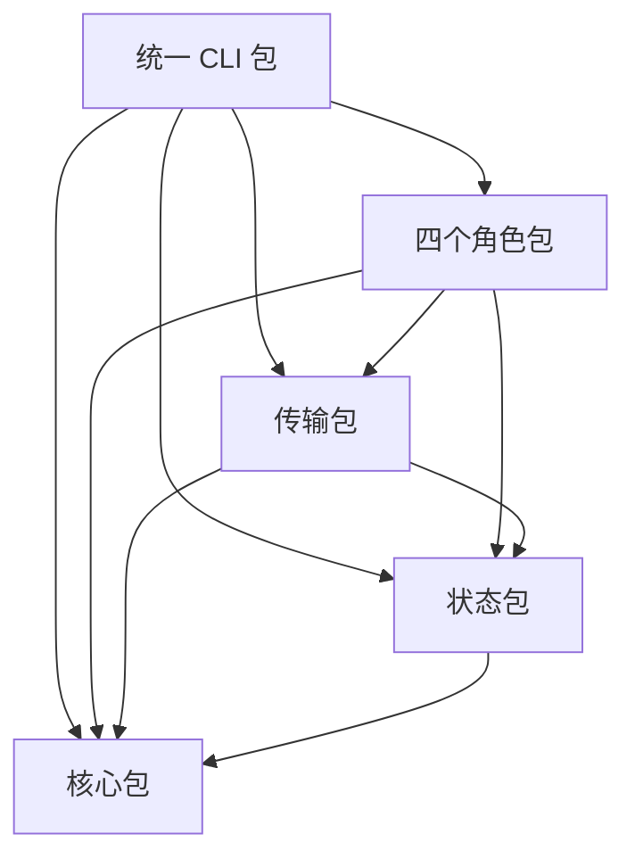

# 增强工作流架构契约

[English](ENHANCED_ARCHITECTURE.md) | [简体中文](ENHANCED_ARCHITECTURE_zh_cn.md)

本文档负责可选 Enhanced 工作流架构的组件与接口契约。它将稳定规则节点映射到既有 owner，不复制其政策正文。本仓库已实现并测试核心 Python、SQLite、规则注册表加载、MCP stdio 和 Decisions 建议组件。这些实现证据不能证明生产宿主绑定可信，也不能证明真实 Codex/ChatGPT Desktop Enhanced 可用；在真实宿主提供经证明的身份和实际操作守卫前，该能力仍为不可用/未验证。

## 组件与权威数据

实现采用 `mcp/` 下含八个包的 uv workspace，使用 Pydantic、`sqlite3`、官方 MCP SDK v2 和 OpenAI SDK。stdio 子进程 SDK 测试通过仅用于测试的可信嵌入 harness 验证了发现和受保护调用，并协商到协议修订 `2026-07-28`。这验证的是实现和 wire 契约，不是生产桌面宿主的身份 attestation 或 OS 权限执行。统一生产入口的四个 MCP profile 即使未绑定也暴露固定且互不重复的工具清单；受保护调用仍拒绝缺失或不充分的绑定。[MCP 开发指南](../../mcp/DEVELOPMENT_zh_cn.md)负责可执行程序名称、工具归属、按角色分派的共享适配器及安装/注册说明。工具发现不建立身份或操作守卫。

Markdown owner 文档仍是政策文本的唯一权威。JSON 注册表 [`mcp/rule-registry.json`](../../mcp/rule-registry.json) 将稳定节点 ID 映射到 owner 标题、事实、证据、分支、判断方式、失败处理和后续检查点，不得复制 owner 正文。实现加载时读取当前 owner 文本并计算 Hash；不维护第二份人工编写的政策正文或持久化节点 Hash。普通正文变化通过动态重读生效。节点结构、分支枚举或硬约束变化时，必须使用变化后的 `contract_version` 同步兼容实现与测试。

SQLite 保存结构化控制状态、证据引用、语义正文引用及 Hash、索引。完整 Contract、Decision Brief、Plan、Memo、Capsule、Handoff 等语义正文仍保存在 Markdown 或 Serena Memory 中，并遵守各自 owner。SQLite 索引不取代正式消息、可见性要求或共享 worktree 冲突控制。

[增强状态存储](references/coding/layer-01-fundamental-concepts/enhanced-native-state/enhanced-state-store_zh_cn.md)负责持久化权威和访问边界；[增强 Schema 迁移](references/coding/layer-01-fundamental-concepts/enhanced-native-state/enhanced-schema-migrations_zh_cn.md)负责 Schema 兼容、迁移、备份和恢复。Native 模式下 parent context 记录仍为 canonical，并按其原 owner 读回。Enhanced 模式下，只有经授权初始化且身份/Schema 核验通过后，Root SQLite 才成为 canonical；此后 parent context 仅保留可读快照或引用。Mode 通过不初始化或迁移 store。首次 Root 写入必须在 Mode 通过且 Session 身份、职责、Context Firewall 已核验后进行。Root 审计仅由 Root 持有；Enhanced 模式须确认审计记录已写入获授权 store 并读回，Native 模式则读回其 parent context 规范记录。pending 或更新失败不代表完成。只有真实 Worker 身份绑定到已放行 allocation 且已选择 Enhanced 后才初始化 Worker store。

## 实现包

uv workspace 根项目与七个成员分别是独立的 Python 分发包，各有构建元数据。只有根包导出 console script；角色库导出工具注册，而非可执行程序。

| 分发包 | 项目 | Canonical 导入 / 职责 |
| --- | --- | --- |
| `token-io-decoupling` | [workspace 根项目](../../mcp/pyproject.toml) | `token_io_decoupling`：CLI、Codex setup、服务组装 |
| `token-io-decoupling-core` | [core](../../mcp/packages/token_io_decoupling_core/pyproject.toml) | `token_io_decoupling_core`：契约、绑定、profile、规则与打包资源 |
| `token-io-decoupling-state` | [state](../../mcp/packages/token_io_decoupling_state/pyproject.toml) | `token_io_decoupling_state`：状态 façade、领域操作、事务与迁移 |
| `token-io-decoupling-transport` | [transport](../../mcp/packages/token_io_decoupling_transport/pyproject.toml) | `token_io_decoupling_transport`：MCP 注册、请求 scope 与共享 wire schema |
| `token-io-decoupling-workflow` | [workflow](../../mcp/packages/token_io_decoupling_workflow/pyproject.toml) | `token_io_decoupling_workflow`：规则/判断工具与可选 Decisions 建议 |
| `token-io-decoupling-root-agent-tools` | [Root 工具](../../mcp/packages/token_io_decoupling_root/pyproject.toml) | `token_io_decoupling_root`：Root 工具注册 |
| `token-io-decoupling-worker-agent-tools` | [Worker 工具](../../mcp/packages/token_io_decoupling_worker/pyproject.toml) | `token_io_decoupling_worker`：Worker 工具注册 |
| `token-io-decoupling-share-tools` | [共享工具](../../mcp/packages/token_io_decoupling_shared/pyproject.toml) | `token_io_decoupling_shared`：共享状态/证据工具注册 |

主要依赖方向如下：

Core 不向上导入实现。State 独立于 transport 和 launcher；transport 不导入角色包。Workflow 专用的建议 payload 归 workflow 所有，避免 transport/workflow 环。状态 façade 委派给有界 owner，分别负责证据/判断、Control、Native 恢复、委派、Worker 操作、派发、持久化、校验与投影；兼容签名与可重载的 Worker 派发边界仍显式保留。

重命名后的 `token_io_decoupling_mcp` 适配命名空间使用 core 所有的 `pkgutil.extend_path` 初始化文件；core、state 与 launcher 分别拥有不重叠的适配文件。功能实现使用 canonical 包名。所有已发布迁移源码均保持逐字节不变。两个 v1 迁移文件仍从历史路径 `token_io_mcp.models` 导入 `DatabaseKind`；state loader 仅在导入迁移期间临时提供该模块名，随后移除。直接导入 frozen state 迁移模块会绕过该局部兼容加载器，不受支持；需要直接导入时请用重命名后的 adapter migration 路径。此迁移专用别名不是通用旧版导入命名空间。构建测试核验独立产物、wheel 文件不重复归属及旧数据库历史。

## 身份与状态边界

Root 数据库是根控制状态的逻辑 Owner。Worker 数据库只包含只读任务快照，以及该 Worker 自身的进度、里程碑、局部检查、证据、阻塞项和恢复上下文。Root 仅通过授权接口读取摘要和证据，核验后执行根级状态迁移；Worker 自报不等于 Root 确认完成。

预期目录为 `~/.local/state/token-io-decoupling/<project-id>/<root-session-id>/workflow.sqlite3`，Worker 数据库位于 `subagents/<subagent-session-id>/worker.sqlite3`。Project 和 Session 绑定必须来自可信运行时上下文。调用方提供的身份、路径或 `authorized=true` 不足以建立信任。只有真实子 Agent 身份经过验证并绑定到预留 Allocation 后，才初始化 Worker 数据库。路径由可信绑定生成，并拒绝目录穿越及越界符号链接。

模式/数量、Allocation、状态 Revision、规则/Schema 兼容版本，以及 implementation/content、documentation、Git metadata 三类 Verification Epoch 是彼此独立的维度，不得互相替代。其约束政策仍由既有 owner 负责，见“相关概念”一节。

## 接口与事务契约

MCP 接口提供公共只读能力、规则上下文和 Schema 状态操作；Root 操作包括打开及读取工作流状态、预留/绑定 Allocation、检查/释放 Slice、评估检查点、记录证据、迁移状态、读取 Worker 摘要和协调；Worker 操作包括读取自身任务/状态、记录进度/证据、报告阻塞项及获取恢复上下文。输入采用明确类型和枚举。写入携带预期 Revision 与幂等键，并返回结果状态、原因、规则版本、证据引用、当前 Revision 和后续要求。接口不提供任意 SQL、Shell 或自由格式提示词执行。

Root 与 Worker 使用独立迁移序列，均从 `v0001` 开始。每个数据库记录自身类型及迁移版本、名称、checksum、应用时间和耗时。授权写入打开数据库时，先验证身份、权限、路径、数据库类型、迁移历史、checksum 和程序兼容性；获取每个数据库的独占迁移锁；有待执行迁移时先备份；再逐个以事务提交迁移及其历史记录。开放业务写入前校验 Schema 和完整性。只读诊断不触发迁移。已发布迁移不可修改；不提供自动降级。迁移失败会回滚当前迁移，并保留此前成功的迁移和备份。历史缺失、checksum 不符、未来 Schema、损坏或不兼容都会阻止增强写入；不得静默重建数据库。

Schema 状态检查受角色绑定、只读且仅限调用者自己的 Root 或 Worker store。它不创建文件/目录、不迁移、不刷新能力快照、不推进 Revision，也不修改收据。Root 读取返回有界恢复索引；省略项通过绑定集合与 Revision 的游标读取，过期游标无写入地拒绝。Session 审计值和提问时序仍由既有审计 reference 负责；store 契约仅涵盖持久化权威与 pending/readback 边界。

单库状态迁移使用事务、约束、单调 Revision 检查和幂等键。跨库交换使用事件 ID 与 Parent 确认，不假设 Root 和 Worker 数据库可以原子提交。

## Native 与 Enhanced 可用性

Native 是默认运行方式：Agent 阅读权威文档，并按其 owner 维护既有结构化记录和语义正文。[增强工作流可用性](references/coding/layer-01-fundamental-concepts/enhanced-native-state/enhanced-workflow-availability_zh_cn.md) owner 负责路线选择和不可用处置；[增强宿主绑定](references/coding/layer-01-fundamental-concepts/enhanced-native-state/enhanced-host-binding_zh_cn.md) owner 负责可信身份和每次调用的守卫证据。公共规则访问不能证明 Enhanced 状态或权限访问。当前 SDK 与测试 harness 证据不能证明真实桌面宿主绑定，因此真实 Codex/ChatGPT Desktop Enhanced 可用性仍未验证。保留 Native 作为降级路径，只阻塞依赖缺失 Enhanced 能力的操作。Mode/count 和 Native 对账仍由各自既有 owner 负责。

Decisions API 默认关闭，普通测试使用 Mock。真实请求必须具备显式启用及出站数据授权，架构契约本身不授予这些权限。Root 和每个受委派的 Agent 都必须在项目功能代码及真实测试/smoke 代码中执行同一前置条件：在实际调用时读取本地进程环境中的 `OPENAI_API_KEY` 和 `OPENAI_BASE_URL`，要求两项都非空，并显式传给 SDK。缺少任一项时，不得创建 client 或发送真实请求。禁止硬编码或调用方提供的替代值，也禁止使用 SDK 默认端点；不得打印或持久化其值。合成值仅用于不发送网络请求的 Mock。执行限制见[开发指南](../../mcp/DEVELOPMENT_zh_cn.md#真实-api-请求的必需配置)。

Decisions advisor 已实现为针对五个固定语义节点的可选建议。一次 325-token 合成真实 smoke 直接调用 advisor，并使用临时 Root 状态和规则加载；它没有经过 MCP handler 或真实宿主。API 建议与 Core 结果分离，绝不授权操作或释放 Slice。 [Decisions 建议](references/coding/layer-01-fundamental-concepts/execution-planning/decisions-advisory_zh_cn.md) owner 负责五节点生命周期、输入绑定、过期结果处置和显式直接 owner 降级。显式启用的 API 不可用、超时、拒绝输入或返回无效/过期结果时，语义判断切回文档路径。若 MCP 和 SQLite 仍可用，继续维护其状态。

Enhanced 不可用本身不会把权威转交给 Native。继续依赖状态的工作前，Root 必须确认最后已提交状态；在回执或经核验的回读可用时据此消解结果不明的在途操作；以真实证据停住竞争写入，并保留完整、经核验的 Native 权威记录。超时不能证明回滚或服务已停止。必需状态未知时阻塞依赖工作；独立且已获授权的工作可以继续。从开始即选择 Native 时无需转交。损坏或不兼容的数据库绝不通过 Native 降级直接写入。

服务恢复后，Root 必须先比较有效 Native 记录与现有绑定数据库，再恢复普通 Enhanced 写入。一致记录需要显式确认；受支持的实质差异需要 Root 针对完整待审集合显式裁定，并保留双方记录及引用。裁定将 Revision 和每个 Epoch 推进到双方已审时间线之后，保留旧历史，并要求下一 Slice 前重新检查及作出 Control；旧验证和 Acceptance 不跨越恢复下界继续有效。不受支持的身份、生命周期、Worker 或待完成派发差异仍然阻塞。任何恢复都不创建新 Run，不重置已锁定 Mode/count 或审计，也不以引用 Hash 替代真实宿主授权。

[Native 权威转交](references/coding/layer-01-fundamental-concepts/enhanced-native-state/native-authority-transfer_zh_cn.md) owner 定义转交协议及能力不可用边界；[Native 对账](references/coding/layer-01-fundamental-concepts/enhanced-native-state/native-reconciliation_zh_cn.md) owner 定义比较、受支持的裁定和恢复 Enhanced 写入前的检查。这些 owner 不证明宿主停写或完整导出能力已经实现。

## 规则节点映射

机器可读映射 [`mcp/rule-registry.json`](../../mcp/rule-registry.json) 只是节点映射，不是政策来源。每个节点包含稳定 ID、owner 路径和实际存在的章节标题、必需事实与证据、合法分支、判断方式（`direct`、`deterministic`、`semantic` 或 `hybrid`）、失败处理和后续检查点 ID。`contract_version` 标识映射结构。ID 保持稳定，不得重新分配给其他概念。节点 Hash 从已加载的 owner 正文计算，不在注册表中维护。

注册表消费者只应加载当前检查点所需节点及其直接 owner 标题；每次请求都从同一来源、同一语言重新读取映射和标题，摘录不会递归加载链接 owner。判断依赖摘录未包含的链接 owner 时，必须单独取得并核验该 owner。不得扫描整个仓库。直接引用仍是解释规则的权威；确定性检查只执行明确的结构化约束；语义分类可以辅助判断，但不能授权；混合判断将语义结果与确定性硬约束校验组合。关于有界读取、来源、语言和新鲜度要求，见[增强规则上下文](references/coding/layer-01-fundamental-concepts/enhanced-native-state/enhanced-rule-context_zh_cn.md)。

## 相关概念

- [Coding Delegation State Record](references/coding/layer-01-fundamental-concepts/delegation/delegation-state-record_zh_cn.md) — 根控制记录的责任边界。
- [Enhanced State Store](references/coding/layer-01-fundamental-concepts/enhanced-native-state/enhanced-state-store_zh_cn.md) — 持久化权威、Root/Worker 范围和有界状态索引。
- [Enhanced Schema Migrations](references/coding/layer-01-fundamental-concepts/enhanced-native-state/enhanced-schema-migrations_zh_cn.md) — Schema 诊断、迁移、备份和恢复边界。
- [增强规则上下文](references/coding/layer-01-fundamental-concepts/enhanced-native-state/enhanced-rule-context_zh_cn.md) — 有界读取当前注册 owner 标题。
- [Coding Execution Control](references/coding/layer-01-fundamental-concepts/execution-control/execution-control_zh_cn.md) — Slice 与控制边界的责任归属。
- [Verification Epoch Checkpoint](references/coding/layer-02-workflow-concepts/verification-and-repair/verification-epoch_zh_cn.md) — Epoch 失效规则的责任归属。
- [Coding workflow selector](workflows/coding_zh_cn.md) — 路线导航。
