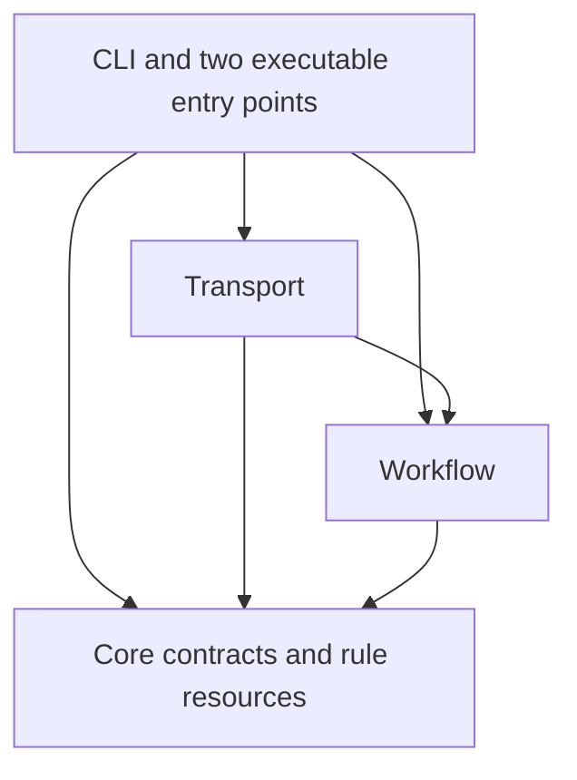

# Workflow Architecture

[English](WORKFLOW_ARCHITECTURE.md) | [简体中文](WORKFLOW_ARCHITECTURE_zh_cn.md)

This document owns the architecture boundary for the repository's local workflow tools. It does not replace the Skill's Markdown workflow owners, determine authorization, or store canonical task state.

## Workflow and rules

The workflow server provides bounded access to current rule context, rule-guided navigation, and structural checks of caller-supplied facts. Rule documents remain authoritative. Tool results, hashes, and caller assertions do not authenticate a caller, prove permission or provenance, decide semantic truth, pass a checkpoint, establish cross-call sequencing, or accept work. The caller must read current owners, independently interpret evidence, and retain the parent-controlled task record in conversation context.

The stateless rule and workflow path requires no SQLite database, API credential, or network request. Optional semantic advice may use an explicitly configured API request under the separate API authorization and credential rules in the development guide; its result remains advisory and may not authorize work. The two standalone MCP executables remain distinct; their supported clients and installed tool inventories are documented in the [MCP development guide](../../mcp/DEVELOPMENT.md).

## Protected output materialization

The optional output materialization operation is separate from workflow evaluation. It requires a trusted startup-injected authorization provider that supplies current Worker binding and assignment context, plus the separately configured grant and existing per-call checks. Tool callers cannot select or supply that provider context. There is no standard provider; without an explicitly trusted provider and grant, the capability is unavailable. Application request scope is not host authentication. Preparation, fresh preflight, manifest checks, and write-time reauthorization remain required by the [Output Materialization](references/coding/layer-01-fundamental-concepts/execution-planning/output-materialization.md) owner.

## Implementation packages

The MCP workspace contains separately built `core`, `transport`, and `workflow` distributions. Core owns stable contracts, manifests, rules and packaged resources; transport owns MCP registration, request scopes and schemas; workflow owns rule lookup, stateless evaluation, navigation/advice and the optional materialization service. The root distribution exposes the two MCP executables and administrative setup. The [development guide](../../mcp/DEVELOPMENT.md) owns current tool counts, package commands, build and verification procedures.

## API and data boundaries

Every optional OpenAI API request must use the required process environment values and fixed model described by the development guide. Missing configuration fails before a request. Workflow tools do not persist session state or perform Git, file, Agent-creation, or dispatch effects. Output materialization is the explicitly bounded exception and remains unavailable without its trusted startup configuration.

The rule registry and fragment index are navigation data tied to current Markdown owners. Source and packaged resources must be read from one source and one language. A context hash identifies returned text; it is not proof of task facts or authority. Structural evaluation checks only declared input shape and rule compatibility, returning review statuses that the Agent must interpret against owners and evidence.

## Related concepts

- [Workflow Rule Context](references/coding/layer-01-fundamental-concepts/workflow-navigation/rule-context.md) — bounded lookup and supplied-fact structural checks.
- [Workflow Navigation Availability](references/coding/layer-01-fundamental-concepts/workflow-navigation/navigation-availability.md) — direct-owner fallback and unavailable disposition.
- [Coding Delegation State Record](references/coding/layer-01-fundamental-concepts/delegation/delegation-state-record.md) — parent-controlled task record.
- [Output Materialization](references/coding/layer-01-fundamental-concepts/execution-planning/output-materialization.md) — separately guarded output writes.
- [Coding workflow selector](workflows/coding.md) — route navigation.
