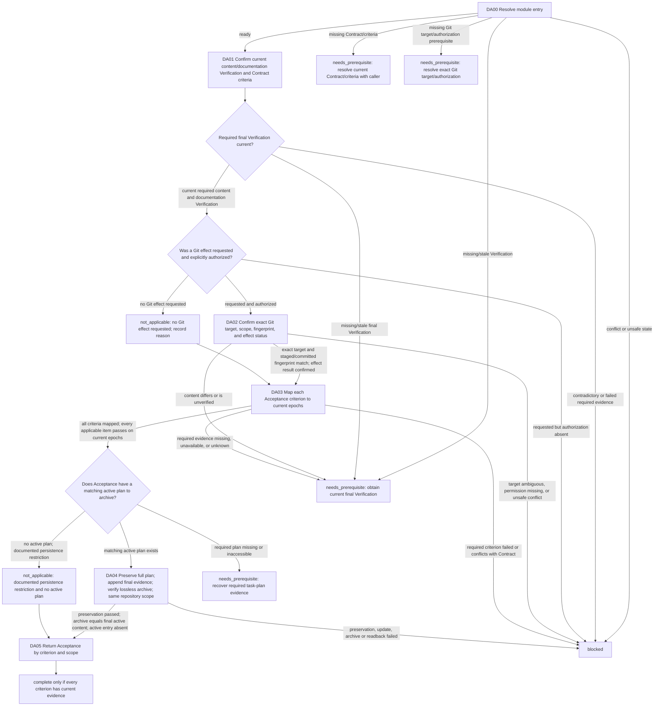

# Delivery and Acceptance Module

[English](delivery-acceptance.md) | [简体中文](delivery-acceptance_zh_cn.md)

This Layer-04 module checks current content/documentation Verification evidence, performs only an explicitly authorized Git delivery effect when requested, then maps every Contract criterion to the current applicable epochs for Acceptance. Module completion grants no additional authority.

## Entry declaration

| Field | Requirement |
| --- | --- |
| Entry prerequisites | The applicable Single-Agent or Multi-Agent Mode gate has released current evidence; current Session identity and authority are confirmed; the caller continuation and completed effects are known, with no unresolved effect ambiguity. |
| Required inputs | Current Contract and all acceptance criteria, current implementation/content and documentation Verification results, current scope/fingerprints/epochs, exact Git target and effect intent, and actual operation-specific Git authorization if a Git effect is requested. |
| Permitted effects | Inspect and perform only the explicitly authorized Git operation against the exact target; read current Acceptance evidence and finalize and read back a matching completed active plan, then archive it with its required readback. Do not replay completed effects or create new authority. |
| Results | `complete` only when every applicable Contract criterion maps to current evidence and any requested authorized delivery result matches verified fingerprints; otherwise `needs_prerequisite` or `blocked` with the unresolved criterion, authorization, or owner. |
| Freshness | Bind delivery to the current target, scope, verified content/documentation fingerprints and epochs, and Git metadata epoch. Any divergence returns to the affected Verification dimension before further Git effects or Acceptance. |

## Workflow map

## Ordered module checklist

1. **DA00 — Resolve entry.** Call [Module Entry Resolution](../../layer-03-workflow-checkpoints/module-entry-resolution.md) with this declaration, current Contract/criteria, current implementation/content and documentation Verification, scope/fingerprints/epochs, exact target/effect intent, authorization, and continuation. Route a missing prerequisite to its semantic owner: Contract/criteria to the caller for current Contract resolution, Verification to the affected Verification owner, and Git target/authorization to the Git owner or authorization boundary. Conflict, unsafe state, or unrecoverable effects return `blocked`.
2. **DA01 — Confirm current Verification before delivery.** Apply [Acceptance](../../layer-02-workflow-concepts/completion-and-effects/acceptance.md), [Verification](../../layer-02-workflow-concepts/verification-and-repair/verification.md), [Verification Epoch](../../layer-02-workflow-concepts/verification-and-repair/verification-epoch.md), and [Documentation](../../layer-02-workflow-concepts/completion-and-effects/documentation.md). Require current final implementation/content and documentation Verification evidence for their applicable latest epochs before any Git effect. If either is absent or stale, return to its Verification owner; do not perform Git. Identify the exact Contract criteria and scope to be accepted.
3. **DA02 — Perform only requested, authorized Git delivery.** Apply [Git](../../layer-02-workflow-concepts/completion-and-effects/git.md). If no Git effect was requested, record Git `not_applicable` with reason and continue to DA03. If an effect was requested but its actual operation-specific authorization is absent, return `blocked`. With authorization, confirm exact repository/worktree/ref/remote/operation, target scope, current fingerprints and latest applicable content/documentation epochs; inspect status/history and exclude unrelated changes. Staged or committed content must match the verified fingerprints and contain no unverified content. Any divergence returns to the corresponding Verification dimension before further Git action. Do not repeat a completed commit/push/other effect while resuming; record its actual result and current Git metadata epoch. Git metadata changes alone do not stale content/documentation epochs. Ambiguous target, missing permission, or unsafe conflict blocks.
4. **DA03 — Map every Acceptance criterion to current epochs.** Apply [Acceptance](../../layer-02-workflow-concepts/completion-and-effects/acceptance.md) and [Verification Epoch](../../layer-02-workflow-concepts/verification-and-repair/verification-epoch.md). For each Contract criterion, cite current evidence from each applicable latest implementation/content, documentation, and Git metadata epoch. Report those three dimensions separately and distinguish pass, fail, not-run, unavailable, assumed, user-authorized, residual risk, and required follow-up. Never use prior-epoch evidence after a relevant change. Proceed to plan matching/archive only after every criterion is mapped and every applicable required item is current and passed. A failed criterion or Contract conflict blocks; missing, unavailable, not-run, assumed, or otherwise unknown required evidence returns `needs_prerequisite` to the affected owner. Do not archive a plan for incomplete Acceptance. Apply [Task Plan Memory Lifecycle](../../layer-01-fundamental-concepts/execution-planning/task-plan-memory-lifecycle.md) to identify the matching completed active plan. Only a documented persistence restriction with no active plan permits the archive exception. A required plan that is missing or inaccessible returns `needs_prerequisite` to that owner; preserve the exact caller position and resume only after current plan evidence is recovered. Unrelated or nonmatching plans never qualify for archive.
5. **DA04 — Finalize and archive only the matching completed plan.** Only after DA03 confirms every applicable criterion passes and this active plan belongs to the completed task, apply [Task Plan Memory Lifecycle](../../layer-01-fundamental-concepts/execution-planning/task-plan-memory-lifecycle.md). Require its full-plan baseline, local completion update plus appended final results/Acceptance evidence/limitations, and complete preservation readback; a final summary cannot replace accumulated records. Reconfirm that the active plan and archive target belong to the same verified repository storage scope; identity or mapping changes stop and return to the planning owner, never selecting another repository or local copy. Then confirm the matching archive target is absent; a collision preserves both entries and blocks archiving. Move only the namespace/name, list the active set, and read back the complete archive to confirm content identical to the verified final active baseline and the active name's absence. A preservation mismatch, plan update, readback or archive failure blocks Acceptance; preserve the last confirmed state, do not replay an uncertain effect, and never edit an existing archive to repair a mismatch. If no matching active plan exists under the documented restriction exception, record `not_applicable` with its evidence; never archive another or an incomplete plan.
6. **DA05 — Return Acceptance.** Return the criterion-to-evidence map, applicable current epochs, separate content/documentation/Git status, exact authorized effects and their results, plan-archive result or justified `not_applicable`, residual risks, and unresolved items. Return `complete` only when every applicable criterion has current evidence, no required verification/capability/authorization remains unresolved, and requested delivery matches the verified fingerprints. Completion of this module does not grant authority for any additional effect.

## Related concepts

- [Acceptance](../../layer-02-workflow-concepts/completion-and-effects/acceptance.md)
- [Git](../../layer-02-workflow-concepts/completion-and-effects/git.md)
- [Verification Epoch](../../layer-02-workflow-concepts/verification-and-repair/verification-epoch.md)
