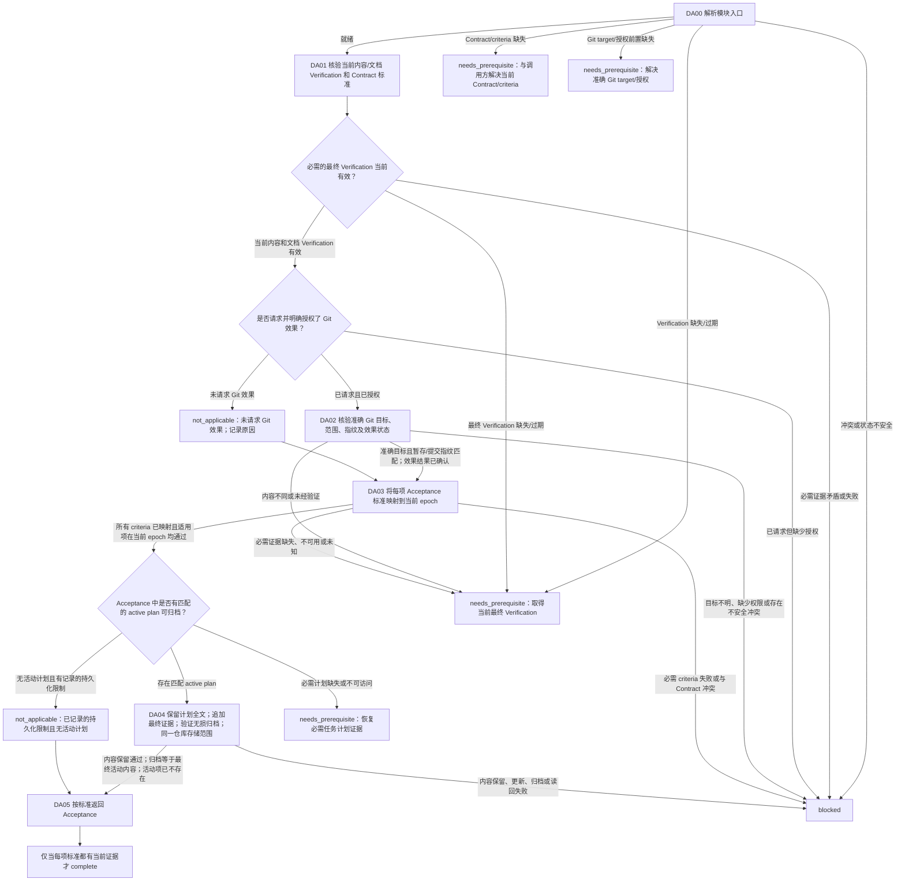

# 交付与验收模块

[English](delivery-acceptance.md) | [简体中文](delivery-acceptance_zh_cn.md)

本 Layer-04 模块先核验当前内容/文档 Verification 证据；仅在用户明确要求且已授权时执行 Git 交付效果；然后将每项 Contract 标准映射到当前适用 epoch 进行 Acceptance。模块完成不会授予额外权限。

## 入口声明

| 字段 | 要求 |
| --- | --- |
| 入口前置条件 | 适用的 Single-Agent 或 Multi-Agent Mode 门禁已有当前释放证据；当前 Session 身份与 authority 已确认；调用方 continuation 和已完成效果均已知，且无未解决的效果歧义。 |
| 必需输入 | 当前 Contract 和全部验收标准、当前 implementation/content 与 documentation Verification 结果、当前范围/指纹/epoch、准确的 Git 目标和效果意图，以及请求 Git 效果时针对该操作的实际授权。 |
| 允许效果 | 仅检查并针对准确目标执行明确授权的 Git 操作；读取当前 Acceptance 证据；对匹配且已完成的 active plan 完成最终更新/读回，再归档并完成所需读回。不得重放已完成效果或产生新授权。 |
| 结果 | 仅当每项适用 Contract 标准都映射到当前证据，且所请求并已授权的交付结果符合已验证指纹时返回 `complete`；否则针对未解决标准、授权或 owner 返回 `needs_prerequisite` 或 `blocked`。 |
| 新鲜度 | 将交付绑定到当前目标、范围、已验证内容/文档指纹与 epoch，以及 Git metadata epoch。任何差异都须在进一步 Git 效果或 Acceptance 前返回受影响的 Verification 维度。 |

## 工作流路线图

## 有序模块清单

1. **DA00 — 解析入口。** 提供本声明、当前 Contract/标准、当前 implementation/content 与 documentation Verification、范围/指纹/epoch、准确目标/效果意图、授权和 continuation，调用[模块入口解析](../../layer-03-workflow-checkpoints/module-entry-resolution_zh_cn.md)。将缺少的前置送回语义对应 owner：Contract/标准交调用方解决当前 Contract；Verification 交受影响的 Verification owner；Git target/授权交 Git owner 或授权边界。冲突、状态不安全或效果无法恢复时返回 `blocked`。
2. **DA01 — 交付前核验当前 Verification。** 应用[Acceptance](../../layer-02-workflow-concepts/completion-and-effects/acceptance_zh_cn.md)、[Verification](../../layer-02-workflow-concepts/verification-and-repair/verification_zh_cn.md)、[Verification Epoch](../../layer-02-workflow-concepts/verification-and-repair/verification-epoch_zh_cn.md)及[Documentation](../../layer-02-workflow-concepts/completion-and-effects/documentation_zh_cn.md)。任何 Git 效果前，必须具备适用最新 epoch 的当前最终 implementation/content 与 documentation Verification 证据。任何一项缺失或过期时，返回相应 Verification owner；不得执行 Git。明确准确的 Contract 标准和验收范围。
3. **DA02 — 仅执行已请求并授权的 Git 交付。** 应用[Git](../../layer-02-workflow-concepts/completion-and-effects/git_zh_cn.md)。未请求 Git 效果时，将 Git 记录为有原因的 `not_applicable` 并进入 DA03。若请求了效果但缺少针对实际操作的授权，则返回 `blocked`。获授权后，确认准确的 repository/worktree/ref/remote/operation、目标范围、当前指纹及适用的最新内容/文档 epoch；检查 status/history 并排除无关改动。暂存或提交内容须匹配已验证指纹，且不得包含未验证内容。有任何差异时，进一步 Git 操作前返回对应 Verification 维度。恢复 continuation 时不得重复已完成的 commit/push/其他效果；记录其实际结果和当前 Git metadata epoch。仅 Git metadata 变化不会使内容/文档 epoch 过期。目标不明确、缺少权限或存在不安全冲突时阻塞。
4. **DA03 — 将每项 Acceptance 标准映射到当前 epoch。** 应用[Acceptance](../../layer-02-workflow-concepts/completion-and-effects/acceptance_zh_cn.md)和[Verification Epoch](../../layer-02-workflow-concepts/verification-and-repair/verification-epoch_zh_cn.md)。对每一项 Contract 标准，引用适用最新 implementation/content、documentation 和 Git metadata epoch 的当前证据。分别报告这三个维度，并区分通过、失败、未运行、不可用、假设、用户授权、剩余风险及必需后续事项。相关变化后不得使用旧 epoch 证据。只有每项标准均已映射且每个适用的必需项都当前并通过时，才能进入 plan 匹配/归档。标准失败或与 Contract 冲突时阻塞；必需证据缺失、不可用、未运行、假设或仍未知时，返回受影响 owner 并返回 `needs_prerequisite`。不得为未完成的 Acceptance 归档 plan。判断 Acceptance 是否存在符合归档条件的匹配 active plan；无关或不匹配计划不适用。 应用[任务计划 Memory 生命周期](../../layer-01-fundamental-concepts/execution-planning/task-plan-memory-lifecycle_zh_cn.md)识别匹配的已完成活动计划。仅有记录的持久化限制且无活动计划才允许归档例外。必需计划缺失或不可访问时，向该 owner 返回 `needs_prerequisite`，保留准确调用位置，仅在恢复当前计划证据后继续；无关或不匹配计划绝不符合归档条件。
5. **DA04 — 完成最终更新并仅归档匹配的已完成计划。** 仅在 DA03 确认所有适用标准通过，且该 active plan 属于已完成任务后，应用[任务计划 Memory 生命周期](../../layer-01-fundamental-concepts/execution-planning/task-plan-memory-lifecycle_zh_cn.md)。要求该 owner 的计划全文基线、局部完成更新并追加最终结果/Acceptance 证据/限制，以及完整内容保留读回；最终摘要不能替换累积记录。先重新核对活动计划与归档目标属于同一已验证仓库存储范围；身份或映射改变时停止并返回规划 owner，绝不选择其他仓库或其他本地副本。再确认匹配的归档目标不存在；碰撞时保留两个条目并阻塞归档。仅移动命名空间/名称，列出活动集合并读回归档全文，确认内容与已验证最终活动基线完全相同，且活动名称已不存在。内容保留不一致、计划更新、读回或归档失败均阻塞 Acceptance；保留最后确认状态，不重放结果不明的效果，绝不编辑已有归档以修复不一致。若在已记录的限制例外下不存在匹配活动计划，则附证据记录 `not_applicable`；不得归档其他或未完成计划。
6. **DA05 — 返回 Acceptance。** 返回按标准映射的证据、适用的当前 epoch、分别报告的内容/文档/Git 状态、准确的已授权效果及其结果、计划归档结果或有依据的 `not_applicable`、剩余风险和未解决项目。只有每项适用标准都有当前证据、无必需验证/能力/授权待解决，且所请求交付符合已验证指纹时，才返回 `complete`。模块完成不授予任何额外效果的权限。

## 相关概念

- [Acceptance](../../layer-02-workflow-concepts/completion-and-effects/acceptance_zh_cn.md)
- [Git](../../layer-02-workflow-concepts/completion-and-effects/git_zh_cn.md)
- [Verification Epoch](../../layer-02-workflow-concepts/verification-and-repair/verification-epoch_zh_cn.md)
