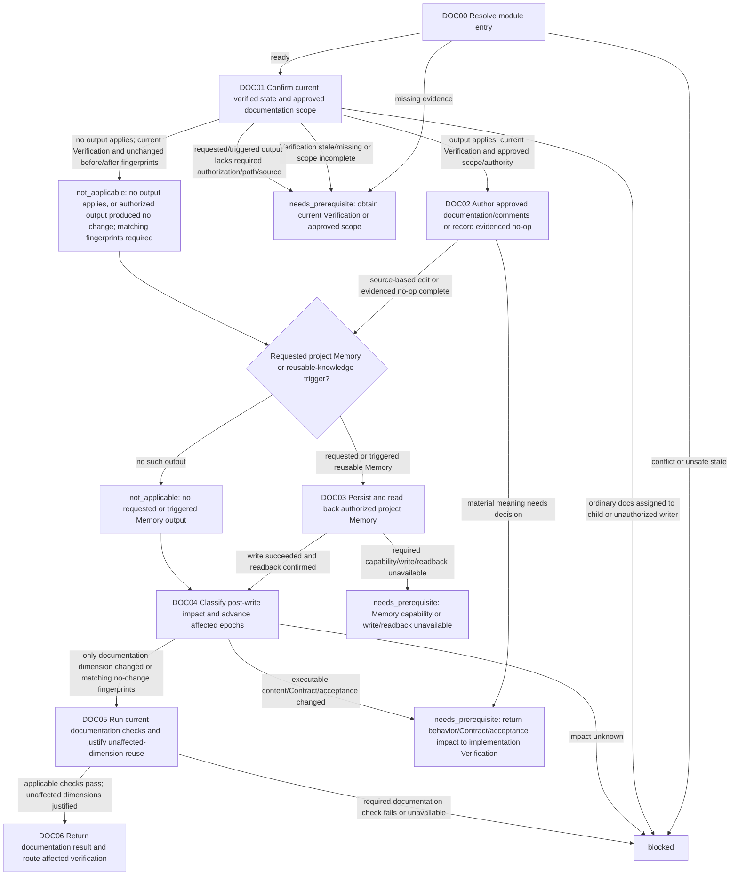

# Documentation Module

[English](documentation.md) | [简体中文](documentation_zh_cn.md)

This Layer-04 module writes only authorized documentation/comments or requested reusable project knowledge against a current verified state, then classifies post-write impact by affected dimension. It does not perform final Verification, decide semantic changes, or authorize Git effects.

## Entry declaration

| Field | Requirement |
| --- | --- |
| Entry prerequisites | The applicable Single-Agent or Multi-Agent Mode gate has released current evidence; current Session identity and authority are confirmed; the caller continuation and completed effects are known, with no unresolved effect ambiguity. |
| Required inputs | Current Contract and scope, current implementation/content Verification for the state under consideration, and before fingerprints. Approved paths, audience, purpose, source evidence, and writer/role authorization are required when a documentation, comment, or Memory output applies. |
| Permitted effects | Edit the released documentation/comment paths; conditionally persist specifically requested or triggered reusable project Memory; run applicable documentation checks and impact classification. Ordinary non-Skill documentation remains parent-authored. |
| Results | `complete` with current documentation epoch, checks, before/after fingerprints, affected/unaffected dimensions, and any reusable Memory write/readback result; otherwise `needs_prerequisite` or `blocked` with the required owner and continuation. |
| Freshness | Bind the source verification and documentation result to current fingerprints and applicable epochs. A post-write change invalidates only affected dimensions; executable-content, Contract, or acceptance changes also invalidate implementation/content evidence. |

## Workflow map

## Ordered module checklist

1. **DOC00 — Resolve entry.** Call [Module Entry Resolution](../../layer-03-workflow-checkpoints/module-entry-resolution.md) with current Contract/scope, applicable implementation/content Verification, current epochs, known effects and before fingerprints, and continuation. Include approved paths, audience, purpose, source evidence, and writer authorization only when an output applies. Missing required evidence returns `needs_prerequisite`; contradictory scope, unsafe state, or unauthorized effects return `blocked`.
2. **DOC01 — Confirm current state and determine applicable output.** Apply [Documentation](../../layer-02-workflow-concepts/completion-and-effects/documentation.md) and [Session Role Ownership](../../layer-01-fundamental-concepts/session-runtime/session-role-ownership.md). Confirm current Contract/scope, applicable implementation/content Verification, and before fingerprints. First decide from current Contract/user intent and owner triggers whether documentation, comments, or reusable project Memory output applies. For applicable output, require exact approved paths, audience, purpose, sources, and writer/role authorization; missing required authorization/path/source returns `needs_prerequisite` or `blocked`, never `not_applicable`. Ordinary non-Skill documentation/comments remain parent-authored. A child may author/edit Skill instructions or references only after all release gates; the parent reviews that result at Documentation and Acceptance. If required current Verification is absent or stale, return to Verification.
3. **DOC02 — Author approved output or record an evidenced no-op.** Edit only authorized Markdown/comment paths using verified sources; keep required English/Chinese mirrors aligned. Do not encode behavior, policy, Contract, acceptance, scope, or Git changes as documentation. Return a material semantic choice to the caller's Contract/Decision path. If no output applies, or authorized output has no actual difference, record `not_applicable` only with matching before/after fingerprints. Preserve already completed effects so resumption does not replay them.
4. **DOC03 — Persist only authorized project Memory.** If the user requested reusable Agent project knowledge or an owner-defined trigger applies, use [LSP MCP Tools](../../layer-01-fundamental-concepts/session-runtime/LSP-MCP-Tools.md), [Content Memo](../../layer-01-fundamental-concepts/context-exchange/content-memo.md), and [Content Memo Lifecycle](../../layer-01-fundamental-concepts/context-exchange/content-memo-lifecycle.md) as applicable: retain the authorized name/path, write through the exposed Memory capability, and confirm the saved entry by readback where required. A `write_content_memo: false` dispatch value does not establish that project Memory is not applicable. If no project Memory output was requested or triggered, record `not_applicable` with reason. If required capability, write, or readback is unavailable/fails, keep the requested output incomplete; do not use a file as fallback.
5. **DOC04 — Classify post-write impact.** Apply [Documentation Impact](../../layer-03-workflow-checkpoints/documentation-impact.md) and [Verification Epoch](../../layer-02-workflow-concepts/verification-and-repair/verification-epoch.md) with before/after fingerprints, after any requested Memory write and readback. Advance the documentation epoch for actual maintained docs/comments/Memory changes. If fingerprints match and no output changed, do not advance the epoch and record `not_applicable` with evidence. Advance only affected dimensions and preserve evidence for unaffected dimensions. If executable content, Contract, or acceptance conditions changed, also classify implementation/content impact and return it to current Verification. Unknown impact blocks.
6. **DOC05 — Run documentation checks and assess evidence reuse.** Run applicable Markdown, link, whitespace, multilingual, and scope checks after all documentation and Memory writes. For documentation-only impact, retain unaffected current evidence only with a fingerprint rationale and rerun changed documentation checks. With no changed output, record checks `not_applicable` with matching fingerprints. Behavior/Contract/acceptance impact returns for implementation/content Verification; do not complete while required re-verification is unresolved.
7. **DOC06 — Return documentation evidence.** Return changed paths, source basis, current documentation fingerprint/epoch, checks and results, before/after dimension classification, rationale for reused unaffected evidence, and any Memory result or reasoned `not_applicable`. Complete only when all applicable checks pass or are justified `not_applicable`, Memory output is read back or justified `not_applicable`, and all content-affecting re-verification has a resolved continuation/result. This does not authorize Git or overall Acceptance.

## Related concepts

- [Documentation](../../layer-02-workflow-concepts/completion-and-effects/documentation.md)
- [Documentation Impact](../../layer-03-workflow-checkpoints/documentation-impact.md)
- [Verification Epoch](../../layer-02-workflow-concepts/verification-and-repair/verification-epoch.md)
