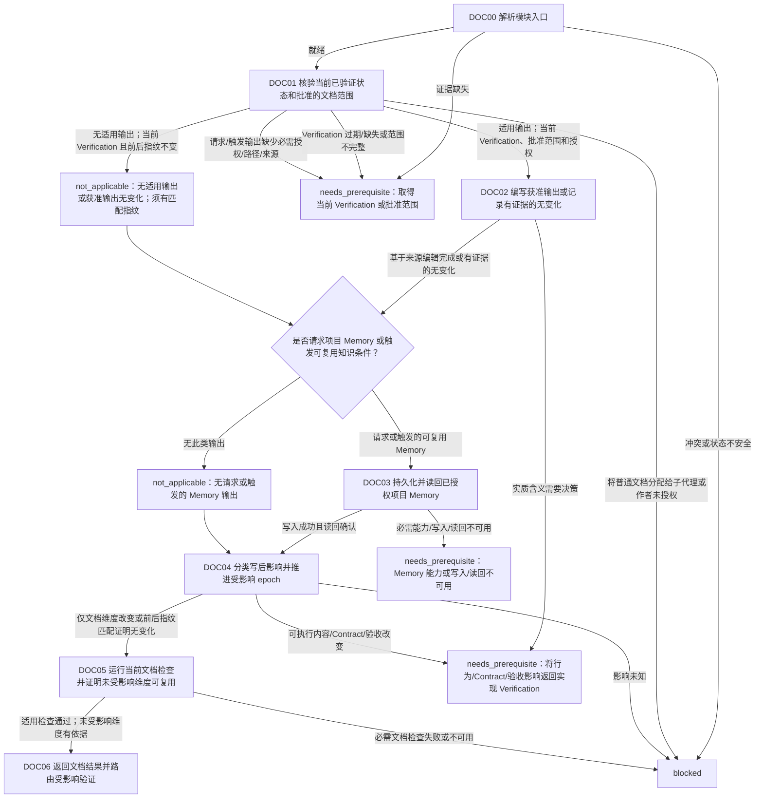

# 文档模块

[English](documentation.md) | [简体中文](documentation_zh_cn.md)

本 Layer-04 模块基于当前已验证状态，仅编写获准的文档/注释或用户要求的可复用项目知识，然后按受影响维度分类写入后的影响。不执行最终 Verification、不决策语义变化，也不授权 Git 影响。

## 入口声明

| 字段 | 要求 |
| --- | --- |
| 入口前置条件 | 适用的 Single-Agent 或 Multi-Agent Mode 门禁已有当前释放证据；当前 Session 身份与 authority 已确认；调用方 continuation 和已完成效果均已知，且无未解决的效果歧义。 |
| 必需输入 | 当前 Contract 和范围、待记录状态的当前 implementation/content Verification，以及写前指纹。适用文档、注释或 Memory 输出时，须提供批准路径、读者、目的、来源证据和作者/职责授权。 |
| 允许效果 | 编辑已放行的文档/注释路径；有条件地持久化明确请求或触发的可复用项目 Memory；运行适用的文档检查并分类影响。普通非 Skill 文档由 parent 编写。 |
| 结果 | 以当前 documentation epoch、检查、前后指纹、受影响/未受影响维度，以及可复用 Memory 写入/读回结果返回 `complete`；否则连同所需 owner 和 continuation 返回 `needs_prerequisite` 或 `blocked`。 |
| 新鲜度 | 将来源 Verification 和文档结果绑定到当前指纹及适用 epoch。写后变化只使受影响维度失效；可执行内容、Contract 或验收变化也会使 implementation/content 证据失效。 |

## 工作流路线图

## 有序模块清单

1. **DOC00 — 解析入口。** 调用[模块入口解析](../../layer-03-workflow-checkpoints/module-entry-resolution_zh_cn.md)，提供当前 Contract/范围、适用的 implementation/content Verification、当前 epoch、已知效果、写前指纹和 continuation。仅在适用输出时提供批准路径、读者、目的、来源证据和作者授权。缺少必需证据时返回 `needs_prerequisite`；范围矛盾、状态不安全或效果未授权时返回 `blocked`。
2. **DOC01 — 核验状态并判断适用输出。** 应用[Documentation](../../layer-02-workflow-concepts/completion-and-effects/documentation_zh_cn.md)和[Session 职责归属](../../layer-01-fundamental-concepts/session-runtime/session-role-ownership_zh_cn.md)。确认当前 Contract/范围、适用的 implementation/content Verification 和写前指纹。首先依据当前 Contract/用户意图及 owner triggers 判断是否适用文档、注释或可复用项目 Memory 输出。输出适用时，必须具备准确批准路径、读者、目的、来源及作者/职责授权；缺少必需授权/路径/来源时返回 `needs_prerequisite` 或 `blocked`，不得标为 `not_applicable`。普通非 Skill 文档/注释由 parent 编写。只有通过全部 release gates 后，才可将 Skill 指令/参考文档分配给 child；parent 在 Documentation 和 Acceptance 阶段审查。必需 Verification 缺失或过期时返回 Verification。
3. **DOC02 — 编写获准输出或记录有证据的无变化。** 仅根据已验证来源编辑授权 Markdown/注释路径，保持必需的英中镜像一致。不得以文档名义引入行为、政策、Contract、验收、范围或 Git 变化。实质语义选择返回调用方 Contract/Decision 路径。无适用输出或获准输出实际无差异时，只有前后指纹匹配才可记录 `not_applicable`。保留已完成效果，恢复时不得重放。
4. **DOC03 — 仅持久化已授权项目 Memory。** 用户要求可复用 Agent 项目知识，或 owner 定义的触发条件适用时，按适用情况应用[LSP MCP Tools](../../layer-01-fundamental-concepts/session-runtime/LSP-MCP-Tools_zh_cn.md)、[Content Memo](../../layer-01-fundamental-concepts/context-exchange/content-memo_zh_cn.md)及[Content Memo Lifecycle](../../layer-01-fundamental-concepts/context-exchange/content-memo-lifecycle_zh_cn.md)：保留获准名称/路径，通过暴露的 Memory 能力写入，并在要求时读回确认。派发字段 `write_content_memo: false` 不代表项目 Memory 不适用。未请求且未触发项目 Memory 输出时记录带原因的 `not_applicable`。必需能力、写入或读回不可用/失败时，保持请求输出未完成；不得以文件替代。
5. **DOC04 — 分类写后影响。** 在任何请求的 Memory 写入和读回之后，结合前后指纹应用[Documentation Impact](../../layer-03-workflow-checkpoints/documentation-impact_zh_cn.md)及[Verification Epoch](../../layer-02-workflow-concepts/verification-and-repair/verification-epoch_zh_cn.md)。实际维护文档/注释/Memory 变化推进 documentation epoch。若无输出变化且指纹匹配，不推进 epoch，并以证据记录 `not_applicable`。仅推进受影响维度，保留未受影响证据理由。可执行内容、Contract 或验收变化还须分类为 implementation/content 影响，并返回当前 Verification。影响未知时阻塞。
6. **DOC05 — 运行文档检查并评估证据复用。** 所有文档和 Memory 写入后，运行适用的 Markdown、链接、空白、多语言和范围检查。仅文档影响时，凭指纹理由保留未受影响的当前证据，并重跑变更的文档检查。没有变更输出时，以匹配指纹将检查标为 `not_applicable`。行为/Contract/验收影响返回 implementation/content Verification；必需重验未解决时不得完成。
7. **DOC06 — 返回文档证据。** 返回变更路径、来源依据、当前 documentation fingerprint/epoch、检查及结果、前后维度分类、复用未变证据的理由，以及 Memory 结果或有原因的 `not_applicable`。所有适用检查通过或有依据地 `not_applicable`、Memory 输出已读回或有依据地 `not_applicable`，且内容影响重新验证均已解决后，才返回 `complete`。这不授权 Git 或整体验收。

## 相关概念

- [Documentation](../../layer-02-workflow-concepts/completion-and-effects/documentation_zh_cn.md)
- [Documentation Impact](../../layer-03-workflow-checkpoints/documentation-impact_zh_cn.md)
- [Verification Epoch](../../layer-02-workflow-concepts/verification-and-repair/verification-epoch_zh_cn.md)
