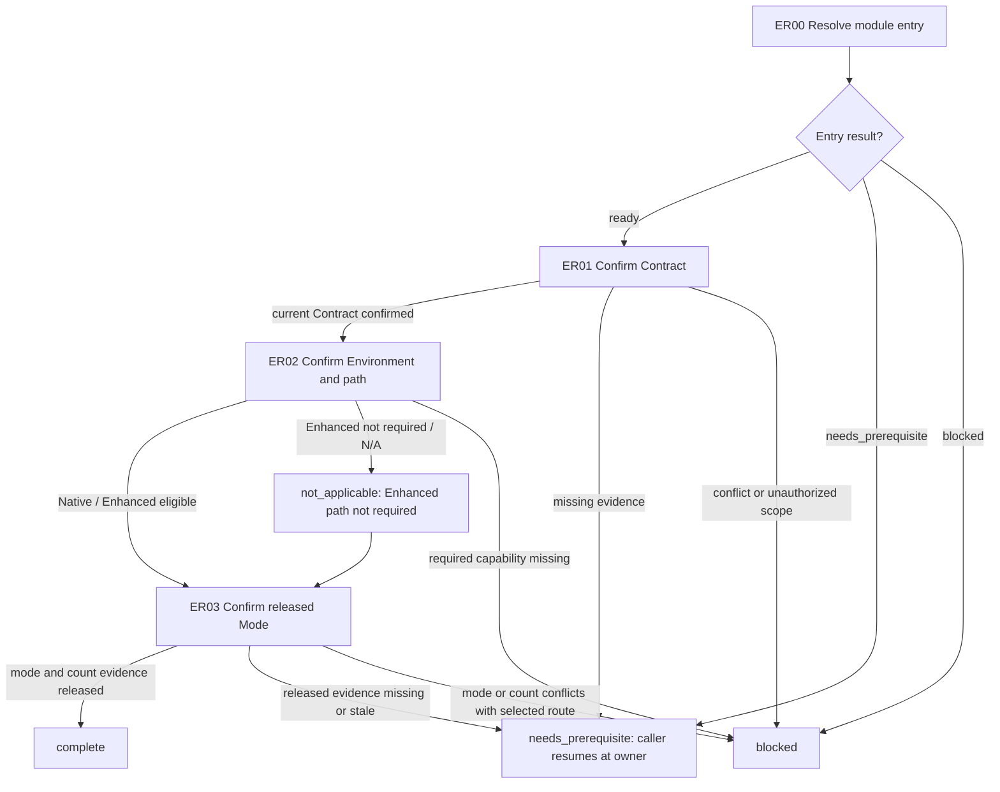

# Entry Readiness Module

[English](entry-readiness.md) | [简体中文](entry-readiness_zh_cn.md)

This Layer-04 module composes the current task Contract, Environment/capability, and released Mode evidence needed to establish route readiness. It consumes the existing Layer-01 through Layer-03 owners; it does not select a route, reinterpret Mode, or authorize implementation or child effects.

## Entry declaration

| Field | Requirement |
| --- | --- |
| Required inputs | The Coding selector's current `Contract`, `Environment`, capability inventory, and `Mode` pass evidence; [Route Entry](../../layer-03-workflow-checkpoints/route-entry.md) result naming the selected route; current task scope and known effect state. |
| Permitted effects | Read and qualify declared evidence; select Native versus eligible Enhanced path through its owner. Do not initialize or mutate state, reopen Mode, or create/dispatch an Agent. |
| Results | `complete` with current Contract, Environment/capability, released Mode/count, selected-route evidence, and Enhanced eligibility or justified `not_applicable`; otherwise `needs_prerequisite` or `blocked` with the suspended position. |
| Freshness | Confirm evidence against the current task/Session and its source/revision. Any material scope, Environment, capability, or Mode change requires the relevant owner to be rechecked before returning `complete`. |

## Workflow map

## Ordered module checklist

1. **ER00 — Resolve entry.** Call [Module Entry Resolution](../../layer-03-workflow-checkpoints/module-entry-resolution.md) with this declaration and the caller's current task, authorization, Session, evidence, and effect status. Consume the Coding selector's passed Contract/Environment/capability/Mode evidence and the [Route Entry](../../layer-03-workflow-checkpoints/route-entry.md) result naming the selected route; do not select or reselect it here. `ready` permits these checks only; map missing evidence to `needs_prerequisite` with this suspended position, and map a conflict or unsafe state to `blocked`. A direct caller may establish the continuation record; no top-level route is required.
2. **ER01 — Confirm Contract and common protocol.** Apply [Contract](../../layer-02-workflow-concepts/entry-and-context/contract.md): confirm the goal, hard user/runtime/repository/permission/safety constraints, authorized effects, settled decisions, open questions, and acceptance conditions. Apply [Shared Protocols](../../../share/shared-protocols.md) to keep one current Semantic Contract, distinguish facts from assumptions, carry later changes as bounded amendments, and stop dependent work if required context or a return path is unavailable. An unresolved question is not implementation authority. Confirm that the released Contract records task intent and eligible output classification from direct authoritative sources, as required by Contract action 5; this step only checks those Contract records.
3. **ER02 — Confirm Environment and selected path.** Apply [Environment](../../layer-02-workflow-concepts/entry-and-context/environment.md) and [Environment Capability Inventory](../../layer-02-workflow-concepts/entry-and-context/environment-capability-inventory.md) to identify one actual runtime and the capabilities this task needs. Call [Enhanced Path Selection](../../layer-03-workflow-checkpoints/enhanced-path-selection.md). If no required operation needs Enhanced, record Native and `not_applicable` with the reason; do not initialize Enhanced state. Otherwise apply [Enhanced Workflow Availability](../../layer-01-fundamental-concepts/enhanced-native-state/enhanced-workflow-availability.md) and [Enhanced Host Binding](../../layer-01-fundamental-concepts/enhanced-native-state/enhanced-host-binding.md); return verified eligibility, identity, and guard evidence. Unknown required capability or missing evidence blocks the dependent branch.
4. **ER03 — Confirm released Mode against the selected route.** Apply [Mode](../../layer-02-workflow-concepts/entry-and-context/mode.md), [Mode Confirmation](../../layer-01-fundamental-concepts/delegation/delegation-mode-confirmation.md), [Delegation Count Gate](../../layer-01-fundamental-concepts/delegation/delegation-mode-count-gate.md), [Delegation State Record](../../layer-01-fundamental-concepts/delegation/delegation-state-record.md), and [Mode Re-entry](../../layer-01-fundamental-concepts/delegation/delegation-mode-reentry.md). Verify the exact released mode and locked count/state; Single-Agent requires `child_count: 0` and no allocations. Multi-Agent requires a positive locked count and valid current allocations consistent with the record; occupied/created and unassigned slots are both valid states, so do not require every slot to remain unbound. Missing or stale release evidence returns `needs_prerequisite`; a mode/count that conflicts with the already selected route returns `blocked`. A later directive reuses locked topology. This confirms route eligibility only: it does not release a concrete Slice or authorize child creation. Return `complete` with current gate evidence.

## Related concepts

- [Contract](../../layer-02-workflow-concepts/entry-and-context/contract.md)
- [Environment capability inventory](../../layer-02-workflow-concepts/entry-and-context/environment-capability-inventory.md)
- [Enhanced path selection](../../layer-03-workflow-checkpoints/enhanced-path-selection.md)
- [Mode](../../layer-02-workflow-concepts/entry-and-context/mode.md)
