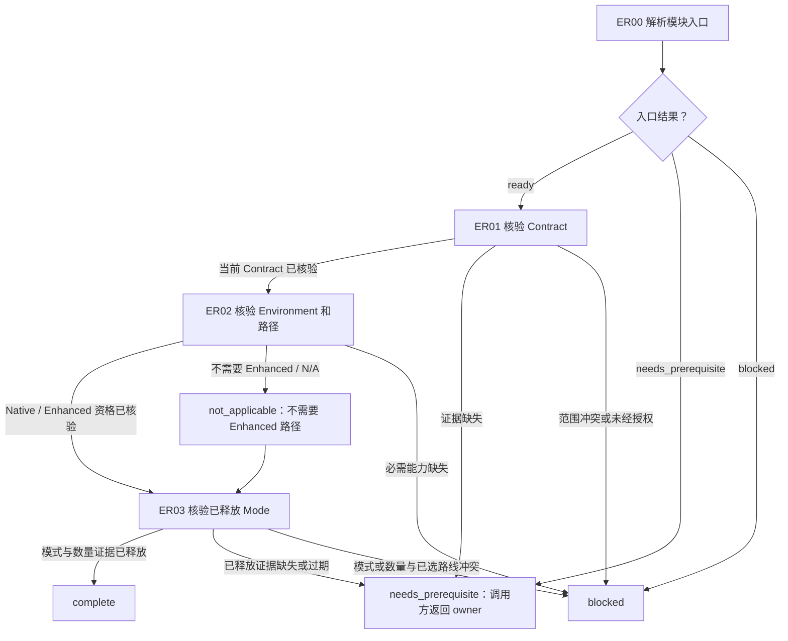

# 入口就绪模块

[English](entry-readiness.md) | [简体中文](entry-readiness_zh_cn.md)

本 Layer-04 模块组合建立路线就绪所需的当前任务 Contract、Environment/能力及已释放 Mode 证据。它消费现有 Layer-01 至 Layer-03 owners；不选择路线、不重新解释 Mode，也不授权实施或子代理效果。

## 入口声明

| 字段 | 要求 |
| --- | --- |
| 必需输入 | Coding selector 当前已通过的 `Contract`、`Environment`、能力清单和 `Mode` 证据；指出已选路线的[路线入口](../../layer-03-workflow-checkpoints/route-entry_zh_cn.md)结果；当前任务范围和已知效果状态。 |
| 允许效果 | 读取并核验声明的证据；通过 owner 选择 Native 或符合资格的 Enhanced 路径。不得初始化或修改 state、重开 Mode，也不得创建/派发 Agent。 |
| 结果 | 以当前 Contract、Environment/能力、已释放的 Mode/count、已选路线证据，以及 Enhanced 资格或有依据的 `not_applicable` 返回 `complete`；否则以暂停位置返回 `needs_prerequisite` 或 `blocked`。 |
| 新鲜度 | 根据当前任务/Session 及其来源/revision 确认证据。范围、Environment、能力或 Mode 有实质变化时，返回 `complete` 前须重核相关 owner。 |

## 工作流路线图

## 有序模块清单

1. **ER00 — 解析入口。** 提供本声明以及调用方当前任务、授权、Session、证据和效果状态，调用[模块入口解析](../../layer-03-workflow-checkpoints/module-entry-resolution_zh_cn.md)。消费 Coding selector 已通过的 Contract/Environment/能力/Mode 证据以及指出已选路线的[路线入口](../../layer-03-workflow-checkpoints/route-entry_zh_cn.md)结果；此处不得选择或重新选择路线。`ready` 只允许执行本模块的核验；将证据缺失映射为带暂停位置的 `needs_prerequisite`，将冲突或不安全状态映射为 `blocked`。直接调用方可以建立 continuation 记录；不要求存在顶层路线。
2. **ER01 — 核验 Contract 和共享协议。** 应用[Contract](../../layer-02-workflow-concepts/entry-and-context/contract_zh_cn.md)，确认目标、用户/运行环境/仓库/权限/安全硬约束、已授权效果、已解决的决策、开放问题和验收条件。应用[共享协议](../../../share/shared-protocols_zh_cn.md)，保持一个当前 Semantic Contract，区分事实与假设，以有界增量传递后续变化，并在必需上下文或返回路径不可用时停止依赖工作。未解决的问题不构成实施授权。按 Contract 动作 5，核验已释放 Contract 是否从直接权威来源记录了 task intent 和 eligible output classification；此处仅核验这些 Contract 记录。
3. **ER02 — 核验 Environment 和所选路径。** 应用[Environment](../../layer-02-workflow-concepts/entry-and-context/environment_zh_cn.md)与[Environment 能力清单](../../layer-02-workflow-concepts/entry-and-context/environment-capability-inventory_zh_cn.md)，确认唯一的实际运行环境及任务所需能力。调用[Enhanced 路径选择](../../layer-03-workflow-checkpoints/enhanced-path-selection_zh_cn.md)。若没有必需操作需要 Enhanced，记录 Native 和带原因的 `not_applicable`；不得初始化 Enhanced state。否则应用[Enhanced Workflow Availability](../../layer-01-fundamental-concepts/enhanced-native-state/enhanced-workflow-availability_zh_cn.md)与[Enhanced Host Binding](../../layer-01-fundamental-concepts/enhanced-native-state/enhanced-host-binding_zh_cn.md)，返回核验后的资格、身份和守卫证据。必需能力未知或证据缺失时阻塞依赖分支。
4. **ER03 — 对照已选路线核验已释放 Mode。** 应用[Mode](../../layer-02-workflow-concepts/entry-and-context/mode_zh_cn.md)、[模式确认](../../layer-01-fundamental-concepts/delegation/delegation-mode-confirmation_zh_cn.md)、[委派数量门禁](../../layer-01-fundamental-concepts/delegation/delegation-mode-count-gate_zh_cn.md)、[委派状态记录](../../layer-01-fundamental-concepts/delegation/delegation-state-record_zh_cn.md)和[模式重入](../../layer-01-fundamental-concepts/delegation/delegation-mode-reentry_zh_cn.md)。核验准确的已释放模式及锁定数量/状态；Single-Agent 要求 `child_count: 0` 且无 allocations。Multi-Agent 要求正数锁定数量及有效且与记录一致的当前 allocation；已占用/已创建和未分配的名额都可能是有效状态，不得要求每个名额都保持未绑定。已释放证据缺失或过期时返回 `needs_prerequisite`；模式/count 与已选路线冲突时返回 `blocked`。后续指令复用已锁定拓扑。这只确认路线资格，不释放具体 Slice 或授权创建子代理。以当前门禁证据返回 `complete`。

## 相关概念

- [Contract](../../layer-02-workflow-concepts/entry-and-context/contract_zh_cn.md)
- [Environment 能力清单](../../layer-02-workflow-concepts/entry-and-context/environment-capability-inventory_zh_cn.md)
- [Enhanced 路径选择](../../layer-03-workflow-checkpoints/enhanced-path-selection_zh_cn.md)
- [Mode](../../layer-02-workflow-concepts/entry-and-context/mode_zh_cn.md)
