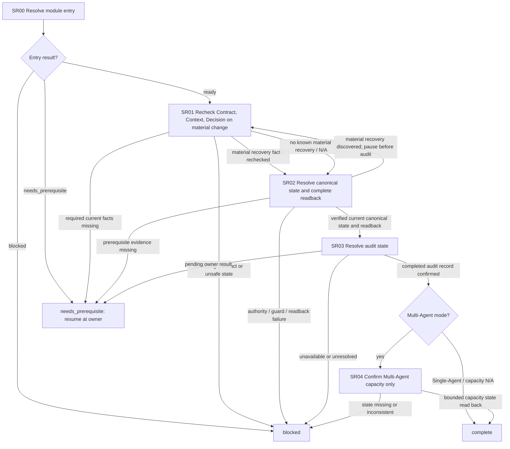

# Session Readiness Module

[English](session-readiness.md) | [简体中文](session-readiness_zh_cn.md)

This Layer-04 module establishes a current, verified Session record and audit result for bounded downstream work. It composes the Session owners and returns evidence to its caller; it does not reopen Mode, produce a plan/decision output, or schedule other modules.

## Entry declaration

| Field | Requirement |
| --- | --- |
| Required inputs | Current task scope and Contract, released entry/route/mode evidence, current Session identity/role facts, selected Native/Enhanced path evidence, and known recovery/effect status. The canonical record is an output of this module, not an entry prerequisite. |
| Permitted effects | Verify current state and perform only state open/resume or audit-record effects allowed by their direct owners and already authorized for this task. No authority transfer, migration write, or other mutation without its existing operation-specific authorization. |
| Results | The module returns `complete` with canonical authority, guarded state readback, owner-complete audit result, and Multi-Agent capacity evidence when applicable; otherwise return `needs_prerequisite` with suspended position or `blocked`. Conditional substeps may be recorded `not_applicable` with reason; the required Session module itself cannot be skipped as not applicable. |
| Freshness | Bind record evidence to current Session identity, canonical revision, audit revision/status/deadline, allocation revision, source, and relevant epoch. Any material recovery change invalidates affected facts and requires recovery recheck followed by a new state readback before audit or capacity results are consumed. |

## Workflow map

## Ordered module checklist

1. **SR00 — Resolve entry.** Call [Module Entry Resolution](../../layer-03-workflow-checkpoints/module-entry-resolution.md) with this declaration, current task scope, released entry/route/mode evidence, Session identity/role facts, selected path, epochs, and continuation/effect state. The canonical record is produced here and is not a prerequisite to entry. Resume from the recorded substep. A missing prerequisite returns `needs_prerequisite` with its owner and suspended position; an unsafe or unrecoverable state returns `blocked`.
2. **SR01 — Recheck only material recovery facts.** On entry, use any current recovery indication. If [Session State Resolution](../../layer-03-workflow-checkpoints/session-state-resolution.md) later discovers that reconciliation or transfer materially changed current facts or an authorized decision, pause it before audit and return here. Recheck the current [Contract](../../layer-02-workflow-concepts/entry-and-context/contract.md), [Context](../../layer-02-workflow-concepts/entry-and-context/context.md), and [Decision](../../layer-02-workflow-concepts/decision-and-execution/decision.md) from direct evidence only. Do not rerun planning, request advice, reopen Mode, repeat a completed prompt, or start downstream effects. When there is no material recovery to review, record `not_applicable` with the observed reason. Missing current facts return `needs_prerequisite`; conflicting facts or unsafe state return `blocked`. After a triggered recheck, resume SR02 to establish and read back current canonical state.
3. **SR02 — Resolve canonical state and complete readback.** Apply [Session State Resolution](../../layer-03-workflow-checkpoints/session-state-resolution.md) and its directly linked Session, role, Context Firewall, authority, schema, migration, reconciliation, and transfer owners only on their stated triggers. Check current identity, role, canonical authority, required guards/schema, and open/resume conditions before state operations. Preserve the existing record; an outage does not transfer authority and missing state is not permission to recreate it. Confirm the current canonical record, identity, revision, and applicable allocation state by readback. If reconciliation/transfer discovers a material change, return to SR01 and do not proceed to audit; after SR01 rechecks the facts, re-run this step and confirm a current readback. Missing prerequisite evidence returns `needs_prerequisite`; an unresolved authority, guard, or readback failure returns `blocked`.
4. **SR03 — Resolve and confirm the audit result.** Only after SR02 readback, apply [Session Audit Resolution](../../layer-03-workflow-checkpoints/session-audit-resolution.md), [Session Audit Visibility](../../layer-01-fundamental-concepts/session-runtime/session-audit-visibility.md), [Reasoning Summary Visibility](../../layer-01-fundamental-concepts/session-runtime/reasoning-summary-visibility.md), and the relevant state-record owner. Follow the configured cadence for a concise, safe progress summary at completion or material boundaries, preserving required progress/report duties without exposing private reasoning. Reuse a valid completed audit result and verify its canonical readback. If audit state is `pending`, resume against the original deadline and preserve the observed prompt/reply state; do not repeat the prompt or count pending as complete. Return `needs_prerequisite` while required input/resolution remains pending, or `blocked` if the owner cannot safely ask, wait, or read back. Return only after the owner-defined completion evidence and readback pass.
5. **SR04 — Confirm capacity only when Multi-Agent applies.** Under released Multi-Agent mode, re-read the current bounded allocation after any material recovery. Use [Delegation Count Gate](../../layer-01-fundamental-concepts/delegation/delegation-mode-count-gate.md), [Delegation State Record](../../layer-01-fundamental-concepts/delegation/delegation-state-record.md), [Enhanced State Store](../../layer-01-fundamental-concepts/enhanced-native-state/enhanced-state-store.md) when selected, and conditionally [Child Role Allocation](../../layer-01-fundamental-concepts/delegation/delegation-child-role-allocation.md) to confirm locked capacity, occupied roles, and genuinely unassigned slots. This is read-only confirmation: do not select/reserve a role, release a Slice, create a child, or recycle a slot. In Single-Agent mode, record capacity as `not_applicable` and why; do not load child-specific owners. Return `complete` with current Session, audit, and applicable allocation evidence; never imply that a child role or task is authorized. This conditional capacity result does not make the required Session/state/audit module `not_applicable`.

## Related concepts

- [Session state resolution](../../layer-03-workflow-checkpoints/session-state-resolution.md)
- [Session audit resolution](../../layer-03-workflow-checkpoints/session-audit-resolution.md)
- [Delegation state record](../../layer-01-fundamental-concepts/delegation/delegation-state-record.md)
- [Mode](../../layer-02-workflow-concepts/entry-and-context/mode.md)
