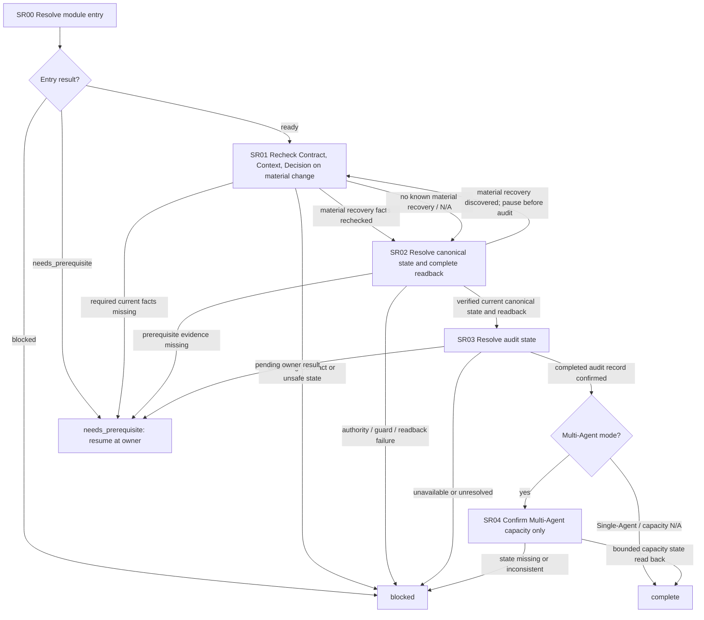

# Session Readiness Module

[English](session-readiness.md) | [简体中文](session-readiness_zh_cn.md)

This Layer-04 module establishes a current, verified Session record and audit result for bounded downstream work. It composes the Session owners and returns evidence to its caller; it does not reopen Mode, produce a plan/decision output, or schedule other modules.

## Entry declaration

| Field | Requirement |
| --- | --- |
| Required inputs | Current task scope and Contract, released entry/route/mode evidence, current Session identity/role facts, and the parent-controlled record source. The record is confirmed here, not an entry prerequisite. |
| Permitted effects | Read and confirm current Session facts and parent-controlled record; apply audit preferences to that record when authorized under its owner. |
| Results | The module returns `complete` with current Session facts, canonical parent-context record readback, effective audit preferences, and Multi-Agent capacity evidence when applicable; otherwise return `needs_prerequisite` with suspended position or `blocked`. Conditional substeps may be `not_applicable` with reason; the required Session module itself cannot be skipped. |
| Freshness | Bind evidence to current Session identity/role, latest parent-context readback, explicit/default audit values, allocation state, source, and relevant epoch. Material changes invalidate affected facts; read the parent-controlled record again before consuming dependent results. |

## Workflow map

## Ordered module checklist

1. **SR00 — Resolve entry.** Call [Module Entry Resolution](../../layer-03-workflow-checkpoints/module-entry-resolution.md) with this declaration, current task scope, released entry/route/mode evidence, Session identity/role facts, selected path, epochs, and continuation/effect state. The canonical record is produced here and is not a prerequisite to entry. Resume from the recorded substep. A missing prerequisite returns `needs_prerequisite` with its owner and suspended position; an unsafe or unrecoverable state returns `blocked`.
2. **SR01 — Recheck material changes.** If the current Contract, Context, or Decision materially changed, review current direct evidence before relying on it. Do not rerun planning, request advice, reopen Mode, or start downstream effects. When no material change exists, record `not_applicable` and why. Missing facts return `needs_prerequisite`; conflicting or unsafe facts return `blocked`.
3. **SR02 — Confirm the canonical parent-context record.** Apply [Session State Resolution](../../layer-03-workflow-checkpoints/session-state-resolution.md) and its directly linked Session, role, and Context Firewall owners. Verify released mode/count, current identity and role, required per-operation permissions, and record consistency. Read back the canonical record and applicable allocation state. A structural tool result or application request scope is not identity or authorization proof. Missing evidence returns `needs_prerequisite`; an unresolved conflict or unavailable required owner returns `blocked`.
4. **SR03 — Apply audit preferences.** Apply [Session Audit Resolution](../../layer-03-workflow-checkpoints/session-audit-resolution.md), [Session Audit Visibility](../../layer-01-fundamental-concepts/session-runtime/session-audit-visibility.md), [Reasoning Summary Visibility](../../layer-01-fundamental-concepts/session-runtime/reasoning-summary-visibility.md), and the [Delegation State Record](../../layer-01-fundamental-concepts/delegation/delegation-state-record.md). Keep required progress/report duties and confidentiality rules. Apply explicit preferences or defaults immediately; do not make a prompt, timer, migration, or audit preference a prerequisite. Record Worker-log visibility only from actual access evidence and block only a dependent judgment when required log evidence is unavailable or unverified.
5. **SR04 — Confirm capacity only when Multi-Agent applies.** Under released Multi-Agent mode, read the current parent-controlled allocation. Use [Delegation Count Gate](../../layer-01-fundamental-concepts/delegation/delegation-mode-count-gate.md), [Delegation State Record](../../layer-01-fundamental-concepts/delegation/delegation-state-record.md), and conditionally [Child Role Allocation](../../layer-01-fundamental-concepts/delegation/delegation-child-role-allocation.md) to confirm locked capacity, occupied roles, and unassigned slots. This is read-only confirmation: do not select/reserve a role, release a Slice, create a child, or recycle a slot. In Single-Agent mode, record capacity as `not_applicable` and why. Return `complete` with the current parent-record readback, effective audit preferences, and applicable capacity evidence; none authorizes a child task.

## Related concepts

- [Session state resolution](../../layer-03-workflow-checkpoints/session-state-resolution.md)
- [Session audit resolution](../../layer-03-workflow-checkpoints/session-audit-resolution.md)
- [Delegation state record](../../layer-01-fundamental-concepts/delegation/delegation-state-record.md)
- [Mode](../../layer-02-workflow-concepts/entry-and-context/mode.md)
