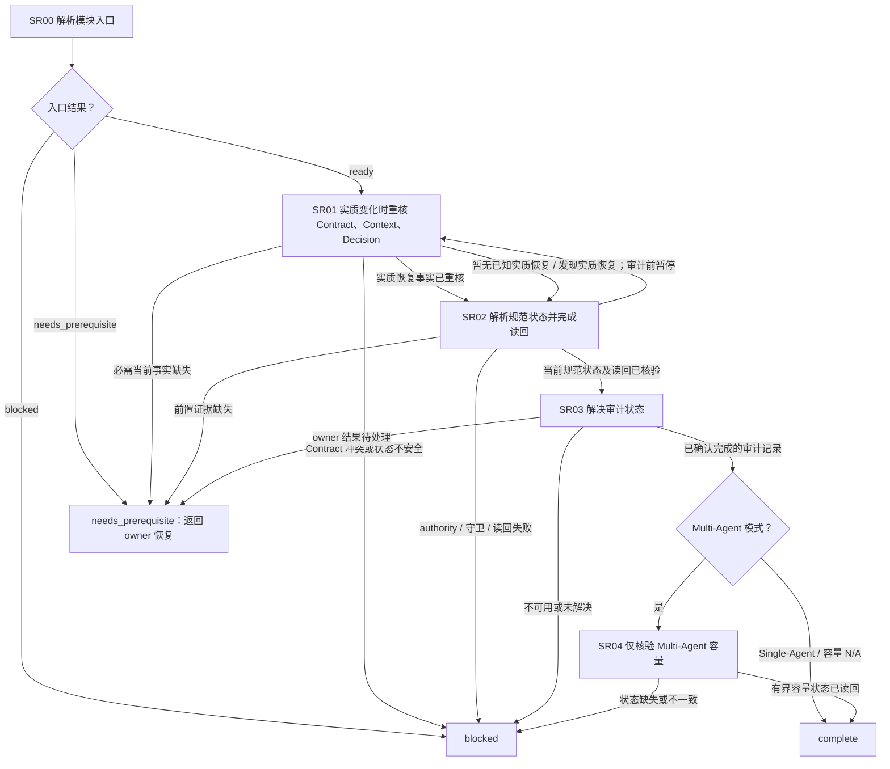

# Session 就绪模块

[English](session-readiness.md) | [简体中文](session-readiness_zh_cn.md)

本 Layer-04 模块为有界下游工作建立当前且已核验的 Session 记录与审计结果。它组合 Session owners 并向调用方返回证据；不重开 Mode、不产生计划/决策输出，也不调度其他模块。

## 入口声明

| 字段 | 要求 |
| --- | --- |
| 必需输入 | 当前任务范围和 Contract、已释放入口/路线/模式证据、当前 Session 身份/角色事实及父级控制记录来源。此处核验该记录，但它不是入口前置条件。 |
| 允许效果 | 读取并核实当前 Session 事实和父级控制记录；在其 owner 授权下将审计偏好应用于该记录。 |
| 结果 | 适用时，模块返回含当前 Session 事实、规范 parent-context 记录回读、生效审计偏好和 Multi-Agent 容量证据的 `complete`；否则返回带暂停位置的 `needs_prerequisite` 或 `blocked`。条件子步骤可记录有原因的 `not_applicable`；Session 模块本身不可跳过。 |
| 新鲜度 | 将证据绑定至当前 Session 身份/角色、最新 parent-context 回读、显式/缺省审计值、分配状态、来源及相关 epoch。实质变化会使受影响事实失效；消费依赖结果前重新读取父级控制记录。 |

## 工作流路线图

## 有序模块清单

1. **SR00 — 解析入口。** 提供本声明、当前任务范围、已释放的入口/路线/模式证据、Session 身份/角色事实、所选路径、epoch 和 continuation/效果状态，调用[模块入口解析](../../layer-03-workflow-checkpoints/module-entry-resolution_zh_cn.md)。规范记录由本模块建立，不是入口前置条件。从记录的子步骤恢复。缺少前置条件时，以 owner 和暂停位置返回 `needs_prerequisite`；状态不安全或无法恢复时返回 `blocked`。
2. **SR01 — 复核实质变化。** 若当前 Contract、Context 或 Decision 发生实质变化，在依赖它们前审阅当前直接证据。不得重做规划、请求建议、重开 Mode 或启动下游效果。无实质变化时，记录有原因的 `not_applicable`。事实缺失时返回 `needs_prerequisite`；冲突或不安全事实返回 `blocked`。
3. **SR02 — 核验规范 parent-context 记录。** 应用[Session 状态解决](../../layer-03-workflow-checkpoints/session-state-resolution_zh_cn.md)及其直接链接的 Session、角色和 Context Firewall owner。核实已释放的 mode/count、当前身份和角色、逐操作所需权限以及记录一致性。回读规范记录和适用的 allocation 状态。结构工具结果或应用请求范围不能证明身份或授权。证据缺失时返回 `needs_prerequisite`；未解决冲突或必需 owner 不可用时返回 `blocked`。
4. **SR03 — 应用审计偏好。** 应用[Session 审计解决](../../layer-03-workflow-checkpoints/session-audit-resolution_zh_cn.md)、[Session Audit Visibility](../../layer-01-fundamental-concepts/session-runtime/session-audit-visibility_zh_cn.md)、[Reasoning Summary Visibility](../../layer-01-fundamental-concepts/session-runtime/reasoning-summary-visibility_zh_cn.md)和[委派状态记录](../../layer-01-fundamental-concepts/delegation/delegation-state-record_zh_cn.md)。保留必需进度/报告义务和保密规则。立即应用显式偏好或缺省值；不得将提示、计时器、迁移或审计偏好设为前置条件。Worker 日志可见性只依据实际访问证据记录；仅当必需日志证据不可用或未验证时，才阻塞依赖它的判断。
5. **SR04 — 仅在 Multi-Agent 适用时核验容量。** 在已放行 Multi-Agent 模式下，读取当前父级控制分配。应用[委派数量门禁](../../layer-01-fundamental-concepts/delegation/delegation-mode-count-gate_zh_cn.md)、[委派状态记录](../../layer-01-fundamental-concepts/delegation/delegation-state-record_zh_cn.md)，并按条件应用[子代理职责分配](../../layer-01-fundamental-concepts/delegation/delegation-child-role-allocation_zh_cn.md)，核实锁定容量、已占用角色和未分配名额。这只是只读核验：不得选择/预留角色、释放 Slice、创建子代理或回收名额。Single-Agent 模式记录附有理由的 `not_applicable`。返回 `complete`，并附上当前父级记录读回、生效的审计偏好和适用的容量证据；这些证据均不授权子代理任务。

## 相关概念

- [Session 状态解析](../../layer-03-workflow-checkpoints/session-state-resolution_zh_cn.md)
- [Session 审计解决](../../layer-03-workflow-checkpoints/session-audit-resolution_zh_cn.md)
- [委派状态记录](../../layer-01-fundamental-concepts/delegation/delegation-state-record_zh_cn.md)
- [Mode](../../layer-02-workflow-concepts/entry-and-context/mode_zh_cn.md)
