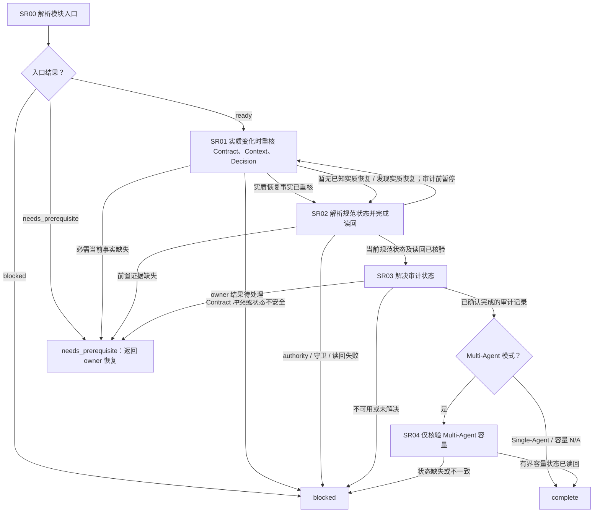

# Session 就绪模块

[English](session-readiness.md) | [简体中文](session-readiness_zh_cn.md)

本 Layer-04 模块为有界下游工作建立当前且已核验的 Session 记录与审计结果。它组合 Session owners 并向调用方返回证据；不重开 Mode、不产生计划/决策输出，也不调度其他模块。

## 入口声明

| 字段 | 要求 |
| --- | --- |
| 必需输入 | 当前任务范围与 Contract、已释放的入口/路线/模式证据、当前 Session 身份/角色事实、所选 Native/Enhanced 路径证据，以及已知恢复/效果状态。规范记录是本模块的输出，不是入口前置条件。 |
| 允许效果 | 核验当前状态；仅执行直接 owner 允许且本任务已有授权的 state 打开/恢复或 audit 记录效果。没有现有的操作级授权，不得转移 authority、写入迁移或执行其他修改。 |
| 结果 | 本模块以规范 authority、有守卫的状态读回、owner 已完成的审计结果和适用的 Multi-Agent 容量证据返回 `complete`；否则返回带暂停位置的 `needs_prerequisite` 或 `blocked`。条件子步骤可记录带原因的 `not_applicable`；必需的 Session 模块本身不得整体跳过为不适用。 |
| 新鲜度 | 将记录证据绑定到当前 Session 身份、规范 revision、审计 revision/status/deadline、allocation revision、来源和相关 epoch。任何实质恢复变化都会使受影响事实失效；在审计或容量结果被消费前，须重核恢复事实并重新读回 state。 |

## 工作流路线图

## 有序模块清单

1. **SR00 — 解析入口。** 提供本声明、当前任务范围、已释放的入口/路线/模式证据、Session 身份/角色事实、所选路径、epoch 和 continuation/效果状态，调用[模块入口解析](../../layer-03-workflow-checkpoints/module-entry-resolution_zh_cn.md)。规范记录由本模块建立，不是入口前置条件。从记录的子步骤恢复。缺少前置条件时，以 owner 和暂停位置返回 `needs_prerequisite`；状态不安全或无法恢复时返回 `blocked`。
2. **SR01 — 仅重核实质恢复事实。** 进入时使用已有的当前恢复信号。若[Session 状态解析](../../layer-03-workflow-checkpoints/session-state-resolution_zh_cn.md)随后发现对账或转移实质改变当前事实或授权决策，则在审计前暂停，并返回此处。只根据直接证据重核当前[Contract](../../layer-02-workflow-concepts/entry-and-context/contract_zh_cn.md)、[Context](../../layer-02-workflow-concepts/entry-and-context/context_zh_cn.md)和[Decision](../../layer-02-workflow-concepts/decision-and-execution/decision_zh_cn.md)。不得重做规划、请求建议、重开 Mode、重复已完成的提问或启动下游效果。没有实质恢复需要复核时，记录 `not_applicable` 及观察到的原因。当前事实缺失时返回 `needs_prerequisite`；事实冲突或状态不安全时返回 `blocked`。触发重核后恢复 SR02，以建立并读回当前规范状态。
3. **SR02 — 解析规范状态并完成读回。** 应用[Session 状态解析](../../layer-03-workflow-checkpoints/session-state-resolution_zh_cn.md)，并仅按触发条件应用其直接链接的 Session、角色、Context Firewall、authority、schema、迁移、对账和转移 owners。执行状态操作前核验当前身份、角色、规范 authority、必需守卫/schema 及打开/恢复条件。保留现有记录；故障不等于 authority 转移，状态缺失也不允许重建。通过读回确认当前规范记录、身份、revision 和适用的 allocation 状态。若对账/转移发现实质变化，返回 SR01，不进入审计；SR01 重核事实后重新执行本步骤并确认当前读回。前置证据缺失时返回 `needs_prerequisite`；authority、守卫或读回未解决的失败返回 `blocked`。
4. **SR03 — 解决并确认审计结果。** 仅在 SR02 读回后，应用[Session 审计解决](../../layer-03-workflow-checkpoints/session-audit-resolution_zh_cn.md)、[Session 审计可见性](../../layer-01-fundamental-concepts/session-runtime/session-audit-visibility_zh_cn.md)、[推理摘要可见性](../../layer-01-fundamental-concepts/session-runtime/reasoning-summary-visibility_zh_cn.md)及相关状态记录 owner。按配置的 cadence，在完成或实质边界输出简短且安全的进度摘要；履行必需的进度/报告职责，同时不暴露私有推理。复用有效且已完成的审计结果，并核验其规范读回。审计状态为 `pending` 时，按原 deadline 恢复，并保留已观察的提问/答复状态；不得重复提问，也不得把 pending 计为完成。必需输入/解决仍待处理时返回 `needs_prerequisite`；owner 无法安全提问、等待或读回时返回 `blocked`。只有 owner 定义的完成证据和读回均通过后才继续。
5. **SR04 — 仅在适用 Multi-Agent 时核验容量。** 在已释放的 Multi-Agent 模式下，任何实质恢复后重新读取当前有界 allocation。应用[委派数量门禁](../../layer-01-fundamental-concepts/delegation/delegation-mode-count-gate_zh_cn.md)、[委派状态记录](../../layer-01-fundamental-concepts/delegation/delegation-state-record_zh_cn.md)、所选路径适用时的[Enhanced State Store](../../layer-01-fundamental-concepts/enhanced-native-state/enhanced-state-store_zh_cn.md)，以及条件适用的[子代理职责分配](../../layer-01-fundamental-concepts/delegation/delegation-child-role-allocation_zh_cn.md)，核实锁定容量、已占角色和真实未分配名额。这里只读确认：不得选择/预留角色、释放 Slice、创建子代理或回收名额。Single-Agent 模式下，将容量记录为 `not_applicable` 并说明原因；不加载子代理专属 owners。以当前 Session、审计和适用 allocation 证据返回 `complete`；不得暗示子代理角色或任务已获授权。此条件性容量结果不使必需的 Session/state/audit 模块整体 `not_applicable`。

## 相关概念

- [Session 状态解析](../../layer-03-workflow-checkpoints/session-state-resolution_zh_cn.md)
- [Session 审计解决](../../layer-03-workflow-checkpoints/session-audit-resolution_zh_cn.md)
- [委派状态记录](../../layer-01-fundamental-concepts/delegation/delegation-state-record_zh_cn.md)
- [Mode](../../layer-02-workflow-concepts/entry-and-context/mode_zh_cn.md)
