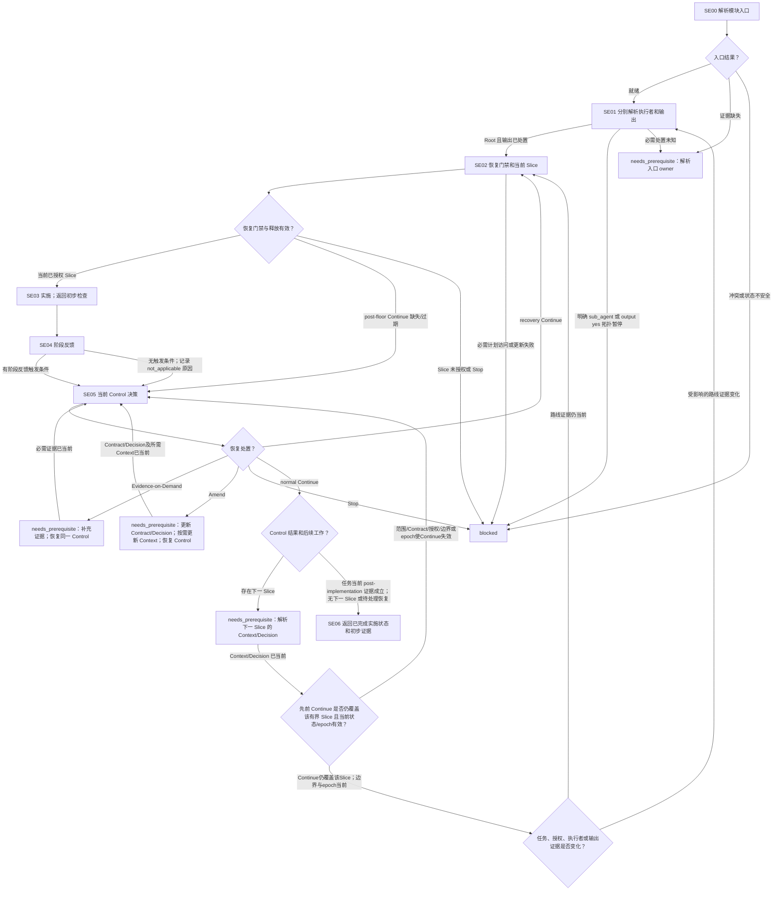

# Single-Agent 执行模块

[English](single-execution.md) | [简体中文](single-execution_zh_cn.md)

本 Layer-04 模块组合已授权 Single-Agent 任务的执行者/输出处置、当前受控 Slice、本地实施、阶段反馈和 Control。它向调用方返回实施状态与初步证据；最终验证属于后续验证/修复工作流。

## 入口声明

| 字段 | 要求 |
| --- | --- |
| 必需输入 | 当前已授权任务和 Contract、已释放的 Single-Agent 模式、完整且当前的 Session/审计、有来源的 Context 和 Decision、continuation/效果状态，以及任何恢复底线和当前 Control 证据。 |
| 允许效果 | 解析执行者/输出、释放和实施已授权 Slice、持久化/读回已授权进度、提供阶段反馈及解决 Control。不得创建/派发子代理、预留角色、扩大范围或进行最终验证。 |
| 结果 | 仅在返回当前实施状态、指纹、初步检查和 Control 处置且无待处理恢复/下一 Slice 时返回 `complete`；否则以 continuation 返回 `needs_prerequisite` 或 `blocked`。条件子步骤可带原因标为 `not_applicable`。 |
| 新鲜度 | 将证据绑定到当前 Contract、任务/Slice 指纹、规范 state revision、Control 规则及相关 epoch。实质变化会使受影响证据失效，并要求从指定检查点重新进入。 |

## 工作流路线图

## 有序模块清单

1. **SE00 — 解析入口。** 提供本声明、当前授权与路线/模式证据、完整 Session/审计和 Context/Decision 证据、先前效果、恢复状态及 continuation，调用[模块入口解析](../../layer-03-workflow-checkpoints/module-entry-resolution_zh_cn.md)。`ready` 只允许模块核验。证据缺失时连同 owner 和位置返回 `needs_prerequisite`；冲突、状态不安全或先前效果无法恢复时返回 `blocked`。
2. **SE01 — 分别解析执行者和输出。** 应用[任务分配](../../layer-01-fundamental-concepts/execution-planning/task-assignment_zh_cn.md)和[执行者选择](../../layer-03-workflow-checkpoints/executor-selection_zh_cn.md)，再应用[输出 Token 路由](../../layer-01-fundamental-concepts/execution-planning/output-token-routing_zh_cn.md)及[输出路由选择](../../layer-03-workflow-checkpoints/output-route-selection_zh_cn.md)。在已释放 Single-Agent 模式下，明确的 `sub_agent` 结果与锁定 Mode 冲突，返回 `blocked`。Root 直接输出为 `yes` 时，报告锁定的拓扑边界并阻塞 Slice 释放；不得暗示本 Session 可以更改 Mode。必需的执行者/输出证据未知时返回 `needs_prerequisite`。仅当 Root 执行已确认且输出已处置时继续。
3. **SE02 — 应用恢复门禁并释放当前 Slice。** 应用[执行控制](../../layer-01-fundamental-concepts/execution-control/execution-control_zh_cn.md)、[执行规划](../../layer-01-fundamental-concepts/execution-planning/execution-planning_zh_cn.md)及[Native 对账](../../layer-01-fundamental-concepts/enhanced-native-state/native-reconciliation_zh_cn.md)。存在恢复底线时，须有 post-floor `Continue`，且其 Control 规则和相关 epoch 均为当前；若缺失或过期，则在释放/恢复实施前返回 SE05。`Stop` 阻塞。仅释放当前 Context 和 Decision 支持的有界 Slice，并说明目标、授权范围/修改、返回条件及未释放边界。Enhanced state 条件适用时，应用[Enhanced State Store](../../layer-01-fundamental-concepts/enhanced-native-state/enhanced-state-store_zh_cn.md)及[Enhanced Schema Migrations](../../layer-01-fundamental-concepts/enhanced-native-state/enhanced-schema-migrations_zh_cn.md)：按要求使用已授权的 typed 持久化及预期 revision/idempotency，然后读回并确认返回状态；schema 不兼容时阻塞依赖写入。Native 模式按其 owner 更新规范 parent-context record，并确认当前记录。没有恢复底线时，记录该门禁 `not_applicable` 及原因。 释放前应用[任务计划 Memory 生命周期](../../layer-01-fundamental-concepts/execution-planning/task-plan-memory-lifecycle_zh_cn.md)：确认当前共享计划与读回，或其已记录的限制例外；必需访问/更新缺失时阻塞依赖释放。执行及需求修订期间保持先更新再汇报/依赖动作的顺序。
4. **SE03 — 实施并返回初步检查。** 应用[实施](../../layer-02-workflow-concepts/decision-and-execution/implementation_zh_cn.md)。仅检查必要来源并作最小授权改动。只有需要代码结构证据且能力可用时才使用[LSP MCP Tools](../../layer-01-fundamental-concepts/session-runtime/LSP-MCP-Tools_zh_cn.md)。所需 LSP 语义不可用时，说明限制并回退到定向文本搜索和路径范围较小的读取；不得将这些发现称为 LSP 证据。只有不需要代码结构证据时才能记录 `not_applicable`。必需关系仍未知时阻塞。运行聚焦的初步检查，返回变更路径、效果、当前指纹、检查输出和未解决问题。这不是最终验证。
5. **SE04 — 提供阶段反馈。** 触发时应用[执行阶段反馈](../../layer-01-fundamental-concepts/execution-control/execution-stage-feedback_zh_cn.md)，在实质阶段边界返回有界 Progress Signal。无触发条件时，记录带观察原因的 `not_applicable`。两条路径都进入 SE05；不得跳过 Control。
6. **SE05 — 解决当前 Control。** 应用[Control](../../layer-02-workflow-concepts/decision-and-execution/control_zh_cn.md)、[执行控制](../../layer-01-fundamental-concepts/execution-control/execution-control_zh_cn.md)、[建议选择](../../layer-03-workflow-checkpoints/advisory-selection_zh_cn.md)及[Decisions Advisory](../../layer-01-fundamental-concepts/execution-planning/decisions-advisory_zh_cn.md)。消费当前 Progress Signal 的 status、findings、change scope、verification、issue、need 和当前未释放边界证据。仅在建议当前可信、符合条件、已启用且已授权时消费；否则记录带原因的建议 `not_applicable`，并根据当前直接证据决策。为各结果保留当前 continuation：
   - post-floor `Continue` 缺失/过期时，进入或恢复同一 Control 检查。新的 recovery `Continue` 返回 SE02 处理下一/恢复 Slice。
   - `Evidence-on-Demand` 暂停释放并返回 `needs_prerequisite`；保留同一 Control continuation，证据到达后回到此处。
   - `Amend` 返回 `needs_prerequisite`；按 owners 更新 Contract 和 Decision，并在需要时更新 Context。随后恢复同一 Control 检查，并取得新的明确 `Continue` 后才返回 SE02；先前结果不释放工作。
   - `Stop` 返回 `blocked`。
   - 普通 `Continue` 后若有下一 Slice，则返回 `needs_prerequisite`，先为该 Slice 解析当前 Context/Decision，并核验此 `Continue` 仍覆盖新的有界 Slice 且状态/epoch 当前。若范围、Contract、授权、未释放边界或相关 epoch 使其失效，则恢复此 Control 检查并取得新的明确 `Continue`；否则仅在 SE01 重核已变化的执行者/输出证据，然后进入 SE02，不重放已完成效果。若没有下一 Slice 且没有待处理恢复结果，只有当前 post-implementation 证据确认任务已完成后才进入 SE06。
7. **SE06 — 返回实施状态。** 返回证据证明当前任务实施已完成、路径/效果、当前指纹、初步检查证据、当前 Control 结果及 continuation 状态，以及限制。不得声称最终验证或最终 Acceptance；这由后续验证/修复及调用方工作流负责。

## 相关概念

- [执行控制](../../layer-01-fundamental-concepts/execution-control/execution-control_zh_cn.md)
- [执行者选择](../../layer-03-workflow-checkpoints/executor-selection_zh_cn.md)
- [实施](../../layer-02-workflow-concepts/decision-and-execution/implementation_zh_cn.md)
