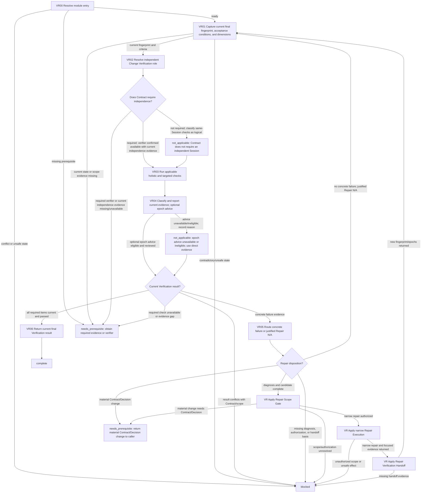

# Verification and Repair Module

[English](verification-repair.md) | [简体中文](verification-repair_zh_cn.md)

This Layer-04 module captures and verifies the current final state, classifies and reports results, and routes concrete failures through authorized narrow repair and back to current Verification. Entry does not require a pre-existing final Verification result; final Verification is produced here for the current state.

## Entry declaration

| Field | Requirement |
| --- | --- |
| Entry prerequisites | The applicable Single-Agent or Multi-Agent Mode gate has released current evidence; current Session identity and authority are confirmed; the caller continuation and completed effects are known, with no unresolved effect ambiguity. This entry does not authorize an independent verifier; required independence must already be authorized and evidenced by its owner. |
| Required inputs | Current Contract and acceptance conditions, completed implementation or actual delegated result, current task scope and source/effect evidence, and the current state from which final Verification can be captured. |
| Permitted effects | Read state, run authorized checks, classify/report evidence, and route a diagnosed repair through its direct owners. Repair writes are limited to their separately authorized narrow scope. |
| Results | `complete` with current final fingerprint/epochs, required checks, independence status, result categories, unresolved-item/blocking report, and no unresolved required failure; otherwise `needs_prerequisite` or `blocked` with owner and continuation. |
| Freshness | Bind each result to the exact current fingerprint and applicable implementation/content, documentation, and Git metadata epochs. Any repair or other relevant change invalidates only covered dimensions and returns to current Verification. |

## Workflow map

## Ordered module checklist

1. **VR00 — Resolve entry.** Call [Module Entry Resolution](../../layer-03-workflow-checkpoints/module-entry-resolution.md) with this declaration, current Contract/criteria, implementation or actual child result, task scope, source/effect evidence, and continuation. Do not require a prior final Verification result. Missing evidence returns `needs_prerequisite`; conflict, unsafe state, or unrecoverable effects return `blocked`.
2. **VR01 — Capture the current final state.** Apply [Verification](../../layer-02-workflow-concepts/verification-and-repair/verification.md) to capture the exact current fingerprint/epoch and map each Contract acceptance condition to applicable coverage dimensions. Apply [Verification Epoch](../../layer-02-workflow-concepts/verification-and-repair/verification-epoch.md) to track implementation/content, documentation, and Git metadata separately. Current implementation state and Contract criteria are required inputs; previous evidence is reusable only for dimensions whose fingerprint and epoch remain unchanged. Missing current state or criteria blocks dependent verification. Apply [Task Plan Memory Lifecycle](../../layer-01-fundamental-concepts/execution-planning/task-plan-memory-lifecycle.md): confirm the exact shared plan and current read access, or its documented restriction exception. The independent verifier receives only authorized plan/source scope, and may update its named verification contribution without editing the reviewed implementation.
3. **VR02 — Resolve the independence requirement.** Apply [Verification Independence](../../layer-02-workflow-concepts/verification-and-repair/verification-independence.md) and [Session Role Ownership](../../layer-01-fundamental-concepts/session-runtime/session-role-ownership.md). When the Contract requires an independent Change Verification Session, use that role and pass only the supplied scope evidence and acceptance conditions; otherwise classify same-Session checks as logical verification. In Multi-Agent execution, a Worker or child actual-body/result is evidence of implementation, not independent verification; reuse or complete visibility does not satisfy a required independent verifier. If required independence is unavailable, return `needs_prerequisite`; do not claim the Contract is satisfied.
4. **VR03 — Run current checks.** Run the strongest applicable holistic and targeted checks against the exact VR01 fingerprint. Include all required criteria and any checks made necessary by changed dimensions. Do not use earlier-epoch evidence for affected dimensions. If a required check cannot run, preserve the unavailable reason and its blocking effect.
5. **VR04 — Classify and report evidence.** Apply [Verification Reporting](../../layer-02-workflow-concepts/verification-and-repair/verification-reporting.md) and [Verification Epoch](../../layer-02-workflow-concepts/verification-and-repair/verification-epoch.md). Report passed, failed, unavailable, and assumed checks; residual risks; unresolved items; and blocking effects. Optional verification-impact advice may be assessed only through [Advisory Selection](../../layer-03-workflow-checkpoints/advisory-selection.md) and [Decisions Advisory](../../layer-01-fundamental-concepts/execution-planning/decisions-advisory.md) when enabled, eligible, relevant, authorized, and bound to current fingerprints/epochs. It suggests dimensions only and cannot waive checks or declare success. Otherwise record advice `not_applicable` and why, then use direct evidence. Persist new verification facts/progress in that plan and verify readback before reporting or dependent action; required access/update failure blocks that boundary. Respect the documented restriction exception and preserve verifier independence.
6. **VR05 — Route failure or establish Repair N/A.** Apply [Repair Disposition](../../layer-03-workflow-checkpoints/repair-disposition.md). A concrete failure requires diagnosis, affected paths, and the smallest candidate; then apply [Repair Scope Gate](../../layer-02-workflow-concepts/verification-and-repair/repair-scope-gate.md), [Repair Execution](../../layer-02-workflow-concepts/verification-and-repair/repair-execution.md), and [Repair Verification Handoff](../../layer-02-workflow-concepts/verification-and-repair/repair-verification-handoff.md) in that order. Execute only an authorized narrow repair, preserve its actual changed paths/evidence, and return the new fingerprint/affected epochs to VR01 for current re-verification. A material Contract or Decision change returns `needs_prerequisite` to the caller for semantic review and scheduling; do not treat it as a repair. If there is no concrete failure, record Repair `not_applicable` with its evidence basis and return to VR01 to confirm the current Verification result. Missing diagnosis, authorization, bounded scope, repair evidence, or handoff blocks dependent work.
7. **VR06 — Return current final Verification.** Return the current fingerprint, each applicable epoch and its status, criterion-to-evidence mapping, independence classification, checks/result categories, residual risks, unresolved items, and blocking effects. Return `complete` only when all required current Verification items pass, required independent verification is satisfied, and no unresolved required repair/evidence remains. This result does not itself declare overall Acceptance.

## Related concepts

- [Verification](../../layer-02-workflow-concepts/verification-and-repair/verification.md)
- [Repair Disposition](../../layer-03-workflow-checkpoints/repair-disposition.md)
- [Verification Epoch](../../layer-02-workflow-concepts/verification-and-repair/verification-epoch.md)
