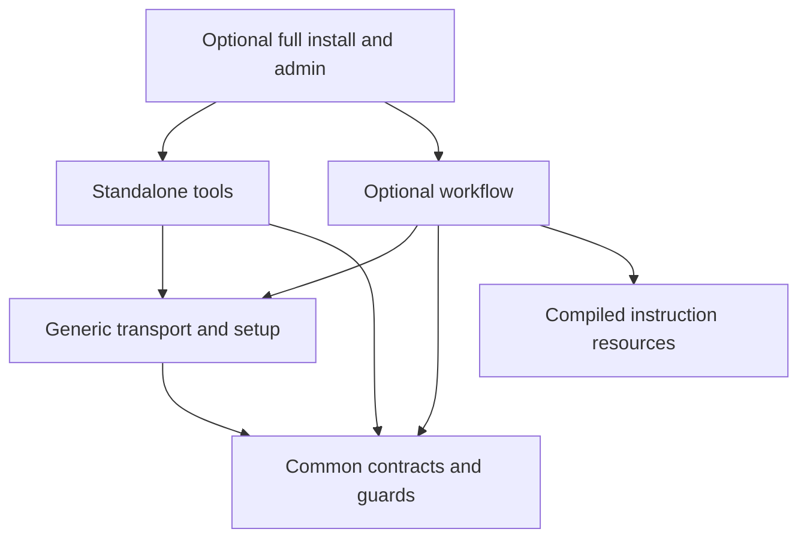

# Workflow and tools architecture

[English](WORKFLOW_ARCHITECTURE.md) | [简体中文](WORKFLOW_ARCHITECTURE_zh_cn.md)

## Independent services

Tools and workflow are independently installable local Codex CLI MCP services. Neither implementation, CLI, startup factory, schema nor metadata imports the other service. The root distribution is an optional full-installation and administration package. A tools-only client does not install the Coding Skill or follow its route.

## Implementation packages

- `token-io-decoupling-core` owns shared typed contracts, identity/authorization guards and generic candidate checks. It contains no compiled rule resources.
- `token-io-decoupling-transport` owns generic registration, payload helpers, caller scopes, environment forwarding and selected-service Codex setup. Service descriptions are injected by the owning implementation.
- `token-io-decoupling-tools` owns 41 operations: upstream development helpers, task plans, local Memory queries, candidate preflight, protected output materialization and optional diagnostics. It owns its console script and explicit backend startup factories. It does not load workflow rules or initialize workflow services.
- `token-io-decoupling-workflow` owns 11 rule, navigation, advisory and structural-evaluation tools, its console script, rule loader and approved compiled resources. It neither probes nor reports another service's backend readiness.
- The root distribution owns administration and the optional generated Skill ZIP. Its compatibility Python factories import the selected runtime lazily.

## Operation contracts

Each tools operation consumes its own inputs and current resource state. There are no workflow checkpoint, mode, route, prerequisite-tool or follow-up-tool gates. Schema bounds, current revisions, path checks and host authorization remain part of the operation. Plan completion consumes an existing compatible plan; archive consumes a completed plan; output apply consumes an existing prepared artifact. Resource state is not proof that a previous tool or workflow step was called.

Task plans and Memory belong to tools. `tools_capabilities` is an optional, local dependency diagnostic. Plan writes use an explicitly configured backend; Memory queries use the tools server startup project's existing `.serena/memories`. Optional API operations use their own required process configuration and outbound review. A missing dependency affects only operations using it.

## Optional compiled workflow

The Coding Skill applies only when explicitly adopted. Its routes can use independent tools under the caller's current authorization; they do not become prerequisites for those tools. The workflow service returns approved compiled actions, conditions, evidence and exact continuations. It stores no checkpoint state. Static lookup needs no API, plan backend, Memory or tools server. Missing or incompatible rule resources block only dependent workflow operations, without author-source fallback.

## Protected writes

Output materialization retains the trusted current Worker binding and assignment, independent operator grant, pinned roots, path and baseline checks, fresh preflight, immutable manifests, write-time reauthorization and receipts. Callers cannot provide trusted identity or permission in a payload. Standard unconfigured materialization is unavailable. Discovery, hashes, diagnostic statuses and structural review do not grant authority or certify completion.

The private compiler produces workflow resources and the optional Skill ZIP as one approved batch. Generated resources are never hand-edited. The [development guide](../../../.agents/skills/token-io-decoupling-dev/references/mcp/DEVELOPMENT.md) owns checks and installation verification.
