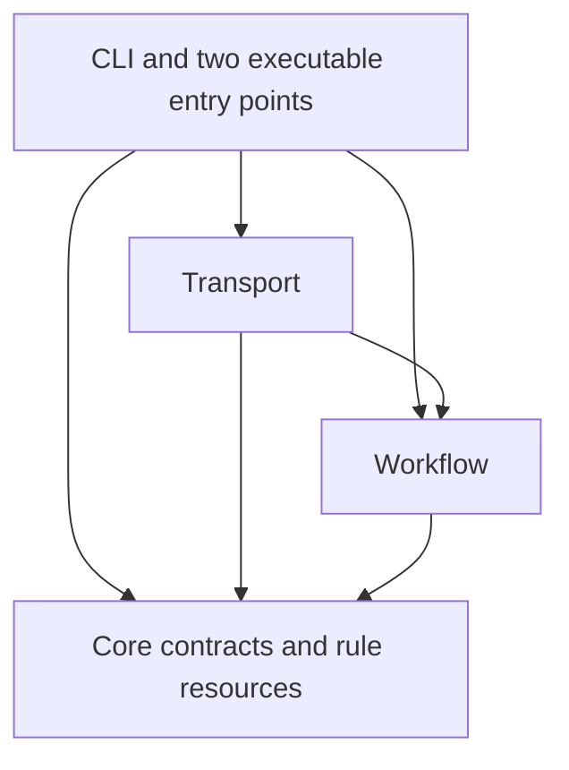

# Workflow Architecture

[English](WORKFLOW_ARCHITECTURE.md) | [简体中文](WORKFLOW_ARCHITECTURE_zh_cn.md)

This document owns the architecture boundary for the repository's local workflow tools. It does not replace the Skill's Markdown workflow owners, determine authorization, or store canonical task state.

## Workflow and rules

The workflow server returns approved, versioned execution instructions compiled during development. Product execution consumes compiled resources; author documents are the development policy source, not a runtime lookup requirement. Rules and route results include the current scope's actions, conditions, evidence, failure handling and exact continuations. Neither hashes nor caller assertions establish identity, permission, completed checkpoints or acceptance.

Static instruction lookup uses no database, API credentials or network. Optional semantic advice remains separate and uses its existing explicit API permission and process configuration. Source development and installed packages use the same compiled resource loader; missing or incompatible resources block dependent work without reading author Markdown.

## Protected output materialization

The optional output materialization operation is separate from workflow evaluation. It requires a trusted startup-injected authorization provider that supplies current Worker binding and assignment context, plus the separately configured grant and existing per-call checks. Tool callers cannot select or supply that provider context. There is no standard provider; without an explicitly trusted provider and grant, the capability is unavailable. Application request scope is not host authentication. Preparation, fresh preflight, manifest checks, and write-time reauthorization remain required by the [Output Materialization](references/coding/layer-01-fundamental-concepts/execution-planning/output-materialization.md) owner.

## Implementation packages

The MCP workspace contains separately built `core`, `transport`, and `workflow` distributions. Core owns stable runtime contracts, manifests and compiled instruction resources; transport owns MCP registration, request scopes and schemas; workflow owns rule lookup, stateless evaluation, navigation/advice and the optional materialization service. The root distribution exposes the two MCP executables and administrative setup. The [development guide](../../../.agents/skills/token-io-decoupling-dev/references/mcp/DEVELOPMENT.md) owns current tool counts, package commands, build and verification procedures.

## API and data boundaries

Every optional OpenAI API request must use the required process environment values and fixed model described by the development guide. Missing configuration fails before a request. Workflow tools do not persist session state or perform Git, file, Agent-creation, or dispatch effects. Output materialization is the explicitly bounded exception and remains unavailable without its trusted startup configuration.

The private instruction compiler validates author sources and explicit execution dependencies, then emits one approved resource and Skill batch. Runtime node/fragment/stage IDs resolve only within that batch. A content hash identifies returned instructions, not task facts or authority. Structural evaluation returns current compiled instructions and review statuses; the caller still judges real evidence and authorization.

## Related concepts

- [Workflow Rule Context](references/coding/layer-01-fundamental-concepts/workflow-navigation/rule-context.md) — bounded lookup and supplied-fact structural checks.
- [Workflow Navigation Availability](references/coding/layer-01-fundamental-concepts/workflow-navigation/navigation-availability.md) — compiled-instruction continuations and unavailable disposition.
- [Coding Delegation State Record](references/coding/layer-01-fundamental-concepts/delegation/delegation-state-record.md) — parent-controlled task record.
- [Output Materialization](references/coding/layer-01-fundamental-concepts/execution-planning/output-materialization.md) — separately guarded output writes.
- [Coding workflow selector](workflows/coding.md) — route navigation.
