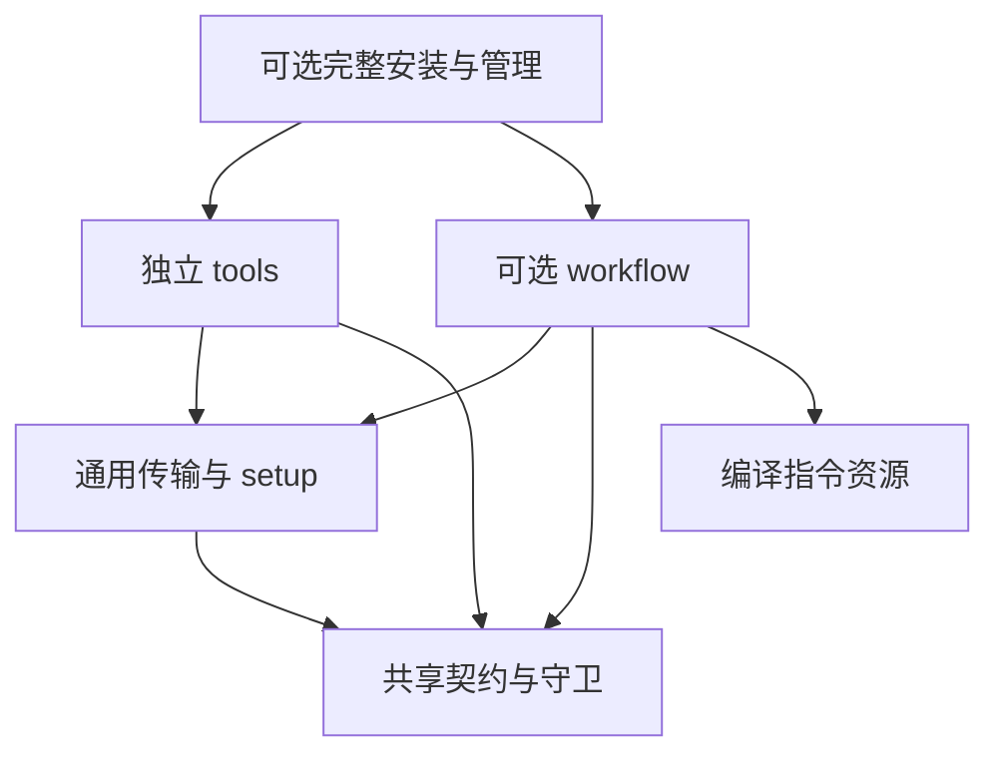

# 工作流与工具架构

[English](WORKFLOW_ARCHITECTURE.md) | [简体中文](WORKFLOW_ARCHITECTURE_zh_cn.md)

## 独立服务

Tools 与 workflow 是可分别安装的本地 Codex CLI MCP 服务。实现、CLI、启动 factory、schema 和 metadata 均不导入对方服务。根分发包仅提供可选的完整安装与管理；仅使用 tools 的客户端不安装 Coding Skill，也不遵循其路线。

## 实现包

- `token-io-decoupling-core` 负责共享类型契约、身份／授权守卫及通用候选检查，不包含编译规则资源。
- `token-io-decoupling-transport` 负责通用注册、payload helper、调用方 scope、环境转发及按服务选择的 Codex setup；服务说明由所属实现注入。
- `token-io-decoupling-tools` 负责 41 项操作：上游开发助手、任务计划、本地 Memory 查询、候选 preflight、受保护输出物化及可选诊断。它拥有自己的 console script 及显式后端启动 factory，不加载工作流规则或初始化工作流服务。
- `token-io-decoupling-workflow` 负责 11 个规则、导航、建议及结构评估工具、自身 console script、规则加载器及批准的编译资源；不探测或报告其他服务的后端就绪状态。
- 根分发包负责管理入口和可选生成 Skill ZIP；兼容 Python factory 延迟导入所选运行时。

## 操作契约

每项 tools 操作消费自身输入和当前资源状态，不要求工作流检查点、模式、路线、前置工具或后续工具。Schema 边界、当前版本、路径检查及宿主授权保留在操作内。计划完成操作消费已有兼容计划，归档消费已有完成计划，输出 apply 消费已有 prepared artifact；资源状态不证明先前调用过某个工具或工作流步骤。

任务计划和 Memory 属于 tools。`tools_capabilities` 是可选本地依赖诊断。计划写入使用显式配置的后端，Memory 查询读取 tools 服务启动项目已有的 `.serena/memories`。可选 API 操作使用各自必需的进程配置和外发审核；缺少依赖只影响使用该依赖的操作。

## 可选编译工作流

仅在明确采用时应用 Coding Skill。其路线可在当前调用方授权下使用独立工具，但不成为这些工具的前置条件。Workflow 服务返回批准的编译动作、条件、证据和准确续接，不存储检查点状态。静态查询不需要 API、计划后端、Memory 或 tools 服务。规则资源缺失或不兼容仅阻止依赖它的工作流操作，不回退到作者源。

## 受保护写入

输出物化保留可信的当前 Worker 身份与任务分配、独立操作者授权、固定根目录、路径及基线检查、新鲜 preflight、不可变 manifest、写入时重新授权和回执。调用方不能通过 payload 提供可信身份或权限。标准未配置物化服务保持不可用。发现、哈希、诊断状态和结构审查均不授予权限或证明完成。

私有编译器将 workflow 资源和可选 Skill ZIP 生成为同一批准批次，禁止手工修改生成物。[开发指南](../../../.agents/skills/token-io-decoupling-dev/references/mcp/DEVELOPMENT_zh_cn.md)负责检查与安装验证。
