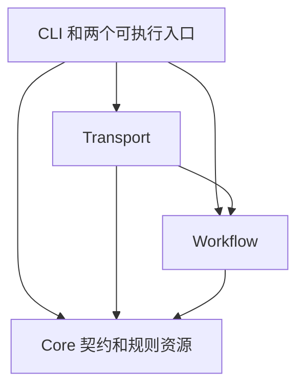

# 工作流架构

[English](WORKFLOW_ARCHITECTURE.md) | [简体中文](WORKFLOW_ARCHITECTURE_zh_cn.md)

本文档负责本仓库本地工作流工具的架构边界；不取代 Skill Markdown 工作流 owner、不决定授权，也不存储规范任务状态。

## 工作流与规则

工作流 server 返回开发期编译、批准并版本化的执行指令。产品执行只消费编译资源；作者文档是开发期政策源，不是运行时查阅要求。规则与路由结果包含当前范围的动作、条件、证据、失败处理及精确继续位置。Hash 和调用方声明均不证明身份、权限、检查点完成或验收通过。

静态指令查询不依赖数据库、API 凭据或网络。可选语义建议保持独立，沿用其明确 API 授权和进程配置要求。源码开发与安装包使用相同编译资源加载器；资源缺失或不兼容时阻止依赖工作，不回读作者 Markdown。

## 受保护的输出物化

可选输出物化操作独立于工作流评估。它需要由可信启动配置注入的授权 provider，提供当前 Worker 绑定和 assignment 上下文；另须提供独立 grant 并通过既有的逐次调用检查。工具调用方不能选择或提供该 provider 上下文。当前没有标准 provider；未显式配置可信 provider 和 grant 时，此能力不可用。应用请求范围不等于宿主认证。[输出物化](references/coding/layer-01-fundamental-concepts/execution-planning/output-materialization_zh_cn.md) owner 仍负责准备、全新预检、manifest 检查和写入时重新授权。

## 实现包

MCP workspace 包含独立构建的 `core`、`transport` 和 `workflow` 分发包。Core 负责稳定运行时契约、清单和编译指令资源；transport 负责 MCP 注册、请求范围和 schema；workflow 负责规则查找、无状态评估、导航/建议及可选物化服务。根分发包提供两个 MCP 可执行程序及管理 setup。[开发指南](../../../.agents/skills/token-io-decoupling-dev/references/mcp/DEVELOPMENT_zh_cn.md)负责当前工具数量、包命令、构建和验证流程。

## API 与数据边界

每个可选 OpenAI API 请求都必须使用开发指南指定的必需进程环境值和固定模型。配置缺失时必须在发出请求前失败。工作流工具不持久化 Session 状态，也不执行 Git、文件、Agent 创建或派发操作。输出物化是范围明确的例外；缺少可信启动配置时仍不可用。

私有指令编译器验证作者源和显式执行依赖，生成同一批准批次的资源与 Skill。运行时 node/fragment/stage ID 仅在该批次内解析。内容 Hash 只标识指令，不证明任务事实或授权。结构评估返回当前编译指令和审阅状态；调用方仍须判断真实证据与权限。

## 相关概念

- [工作流规则上下文](references/coding/layer-01-fundamental-concepts/workflow-navigation/rule-context_zh_cn.md) — 有界查找和所供事实结构检查。
- [工作流导航可用性](references/coding/layer-01-fundamental-concepts/workflow-navigation/navigation-availability_zh_cn.md) — 编译指令继续位置与不可用处置。
- [Coding Delegation State Record](references/coding/layer-01-fundamental-concepts/delegation/delegation-state-record_zh_cn.md) — 父级控制任务记录。
- [Output Materialization](references/coding/layer-01-fundamental-concepts/execution-planning/output-materialization_zh_cn.md) — 独立守卫的输出写入。
- [Coding 工作流选择器](workflows/coding_zh_cn.md) — 路线导航。
