# Coding Workflow — Multi-Agent Mode

[English](coding-multi-agent.md) | [简体中文](coding-multi-agent_zh_cn.md)

This route is selected by the Coding workflow and is valid only after the Mode checkpoint releases Multi-Agent Coding. Before route entry, the Mode checkpoint consumes only mode confirmation, count, re-entry, and the state record; child allocation, creation, dispatch, reuse, and lifecycle are loaded at their numbered route steps.

## Workflow map

```mermaid
flowchart TD
    M01["01 Contract"]
    M02["02 Environment"]
    M03["03 Mode"]
    M04["04 Session / audit configuration and summary cadence"]
    D_AUDIT_CONFIG{"Reuse valid explicit/completed settings, resume pending prompt, or ask if unasked?"}
    ACT_AUDIT_PROMPT["Ask fixed audit question only if unasked; record actual prompt and deadline"]
    D_AUDIT_REPLY{"Valid reply, invalid/ambiguous reply, verified timeout, or unavailable?"}
    ACT_AUDIT_REPLY["Record valid reply; update only selected Root fields"]
    ACT_AUDIT_CLARIFY["Clarify only invalid/ambiguous fields; retain pending prompt"]
    D_AUDIT_CORRECTION{"Valid correction, still invalid/ambiguous, or explicit default?"}
    ACT_AUDIT_DEFAULT["Record explicit Root balanced/milestone_only; preserve Worker value and timeout history"]
    ACT_AUDIT_WAIT["Wait before deadline; preserve pending state"]
    ACT_AUDIT_TIMEOUT["No reply and actual elapsed time >=60s; default Root balanced/milestone_only; preserve Worker or fill full"]
    M05["05 Allocation"]
    M06["06 Context / optional project memory"]
    M07["07 Decision / two-level plan"]
    M08["08 Slice"]
    M09["09 Conditional Child Creation / eligible output only; otherwise Not applicable"]
    M10["10 Dispatch / preset-selected preview or full body; N/A when no child"]
    M11["11 Implementation / Worker output / read actual return and apply audit preset"]
    M12["12 Verification / read actual report and apply audit preset"]
    M13["13 Repair / read actual exchange and apply audit preset"]
    M14["14 Parent-authored ordinary documentation / parent review of Skill docs / project memory when applicable"]
    M15["15 Git / read actual exchange and apply audit preset"]
    M16["16 Acceptance"]
    D_PLAN{"User goal requests planning, exploration, or producing/updating a plan?"}
    ACT_PLAN["Persist and read-verify plan Memory"]
    D_PLAN_SAVED{"Plan Memory saved and read-verified?"}
    D_ARCHIVE{"Active plan Memory for this task exists?"}
    ACT_ARCHIVE["Move plan to archive and read-verify"]
    D_ARCHIVED{"Archived plan verified?"}
    D_BOOT{"Bootstrap justified?"}
    ACT_BOOT_PLAN["Reserve Bootstrap role only; no child yet"]
    D_PLAN_MATCH{"Relevant active plan exists?"}
    ACT_PLAN_SCAN["List active plans/"]
    ACT_PLAN_READ["Read and check matching plan"]
    D_RECON{"More facts required?"}
    ACT_RECON_PLAN["Plan bounded reconnaissance; no implementation release"]
    D_MEMO{"Eligible child output? If yes, memo enabled?"}
    ACT_MEMO["Verify named memory and write capability"]
    D_CONTROL{"Control: Continue / Amend / Stop"}
    D_VERIFY{"Current epoch passed?"}
    D_DOC{"Documentation changed content or Contract?"}
    D_GIT{"Git authorized and verified?"}
    BLOCK["Blocked: report missing boundary"]
    DONE["Acceptance complete"]
    M01 --> M02
    M02 --> M03
    M03 --> M04
    M04 --> D_AUDIT_CONFIG
    D_AUDIT_CONFIG -- yes / migration reuse --> M05
    D_AUDIT_CONFIG -- unasked / first eligible question only --> ACT_AUDIT_PROMPT
    D_AUDIT_CONFIG -- pending / no reply observed; resume original deadline --> D_AUDIT_REPLY
    D_AUDIT_CONFIG -- pending / invalid reply already observed --> D_AUDIT_CORRECTION
    D_AUDIT_CONFIG -- invalid config / focused clarification --> ACT_AUDIT_CLARIFY
    D_AUDIT_CONFIG -- unavailable / unresolved schema conflict --> BLOCK
    ACT_AUDIT_PROMPT --> D_AUDIT_REPLY
    D_AUDIT_REPLY -- valid actual reply --> ACT_AUDIT_REPLY
    ACT_AUDIT_REPLY --> M05
    D_AUDIT_REPLY -- invalid / ambiguous reply --> ACT_AUDIT_CLARIFY
    ACT_AUDIT_CLARIFY -- same prompt / original deadline --> D_AUDIT_CORRECTION
    D_AUDIT_CORRECTION -- valid correction --> ACT_AUDIT_REPLY
    D_AUDIT_CORRECTION -- still invalid / ambiguous --> ACT_AUDIT_CLARIFY
    D_AUDIT_CORRECTION -- explicit default choice --> ACT_AUDIT_DEFAULT
    ACT_AUDIT_DEFAULT --> M05
    D_AUDIT_REPLY -- pending / before deadline --> ACT_AUDIT_WAIT
    ACT_AUDIT_WAIT -- check reply / retain deadline --> D_AUDIT_REPLY
    D_AUDIT_REPLY -- no reply / actual elapsed >=60s --> ACT_AUDIT_TIMEOUT
    ACT_AUDIT_TIMEOUT --> M05
    D_AUDIT_REPLY -- prompt or timing unavailable --> BLOCK
    M05 --> D_BOOT
    D_BOOT -- yes --> ACT_BOOT_PLAN
    ACT_BOOT_PLAN --> M06
    D_BOOT -- no / N/A --> M06
    M06 --> ACT_PLAN_SCAN
    ACT_PLAN_SCAN --> D_PLAN_MATCH
    ACT_PLAN_SCAN -- failed / unavailable --> BLOCK
    D_PLAN_MATCH -- yes --> ACT_PLAN_READ
    D_PLAN_MATCH -- no / N/A --> M07
    ACT_PLAN_READ --> M07
    ACT_PLAN_READ -- failed / unavailable --> BLOCK
    M07 --> D_PLAN
    D_PLAN -- yes --> ACT_PLAN
    D_PLAN -- no / N/A --> D_RECON
    ACT_PLAN --> D_PLAN_SAVED
    D_PLAN_SAVED -- yes --> D_RECON
    D_PLAN_SAVED -- no / unavailable --> BLOCK
    D_RECON -- yes --> ACT_RECON_PLAN
    ACT_RECON_PLAN --> M08
    D_RECON -- no / N/A --> M08
    M08 --> M09
    M09 -- eligible output and creation checks pass / no eligible output: Not applicable --> D_MEMO
    M09 -- required model/effort cannot be set or established, or another creation boundary fails --> BLOCK
    M10 -- task authorization and body visible / no extra message: N/A --> M11
    M10 -- authorization or body check fails --> BLOCK
    D_MEMO -- enabled --> ACT_MEMO
    ACT_MEMO --> M10
    D_MEMO -- disabled / N/A --> M10
    M11 -- complete return visible --> D_CONTROL
    M11 -- actual return body unavailable/incomplete, or preset evidence missing --> BLOCK
    D_CONTROL -- continue / evidence --> M06
    D_CONTROL -- amend --> M07
    D_CONTROL -- done --> M12
    D_CONTROL -- stop --> BLOCK
    M12 -- verifier exchange visible / no child verifier required: N/A --> D_VERIFY
    M12 -- actual request/report body unavailable/incomplete, or preset evidence missing --> BLOCK
    D_VERIFY -- repairable --> M13
    D_VERIFY -- passed --> M14
    D_VERIFY -- required evidence unavailable --> BLOCK
    M13 -- repair exchange visible / no child exchange: N/A --> M12
    M13 -- actual repair body unavailable/incomplete, or preset evidence missing --> BLOCK
    M14 -- parent documentation complete / no docs child: N/A --> D_DOC
    M14 -- required parent evidence unavailable --> BLOCK
    D_DOC -- content change --> M12
    D_DOC -- Contract change --> M07
    D_DOC -- no change / N/A --> M15
    M15 -- Git exchange visible / no Git child: N/A --> D_GIT
    M15 -- actual Git body unavailable/incomplete, or preset evidence missing --> BLOCK
    D_GIT -- authorized / N/A --> M16
    D_GIT -- no permission --> BLOCK
    M16 --> D_ARCHIVE
    D_ARCHIVE -- yes --> ACT_ARCHIVE
    D_ARCHIVE -- no / N/A --> DONE
    ACT_ARCHIVE --> D_ARCHIVED
    D_ARCHIVED -- yes --> DONE
    D_ARCHIVED -- no / failed / unavailable --> BLOCK
```



Numbered nodes match the sole ordered checklist below. Record the `Not applicable` reason for a skipped conditional concept. The map selects and orders concepts; the checklist and same-language owner links provide concrete actions, evidence, and failure handling.

## Mode contract

- A Worker receives one released Interaction Slice and returns only through the parent-controlled channel; it never creates a recursive hierarchy or treats another Worker's progress as permission.
- The [mode-confirmation](../layer-01-fundamental-concepts/delegation-mode-confirmation.md), [count-gate](../layer-01-fundamental-concepts/delegation-mode-count-gate.md), [mode-reentry](../layer-01-fundamental-concepts/delegation-mode-reentry.md), and [state-record](../layer-01-fundamental-concepts/delegation-state-record.md) owners govern their respective root mode, count, re-entry, and state-record boundaries; [child-creation](../layer-01-fundamental-concepts/delegation-child-creation.md), [child-role-allocation](../layer-01-fundamental-concepts/delegation-child-role-allocation.md), [child-dispatch](../layer-01-fundamental-concepts/delegation-child-dispatch.md), [child-reuse/replacement](../layer-01-fundamental-concepts/delegation-child-reuse-replacement.md), and [child-lifecycle](../layer-01-fundamental-concepts/delegation-child-lifecycle.md) own their corresponding child boundaries. Role names do not independently authorize a Session.
- If a user prohibition conflicts with this route, stop dependent work and report the blocked mode/count conflict under Re-entry; do not silently select another mode or simulate multi-agent behavior.

## Composed inputs

At their consuming checklist steps, use [shared protocols](../../share/shared-protocols.md), [delegation state](../layer-01-fundamental-concepts/delegation-state-record.md), [the mode-confirmation reference](../layer-01-fundamental-concepts/delegation-mode-confirmation.md), [the mode/count gate](../layer-01-fundamental-concepts/delegation-mode-count-gate.md), [the mode-reentry reference](../layer-01-fundamental-concepts/delegation-mode-reentry.md), [child creation](../layer-01-fundamental-concepts/delegation-child-creation.md), [child role allocation](../layer-01-fundamental-concepts/delegation-child-role-allocation.md), [child dispatch](../layer-01-fundamental-concepts/delegation-child-dispatch.md), [child message visibility](../layer-01-fundamental-concepts/delegation-child-message-visibility.md), [child reuse/replacement](../layer-01-fundamental-concepts/delegation-child-reuse-replacement.md), [child lifecycle](../layer-01-fundamental-concepts/delegation-child-lifecycle.md), [session model](../layer-01-fundamental-concepts/session-model.md), [session role ownership](../layer-01-fundamental-concepts/session-role-ownership.md), [reasoning summary visibility](../layer-01-fundamental-concepts/reasoning-summary-visibility.md), [session context firewall](../layer-01-fundamental-concepts/session-context-firewall.md), and [execution control](../layer-01-fundamental-concepts/execution-control.md) for this route; load [context exchange](../layer-01-fundamental-concepts/context-exchange.md), [context workspace boundary](../layer-01-fundamental-concepts/context-exchange-workspace-boundary.md), [context handoff](../layer-01-fundamental-concepts/context-exchange-handoff.md), [content memo](../layer-01-fundamental-concepts/content-memo.md), or [project-memory and code-structure capability](../layer-01-fundamental-concepts/LSP-MCP-Tools.md) only when the released slice needs them. The Mode checkpoint validates only the route/count record. This section is a concept catalog, not a preload instruction; load conditional owners at their numbered steps. The checklist below is the complete executable route.

## Responsibility boundary

Use the role ownership defined in [session role ownership](../layer-01-fundamental-concepts/session-role-ownership.md); this route adds only the Multi-Agent conditions below.

## Route-specific environment requirements

Use the inventory and shared runtime rules from the [Environment capability inventory](../layer-02-workflow-concepts/environment-capability-inventory.md), including the model bindings in [Runtime and Model Provider Support](../layer-01-fundamental-concepts/runtime-provider-support.md). Continue only when it exposes the capabilities required by the task record and released slice. A Worker returns only to its direct parent and cannot create/manage Agents or contact arbitrary threads.

## Ordered route checklist

Run every numbered stage in order. For every linked owner, check its applicable actions and pass condition, record the result and evidence, and stop when a required result is missing. Record `Not applicable` with a reason for each conditional action; a link or earlier summary is not proof that its check was completed. The Coding selector completed stages 1–3 before route entry: inspect their released evidence without repeating the gates. The root parent makes semantic decisions and controls every release; Workers return only through that parent.

1. **Contract and common protocol.** Confirm the [Contract checkpoint](../layer-02-workflow-concepts/contract.md) has an explicit goal, hard user/runtime/repository/permission/safety limits, authorized effects, settled decisions, open questions, and acceptance conditions. Apply the [shared protocols](../../share/shared-protocols.md): keep one current Semantic Contract, separate observed facts from assumptions, send bounded amendments with a stable prefix and small delta, use a parent-only return path and the Dispatch Preview or complete safe body selected by the audit preset, and stop the dependent slice if required context or a return path is unavailable. Do not turn an unresolved question into dispatch authority.
2. **Environment and capabilities.** Confirm the [Environment checkpoint](../layer-02-workflow-concepts/environment.md) classified exactly one runtime from explicit metadata, using tools and workspace facts only as corroboration; do not use a browser, GUI, or visual content to identify the runtime. If classification is ambiguous, use the provider owner's exact fallback question and pause. Check the [Environment capability inventory](../layer-02-workflow-concepts/environment-capability-inventory.md) for actual models, profile-required parameters, child identity, parent-controlled return path, bounded wait, lifecycle, filesystem/permission scope, and tools. Apply [Runtime and Model Provider Support](../layer-01-fundamental-concepts/runtime-provider-support.md) for branch-specific model bindings. Record missing or unknown requirements in `unavailable_capabilities`; block dependent work instead of inferring or substituting a capability.
3. **Mode, count, and record.** Confirm [Mode](../layer-02-workflow-concepts/mode.md) released Multi-Agent; check [mode confirmation](../layer-01-fundamental-concepts/delegation-mode-confirmation.md), [count gate](../layer-01-fundamental-concepts/delegation-mode-count-gate.md), [state record](../layer-01-fundamental-concepts/delegation-state-record.md), and [re-entry](../layer-01-fundamental-concepts/delegation-mode-reentry.md) for a locked positive count, `gate_status: released`, and exactly `child_count` initially `agent: unbound`, `role: unassigned`, `slice_status: pending` reserved slots. This releases route/count only, not a concrete slice or Child Creation. Later directives reuse locked topology; missing state/capabilities block the route.
4. **Session roles and Context Firewall.** Check the [session model](../layer-01-fundamental-concepts/session-model.md) and [role ownership](../layer-01-fundamental-concepts/session-role-ownership.md): the root parent directly analyzes instructions and project facts, owns the Contract, decisions, and acceptance, and releases precise scopes; the assigned Primary Session implements, an allocated verifier checks independently, Documentation/Comments & Git Operations handles only separately released non-trivial Git work, and ordinary documentation remains parent-authored. An unallocated role is not an independent Session.
   - **Audit record and migration.** The [session audit visibility](../layer-01-fundamental-concepts/session-audit-visibility.md) owner defines values and display semantics; this route owns resolution. Read the record. For known v1, preserve each valid value/source; if either Root field is `explicit`, reuse that pair and fill only a missing Root field from v2 defaults `balanced`/`milestone_only`; preserve valid Worker cadence or fill missing as `full/default`. If both Root sources are `default` and no completed prompt exists, ask once and retain old v1 values while pending. After the known mapping is resolved—immediately for a reusable explicit pair, or after a valid answer/true timeout for the pending default pair—apply the result and set `revision: session-audit/v2`. Invalid fields, same-field conflicts, or unknown revisions require targeted clarification; do not guess or reset unrelated fields.
   - **Reuse and resume.** Reuse valid explicit startup values or completed records; record `status: reused` and resolution `startup_explicit` or `prior_record` where applicable. For `pending`, never repeat the template: if `response_at: null`, resume waiting against the original deadline; if a reply was observed, continue focused correction from it and never auto-timeout.
   - **First question.** Ask only for `unasked` records that need a question, exactly once with this unchanged template:

     > Root audit preference for this Coding session? Choose one: **balanced/milestone_only** (recommended default), **economy/off** (lowest display visibility), or **full/full**. Or reply with `audit_mode=<economy|balanced|full>` and/or `root_reasoning_cadence=<off|milestone_only|full>` to customize those fields. Worker cadence stays at its valid recorded value, or defaults to `full` if missing. If you do not reply within 60 seconds, Root defaults to **balanced/milestone_only**; Worker cadence stays at its valid recorded value, or defaults to `full` if missing. This affects display and optional summaries only; it grants no authorization.

     Use an actually available and authorized asynchronous input capability when present; otherwise use ordinary user-visible text only if permitted. Record the actual observed UTC prompt time and exact 60-second deadline, set status `pending`, `response_at: null`, and resolution `awaiting_input`. Wait using input-interruptible intervals no longer than 60 seconds. Record `unavailable` instead of guessing if asking, timing, or interruptible bounded waiting is unavailable; block this gate while allowing independent work.
   - **Reply and clarification.** A valid reply updates only named Root fields with source `explicit`, sets status `answered`, and resolution `question_reply`; for a valid late reply use `question_reply_after_timeout`, preserve the timeout evidence, and apply it only to future messages without replay. A preset sets both Root fields; keyed free text updates named fields, with other missing Root fields defaulting to `balanced`/`milestone_only`. Set `response_at` to the actual observed reply time. An invalid/ambiguous reply stays `pending`; clarify only affected fields under the original prompt/deadline, update `response_at`, and never auto-timeout after any reply.
   - **Timeout and record check.** Set status `timed_out` and resolution `timeout_default` only if no reply was ever observed and a reliable clock confirms at least 60 seconds elapsed. Then set Root to `balanced`/`milestone_only` with source `default`; preserve a valid Worker cadence or fill missing as `full/default`. Read back values, sources, prompt fields, and revision. This preference does not change Mode/count or grant authorization. If this route creates a Worker Session, check once when log evidence is first needed whether its complete safe conversation record is accessible and record the evidence; Root’s complete return body or tool existence alone does not prove access. Block only an audit that depends on unavailable/unverified log evidence; otherwise report the limitation and still obtain/read the complete actual return body. With no Worker, record `Not applicable` and why.
   - Configure the parent and each Worker with its independently recorded cadence. Follow [reasoning summary visibility](../layer-01-fundamental-concepts/reasoning-summary-visibility.md) for required boundaries, markers, fields, and safe-summary content; confirm each required summary is complete, and report/block dependent action if evidence is missing or malformed. Apply the [Context Firewall](../layer-01-fundamental-concepts/session-context-firewall.md): parent reconnaissance is bounded, Workers consume only released raw state, and returns are compressed facts with source pointers. Keep semantic decisions and final acceptance with the input-side phase.
5. **Allocation and child budget.** Under [child role allocation](../layer-01-fundamental-concepts/delegation-child-role-allocation.md), confirm every independent role consumes one locked slot and no unallocated verifier or auxiliary role is invented. Allocate Context Bootstrap/Refresh only for at least two independent downstream Workers, broad discovery with at least three routed policy modules, or roughly more than 20k source characters / 5k token-equivalents. Skip it for one small Worker or a documentation-only fast path; record the reason. Do not create a child yet: first confirm the relevant facts, context, decision, and released slice in stages 6–8. With one child, reserve Primary Output for eligible code/configuration implementation or this Skill's instruction/reference authoring. Ordinary non-Skill documentation is parent-authored and never triggers or consumes that slot, including when code changes are present. Never recycle a created Agent's slot.
6. **Context and transport.** At [Context](../layer-02-workflow-concepts/context.md), name the smallest next-slice question, read only required sources, and check reused context's owner, source paths, freshness, and epoch. If answering the question requires reusable Agent project knowledge, apply [project-memory and code-structure capability](../layer-01-fundamental-concepts/LSP-MCP-Tools.md) to read relevant project memories and verify their source pointers and freshness against authoritative project files. If no relevant memory exists or cross-session knowledge is unnecessary, record `Not applicable` and why. If the capability is unavailable, report it and use approved authoritative sources; block only when a required fact cannot otherwise be established. A memory does not replace an authoritative source in approved paths. If Workers need persistent exchange records, apply [context exchange](../layer-01-fundamental-concepts/context-exchange.md): store only concise neutral facts, exact authoritative pointers, hashes, and freshness data; bootstrap Memory names preserve `MANIFEST`, `project-context`, and `policy-context`; check HEAD/tree, tracked deltas, source hashes, relevant untracked state, and task/scope freshness; reject stale records, and never use a capsule as the Contract or verification. Under [context workspace boundary](../layer-01-fundamental-concepts/context-exchange-workspace-boundary.md), map former filenames/subdirectories to named Memories and follow logical ownership instructions in the released task; Serena does not enforce Worker-level isolation. If the capability is unavailable, report it and block dependent work; do not fall back to files. Apply [context handoff](../layer-01-fundamental-concepts/context-exchange-handoff.md) only for a concrete handoff or recovery: record achieved state, failed approaches with evidence, current changes and verification, blockers, and next action; read only records explicitly exposed by the task. If no exchange or handoff is needed, record each omission separately. Worker memo and cross-Worker exchange remain independent triggers. A Context ID never grants Agent-creation rights.
7. **Decision and two-level plan.** At [Decision](../layer-02-workflow-concepts/decision.md), state the material question, facts, constraints, options, chosen direction, rejected alternatives, authorized paths/mutations, and unreleased boundary. Apply the [decision gate](../layer-01-fundamental-concepts/execution-decision-gate.md): prepare a concise Decision Brief with Problem, Known facts, Assumptions and unknowns, Decision questions, Solution envelope, Risks, Acceptance, and Stages/checkpoints unless its simple fast path applies; release reconnaissance only while a material choice remains open. Use [execution planning](../layer-01-fundamental-concepts/execution-planning.md) to order bounded inspection, implementation, and focused checks with expected evidence. If the user’s task goal is planning, exploration, or producing/updating a plan, apply [Planning Intent Plan Memory Lifecycle](../layer-01-fundamental-concepts/planning-intent-plan-memory-lifecycle.md) to persist the concise synthesized plan and read it back to confirm the stored result; if the user’s task goal does not include planning, exploration, or producing/updating a plan, record `Not applicable` and why. If required persistence capability is unavailable or writing/readback fails, report the failure and block dependent work; do not use a filesystem fallback. Confirm the Contract permits one concrete slice before any child assignment or material dispatch.
8. **Slice and stage release.** Use [execution control](../layer-01-fundamental-concepts/execution-control.md) to state `Objective`, `Authorized scope/mutations`, `Return conditions`, and `Unreleased boundary`; keep dependent writes sequential. Apply [execution stage feedback](../layer-01-fundamental-concepts/execution-stage-feedback.md) for high-uncertainty work: predeclare short evidence-producing stages, keep routine mechanics inside a stage, and return compressed Progress Signals only at material boundaries. Route a new semantic choice back to stage 7. Set this allocation's `slice_status: released` only after Context and Decision confirm the task. At this gate classify the released output: only actual code/configuration implementation or authoring/editing this Skill's instructions/reference documents is eligible for child creation; ordinary non-Skill documentation remains parent-authored, including alongside code changes. If no eligible output exists, record `Not applicable` with the reason and keep the reserved slot unbound; do not initialize a child.
9. **Conditional child creation and lifecycle.** Only for eligible output released in step 8, under [delegation state](../layer-01-fundamental-concepts/delegation-state-record.md) use the stable `run_id` and `allocation_id`; under [child creation](../layer-01-fundamental-concepts/delegation-child-creation.md) confirm the real parent-controlled creation mechanism, released record, locked count, reserved slot, assigned role, released slice, allowed paths, return conditions, and required context before creating exactly the authorized child. Set the role-required model and reasoning-effort in the child-creation operation using parent-controlled launch configuration and applicable runtime precedence; block creation if the operation cannot set or establish these required controls. If the operation accepts them but exposes no additional runtime-resolved observation, task work can proceed without one. The child must not inspect, read, or report its own model/effort. Record the actual child identity and lifecycle in the allocation. Apply [child lifecycle](../layer-01-fundamental-concepts/delegation-child-lifecycle.md): retain identity and lifecycle, use bounded event-driven waits where available, update lifecycle only when it changes, mark completed only after final evidence, and retain error/interruption state. Never create an extra child to recover from an error. Reuse an existing Agent by its original identity, never recycle slots or create a replacement. Apply [child message visibility](../layer-01-fundamental-concepts/delegation-child-message-visibility.md): display the preview or complete safe message selected by the configured preset; only when preview is selected, limit it to 3 items and 600 Unicode code points. Include the complete released task and audit configuration in the actual creation payload. Worker must display the complete safe inbound prompt when available; missing Worker-side body is a targeted audit limitation. If no eligible output exists, record `Not applicable` and why; keep the slot unbound and do not initialize a child. When reusing an existing child without a new creation prompt, record this check as Not applicable with the reuse reason; handle follow-up in step 10.
10. **Conditional dispatch, Worker record, and memo.** Only when step 8 released eligible output and step 9 created or resumed the allocated child, apply [child dispatch](../layer-01-fundamental-concepts/delegation-child-dispatch.md): do not repeat model/effort checks after creation, and do not ask the child to inspect or report those settings. Continue to verify task authorization, released scope, return conditions, and required context for every dispatch or follow-up. Parent confirms prerequisite facts, follows the selected audit preset and, when preview is selected, uses no more than 3 items and 600 Unicode code points, names only allowed code/context paths, and releases one slice unless independent non-conflicting work was approved. Under [Worker boundary](../layer-01-fundamental-concepts/delegation-worker-boundary.md), pass only the relevant released record snapshot; Workers do not mutate it, reopen gates, coordinate peers, or create children; block dispatch if the record cannot be persisted or returned. Apply [content memo dispatch](../layer-01-fundamental-concepts/content-memo-dispatch.md): serialize explicit `write_content_memo: true | false` in every released bundle. If enabled, apply the [content memo contract](../layer-01-fundamental-concepts/content-memo.md) and [memo lifecycle](../layer-01-fundamental-concepts/content-memo-lifecycle.md): Chinese prose in `context-exchange/workers/<worker-context-id>/content-memo`, stable facts/evidence/changed paths only, and updates at material milestones; no secrets, full transcripts, complete diffs, or per-command journal. Serena does not enforce Worker-level isolation for this name. If disabled, record the parent reason; do not create a no-op Worker for an inapplicable role. When enabled confirm the Memory capability and named entry are available; if unavailable, report and block dependent work, with no file fallback. When disabled, record why and omit the write. For every parent-child text message, apply [child message visibility](../layer-01-fundamental-concepts/delegation-child-message-visibility.md) and the configured audit preset: Worker keeps full safe inbound and outbound visibility, Root follows the configured preset: preview, summary, or full body (full when the preset requires it), and Root reads the complete actual return before relying on it. If no separate message is needed because the released task prompt already carries the bundle, record Not applicable and why. An actual body that is unavailable or incomplete, or audit evidence required by the configured preset that is missing, blocks the dependent slice; a concise display selected by the preset is not a hidden body. If no eligible output exists, record `Not applicable` and why; no dispatch, Worker record, or memo is created.
11. **Conditional Worker implementation and Control.** When an eligible child slice is active, at [Implementation](../layer-02-workflow-concepts/implementation.md) require the Worker to re-read the released objective/scope/return conditions and inspect only needed files. When understanding code structure is needed, apply [project-memory and code-structure capability](../layer-01-fundamental-concepts/LSP-MCP-Tools.md): use available language-server queries and retain exact symbol/path pointers as evidence. If the capability or required language semantics are unavailable, state the limitation and use targeted text search and small reads; do not claim language-server evidence, and block if the required relationship remains unverified. If code-structure queries are not needed, record `Not applicable` and why. Then make the smallest authorized code/configuration or Skill-document change, run focused provisional checks without treating them as final acceptance, and return changed paths, evidence, issues, and the unreleased boundary. At [Control](../layer-02-workflow-concepts/control.md), parent records `Status`, `Findings`, `Changed`, `Verification`, `Issue`, `Need`, and `Unreleased boundary`, checks material risks/scope/effects, and explicitly chooses Continue, Amend, Stop, or Evidence-on-Demand. Apply [child reuse/replacement](../layer-01-fundamental-concepts/delegation-child-reuse-replacement.md): reuse the same child for authorized follow-ups; after count locking, a failed child cannot be replaced, and do not re-check model/effort. Repeat stages 6–11 only for another approved eligible slice. `Evidence-on-Demand` is only an intermediate pause for evidence; return to Control for a final `Continue`, `Amend`, or `Stop`. Consume Progress Signal instead of duplicating feedback. Apply [child message visibility](../layer-01-fundamental-concepts/delegation-child-message-visibility.md) to every Worker return: read the complete actual body before reliance and display according to the configured audit preset. If the runtime exposes only activity/status or the body is incomplete, do not use it for Control and block the dependent slice. If no eligible output exists, record `Not applicable` and why; the root parent retains the work and proceeds to Verification without a Worker return.
12. **Final-state verification.** At [Verification](../layer-02-workflow-concepts/verification.md), capture the current fingerprint and acceptance conditions, then run applicable holistic and targeted checks against that state. Apply [Verification independence](../layer-02-workflow-concepts/verification-independence.md): use an allocated independent verifier when required, otherwise label same-Session checks as logical and independence unavailable. Apply [Verification reporting](../layer-02-workflow-concepts/verification-reporting.md): record passed, failed, unavailable, assumed, residual risks, unresolved items, and blocking effects. Apply [Verification epoch](../layer-02-workflow-concepts/verification-epoch.md): track implementation/content, documentation, and Git metadata separately; re-evaluate changed coverage with current evidence, reusing the allocated verifier for later epochs. Do not release dependent work while a required evidence gap remains. When an allocated child verifier is used, apply [child message visibility](../layer-01-fundamental-concepts/delegation-child-message-visibility.md): read the complete actual request and report; Worker keeps their safe bodies visible in its own conversation, while Root displays according to the configured preset. An actual request/report body that is unavailable or incomplete, or preset-required visible evidence that is missing, blocks verification acceptance; a concise display selected by the preset does not. If same-Session verification is permitted because independent verification is not required, record Not applicable for child messaging and the reason; a missing required verifier remains blocked under Verification independence.
13. **Repair and re-verification.** At [Repair](../layer-02-workflow-concepts/repair.md), name failing evidence, affected paths, and the smallest candidate. Use the [Repair scope gate](../layer-02-workflow-concepts/repair-scope-gate.md) to confirm Contract/Decision compatibility; return to stages 1 and 7 if a material decision changes. At [Repair execution](../layer-02-workflow-concepts/repair-execution.md), release only an authorized narrow repair to the existing child and run focused checks. Under [Repair verification handoff](../layer-02-workflow-concepts/repair-verification-handoff.md), capture the new state and return to stage 12, preferably to the same allocated verifier. Apply the lifecycle/reuse boundary on interruption; if the child cannot safely continue after count locking, mark the route blocked rather than replace it. If no failure exists, record Repair as not applicable. Repair reuses the same created child when safe and returns changed epochs to step 12; unsafe reuse blocks dependent work. For every child repair instruction and returned repair result, apply [child message visibility](../layer-01-fundamental-concepts/delegation-child-message-visibility.md): read the complete actual body before reliance and display according to the configured preset. An actual repair instruction/result body that is unavailable or incomplete, or preset-required visible evidence that is missing, blocks the repair handoff or re-verification; a concise display selected by the preset does not. If repair is parent-only or no failure requires repair, record Not applicable and why.
14. **Parent-owned ordinary documentation.** At [Documentation](../layer-02-workflow-concepts/documentation.md), the root parent authors all ordinary non-Skill documentation and comments, including when the task also contains code changes; this work never triggers or consumes the reserved child slot. Confirm approved paths, audience, purpose, source evidence, and the verification boundary; release documentation/comments as a bounded scope separate from Git. If approved output includes reusable Agent project knowledge or a cross-session note explicitly requested by the user, apply [project-memory and code-structure capability](../layer-01-fundamental-concepts/LSP-MCP-Tools.md) to persist it with the existing name and subdirectory intent. Confirm the write result; if the capability is unavailable, report it and block completion of that requested output. If no such output was requested, record `Not applicable` and why. Authoritative repository documents and code comments remain in their approved repository paths. Synchronize maintained language mirrors, advance the documentation epoch, and run applicable Markdown, link, whitespace, multilingual, and scope checks. If content changes behavior, the Contract, or acceptance, return to implementation/content Verification; otherwise retain valid product evidence. Report unavailable checks. Do not dispatch a Documentation/Comments Worker for ordinary docs. If no Skill-document output was assigned to the Primary Output child, record `Not applicable` for child documentation messaging and why. Any Skill instructions/reference documents authored by that child under the released-slice gate remain subject to parent review here and at Acceptance.
15. **Git effects.** At [Git](../layer-02-workflow-concepts/git.md), confirm exact repository, worktree, branch/ref, remote, operation, and authorization. Inspect status/history, preserve unrelated changes, and confirm staged/committed content matches the latest verified content and documentation fingerprints. Treat index/commit/branch/history changes as Git metadata changes; separately authorize commit, push, Issue, PR, and other effects. Stop on ambiguous target, conflict, missing permission, or unverified content. If no Git work applies, record why. If a Git Worker is used, apply [child message visibility](../layer-01-fundamental-concepts/delegation-child-message-visibility.md): display the preview or complete safe task body selected by the configured preset, read the complete actual return before reliance, and display according to the configured preset. An actual Git instruction/result body that is unavailable or incomplete, or preset-required visible evidence that is missing, blocks dependent Git work; a concise display selected by the preset does not. If the parent retains the work or no Git Worker is allocated, record Not applicable and why.
16. **Acceptance.** At [Acceptance](../layer-02-workflow-concepts/acceptance.md), map each Contract criterion to current evidence for the latest implementation/content, documentation, and Git metadata epochs. Check paths/effects against scope and report passed, failed, not-run, unavailable, assumed, and user-authorized items separately with residual risks. If this route has an active plan Memory confirmed to belong to the task being completed, apply [Planning Intent Plan Memory Lifecycle](../layer-01-fundamental-concepts/planning-intent-plan-memory-lifecycle.md) to archive it under the matching archive name and verify the active name is absent and archive is readable; block completion if required archive/verification fails. If no matching active plan belongs to the task being completed, record `Not applicable` and why. Report `COMPLETE` only when every required item and boundary is resolved.

For each released Worker bundle in stages 8–10, make these fields explicit:

```text
Owner: Primary Output | Documentation/Comments & Git Operations | Change Verification
Objective: ...
Authorized scope/mutations: ...
write_content_memo: true | false
Return conditions: ...
Unreleased boundary: ...
```

## Completion

Apply the root Coding completion gate for documentation, Git, and final acceptance. The final report must distinguish real independent Sessions from same-Session logical phases and map every acceptance criterion to current evidence.
## Related concepts

- [Shared protocols](../../share/shared-protocols.md) — locate common Session conventions.
- [Session role ownership](../layer-01-fundamental-concepts/session-role-ownership.md) — locate parent and Worker responsibilities.
