# Coding 工作流——多代理模式

[English](coding-multi-agent.md) | [简体中文](coding-multi-agent_zh_cn.md)

本路线由 Coding 工作流选择；只有模式检查点放行多代理 Coding 后才有效。进入路线前，Mode 检查点只消费模式确认、数量门禁、重新进入与状态记录；职责分配、子代理创建、派发、复用和生命周期在对应编号步骤按需加载。

## 工作流路线图

```mermaid
flowchart TD
    M01["01 Contract / 契约"]
    M02["02 Environment / 环境与能力"]
    D_ENHANCED{"是否需要可选 Enhanced 操作？"}
    D_ENHANCED_HOST{"可信身份及操作必需守卫均已验证？"}
    ACT_NATIVE["Native 候选路径；使用前核验既有 Enhanced 权威"]
    M03["03 Mode / 模式与数量"]
    M04["04 Session / 审计配置与摘要频率"]
    D_ROOT_STORE{"是否选择 Enhanced Root store，且身份、守卫和 Schema 均有效？"}
    ACT_ROOT_OPEN["通过 Session 边界后打开或恢复 Root store；Root 记录实际审计结果前保持 pending"]
    D_AUTHORITY_TRANSFER{"是否需将既有规范 Enhanced 记录转回 Native？"}
    ACT_NATIVE_TRANSFER["冻结 Enhanced 写入者和在途操作，并写入读回完整规范记录"]
    D_NATIVE_RECON{"Native 当前是否为规范权威，或 Root 对账是否未决？"}
    ACT_NATIVE_RECON["审阅完整集合；确认精确比较，或裁决受支持差异"]
    ACT_RECOVERY_RECHECK["重核 Contract、当前 Context 和 Decision；读回当前规范审计记录，不重开 Mode 或重复已完成提问"]
    D_AUDIT_CONFIG{"复用有效显式／已完成配置、恢复 pending 提问，还是仅在 unasked 时询问？"}
    ACT_AUDIT_PROMPT["仅在 unasked 时调用固定审计问题；记录实际提问时间与截止时间"]
    D_AUDIT_REPLY{"有效答复、无效/歧义答复、已验证超时或不可用？"}
    ACT_AUDIT_REPLY["记录有效答复；仅更新所选 Root 字段"]
    ACT_AUDIT_CLARIFY["仅澄清无效/歧义字段；保留 pending 提问"]
    D_AUDIT_CORRECTION{"有效更正、仍无效/歧义或明确选择默认值？"}
    ACT_AUDIT_DEFAULT["记录 Root 明确选择 balanced/milestone_only；保留 Worker 值和超时历史"]
    ACT_AUDIT_WAIT["截止前等待；保留 pending 状态"]
    ACT_AUDIT_TIMEOUT["无回复且实际经过>=60秒；Root 默认 balanced/milestone_only；保留 Worker 值，缺失才补 full"]
    ACT_AUDIT_CONFIRM["确认所选规范 Root 审计记录并读回后才离开 Session"]
    M05["05 Allocation / 分配名额"]
    M06["06 Context / 上下文与可选项目 Memory"]
    M07["07 Decision / 决策与两级规划"]
    M08["08 Slice / 切片放行"]
    M09["09 Child Creation / effort 与当前切片指纹和输入 Hash 核对"]
    D_WORKER_STORE{"是否选择 Enhanced 且真实子代理身份已绑定到已放行 allocation？"}
    ACT_WORKER_OPEN["仅在身份绑定且 Schema 核验后初始化或恢复该 Worker 自身 store"]
    M10["10 Dispatch / 按预设展示预览或全文；无子代理时不适用"]
    M11["11 Implementation / Worker 输出 / 读取实际返回并应用审计预设"]
    M12["12 Verification / 读取实际报告并应用审计预设"]
    M13["13 Repair / 读取实际交接并应用审计预设"]
    M14["14 Documentation / 父级编写普通文档并审阅 Skill 文档 / 适用时保存项目 Memory"]
    M15["15 Git / 读取实际交接并应用审计预设"]
    M16["16 Acceptance / 验收"]
    D_PLAN{"用户目标是否要求规划、探索或制定／输出／更新计划？"}
    ACT_PLAN["持久化并读回核验计划 Memory"]
    D_PLAN_SAVED{"计划 Memory 是否写入并读回核验？"}
    D_ARCHIVE{"是否存在本任务对应的活动计划 Memory？"}
    ACT_ARCHIVE["移至归档并读回核验"]
    D_ARCHIVED{"归档计划是否已核验？"}
    D_BOOT{"是否需要 Bootstrap？"}
    ACT_BOOT_PLAN["只预留 Bootstrap 角色，不创建代理"]
    D_PLAN_MATCH{"是否存在相关活动计划？"}
    ACT_PLAN_SCAN["列出活动 plans/ 计划"]
    ACT_PLAN_READ["读取并核对匹配计划"]
    D_RULE_ACCESS{"是否选择有界的当前规则读取？"}
    ACT_RULE_CONTEXT["读取所选当前节点及其映射的 owner 标题"]
    ACT_RULE_DIRECT["核验直接 owner 正文及必需引用"]
    ACT_INITIAL_CLASSIFY["从直接 owner 确认意图/输出分类；授权 Root 前建议不适用"]
    D_DECISION_ADVICE{"是否为当前 Decision 问题使用可选建议？"}
    ACT_DECISION_ADVICE["仅将类型化建议作为输入；过期/失败时回到直接 owner"]
    ACT_DECISION_DIRECT["规划/放行前核验直接 owner 和当前事实"]
    D_CONTROL_ADVICE{"是否使用可选 Control 建议？"}
    ACT_CONTROL_ADVICE["仅将建议作为输入；过期/失败时回到直接 owner"]
    ACT_CONTROL_DIRECT["核验当前证据并通过可信路径选择显式结果"]
    D_EPOCH_ADVICE{"是否使用可选覆盖维度建议？"}
    ACT_EPOCH_ADVICE["仅审阅覆盖建议；过期/失败时回到直接 owner"]
    ACT_EPOCH_DIRECT["核验当前 fingerprint 并运行必需验证"]
    D_RECON{"是否仍需事实？"}
    ACT_RECON_PLAN["规划有界侦察，不放行实现"]
    D_MEMO{"子代理输出符合条件？若是，是否启用 Memo？"}
    ACT_MEMO["核验具名 Memory 与写入能力"]
    D_CONTROL{"控制：继续／修订／停止"}
    D_RECOVERY_GATE{"下一 Slice 前，floor 后的 Control Continue 对当前 Control 规则和相关 Epoch 是否仍有效？"}
    D_VERIFY{"当前 Epoch 是否通过？"}
    D_DOC{"文档是否改变内容或 Contract？"}
    D_GIT{"Git 是否已授权并验证？"}
    BLOCK["阻塞：报告缺失条件"]
    DONE["完成验收"]
    M01 --> ACT_INITIAL_CLASSIFY
    ACT_INITIAL_CLASSIFY -- 已核验直接来源／Root 前建议不适用 --> M02
    ACT_INITIAL_CLASSIFY -- 必需来源不可用 --> BLOCK
    M02 --> D_ENHANCED
    D_ENHANCED -- 否／Native 默认／不适用 --> M03
    D_ENHANCED -- 是／需要 Enhanced --> D_ENHANCED_HOST
    D_ENHANCED_HOST -- 已验证 --> M03
    D_ENHANCED_HOST -- Native 候选路径；使用前核验既有 Enhanced 权威 --> ACT_NATIVE
    ACT_NATIVE --> M03
    D_ENHANCED_HOST -- 必需能力缺失或未知 --> BLOCK
    M03 --> M04
    M04 --> D_ROOT_STORE
    D_ROOT_STORE -- Enhanced 已选择；当前身份和 Schema 已核验 --> D_NATIVE_RECON
    D_ROOT_STORE -- Native／未选择 Enhanced／核验既有规范权威 --> D_AUTHORITY_TRANSFER
    D_ROOT_STORE -- 必需身份、守卫或 Schema 不可用 --> BLOCK
    ACT_ROOT_OPEN -- 打开或核验失败 --> BLOCK
    ACT_ROOT_OPEN -- 对账后打开或恢复 --> D_AUDIT_CONFIG
    D_AUTHORITY_TRANSFER -- 从未有 Enhanced 权威／不适用 --> D_AUDIT_CONFIG
    D_AUTHORITY_TRANSFER -- 已有 Enhanced 权威；转移获准且已核验 --> ACT_NATIVE_TRANSFER
    D_AUTHORITY_TRANSFER -- 历史、冻结或读回未知／失败 --> BLOCK
    ACT_NATIVE_TRANSFER -- 完整记录已冻结、写入并读回 --> D_AUDIT_CONFIG
    ACT_NATIVE_TRANSFER -- 不完整或结果不确定 --> BLOCK
    D_NATIVE_RECON -- 无 Native 历史／不适用 --> ACT_ROOT_OPEN
    D_NATIVE_RECON -- 先前裁决仍当前；无未决比较 --> D_AUDIT_CONFIG
    D_NATIVE_RECON -- 存在未决 Native 历史或比较 --> ACT_NATIVE_RECON
    ACT_NATIVE_RECON -- 精确比较已确认 --> D_AUDIT_CONFIG
    ACT_NATIVE_RECON -- 实质差异已裁决并提交；重核 Contract --> ACT_RECOVERY_RECHECK
    ACT_NATIVE_RECON -- 差异不受支持或审阅不完整 --> BLOCK
    ACT_RECOVERY_RECHECK -- Contract 已重核；确认当前规范审计记录 --> D_AUDIT_CONFIG
    D_AUDIT_CONFIG -- 是／迁移后复用 --> ACT_AUDIT_CONFIRM
    D_AUDIT_CONFIG -- unasked／仅首次符合条件时询问 --> ACT_AUDIT_PROMPT
    D_AUDIT_CONFIG -- pending／尚无答复；恢复原截止时间 --> D_AUDIT_REPLY
    D_AUDIT_CONFIG -- pending／已观察到无效答复 --> D_AUDIT_CORRECTION
    D_AUDIT_CONFIG -- 配置无效／定向澄清 --> ACT_AUDIT_CLARIFY
    D_AUDIT_CONFIG -- 不可用／未解决的 schema 冲突 --> BLOCK
    ACT_AUDIT_PROMPT --> D_AUDIT_REPLY
    D_AUDIT_REPLY -- 有效实际答复 --> ACT_AUDIT_REPLY
    ACT_AUDIT_REPLY --> ACT_AUDIT_CONFIRM
    D_AUDIT_REPLY -- 无效／歧义答复 --> ACT_AUDIT_CLARIFY
    ACT_AUDIT_CLARIFY -- 沿用原问题／原截止时间 --> D_AUDIT_CORRECTION
    D_AUDIT_CORRECTION -- 有效更正 --> ACT_AUDIT_REPLY
    D_AUDIT_CORRECTION -- 仍无效／歧义 --> ACT_AUDIT_CLARIFY
    D_AUDIT_CORRECTION -- 用户明确选择默认值 --> ACT_AUDIT_DEFAULT
    ACT_AUDIT_DEFAULT --> ACT_AUDIT_CONFIRM
    D_AUDIT_REPLY -- pending／尚未到期 --> ACT_AUDIT_WAIT
    ACT_AUDIT_WAIT -- 检查答复／保留截止时间 --> D_AUDIT_REPLY
    D_AUDIT_REPLY -- 无回复／实际经过>=60秒 --> ACT_AUDIT_TIMEOUT
    ACT_AUDIT_TIMEOUT --> ACT_AUDIT_CONFIRM
    ACT_AUDIT_CONFIRM -- 规范 Root 审计记录已确认并读回 --> M05
    ACT_AUDIT_CONFIRM -- 规范记录缺失或未确认 --> BLOCK
    D_AUDIT_REPLY -- 提问或计时不可用 --> BLOCK
    M05 --> D_BOOT
    D_BOOT -- 需要 --> ACT_BOOT_PLAN
    ACT_BOOT_PLAN --> M06
    D_BOOT -- 不需要 --> M06
    M06 --> D_RULE_ACCESS
    D_RULE_ACCESS -- 是／选择有界读取 --> ACT_RULE_CONTEXT
    D_RULE_ACCESS -- 否／直接来源／不适用 --> ACT_RULE_DIRECT
    ACT_RULE_CONTEXT -- 已读取或不可用／直接回退 --> ACT_RULE_DIRECT
    ACT_RULE_DIRECT -- 已核验当前 owner 与必需引用 --> ACT_PLAN_SCAN
    ACT_RULE_DIRECT -- 必需 owner 不可用 --> BLOCK
    ACT_PLAN_SCAN --> D_PLAN_MATCH
    ACT_PLAN_SCAN -- 失败／不可用 --> BLOCK
    D_PLAN_MATCH -- 是 --> ACT_PLAN_READ
    D_PLAN_MATCH -- 无／不适用 --> M07
    ACT_PLAN_READ --> M07
    ACT_PLAN_READ -- 失败／不可用 --> BLOCK
    M07 --> D_DECISION_ADVICE
    D_DECISION_ADVICE -- 是／明确启用且与当前问题相关 --> ACT_DECISION_ADVICE
    D_DECISION_ADVICE -- 否／Native／关闭／不可用／不适用 --> ACT_DECISION_DIRECT
    ACT_DECISION_ADVICE -- 建议当前或失败／直接核验 --> ACT_DECISION_DIRECT
    ACT_DECISION_DIRECT -- 已核验 owner 和事实 --> D_PLAN
    ACT_DECISION_DIRECT -- 必需 owner 或证据不可用 --> BLOCK
    D_PLAN -- 是 --> ACT_PLAN
    D_PLAN -- 无计划文档／不适用 --> D_RECON
    ACT_PLAN --> D_PLAN_SAVED
    D_PLAN_SAVED -- 是 --> D_RECON
    D_PLAN_SAVED -- 失败／不可用 --> BLOCK
    D_RECON -- 需要 --> ACT_RECON_PLAN
    D_RECON -- 不需要 --> D_RECOVERY_GATE
    ACT_RECON_PLAN --> D_RECOVERY_GATE
    D_RECOVERY_GATE -- 无恢复 floor／不适用，或 floor 后 Continue 对当前 Control 规则和相关 Epoch 仍有效 --> M08
    D_RECOVERY_GATE -- 需要新的当前 Continue --> D_CONTROL_ADVICE
    M08 --> M09
    M09 -- 已创建真实子代理且身份已绑定 --> D_WORKER_STORE
    D_WORKER_STORE -- 已选择 Enhanced；身份已绑定；守卫有效 --> ACT_WORKER_OPEN
    D_WORKER_STORE -- Native／未选择 Enhanced／不适用 --> D_MEMO
    ACT_WORKER_OPEN --> D_MEMO
    ACT_WORKER_OPEN -- 打开或核验失败 --> BLOCK
    D_WORKER_STORE -- 必需身份、守卫或 Schema 不可用 --> BLOCK
    M09 -- 无符合条件的输出：Not applicable --> D_MEMO
    M09 -- 必需证据或足够 effort 不可用、指纹或决策输入 Hash 过期/不匹配，或创建门禁失败 --> BLOCK
    M10 -- 任务授权与正文可见／无额外消息：N/A --> M11
    M10 -- 授权或正文检查失败 --> BLOCK
    D_MEMO -- 启用 --> ACT_MEMO
    ACT_MEMO --> M10
    D_MEMO -- 关闭／不适用 --> M10
    M11 --> D_CONTROL_ADVICE
    D_CONTROL_ADVICE -- 是／明确启用 --> ACT_CONTROL_ADVICE
    D_CONTROL_ADVICE -- 否／Native／关闭／不可用／不适用 --> ACT_CONTROL_DIRECT
    ACT_CONTROL_ADVICE -- 建议当前或失败／直接核验 --> ACT_CONTROL_DIRECT
    ACT_CONTROL_DIRECT -- 已选择可信显式结果 --> D_CONTROL
    ACT_CONTROL_DIRECT -- 必需 owner 或关键证据不可取得 --> BLOCK
    M11 -- 实际返回正文/必需可见证据缺失或仅状态 --> BLOCK
    D_CONTROL -- Continue／Evidence-on-Demand（可补证据暂停） --> M06
    D_CONTROL -- 修订 --> M07
    D_CONTROL -- 已完成／仅限正常实现后；不存在待放行的恢复 Slice --> M12
    D_CONTROL -- 停止 --> BLOCK
    M12 -- verifier 通信可见／无需子代理 verifier：N/A --> D_EPOCH_ADVICE
    D_EPOCH_ADVICE -- 是／明确启用 --> ACT_EPOCH_ADVICE
    D_EPOCH_ADVICE -- 否／Native／关闭／不可用／不适用 --> ACT_EPOCH_DIRECT
    ACT_EPOCH_ADVICE -- 覆盖提示或失败／直接验证 --> ACT_EPOCH_DIRECT
    ACT_EPOCH_DIRECT -- 已核验当前证据 --> D_VERIFY
    ACT_EPOCH_DIRECT -- 必需证据不可用 --> BLOCK
    M12 -- 实际请求/报告正文或必需可见证据缺失／仅状态 --> BLOCK
    D_VERIFY -- 可修复 --> M13
    D_VERIFY -- 通过 --> M14
    D_VERIFY -- 必需证据不可用 --> BLOCK
    M13 -- 修复通信可见／无子代理通信：N/A --> M12
    M13 -- 实际修复正文或必需可见证据缺失／仅状态 --> BLOCK
    M14 -- 父级文档完成／无需文档子代理：N/A --> D_DOC
    M14 -- 必需的父级证据不可用 --> BLOCK
    D_DOC -- 内容变化 --> M12
    D_DOC -- 契约变化 --> M07
    D_DOC -- 无变化／不适用 --> M15
    M15 -- Git 通信可见／无 Git 子代理：N/A --> D_GIT
    M15 -- 实际 Git 正文或必需可见证据缺失／仅状态 --> BLOCK
    D_GIT -- 获授权／不适用 --> M16
    D_GIT -- 未授权 --> BLOCK
    M16 --> D_ARCHIVE
    D_ARCHIVE -- 是 --> ACT_ARCHIVE
    D_ARCHIVE -- 无／不适用 --> DONE
    ACT_ARCHIVE --> D_ARCHIVED
    D_ARCHIVED -- 是 --> DONE
    D_ARCHIVED -- 否／失败／不可用 --> BLOCK
```



编号节点与下方唯一路线顺序检查清单一一对应。未触发的条件概念记录 `Not applicable` 原因；路线图只负责概念选择和排序，具体动作、证据与失败处理以清单及同语言 owner 为准。

## 模式 Contract

- Worker 接收一个已发布的 Interaction Slice，只能通过父级控制的通道返回；不得递归创建层级，也不得把其他 Worker 的进度当作授权。
- [模式确认](../layer-01-fundamental-concepts/delegation-mode-confirmation_zh_cn.md)、[数量门禁](../layer-01-fundamental-concepts/delegation-mode-count-gate_zh_cn.md)、[模式重新进入](../layer-01-fundamental-concepts/delegation-mode-reentry_zh_cn.md)和[状态记录](../layer-01-fundamental-concepts/delegation-state-record_zh_cn.md) owner 分别负责各自的根模式、数量、重新进入和状态记录边界；[子代理创建](../layer-01-fundamental-concepts/delegation-child-creation_zh_cn.md)、[子代理职责分配](../layer-01-fundamental-concepts/delegation-child-role-allocation_zh_cn.md)、[子代理派发](../layer-01-fundamental-concepts/delegation-child-dispatch_zh_cn.md)、[子代理复用/替换](../layer-01-fundamental-concepts/delegation-child-reuse-replacement_zh_cn.md)和[子代理生命周期](../layer-01-fundamental-concepts/delegation-child-lifecycle_zh_cn.md) owner 负责对应的子代理边界。职责名称不能独立授权 Session。
- 如果用户禁止本路线所需的子代理、子任务、独立 Session 或并行委派，应按 Re-entry 阻塞依赖工作并报告模式/数量冲突，不得静默切换路线或模拟多代理行为。

## 组合输入

在对应编号步骤按需消费[共享协议](../../share/shared-protocols_zh_cn.md)、[委派状态记录](../layer-01-fundamental-concepts/delegation-state-record_zh_cn.md)、[模式确认 reference](../layer-01-fundamental-concepts/delegation-mode-confirmation_zh_cn.md)、[模式/数量门禁](../layer-01-fundamental-concepts/delegation-mode-count-gate_zh_cn.md)、[模式重新进入 reference](../layer-01-fundamental-concepts/delegation-mode-reentry_zh_cn.md)、[子代理创建](../layer-01-fundamental-concepts/delegation-child-creation_zh_cn.md)、[子代理职责分配](../layer-01-fundamental-concepts/delegation-child-role-allocation_zh_cn.md)、[子代理派发](../layer-01-fundamental-concepts/delegation-child-dispatch_zh_cn.md)、[子代理消息可见性](../layer-01-fundamental-concepts/delegation-child-message-visibility_zh_cn.md)、[子代理复用/替换](../layer-01-fundamental-concepts/delegation-child-reuse-replacement_zh_cn.md)、[子代理生命周期](../layer-01-fundamental-concepts/delegation-child-lifecycle_zh_cn.md)、[Session 模型](../layer-01-fundamental-concepts/session-model_zh_cn.md)、[Session 职责归属](../layer-01-fundamental-concepts/session-role-ownership_zh_cn.md)、[推理摘要可见性](../layer-01-fundamental-concepts/reasoning-summary-visibility_zh_cn.md)、[Session Context Firewall](../layer-01-fundamental-concepts/session-context-firewall_zh_cn.md)和[执行控制](../layer-01-fundamental-concepts/execution-control_zh_cn.md)；只有已发布切片需要时才加载[上下文交换](../layer-01-fundamental-concepts/context-exchange_zh_cn.md)、[上下文工作区边界](../layer-01-fundamental-concepts/context-exchange-workspace-boundary_zh_cn.md)、[上下文 handoff](../layer-01-fundamental-concepts/context-exchange-handoff_zh_cn.md)、[内容 memo](../layer-01-fundamental-concepts/content-memo_zh_cn.md)或[项目 Memory 与代码结构能力](../layer-01-fundamental-concepts/LSP-MCP-Tools_zh_cn.md)。Mode 检查点仅核验路线与数量记录。本节是概念目录而非预加载指令；条件 owner 在其消费步骤加载。下方编号清单是完整执行路线。

## 职责边界

职责 ownership 见[Session 职责归属](../layer-01-fundamental-concepts/session-role-ownership_zh_cn.md)；本路线只增加下方的多代理条件。

## 本路线的运行环境要求

使用[运行环境能力清单](../layer-02-workflow-concepts/environment-capability-inventory_zh_cn.md)提供的能力清单和共用运行规则，包括[运行环境与模型厂商支持](../layer-01-fundamental-concepts/runtime-provider-support_zh_cn.md)中的模型绑定。只有任务记录和已发布切片所需能力均暴露时才能继续。Worker 只能向直接父级返回，不能创建/管理其他 Agent 或联系任意线程。

## 路线顺序检查清单

按编号顺序执行每一阶段。对每个链接的 owner，核对适用动作和通过条件，记录结果及证据；必需结果缺失时停止。条件动作不适用时，逐项记录 `Not applicable` 及原因；存在链接或早期摘要不等于已经完成检查。Coding 选择器已在进入路线前完成第 1–3 阶段：核查其放行证据，不重复运行门禁。根父级负责语义决策并控制每次放行；Worker 只能向该父级返回。

1. **Contract 与共用协议。** 确认 [Contract 检查点](../layer-02-workflow-concepts/contract_zh_cn.md)明确目标、用户/运行环境/仓库/权限/安全硬约束、已授权影响、已定决策、未解决问题和验收条件。应用[共享协议](../../share/shared-protocols_zh_cn.md)：维护一份当前 Semantic Contract，区分已观察事实与假设，保持稳定前缀并以小幅增量发送有界修订，使用仅向父级返回的路径及按审计预设选择的 Dispatch Preview 或完整安全正文；必需上下文或返回路径不可用时停止依赖切片。不得把未解决的问题当作派发授权。 使用建议前，必须从直接 owner 确认任务意图和符合条件的输出分类；Mode、Session 和已授权 Root 上下文通过前，将建议标记为 `Not applicable`。
2. **运行环境与能力。** 确认[运行环境检查点](../layer-02-workflow-concepts/environment_zh_cn.md)依据明确元数据将环境归入唯一分支，工具和工作区信息只作辅助证据；不得用浏览器、GUI 或视觉内容识别运行环境。分类仍有歧义时，使用厂商 owner 的原文兜底问题并暂停。检查[运行环境能力清单](../layer-02-workflow-concepts/environment-capability-inventory_zh_cn.md)中的真实模型、Profile 所需参数、子代理身份、父级控制的返回路径、有界等待、生命周期、文件系统/权限范围和工具。按[运行环境与模型厂商支持](../layer-01-fundamental-concepts/runtime-provider-support_zh_cn.md)应用分支特定的模型绑定。把缺失或未知要求记入 `unavailable_capabilities`；阻塞依赖工作，不得推断或替换能力。 随后消费[增强工作流可用性](../layer-01-fundamental-concepts/enhanced-workflow-availability_zh_cn.md)和[增强宿主绑定](../layer-01-fundamental-concepts/enhanced-host-binding_zh_cn.md)：不需要 Enhanced 时记录带理由的 `Not applicable`；需要时记录可信身份及必需守卫证据，若能力缺失则标为不可用并阻塞依赖的 Enhanced 工作。Native 仍为默认路线。此检查点不得初始化工作流状态；须等待 Mode 和 Session 门禁通过。
3. **模式、数量与记录。** 确认[模式](../layer-02-workflow-concepts/mode_zh_cn.md)放行 Multi-Agent；根据[模式确认](../layer-01-fundamental-concepts/delegation-mode-confirmation_zh_cn.md)、[数量门禁](../layer-01-fundamental-concepts/delegation-mode-count-gate_zh_cn.md)、[状态记录](../layer-01-fundamental-concepts/delegation-state-record_zh_cn.md)与[重新进入](../layer-01-fundamental-concepts/delegation-mode-reentry_zh_cn.md)，核对已锁定正整数数量、`gate_status: released` 和恰好 `child_count` 个初始 `agent: unbound`、`role: unassigned`、`slice_status: pending` 的预留名额。此时只放行路线与数量预算，不授权任何具体 Slice 或 Child Creation；后续指令沿用锁定拓扑。缺少必需记录或能力则阻塞。Session 通过且存在已授权 Root 状态前，不得请求语义建议；遵循这些既有 owner，建议不得覆盖已锁定的 Mode/count。
4. **Session 职责与 Context Firewall。** 核对[Session 模型](../layer-01-fundamental-concepts/session-model_zh_cn.md)、[职责归属](../layer-01-fundamental-concepts/session-role-ownership_zh_cn.md)及[Session Context Firewall](../layer-01-fundamental-concepts/session-context-firewall_zh_cn.md)。只有 Mode 通过且当前身份、职责、Context Firewall 与 Schema 均核验后，Root 才可创建或迁移状态。Enhanced 已选择且 Native 可能仍是规范权威时，须在普通 Root open 或其他依赖写入前按[Native 对账](../layer-01-fundamental-concepts/native-reconciliation_zh_cn.md)处理。仅当将既有 Enhanced 规范记录转回 Native 时，才应用[Native 权威转移](../layer-01-fundamental-concepts/native-authority-transfer_zh_cn.md)；仅发生故障不能改变权威。首次 Enhanced open 前，按[增强状态存储](../layer-01-fundamental-concepts/enhanced-state-store_zh_cn.md)核验 Root-only 访问、绑定路径及只读身份/状态检查；按[增强 Schema 迁移](../layer-01-fundamental-concepts/enhanced-schema-migrations_zh_cn.md)确认历史与 Schema 兼容。必需迁移须执行其备份、版本、事务及完整性检查；未知或不兼容状态、核验失败或缺少必需守卫时，阻塞依赖写入。没有 Native 历史的新 Enhanced Root 将对账记为 `Not applicable`；已完成裁决且仍当前的状态走读回分支。保留 Root-only 审计状态，并按原 owner 确认当前规范记录。Native 且从未有 Enhanced 权威时，store/Schema 操作记为 `Not applicable` 并读取 parent context 规范记录。Enhanced open 后审计更新失败仍是可恢复的 pending，不授权依赖操作。根父级直接分析指令和项目事实，负责 Contract、决策、验收及精确范围放行；已分配 Primary Session 负责实现，已分配 verifier 负责独立检查，Documentation/Comments & Git Operations 仅处理单独放行的非简单 Git 工作，普通文档仍由父级编写。未分配职责不构成独立 Session。
   - **审计记录与迁移。** [会话审计可见性](../layer-01-fundamental-concepts/session-audit-visibility_zh_cn.md)定义配置值和可见性语义；本路线负责解析。读取记录。对于已知 v1，逐字段保留有效值/来源；任一 Root 字段为 `explicit` 时复用该组合，只将缺失 Root 字段补为 v2 默认 `balanced`/`milestone_only`；保留有效 Worker cadence，缺失时补 `full/default`。若 Root 两字段均为 `default` 且没有已完成提问，则询问一次，并在 pending 期间保留 v1 原值。已知映射解决后（可复用显式字段组合时立即解决；默认组合则在有效答复/真实超时后解决），应用结果并设置 `revision: session-audit/v2`。非法字段、同字段冲突或未知修订版本需定向澄清；不猜测或重置无关值。
   - **复用与恢复。** 复用有效显式启动值或已完成记录。新显式启动选择记录状态 `reused` 和 resolution `startup_explicit`；复用已完成记录时保留原状态和 resolution。若为 `pending`，不得重发模板：`response_at: null` 时按原截止时间恢复等待；已观察到答复时从该答复继续定向更正，绝不自动超时。
   - **首次提问。** 仅对需要提问的 `unasked` 记录询问一次，使用以下固定模板且不改写：

     > 当前 Coding 会话的 Root 审计偏好？选择一项：**balanced/milestone_only**（推荐默认）、**economy/off**（最低可见性）或 **full/full**。也可用 `audit_mode=<economy|balanced|full>` 和/或 `root_reasoning_cadence=<off|milestone_only|full>` 自定义这些字段。Worker cadence 保留已有有效值；缺失时默认为 `full`。若 60 秒内未回复，Root 默认 **balanced/milestone_only**；Worker cadence 保留已有有效值，缺失时才默认为 **full**。这只影响显示和可选摘要，不授予任何授权。

     若有实际可用且获授权的异步输入能力则使用；否则仅在运行时允许时使用普通可见文本。记录实际观察到的 UTC 提问时间和准确的 60 秒截止时间，将状态设为 `pending`、`response_at: null`、resolution `awaiting_input`。使用可被用户输入中断、每次不超过 60 秒的间隔等待。若提问、计时或可中断有界等待不可用，记录 `unavailable`，不得猜测，并阻塞本门；独立工作可继续。
   - **答复与澄清。** 有效答复仅更新点名 Root 字段并将来源设为 `explicit`，状态设为 `answered`，resolution 设为 `question_reply`；有效迟到答复使用 `question_reply_after_timeout`，保留超时证据，只影响后续消息，不重放。预设同时设置 Root 两字段；键值自由文本仅更新点名字段，其他缺失 Root 字段默认为 `balanced`/`milestone_only`。`response_at` 记录实际观察时间。无效/歧义答复保持 `pending`；沿原问题/截止时间只澄清受影响字段，更新 `response_at`；观察到任何答复后不得自动超时。
   - **超时与读回核对。** 仅当从未观察到任何答复且可信时钟确认实际经过至少 60 秒时，将状态设为 `timed_out`、resolution 设为 `timeout_default`。此时 Root 使用 `balanced`/`milestone_only` 且来源为 `default`；Worker 保留有效频率，缺失时补 `full/default`。读回值、来源、提问字段和修订版本。此偏好不改变 Mode/count 或授权。本路线创建 Worker Session 时，在首次需要日志证据时检查一次是否可访问其完整安全会话记录并记录证据；Root 收到完整返回正文或工具存在本身不能证明可访问。仅当审计依赖不可用/未验证日志证据时才阻塞；否则报告限制，同时仍取得并读取完整实际返回正文。未创建 Worker 时记录 `Not applicable` 及原因。
   - 为父级和每个 Worker 配置其独立记录的摘要频率。按[推理摘要可见性](../layer-01-fundamental-concepts/reasoning-summary-visibility_zh_cn.md)要求的边界、标记、字段和安全摘要内容执行；确认每份必需摘要完整，缺失或格式错误时报告并阻塞依赖动作。应用 [Context Firewall](../layer-01-fundamental-concepts/session-context-firewall_zh_cn.md)：父级有界侦察，Worker 只消费已放行原始状态，返回带源指针的压缩事实。语义决策和最终验收由输入侧阶段负责。
5. **分配与子代理预算。** 若选择 Enhanced，通过[增强状态存储](../layer-01-fundamental-concepts/enhanced-state-store_zh_cn.md)核对现有 Root 记录及预留 Allocation；Mode 通过本身未初始化 store。只读取有界当前状态；Native 模式使用 parent context 规范记录。 按[子代理职责分配](../layer-01-fundamental-concepts/delegation-child-role-allocation_zh_cn.md)确认每个独立职责占用一个已锁定名额，不得虚构未分配的 verifier 或辅助角色。只有至少两个独立下游 Worker、宽范围探索且需路由至少三个策略模块，或源材料约超过 20k 字符 / 5k token-equivalents 时才分配 Context Bootstrap/Refresh。只有一个小 Worker 或仅文档快速路径时跳过，并记录原因。此时不要创建子代理：先在第 6–8 阶段确认相关事实、上下文、决策和已放行切片。只有一个子代理时，将 Primary Output 预留给符合条件的代码/配置实现或本 Skill 指令/参考文档编写。普通非 Skill 文档由父级编写且不触发或消耗该名额，即使任务包含代码修改也一样。不得回收已创建 Agent 的名额。
6. **上下文与传输。** 选择 Enhanced 时，使用[增强状态存储](../layer-01-fundamental-concepts/enhanced-state-store_zh_cn.md)读取当前 Root 状态及有界恢复索引；只读或 Schema 状态检查不得创建、迁移或推进状态。记录当前 Revision，省略项仅用绑定同一 Revision 的有效游标读取；Native 模式读取 parent context 规范记录。 在 [Context](../layer-02-workflow-concepts/context_zh_cn.md)提出下一切片的最小问题，只读取必需源材料，并检查复用上下文的 owner、源路径、新鲜度和 epoch。在此 Context 阶段，始终使用[项目 Memory 与代码结构能力](../layer-01-fundamental-concepts/LSP-MCP-Tools_zh_cn.md)列出 `plans/` 下的活动计划，筛选与当前任务相关的计划并逐一读取。核对任务匹配、新鲜度及与当前指令的一致性；当前指令优先，报告冲突并重新评估，Memory 不构成授权。没有匹配的活动计划时，记录 `Not applicable` 及原因。列表或相关计划读取不可用/失败时，报告并阻塞依赖该上下文的工作；不得回退到文件。回答问题需要复用 Agent 项目知识时，应用[项目 Memory 与代码结构能力](../layer-01-fundamental-concepts/LSP-MCP-Tools_zh_cn.md)读取相关项目 Memory，并对照权威项目文件核验来源指针和新鲜度。不存在相关 Memory 或无需跨会话知识时，记录 `Not applicable` 及原因。能力不可用时，报告限制并读取获准的权威来源；只有必需事实无法通过其他方式确认时才阻塞。Memory 不能替代获准路径中的权威来源。Worker 需要持久化交换记录时，应用[上下文交换](../layer-01-fundamental-concepts/context-exchange_zh_cn.md)：只保存精简中性事实、准确权威指针、哈希和新鲜度；bootstrap Memory 沿用 `MANIFEST`、`project-context`、`policy-context` 名称；对照 HEAD/tree、已跟踪差异、来源哈希、相关未跟踪状态及任务/范围核验新鲜度；拒绝过期记录，且记录不能替代 Contract 或验证。按[上下文工作区边界](../layer-01-fundamental-concepts/context-exchange-workspace-boundary_zh_cn.md)将原文件名/子目录意图映射为具名 Memory，并遵守已放行任务的逻辑归属指令；Serena 不强制 Worker 级隔离，能力不可用时报告并阻塞依赖工作，不得回退为文件。仅在具体交接或恢复时应用[上下文交接](../layer-01-fundamental-concepts/context-exchange-handoff_zh_cn.md)：记录已完成状态、带证据的失败尝试、当前改动与验证、阻塞和下一步；只读取任务明确暴露的记录。无需交换或交接时分别记录原因。Worker memo 与跨 Worker 交换仍是独立触发条件。Context ID 不授予创建 Agent 的权限。
   - **有界规则上下文。** 仅在当前问题需要注册节点时应用[增强规则上下文](../layer-01-fundamental-concepts/enhanced-rule-context_zh_cn.md)。核验其当前来源、语言和 Hash；单独读取判断必需的链接 owner。若直接核验 owner 已足够，记录有界读取为 `Not applicable` 并沿用该来源。读取失败时直接读取当前 owner；只有必需权威内容不可用时才阻塞。
7. **决策与两级规划。** Native 实质恢复后，重新评估当前 Decision 和 Contract，再授权下一 Slice；不得重开已锁定 Mode 或重复已完成的审计提问。在 [Decision](../layer-02-workflow-concepts/decision_zh_cn.md)说明实质问题、事实、约束、选项、选定方向、舍弃方案、授权路径/修改和未发布边界。应用[决策门禁](../layer-01-fundamental-concepts/execution-decision-gate_zh_cn.md)：除非符合简单快速路径，否则先形成包含 Problem、Known facts、Assumptions and unknowns、Decision questions、Solution envelope、Risks、Acceptance 和 Stages/checkpoints 的简洁 Decision Brief；实质选择未定时只发布侦察。用[执行规划](../layer-01-fundamental-concepts/execution-planning_zh_cn.md)安排有界检查、实现和聚焦检查，并写明预期证据。用户任务目标是规划、探索、制定/输出/更新计划时，应用[规划意图下的计划 Memory 生命周期](../layer-01-fundamental-concepts/planning-intent-plan-memory-lifecycle_zh_cn.md)持久化精简综合计划并读回确认存储结果；用户任务目标不包含规划、探索、制定/输出/更新计划时，记录 `Not applicable` 及原因。必需持久化能力不可用或写入/读回失败时，报告失败并阻塞依赖工作；不得回退到文件。分配任何子代理或实质派发前，确认 Contract 允许一个具体切片。 已有获授权 Root 上下文后，才可按需使用当前相关的 `task_intent`、`output_class` 或 `contract_change` 建议；核验其规则/输入/状态绑定和当前直接 owner，再依据证据作出实际 Decision。建议绝不改变已锁定 Mode/count，也不释放 Slice。建议关闭、过期、失败或走 Native 路径时，使用直接 owner；未请求建议时明确记录 `Not applicable` 及原因。遵循[Decisions 建议](../layer-01-fundamental-concepts/decisions-advisory_zh_cn.md)。
8. **切片与阶段放行。** 放行下一 Slice 前，按[Native 对账](../layer-01-fundamental-concepts/native-reconciliation_zh_cn.md)执行条件门禁：恢复后必须有 floor 后且对当前 Control 规则和相关 Epoch 仍有效的 `Continue`。若缺失或过期，通过现有 Control 分支重新核验；`Amend` 后先重新检查当前 Context 和 Decision，再回到 Control。`Stop` 会阻塞。无 recovery floor 时记录 `Not applicable` 及原因。Enhanced 状态下，仅通过携带预期 Revision 与幂等键的类型化 Root 转换持久化具体 Slice，并在子代理操作前核验返回状态；遵循[增强状态存储](../layer-01-fundamental-concepts/enhanced-state-store_zh_cn.md)及[增强 Schema 迁移](../layer-01-fundamental-concepts/enhanced-schema-migrations_zh_cn.md)，Schema 不兼容时不得写入。Native 模式按原 owner 更新 parent context 规范记录。 按[执行控制](../layer-01-fundamental-concepts/execution-control_zh_cn.md)写明 `Objective`、`Authorized scope/mutations`、`Return conditions` 和 `Unreleased boundary`；有依赖关系的写操作按顺序发布。对高不确定性工作应用[执行阶段反馈](../layer-01-fundamental-concepts/execution-stage-feedback_zh_cn.md)：预先声明短小、产出证据的阶段，将常规机械操作留在阶段内，只在实质边界返回压缩 Progress Signals。新的语义选择返回第 7 阶段。 只有 Context 和 Decision 已确认具体任务，才将其 allocation 标记为 `slice_status: released`。此门禁分类已放行输出：只有实际代码/配置实现或本 Skill 指令/参考文档编写编辑符合创建条件；普通非 Skill 文档始终由父级编写，即使同时存在代码修改也一样。没有符合条件的输出时，记录 `Not applicable` 及原因，保留未绑定名额且不得初始化子代理。
9. **条件创建子代理及生命周期。** 按[委派状态记录](../layer-01-fundamental-concepts/delegation-state-record_zh_cn.md)使用稳定的 `run_id` 和 `allocation_id`；按[子代理创建](../layer-01-fundamental-concepts/delegation-child-creation_zh_cn.md)仅当第 8 步放行了符合条件的输出时，确认真实且由父级控制的创建机制、已放行记录、锁定数量、预留名额、已分配职责、已放行 Slice、允许路径、返回条件和必需上下文，然后仅创建获准子代理。创建新 Child 时，应用[运行环境与模型供应商支持](../layer-01-fundamental-concepts/runtime-provider-support_zh_cn.md)：提供当前具体任务事实，按适用运行环境指令得出 effort 选择，并保留所选值及运行环境/模型支持和能够应用该值的证据。选择足以满足任务的最低受支持 effort；证据不足、没有任何档位足够、选择证据过期或运行环境/模型不能接受并确认所选 effort 时阻止创建。如果分配模型没有 effort 参数且运行环境 Profile 允许省略，记录 `Not applicable` 和原因。创建前解析有效运行时优先级。创建前立即按运行时 owner 的要求分别比较任何实际返回的当前 Slice fingerprint 与当前 Slice 证据，以及任何决策输入 Hash 与规范化审阅事实。若不匹配、选择证据过期或必需证据不可用，则阻止创建。若运行时 owner 明确允许省略某项，则记录 `Not applicable` 及原因。若创建接受必需控制但没有额外运行时解析观察，无需额外观察即可继续任务。子代理不得检查、读取或报告自己的模型/effort。将实际子代理身份和生命周期写入 allocation。选择 Enhanced 持久化时，只有在真实子代理身份核验并绑定到已放行 Allocation 后，才按[增强状态存储](../layer-01-fundamental-concepts/enhanced-state-store_zh_cn.md)及[增强 Schema 迁移](../layer-01-fundamental-concepts/enhanced-schema-migrations_zh_cn.md)初始化或恢复该 Worker 自身 store。Native 或未选择 Enhanced 时，将 Worker store 记为 `Not applicable` 且不初始化。必需身份、守卫或 Schema 失败时阻塞依赖的 Enhanced 操作。按[子代理生命周期](../layer-01-fundamental-concepts/delegation-child-lifecycle_zh_cn.md)保留身份/生命周期；pending/running 时在可用情况下采用有界事件驱动等待，仅在状态变化时更新；收到最终证据后才标记完成，并保留错误/中断状态。不得为错误恢复额外创建子代理。复用现有 Agent 的原身份，不回收名额或创建替代者。按[子代理消息可见性](../layer-01-fundamental-concepts/delegation-child-message-visibility_zh_cn.md)执行：按配置预设展示预览或完整安全消息；仅当选择 preview 时限制为最多 3 项、总计 600 个 Unicode 码位，并在实际创建载荷中包含完整已放行任务和审计配置。Worker 在可用时完整展示安全入站提示；缺少 Worker 侧正文时定向报告审计限制。没有符合条件的输出时记录 `Not applicable` 及原因，保留名额未绑定且不初始化子代理；复用现有子代理且无需新创建提示时，也记录 Not applicable 及复用原因；follow-up 按步骤 10 处理。
10. **条件派发、Worker 记录和 memo。** 仅当第 8 步放行符合条件的输出且第 9 步创建或复用了已分配子代理时，应用[子代理派发](../layer-01-fundamental-concepts/delegation-child-dispatch_zh_cn.md)：创建后不得重复核验模型/effort，也不得要求子代理检查或报告这些设置。每次派发或 follow-up 仍须核验任务授权、已放行范围、返回条件和必需上下文。父级先核实前置事实，仅当审计预设选择 preview 时限制为最多 3 项、总计 600 个 Unicode 码位；若选择 full，则展示完整安全消息正文，只命名获准代码/上下文路径；除非已批准独立且不冲突的工作，否则一次只发布一个切片。按 [Worker 边界](../layer-01-fundamental-concepts/delegation-worker-boundary_zh_cn.md)只传相关已放行记录快照；Worker 不得修改记录、重开门禁、协调同级或创建子代理；记录无法持久化或返回时阻塞派发。应用[内容 memo 派发](../layer-01-fundamental-concepts/content-memo-dispatch_zh_cn.md)：每个已发布任务包都显式写入 `write_content_memo: true | false`。启用时应用[内容 memo 约束](../layer-01-fundamental-concepts/content-memo_zh_cn.md)及[内容 memo 生命周期](../layer-01-fundamental-concepts/content-memo-lifecycle_zh_cn.md)：Worker 将中文 memo 写入 `context-exchange/workers/<worker-context-id>/content-memo`，只记录稳定事实/证据/修改路径，并在实质里程碑更新；不得写入秘密、完整 transcript、完整 diff 或逐命令日志。Serena 不强制该名称的 Worker 级隔离。禁用时记录父级原因；不适用的职责不得创建无操作 Worker。Memo 开启时确认 Memory 能力和具名记录可用；不可用时报告并阻塞依赖切片，不得回退为文件。关闭时记录理由并跳过写入。整个路线中每条父子文本消息都按[子代理消息可见性](../layer-01-fundamental-concepts/delegation-child-message-visibility_zh_cn.md)和已配置审计预设执行：Worker 保持安全收发正文完整可见；Root 按预设展示预览、摘要或全文（预设要求全文时展示全文），并在依赖前完整读取实际返回正文。若已放行任务提示包含完整任务包，无需另发消息，则记录 Not applicable 及原因。实际正文不可取得或不完整，或审计预设要求的可见证据缺失时，阻塞依赖切片；按预设进行的简洁展示不属于正文隐藏。没有符合条件的输出时，记录 `Not applicable` 及原因；不创建派发、Worker 记录或 memo。
11. **条件 Worker 实现与控制。** 有符合条件的子代理切片时，在 [Implementation](../layer-02-workflow-concepts/implementation_zh_cn.md)要求 Worker 重新读取已放行目标/范围/返回条件并只检查必需文件。需要理解代码结构时，应用[项目 Memory 与代码结构能力](../layer-01-fundamental-concepts/LSP-MCP-Tools_zh_cn.md)：使用可用的语言服务器查询，并将准确符号/路径指针保留为证据。能力或所需语言语义不可用时，说明限制并使用定向文本搜索和小范围读取；不得声称获得语言服务器证据；必需关系仍无法核实时阻塞。无需查询代码结构时，记录 `Not applicable` 及原因。随后实施最小授权的代码/配置或 Skill 文档改动，运行聚焦临时检查且不把它当作最终验收，并返回修改路径、证据、问题和未发布边界。在 [Control](../layer-02-workflow-concepts/control_zh_cn.md)由父级记录 `Status`、`Findings`、`Changed`、`Verification`、`Issue`、`Need` 和 `Unreleased boundary`，检查实质风险/范围/影响，并明确选择 Continue、Amend、Stop 或 Evidence-on-Demand。按[子代理复用/替换](../layer-01-fundamental-concepts/delegation-child-reuse-replacement_zh_cn.md)复用同一子代理处理授权后续工作；数量锁定后不得替换失败的子代理，也不得重新核验模型/effort。其他获准切片才重复第 6–11 阶段。 `Evidence-on-Demand` 只是暂停放行并获取证据的中间动作，返回本 Control 后才从 `Continue`、`Amend`、`Stop` 中选择结果；消费 Progress Signal 而不重复汇报。每次 Worker 返回都按[子代理消息可见性](../layer-01-fundamental-concepts/delegation-child-message-visibility_zh_cn.md)处理：依赖返回前，完整读取实际正文并按已配置审计预设展示。若运行环境只显示活动/状态或正文不完整，不得将其用于 Control，并阻塞依赖切片。没有符合条件的输出时，记录 `Not applicable` 及原因；由根父级保留工作并直接进入验证。 只有核验当前状态、输入/规则绑定和直接 Control owner 后，才可考虑 `control` 建议。它仅为建议；关闭、过期或失败时回到直接 owner，再通过可信转换持久化显式选择的结果。遵循[Decisions 建议](../layer-01-fundamental-concepts/decisions-advisory_zh_cn.md)。
12. **最终状态验证。** 在 [Verification](../layer-02-workflow-concepts/verification_zh_cn.md)记录当前指纹和验收条件，针对该状态运行适用的整体与聚焦检查。应用[验证独立性](../layer-02-workflow-concepts/verification-independence_zh_cn.md)：需要时使用已分配的独立 verifier，否则将同一 Session 检查标为逻辑验证，并报告独立性不可用。应用[验证报告](../layer-02-workflow-concepts/verification-reporting_zh_cn.md)：记录通过、失败、不可用、假设、剩余风险、未解决项及阻塞影响。应用[验证 epoch](../layer-02-workflow-concepts/verification-epoch_zh_cn.md)：分别跟踪实现/内容、文档和 Git 元数据；对变化的覆盖范围使用当前证据重新评估，后续 epoch 复用已分配 verifier。必需证据仍有缺口时不得放行依赖工作。使用已分配的子代理 verifier 时，按[子代理消息可见性](../layer-01-fundamental-concepts/delegation-child-message-visibility_zh_cn.md)执行：完整读取实际请求和报告；Worker 在自身会话保留安全正文可见性，Root 按已配置预设展示。实际请求/报告正文不可取得或不完整，或预设要求的可见证据缺失时，阻塞验证验收；按预设进行的简洁展示不构成缺失。仅当允许同一 Session 验证且无需独立验证时，才将子代理通信记录为 Not applicable 并说明原因；缺少必需 verifier 仍按验证独立性规则阻塞。 `verification_impact` 建议只能提示候选覆盖维度；必须与当前 fingerprint 和直接 Verification/Epoch owner 对照，再运行所有必需检查及变化 Epoch 的重新验证。它绝不是通过结论。建议关闭、过期或失败时，直接判定覆盖范围。遵循[Decisions 建议](../layer-01-fundamental-concepts/decisions-advisory_zh_cn.md)。
13. **修复与重新验证。** 在 [Repair](../layer-02-workflow-concepts/repair_zh_cn.md)指出失败证据、受影响路径和最小候选修复。用[修复范围门禁](../layer-02-workflow-concepts/repair-scope-gate_zh_cn.md)确认与 Contract/Decision 兼容；实质决策变化返回第 1 和第 7 阶段。在[修复执行](../layer-02-workflow-concepts/repair-execution_zh_cn.md)只向现有子代理发布授权的窄范围修复，并运行聚焦检查。按[修复验证交接](../layer-02-workflow-concepts/repair-verification-handoff_zh_cn.md)记录新状态，返回第 12 阶段，优先交回同一已分配 verifier。发生中断时遵循生命周期/复用边界；数量锁定后同一子代理无法安全继续，就将路线标为 blocked，不得替换。没有失败时记录 Repair 不适用。 修复优先复用同一已创建子代理，更新受影响 Epoch 后重新执行步骤 12；无法安全复用时阻塞。每条子代理修复指令及返回的修复结果都按[子代理消息可见性](../layer-01-fundamental-concepts/delegation-child-message-visibility_zh_cn.md)处理：依赖前完整读取实际正文，并按已配置预设展示。实际修复指令/结果正文不可取得或不完整，或预设要求的可见证据缺失时，阻塞修复交接或重新验证；按预设进行的简洁展示不构成缺失。由父级独立修复，或没有失败需要修复时，记录 Not applicable 及原因。
14. **由父级负责的普通文档。** 在 [Documentation](../layer-02-workflow-concepts/documentation_zh_cn.md) 检查点，根父级编写所有普通非 Skill 文档和注释，包括同时包含代码修改的任务；此工作不触发或消耗预留子代理名额。确认获准路径、读者、目的、源证据及验证边界；文档/注释作为与 Git 分开的有界范围发布。获批输出包含可复用 Agent 项目知识，或用户明确要求的跨会话笔记时，应用[项目 Memory 与代码结构能力](../layer-01-fundamental-concepts/LSP-MCP-Tools_zh_cn.md)，按既有名称和子目录意图持久保存。确认写入结果；能力不可用时报告并阻塞该请求输出的完成。未请求此类输出时，记录 `Not applicable` 及原因。权威仓库文档和代码注释仍写入获准仓库路径。同步受维护的语言镜像，推进文档 epoch，并运行适用的 Markdown、链接、空白、多语言和范围检查。若内容改变行为、Contract 或验收，返回实现/内容验证；否则保留有效的产品证据。报告不可用检查。不得为普通文档派发 Documentation/Comments Worker。若没有将 Skill 文档输出分配给 Primary Output 子代理，记录子代理文档消息检查 `Not applicable` 及原因。子代理在已放行切片门禁下编写的 Skill 指令/参考文档由父级在此处和 Acceptance 阶段审阅。
15. **Git 影响。** 在 [Git](../layer-02-workflow-concepts/git_zh_cn.md)确认准确仓库、worktree、分支/ref、远端、操作和授权。检查状态/历史，保留无关改动，确认暂存/提交内容与最新已验证的内容及文档指纹一致。索引/提交/分支/历史变化属于 Git 元数据变化；commit、push、Issue、PR 等影响分别确认授权。目标不明、冲突、权限缺失或内容未经验证时停止。没有 Git 工作时记录原因。使用 Git Worker 时，按[子代理消息可见性](../layer-01-fundamental-concepts/delegation-child-message-visibility_zh_cn.md)执行：按配置预设展示预览或完整安全任务正文，依赖前完整读取实际返回正文并按预设展示。实际 Git 指令/结果正文不可取得或不完整，或预设要求的可见证据缺失时，阻塞依赖 Git 工作；按预设进行的简洁展示不构成缺失。由父级继续处理或未分配 Git Worker 时，记录 Not applicable 及原因。
16. **验收。** 在 [Acceptance](../layer-02-workflow-concepts/acceptance_zh_cn.md)把每项 Contract 验收条件映射到最新实现/内容、文档和 Git 元数据 epoch 的当前证据。核对路径/影响是否在范围内；分别报告通过、失败、未运行、不可用、假设和用户授权项及剩余风险。若本路线有已确认属于当前已完成任务的活动 plan Memory，应用[规划意图下的计划 Memory 生命周期](../layer-01-fundamental-concepts/planning-intent-plan-memory-lifecycle_zh_cn.md)将其归档到匹配名称，并核验活动名称已不存在且归档可读；必需归档/核验失败时阻塞完成。用户任务目标不包含规划、探索、制定/输出/更新计划时，记录 `Not applicable` 及原因。只有必需事项和边界均已解决，才能报告 `COMPLETE`。

第 8–10 阶段的每个已发布 Worker 任务包都显式写明以下字段：

```text
Owner: Primary Output | Documentation/Comments & Git Operations | Change Verification
Objective: ...
Authorized scope/mutations: ...
write_content_memo: true | false
Return conditions: ...
Unreleased boundary: ...
```

## 完成

执行根 Coding 完成门禁，处理文档、Git 和最终验收。最终报告必须区分真实独立 Session 与同一 Session 的逻辑阶段，并把每个验收条件映射到当前证据。
## 相关概念

- [共享协议](../../share/shared-protocols_zh_cn.md)——定位共用 Session 约定。
- [Session 职责归属](../layer-01-fundamental-concepts/session-role-ownership_zh_cn.md)——定位父级与 Worker 的职责。
