# Coding Workflow — Single-Agent Mode

[English](coding-single-agent.md) | [简体中文](coding-single-agent_zh_cn.md)

This route is selected by the Coding workflow and is valid only after the Mode checkpoint releases Single-Agent Coding. Before execution, the checkpoint composes the [delegation state record](../layer-01-fundamental-concepts/delegation-state-record.md), [mode confirmation](../layer-01-fundamental-concepts/delegation-mode-confirmation.md), [mode/count gate](../layer-01-fundamental-concepts/delegation-mode-count-gate.md), and [mode re-entry](../layer-01-fundamental-concepts/delegation-mode-reentry.md) references.

## Workflow map

```mermaid
flowchart TD
    S01["01 Contract"]
    S02["02 Environment"]
    S03["03 Mode"]
    S04["04 Session / audit configuration and summary cadence"]
    D_AUDIT_CONFIG{"Reuse valid explicit/completed settings, resume pending prompt, or ask if unasked?"}
    ACT_AUDIT_PROMPT["Ask fixed audit question only if unasked; record actual prompt and deadline"]
    D_AUDIT_REPLY{"Valid reply, invalid/ambiguous reply, verified timeout, or unavailable?"}
    ACT_AUDIT_REPLY["Record valid reply; update only selected Root fields"]
    ACT_AUDIT_CLARIFY["Clarify only invalid/ambiguous fields; retain pending prompt"]
    D_AUDIT_CORRECTION{"Valid correction, still invalid/ambiguous, or explicit default?"}
    ACT_AUDIT_DEFAULT["Record explicit Root balanced/milestone_only; preserve Worker value and timeout history"]
    ACT_AUDIT_WAIT["Wait before deadline; preserve pending state"]
    ACT_AUDIT_TIMEOUT["No reply and actual elapsed time >=60s; default Root balanced/milestone_only; preserve Worker or fill full"]
    S05["05 Context / optional project memory"]
    S06["06 Decision / two-level plan"]
    S07["07 Implementation / language-server code structure"]
    S08["08 Stage Feedback"]
    S09["09 Control"]
    S10["10 Verification"]
    S11["11 Repair"]
    S12["12 Documentation / save reusable project memory when applicable"]
    S13["13 Git"]
    S14["14 Acceptance"]
    D_PLAN{"User goal requests planning, exploration, or producing/updating a plan?"}
    ACT_PLAN["Persist and read-verify plan Memory"]
    D_PLAN_SAVED{"Plan Memory saved and read-verified?"}
    D_ARCHIVE{"Active plan Memory for this task exists?"}
    ACT_ARCHIVE["Move plan to archive and read-verify"]
    D_ARCHIVED{"Archived plan verified?"}
    D_PLAN_MATCH{"Relevant active plan exists?"}
    ACT_PLAN_SCAN["List active plans/"]
    ACT_PLAN_READ["Read and check matching plan"]
    D_RECON{"More facts required?"}
    ACT_RECON["Current Session: bounded reconnaissance"]
    D_CONTROL{"Control: Continue / Amend / Stop"}
    D_VERIFY{"Current epoch passed?"}
    D_DOC{"Documentation changed content or Contract?"}
    D_GIT{"Git authorized and verified?"}
    BLOCK["Blocked: report missing boundary"]
    DONE["Acceptance complete"]
    S01 --> S02
    S02 --> S03
    S03 --> S04
    S04 --> D_AUDIT_CONFIG
    D_AUDIT_CONFIG -- yes / migration reuse --> S05
    D_AUDIT_CONFIG -- unasked / first eligible question only --> ACT_AUDIT_PROMPT
    D_AUDIT_CONFIG -- pending / no reply observed; resume original deadline --> D_AUDIT_REPLY
    D_AUDIT_CONFIG -- pending / invalid reply already observed --> D_AUDIT_CORRECTION
    D_AUDIT_CONFIG -- invalid config / focused clarification --> ACT_AUDIT_CLARIFY
    D_AUDIT_CONFIG -- unavailable / unresolved schema conflict --> BLOCK
    ACT_AUDIT_PROMPT --> D_AUDIT_REPLY
    D_AUDIT_REPLY -- valid actual reply --> ACT_AUDIT_REPLY
    ACT_AUDIT_REPLY --> S05
    D_AUDIT_REPLY -- invalid / ambiguous reply --> ACT_AUDIT_CLARIFY
    ACT_AUDIT_CLARIFY -- same prompt / original deadline --> D_AUDIT_CORRECTION
    D_AUDIT_CORRECTION -- valid correction --> ACT_AUDIT_REPLY
    D_AUDIT_CORRECTION -- still invalid / ambiguous --> ACT_AUDIT_CLARIFY
    D_AUDIT_CORRECTION -- explicit default choice --> ACT_AUDIT_DEFAULT
    ACT_AUDIT_DEFAULT --> S05
    D_AUDIT_REPLY -- pending / before deadline --> ACT_AUDIT_WAIT
    ACT_AUDIT_WAIT -- check reply / retain deadline --> D_AUDIT_REPLY
    D_AUDIT_REPLY -- no reply / actual elapsed >=60s --> ACT_AUDIT_TIMEOUT
    ACT_AUDIT_TIMEOUT --> S05
    D_AUDIT_REPLY -- prompt or timing unavailable --> BLOCK
    S05 --> ACT_PLAN_SCAN
    ACT_PLAN_SCAN --> D_PLAN_MATCH
    ACT_PLAN_SCAN -- failed / unavailable --> BLOCK
    D_PLAN_MATCH -- yes --> ACT_PLAN_READ
    D_PLAN_MATCH -- no / N/A --> D_RECON
    ACT_PLAN_READ --> D_RECON
    ACT_PLAN_READ -- failed / unavailable --> BLOCK
    D_RECON -- yes --> ACT_RECON
    ACT_RECON --> S05
    D_RECON -- no / N/A --> S06
    S06 --> D_PLAN
    D_PLAN -- yes --> ACT_PLAN
    D_PLAN -- no / N/A --> S07
    ACT_PLAN --> D_PLAN_SAVED
    D_PLAN_SAVED -- yes --> S07
    D_PLAN_SAVED -- no / unavailable --> BLOCK
    S07 --> S08
    S08 --> S09
    S09 --> D_CONTROL
    D_CONTROL -- continue / evidence --> S05
    D_CONTROL -- amend --> S06
    D_CONTROL -- done --> S10
    D_CONTROL -- stop --> BLOCK
    S10 --> D_VERIFY
    D_VERIFY -- repairable --> S11
    D_VERIFY -- passed --> S12
    D_VERIFY -- required evidence unavailable --> BLOCK
    S11 --> S10
    S12 --> D_DOC
    D_DOC -- content change --> S10
    D_DOC -- Contract change --> S06
    D_DOC -- no change / N/A --> S13
    S13 --> D_GIT
    D_GIT -- authorized / N/A --> S14
    D_GIT -- no permission --> BLOCK
    S14 --> D_ARCHIVE
    D_ARCHIVE -- yes --> ACT_ARCHIVE
    D_ARCHIVE -- no / N/A --> DONE
    ACT_ARCHIVE --> D_ARCHIVED
    D_ARCHIVED -- yes --> DONE
    D_ARCHIVED -- no / failed / unavailable --> BLOCK
```

Numbered nodes match the sole ordered checklist below. Record the `Not applicable` reason for a skipped conditional concept. The map selects and orders concepts; the checklist and same-language owner links provide concrete actions, evidence, and failure handling.

## Mode contract

- Keep all work in the current Session. Treat Input-side Reasoning, Primary Output, documentation, and applicable checks as logical phases, not separate agents.
- The [delegation state record](../layer-01-fundamental-concepts/delegation-state-record.md) owns the root state record; [mode confirmation](../layer-01-fundamental-concepts/delegation-mode-confirmation.md) owns Single-Agent mode confirmation; [mode/count gate](../layer-01-fundamental-concepts/delegation-mode-count-gate.md) owns count locking; and [mode re-entry](../layer-01-fundamental-concepts/delegation-mode-reentry.md) owns re-entry conditions. Child dispatch and lifecycle do not apply to this route.
- Keep the Contract, Context, Decision, Control boundary, verification boundary, documentation boundary, Git authorization, and completion gate from the checkpoint sequence below.
- A task-level prohibition such as “do not create subagents” or “do not use a browser” remains active for the entire task.

## Composed inputs

At their consuming checklist steps, use [shared protocols](../../share/shared-protocols.md), [delegation state](../layer-01-fundamental-concepts/delegation-state-record.md), [mode confirmation](../layer-01-fundamental-concepts/delegation-mode-confirmation.md), [the mode/count gate](../layer-01-fundamental-concepts/delegation-mode-count-gate.md), [mode re-entry](../layer-01-fundamental-concepts/delegation-mode-reentry.md), [session model](../layer-01-fundamental-concepts/session-model.md), [session role ownership](../layer-01-fundamental-concepts/session-role-ownership.md), [reasoning summary visibility](../layer-01-fundamental-concepts/reasoning-summary-visibility.md), and [execution control](../layer-01-fundamental-concepts/execution-control.md) for this route. Load [project-memory and code-structure capability](../layer-01-fundamental-concepts/LSP-MCP-Tools.md) conditionally at stages 5, 7, and 12 as described in the checklist. The Mode checkpoint has already validated the record; the checkpoint list below is the complete route composition.

## Responsibility boundary in the current Session

Use the role ownership defined in [session role ownership](../layer-01-fundamental-concepts/session-role-ownership.md); this route runs those roles as logical phases in one Session and cannot provide an independent verifier.

## Route-specific environment requirements

Use the inventory and shared runtime rules from the [Environment capability inventory](../layer-02-workflow-concepts/environment-capability-inventory.md). This route keeps all phases in the current Session; it does not create independent Sessions or Worker return paths. If a required capability is unavailable, stop the slice and report it.

## Ordered route checklist

Run every numbered stage in order in the current Session. For every linked owner, check its applicable actions and pass condition, record the result and evidence, and stop when a required result is missing. Record `Not applicable` with a reason for each conditional action; a link or an earlier summary is not proof that its check was completed. The Coding selector completed stages 1–3 before route entry: inspect their released evidence without repeating the gates.

1. **Contract and common protocol.** Confirm the [Contract checkpoint](../layer-02-workflow-concepts/contract.md) has an explicit goal, hard user/runtime/repository/permission/safety limits in `ACTIVE_CONSTRAINTS`, authorized effects, settled decisions, open questions, and acceptance conditions. Apply the [shared protocols](../../share/shared-protocols.md): keep one current Semantic Contract, separate observed facts from assumptions, carry later changes as bounded amendments with a stable prefix and small delta, and stop the dependent slice if required context is missing. Do not turn an unresolved question into implementation authority.
2. **Environment and capabilities.** Confirm the [Environment checkpoint](../layer-02-workflow-concepts/environment.md) classified exactly one runtime from explicit metadata, using tools and workspace facts only as corroboration; do not use a browser, GUI, or visual content to identify the runtime. If classification is ambiguous, use the provider owner's exact fallback question and pause. Check the [Environment capability inventory](../layer-02-workflow-concepts/environment-capability-inventory.md) for the actual model, every profile-required parameter, tools, filesystem/permission scope, and Session capabilities. Apply [Runtime and Model Provider Support](../layer-01-fundamental-concepts/runtime-provider-support.md) for this branch's model rules. Record missing or unknown requirements in `unavailable_capabilities`; block dependent work instead of inferring or substituting a capability.
3. **Mode and task record.** Confirm the [Mode checkpoint](../layer-02-workflow-concepts/mode.md) released exactly `Single-Agent Coding`. Check [mode confirmation](../layer-01-fundamental-concepts/delegation-mode-confirmation.md), [count gate](../layer-01-fundamental-concepts/delegation-mode-count-gate.md), and [state record](../layer-01-fundamental-concepts/delegation-state-record.md): `gate_status: released`, `child_count: 0`, `allocations: []`, and no unresolved capability block. Keep the conversation mode/count fixed under [mode re-entry](../layer-01-fundamental-concepts/delegation-mode-reentry.md); a conflicting later directive blocks dependent work until a new conversation. Never create, fork, message, hand off to, or simulate an additional Agent or Session on this route.
4. **Session and role boundaries.** Check the [session model](../layer-01-fundamental-concepts/session-model.md) and [role ownership](../layer-01-fundamental-concepts/session-role-ownership.md): the current Session holds Input-side Reasoning, Primary Output, documentation/Git, and allowed-check phases; role labels do not create independent verification.
   - **Audit record and migration.** The [session audit visibility](../layer-01-fundamental-concepts/session-audit-visibility.md) owner defines values and display semantics; this route owns resolution. Read the record. For known v1, preserve each valid value/source; if either Root field is `explicit`, reuse that pair and fill only a missing Root field from v2 defaults `balanced`/`milestone_only`; preserve valid Worker cadence or fill missing as `full/default`. If both Root sources are `default` and no completed prompt exists, ask once and retain old v1 values while pending. After the known mapping is resolved—immediately for a reusable explicit pair, or after a valid answer/true timeout for the pending default pair—apply the result and set `revision: session-audit/v2`. Invalid fields, same-field conflicts, or unknown revisions require targeted clarification; do not guess or reset unrelated fields.
   - **Reuse and resume.** Reuse valid explicit startup values or completed records; record `status: reused` and resolution `startup_explicit` or `prior_record` where applicable. For `pending`, never repeat the template: if `response_at: null`, resume waiting against the original deadline; if a reply was observed, continue focused correction from it and never auto-timeout.
   - **First question.** Ask only for `unasked` records that need a question, exactly once with this unchanged template:

     > Root audit preference for this Coding session? Choose one: **balanced/milestone_only** (recommended default), **economy/off** (lowest display visibility), or **full/full**. Or reply with `audit_mode=<economy|balanced|full>` and/or `root_reasoning_cadence=<off|milestone_only|full>` to customize those fields. Worker cadence stays at its valid recorded value, or defaults to `full` if missing. If you do not reply within 60 seconds, Root defaults to **balanced/milestone_only**; Worker cadence stays at its valid recorded value, or defaults to `full` if missing. This affects display and optional summaries only; it grants no authorization.

     Use an actually available and authorized asynchronous input capability when present; otherwise use ordinary user-visible text only if permitted. Record the actual observed UTC prompt time and exact 60-second deadline, set status `pending`, `response_at: null`, and resolution `awaiting_input`. Wait using input-interruptible intervals no longer than 60 seconds. Record `unavailable` instead of guessing if asking, timing, or interruptible bounded waiting is unavailable; block this gate while allowing independent work.
   - **Reply and clarification.** A valid reply updates only named Root fields with source `explicit`, sets status `answered`, and resolution `question_reply`; for a valid late reply use `question_reply_after_timeout`, preserve the timeout evidence, and apply it only to future messages without replay. A preset sets both Root fields; keyed free text updates named fields, with other missing Root fields defaulting to `balanced`/`milestone_only`. Set `response_at` to the actual observed reply time. An invalid/ambiguous reply stays `pending`; clarify only affected fields under the original prompt/deadline, update `response_at`, and never auto-timeout after any reply.
   - **Timeout and record check.** Set status `timed_out` and resolution `timeout_default` only if no reply was ever observed and a reliable clock confirms at least 60 seconds elapsed. Then set Root to `balanced`/`milestone_only` with source `default`; preserve a valid Worker cadence or fill missing as `full/default`. Read back values, sources, prompt fields, and revision. This preference does not change Mode/count or grant authorization. Record `worker_log_visibility: Not applicable` and `worker_log_evidence: no Worker is created in this route`.
   - Apply the recorded Root cadence using [reasoning summary visibility](../layer-01-fundamental-concepts/reasoning-summary-visibility.md): at required boundaries, use its markers and complete safe-summary fields; report and block dependent action if a required summary is missing or malformed. Apply the [Context Firewall](../layer-01-fundamental-concepts/session-context-firewall.md) by reading progressively and bounding raw project state. Keep semantic decisions and final acceptance with the input-side phase.
5. **Context.** At the [Context checkpoint](../layer-02-workflow-concepts/context.md), name the smallest question needed for the next slice and read only the source, metadata, history, or evidence required to answer it. Check scope, owner, source pointers, freshness, and epoch before reusing context; refresh only affected facts. At this Context stage, always use the [project-memory and code-structure capability](../layer-01-fundamental-concepts/LSP-MCP-Tools.md) to list active plan memories in `plans/`, identify any relevant to this task, and read each match. Check task match, freshness, and consistency with current instructions; current instructions take precedence, report conflicts and re-evaluate, and never treat Memory as authorization. If no matching active plan exists, record `Not applicable` and why. If listing or reading a relevant plan is unavailable or fails, report it and block work that depends on that context; do not fall back to filesystem files. When answering the question requires reusable Agent project knowledge, apply [project-memory and code-structure capability](../layer-01-fundamental-concepts/LSP-MCP-Tools.md) to read relevant project memories and verify their source pointers and freshness against authoritative project files. If no relevant memory exists or no cross-session knowledge is needed, record `Not applicable` and why. If the capability is unavailable, report it and use approved authoritative sources; block only when a required fact cannot otherwise be established. A memory never replaces an authoritative source, the Contract, or verification. If bounded reconnaissance or recovery is unnecessary, record why.
6. **Decision and two-level plan.** At [Decision](../layer-02-workflow-concepts/decision.md), state the material question, facts, constraints, options, chosen direction, rejected alternatives, authorized paths/mutations, and unreleased boundary. Apply the [decision gate](../layer-01-fundamental-concepts/execution-decision-gate.md): prepare a concise Decision Brief with Problem, Known facts, Assumptions and unknowns, Decision questions, Solution envelope, Risks, Acceptance, and Stages/checkpoints unless the task qualifies for its simple fast path; release only reconnaissance while a material choice is open. Use [execution planning](../layer-01-fundamental-concepts/execution-planning.md) to order bounded inspection, implementation, and focused checks with expected evidence. If the user’s task goal is planning, exploration, or producing/updating a plan, apply [Planning Intent Plan Memory Lifecycle](../layer-01-fundamental-concepts/planning-intent-plan-memory-lifecycle.md) to persist the concise synthesized plan and read it back to confirm the stored result; if the user’s task goal does not include planning, exploration, or producing/updating a plan, record `Not applicable` and why. If required persistence capability is unavailable or writing/readback fails, report the failure and block dependent work; do not use a filesystem fallback. Confirm the Contract permits the chosen direction before releasing one slice.
7. **Interaction Slice and implementation.** Use [execution control](../layer-01-fundamental-concepts/execution-control.md) to state `Objective`, `Authorized scope/mutations`, `Return conditions`, and `Unreleased boundary`. At [Implementation](../layer-02-workflow-concepts/implementation.md), re-read that release and inspect only needed files. When understanding code structure is needed, apply [project-memory and code-structure capability](../layer-01-fundamental-concepts/LSP-MCP-Tools.md): use available language-server queries and retain exact symbol/path pointers as evidence. If the capability or required language semantics are unavailable, state the limitation and use targeted text search and small reads; do not claim LSP evidence, and block if the required relationship remains unverified. If code-structure queries are not needed, record `Not applicable` and why. Then make the smallest authorized change, exclude unrelated cleanup and external effects, run focused provisional checks, and return changed paths, evidence, issues, and the still-unreleased boundary. Provisional checks are not final acceptance.
8. **Stage feedback.** Apply [execution stage feedback](../layer-01-fundamental-concepts/execution-stage-feedback.md) when uncertainty requires bounded evidence-producing stages. At material observations, retain only compressed status, findings, changed scope, verification, issue, and need; keep routine reads, edits, and repeated checks inside the approved stage. Send a new material choice back to stage 6 before more implementation.
9. **Control boundary.** At [Control](../layer-02-workflow-concepts/control.md), record `Status`, `Findings`, `Changed`, `Verification`, `Issue`, `Need`, and `Unreleased boundary`. Check for interface, schema, compatibility, security, risk, irreversible, scope, or external-effect changes; explicitly choose Continue, Amend, Stop, or Evidence-on-Demand. Continue only within the current envelope; amend Contract and Decision before crossing it. Repeat stages 5–9 for another approved slice. `Evidence-on-Demand` is an intermediate evidence request, not a fourth final outcome; return here for `Continue`, `Amend`, or `Stop` and consume the Stage Feedback Progress Signal rather than duplicating it.
10. **Final-state verification.** At [Verification](../layer-02-workflow-concepts/verification.md), capture the current final-state fingerprint and acceptance conditions, then run applicable holistic and targeted checks against that state. Apply [Verification independence](../layer-02-workflow-concepts/verification-independence.md): same-Session checks are logical verification, never an independent Session. Apply [Verification reporting](../layer-02-workflow-concepts/verification-reporting.md): record passed, failed, unavailable, and assumed checks, residual risks, unresolved items, and their blocking effects. Apply [Verification epoch](../layer-02-workflow-concepts/verification-epoch.md): track implementation/content, documentation, and Git metadata separately and never reuse stale evidence for a changed dimension. If required independence or evidence is unavailable, keep dependent effects blocked.
11. **Repair only after concrete failure.** At [Repair](../layer-02-workflow-concepts/repair.md), name failing evidence, affected paths, and the smallest candidate. Use the [Repair scope gate](../layer-02-workflow-concepts/repair-scope-gate.md) to confirm Contract/Decision compatibility before authorization; return to stages 1 and 6 for a material change. At [Repair execution](../layer-02-workflow-concepts/repair-execution.md), apply only the authorized narrow change and focused checks. Use [Repair verification handoff](../layer-02-workflow-concepts/repair-verification-handoff.md) to capture the new state and repeat stage 10 before dependent work. If no failure exists, record Repair as not applicable.
12. **Documentation.** At [Documentation](../layer-02-workflow-concepts/documentation.md), confirm approved paths, audience, purpose, source evidence, and applicable verification boundary. If approved output includes reusable Agent project knowledge or a cross-session note the user explicitly requested, apply [project-memory and code-structure capability](../layer-01-fundamental-concepts/LSP-MCP-Tools.md) to persist it with the existing name and subdirectory intent. Confirm the write result; if the capability is unavailable, report it and block completion of that requested output. If no such output was requested, record `Not applicable` and why. Keep authoritative repository documents and code comments in their approved repository paths. Synchronize maintained language mirrors, advance the documentation epoch, and run applicable Markdown, link, whitespace, multilingual, and scope checks. If content changes behavior, the Contract, or acceptance, return to implementation/content Verification; otherwise retain valid product evidence. Record checks that could not run.
13. **Git effects.** At [Git](../layer-02-workflow-concepts/git.md), confirm the exact repository, worktree, branch/ref, remote, operation, and authorization. Inspect status/history, preserve unrelated changes, and confirm staged/committed content matches the latest verified content and documentation fingerprints. Treat index/commit/branch/history changes as Git metadata changes; keep commit, push, Issue, PR, and other effects separately authorized. Stop on ambiguous target, conflict, missing permission, or unverified content. If no Git work applies, record why.
14. **Acceptance.** At [Acceptance](../layer-02-workflow-concepts/acceptance.md), map every Contract criterion to current evidence for the latest implementation/content, documentation, and Git metadata epochs. Check paths/effects against scope; report passed, failed, not-run, unavailable, assumed, and user-authorized items separately with residual risks. If this route has an active plan Memory confirmed to belong to the task being completed, apply [Planning Intent Plan Memory Lifecycle](../layer-01-fundamental-concepts/planning-intent-plan-memory-lifecycle.md) to archive it under the matching archive name and verify the active name is absent and archive is readable; block completion if required archive/verification fails. If no matching active plan belongs to the task being completed, record `Not applicable` and why. Report `COMPLETE` only when every required item and boundary is resolved; identify this route as Single-Agent and the checks as same-Session where applicable.

## Verification limitation

For a material change, the Contract or risk assessment may require an independent Change Verification Session. Single-Agent mode cannot create or claim an independent verifier Session, so independent verification is unavailable on this route. Run the strongest allowed checks in the current Session, report that the result is not independent verification, and do not release dependent external Git effects while the required boundary remains unresolved.

For trivial behavior-preserving or documentation-only work, use the applicable fast path and run: `rg` for stale paths/names referenced by the changed files; a Markdown/link review covering changed local targets; `git diff --check`; `python3 scripts/check-multilingual-docs.py`; and a manual check that each changed rule still agrees with the selected Contract and route. Record each command or review result and its pass condition.

## Completion

Apply the root Coding completion gate. The final report must identify the work as Single-Agent, distinguish provisional checks from final checks, state any unavailable independent verification, and map every acceptance criterion to current evidence.
## Related concepts

- [Shared protocols](../../share/shared-protocols.md) — locate common Session conventions.
- [Session role ownership](../layer-01-fundamental-concepts/session-role-ownership.md) — locate phase responsibilities.
