# Coding 工作流——单代理模式

[English](coding-single-agent.md) | [简体中文](coding-single-agent_zh_cn.md)

本路线由 Coding 工作流选择；只有模式检查点放行单代理 Coding 后才有效。执行前，该检查点组合[委派状态记录](../layer-01-fundamental-concepts/delegation-state-record_zh_cn.md)、[模式确认](../layer-01-fundamental-concepts/delegation-mode-confirmation_zh_cn.md)、[模式/数量门禁](../layer-01-fundamental-concepts/delegation-mode-count-gate_zh_cn.md)和[模式重新进入](../layer-01-fundamental-concepts/delegation-mode-reentry_zh_cn.md) reference。

## 工作流路线图

```mermaid
flowchart TD
    S01["01 Contract / 契约"]
    S02["02 Environment / 环境与能力"]
    D_ENHANCED{"是否需要可选 Enhanced 操作？"}
    D_ENHANCED_HOST{"可信身份及操作必需守卫均已验证？"}
    ACT_NATIVE["Native 候选路径；使用前核验既有 Enhanced 权威"]
    S03["03 Mode / 模式与数量"]
    S04["04 Session / 审计配置与摘要频率"]
    D_ROOT_STORE{"是否选择 Enhanced Root store，且身份、守卫和 Schema 均有效？"}
    ACT_ROOT_OPEN["通过 Session 边界后打开或恢复 Root store；Root 记录实际审计结果前保持 pending"]
    D_AUTHORITY_TRANSFER{"是否需将既有规范 Enhanced 记录转回 Native？"}
    ACT_NATIVE_TRANSFER["冻结 Enhanced 写入者和在途操作，并写入读回完整规范记录"]
    D_NATIVE_RECON{"Native 当前是否为规范权威，或 Root 对账是否未决？"}
    ACT_NATIVE_RECON["审阅完整集合；确认精确比较，或裁决受支持差异"]
    ACT_RECOVERY_RECHECK["重核 Contract、当前 Context 和 Decision；读回当前规范审计记录，不重开 Mode 或重复已完成提问"]
    D_AUDIT_CONFIG{"复用有效显式／已完成配置、恢复 pending 提问，还是仅在 unasked 时询问？"}
    ACT_AUDIT_PROMPT["仅在 unasked 时调用固定审计问题；记录实际提问时间与截止时间"]
    D_AUDIT_REPLY{"有效答复、无效/歧义答复、已验证超时或不可用？"}
    ACT_AUDIT_REPLY["记录有效答复；仅更新所选 Root 字段"]
    ACT_AUDIT_CLARIFY["仅澄清无效/歧义字段；保留 pending 提问"]
    D_AUDIT_CORRECTION{"有效更正、仍无效/歧义或明确选择默认值？"}
    ACT_AUDIT_DEFAULT["记录 Root 明确选择 balanced/milestone_only；保留 Worker 值和超时历史"]
    ACT_AUDIT_WAIT["截止前等待；保留 pending 状态"]
    ACT_AUDIT_TIMEOUT["无回复且实际经过>=60秒；Root 默认 balanced/milestone_only；保留 Worker 值，缺失才补 full"]
    ACT_AUDIT_CONFIRM["确认所选规范 Root 审计记录并读回后才离开 Session"]
    S05["05 Context / 上下文与可选项目 Memory"]
    S06["06 Decision / 决策与两级规划"]
    S07["07 Implementation / 语言服务器代码结构"]
    S08["08 Stage Feedback / 阶段反馈"]
    S09["09 Control / 控制"]
    S10["10 Verification / 验证"]
    S11["11 Repair / 修复"]
    S12["12 Documentation / 适用时保存可复用项目 Memory"]
    S13["13 Git / 版本控制"]
    S14["14 Acceptance / 验收"]
    D_PLAN{"用户目标是否要求规划、探索或制定／输出／更新计划？"}
    ACT_PLAN["持久化并读回核验计划 Memory"]
    D_PLAN_SAVED{"计划 Memory 是否写入并读回核验？"}
    D_ARCHIVE{"是否存在本任务对应的活动计划 Memory？"}
    ACT_ARCHIVE["移至归档并读回核验"]
    D_ARCHIVED{"归档计划是否已核验？"}
    D_PLAN_MATCH{"是否存在相关活动计划？"}
    ACT_PLAN_SCAN["列出活动 plans/ 计划"]
    ACT_PLAN_READ["读取并核对匹配计划"]
    D_RULE_ACCESS{"是否选择有界的当前规则读取？"}
    ACT_RULE_CONTEXT["读取所选当前节点及其映射的 owner 标题"]
    ACT_RULE_DIRECT["核验直接 owner 正文及必需引用"]
    ACT_INITIAL_CLASSIFY["从直接 owner 确认意图/输出分类；授权 Root 前建议不适用"]
    D_DECISION_ADVICE{"是否为当前 Decision 问题使用可选建议？"}
    ACT_DECISION_ADVICE["仅将类型化建议作为输入；过期/失败时回到直接 owner"]
    ACT_DECISION_DIRECT["规划/放行前核验直接 owner 和当前事实"]
    D_CONTROL_ADVICE{"是否使用可选 Control 建议？"}
    ACT_CONTROL_ADVICE["仅将建议作为输入；过期/失败时回到直接 owner"]
    ACT_CONTROL_DIRECT["核验当前证据并通过可信路径选择显式结果"]
    D_EPOCH_ADVICE{"是否使用可选覆盖维度建议？"}
    ACT_EPOCH_ADVICE["仅审阅覆盖建议；过期/失败时回到直接 owner"]
    ACT_EPOCH_DIRECT["核验当前 fingerprint 并运行必需验证"]
    D_RECON{"是否仍需事实？"}
    ACT_RECON["当前 Session 有界侦察"]
    D_CONTROL{"控制：继续／修订／停止"}
    D_RECOVERY_GATE{"下一 Slice 前，floor 后的 Control Continue 对当前 Control 规则和相关 Epoch 是否仍有效？"}
    D_VERIFY{"当前 Epoch 是否通过？"}
    D_DOC{"文档是否改变内容或 Contract？"}
    D_GIT{"Git 是否已授权并验证？"}
    BLOCK["阻塞：报告缺失条件"]
    DONE["完成验收"]
S01 --> ACT_INITIAL_CLASSIFY
    ACT_INITIAL_CLASSIFY -- 已核验直接来源／Root 前建议不适用 --> S02
    ACT_INITIAL_CLASSIFY -- 必需来源不可用 --> BLOCK
    S02 --> D_ENHANCED
    D_ENHANCED -- 否／Native 默认／不适用 --> S03
    D_ENHANCED -- 是／需要 Enhanced --> D_ENHANCED_HOST
    D_ENHANCED_HOST -- 已验证 --> S03
    D_ENHANCED_HOST -- Native 候选路径；使用前核验既有 Enhanced 权威 --> ACT_NATIVE
    ACT_NATIVE --> S03
    D_ENHANCED_HOST -- 必需能力缺失或未知 --> BLOCK
    S03 --> S04
    S04 --> D_ROOT_STORE
    D_ROOT_STORE -- Enhanced 已选择；当前身份和 Schema 已核验 --> D_NATIVE_RECON
    D_ROOT_STORE -- Native／未选择 Enhanced／核验既有规范权威 --> D_AUTHORITY_TRANSFER
    D_ROOT_STORE -- 必需身份、守卫或 Schema 不可用 --> BLOCK
    ACT_ROOT_OPEN -- 打开或核验失败 --> BLOCK
    ACT_ROOT_OPEN -- 对账后打开或恢复 --> D_AUDIT_CONFIG
    D_AUTHORITY_TRANSFER -- 从未有 Enhanced 权威／不适用 --> D_AUDIT_CONFIG
    D_AUTHORITY_TRANSFER -- 已有 Enhanced 权威；转移获准且已核验 --> ACT_NATIVE_TRANSFER
    D_AUTHORITY_TRANSFER -- 历史、冻结或读回未知／失败 --> BLOCK
    ACT_NATIVE_TRANSFER -- 完整记录已冻结、写入并读回 --> D_AUDIT_CONFIG
    ACT_NATIVE_TRANSFER -- 不完整或结果不确定 --> BLOCK
    D_NATIVE_RECON -- 无 Native 历史／不适用 --> ACT_ROOT_OPEN
    D_NATIVE_RECON -- 先前裁决仍当前；无未决比较 --> D_AUDIT_CONFIG
    D_NATIVE_RECON -- 存在未决 Native 历史或比较 --> ACT_NATIVE_RECON
    ACT_NATIVE_RECON -- 精确比较已确认 --> D_AUDIT_CONFIG
    ACT_NATIVE_RECON -- 实质差异已裁决并提交；重核 Contract --> ACT_RECOVERY_RECHECK
    ACT_NATIVE_RECON -- 差异不受支持或审阅不完整 --> BLOCK
    ACT_RECOVERY_RECHECK -- Contract 已重核；确认当前规范审计记录 --> D_AUDIT_CONFIG
    D_AUDIT_CONFIG -- 是／迁移后复用 --> ACT_AUDIT_CONFIRM
    D_AUDIT_CONFIG -- unasked／仅首次符合条件时询问 --> ACT_AUDIT_PROMPT
    D_AUDIT_CONFIG -- pending／尚无答复；恢复原截止时间 --> D_AUDIT_REPLY
    D_AUDIT_CONFIG -- pending／已观察到无效答复 --> D_AUDIT_CORRECTION
    D_AUDIT_CONFIG -- 配置无效／定向澄清 --> ACT_AUDIT_CLARIFY
    D_AUDIT_CONFIG -- 不可用／未解决的 schema 冲突 --> BLOCK
    ACT_AUDIT_PROMPT --> D_AUDIT_REPLY
    D_AUDIT_REPLY -- 有效实际答复 --> ACT_AUDIT_REPLY
    ACT_AUDIT_REPLY --> ACT_AUDIT_CONFIRM
    D_AUDIT_REPLY -- 无效／歧义答复 --> ACT_AUDIT_CLARIFY
    ACT_AUDIT_CLARIFY -- 沿用原问题／原截止时间 --> D_AUDIT_CORRECTION
    D_AUDIT_CORRECTION -- 有效更正 --> ACT_AUDIT_REPLY
    D_AUDIT_CORRECTION -- 仍无效／歧义 --> ACT_AUDIT_CLARIFY
    D_AUDIT_CORRECTION -- 用户明确选择默认值 --> ACT_AUDIT_DEFAULT
    ACT_AUDIT_DEFAULT --> ACT_AUDIT_CONFIRM
    D_AUDIT_REPLY -- pending／尚未到期 --> ACT_AUDIT_WAIT
    ACT_AUDIT_WAIT -- 检查答复／保留截止时间 --> D_AUDIT_REPLY
    D_AUDIT_REPLY -- 无回复／实际经过>=60秒 --> ACT_AUDIT_TIMEOUT
    ACT_AUDIT_TIMEOUT --> ACT_AUDIT_CONFIRM
    ACT_AUDIT_CONFIRM -- 规范 Root 审计记录已确认并读回 --> S05
    ACT_AUDIT_CONFIRM -- 规范记录缺失或未确认 --> BLOCK
    D_AUDIT_REPLY -- 提问或计时不可用 --> BLOCK
    S05 --> D_RULE_ACCESS
    D_RULE_ACCESS -- 是／选择有界读取 --> ACT_RULE_CONTEXT
    D_RULE_ACCESS -- 否／直接来源／不适用 --> ACT_RULE_DIRECT
    ACT_RULE_CONTEXT -- 已读取或不可用／直接回退 --> ACT_RULE_DIRECT
    ACT_RULE_DIRECT -- 已核验当前 owner 与必需引用 --> ACT_PLAN_SCAN
    ACT_RULE_DIRECT -- 必需 owner 不可用 --> BLOCK
    ACT_PLAN_SCAN --> D_PLAN_MATCH
    ACT_PLAN_SCAN -- 失败／不可用 --> BLOCK
    D_PLAN_MATCH -- 是 --> ACT_PLAN_READ
    D_PLAN_MATCH -- 无／不适用 --> D_RECON
    ACT_PLAN_READ --> D_RECON
    ACT_PLAN_READ -- 失败／不可用 --> BLOCK
    D_RECON -- 需要 --> ACT_RECON
    ACT_RECON --> S05
    D_RECON -- 不需要 --> S06
    S06 --> D_DECISION_ADVICE
    D_DECISION_ADVICE -- 是／明确启用且与当前问题相关 --> ACT_DECISION_ADVICE
    D_DECISION_ADVICE -- 否／Native／关闭／不可用／不适用 --> ACT_DECISION_DIRECT
    ACT_DECISION_ADVICE -- 建议当前或失败／直接核验 --> ACT_DECISION_DIRECT
    ACT_DECISION_DIRECT -- 已核验 owner 和事实 --> D_PLAN
    ACT_DECISION_DIRECT -- 必需 owner 或证据不可用 --> BLOCK
    D_PLAN -- 是 --> ACT_PLAN
    D_PLAN -- 无计划文档／不适用 --> D_RECOVERY_GATE
    ACT_PLAN --> D_PLAN_SAVED
    D_PLAN_SAVED -- 是 --> D_RECOVERY_GATE
    D_PLAN_SAVED -- 失败／不可用 --> BLOCK
    D_RECOVERY_GATE -- 无恢复 floor／不适用，或 floor 后 Continue 对当前 Control 规则和相关 Epoch 仍有效 --> S07
    D_RECOVERY_GATE -- 需要新的当前 Continue --> D_CONTROL_ADVICE
    S07 --> S08
    S08 --> S09
    S09 --> D_CONTROL_ADVICE
    D_CONTROL_ADVICE -- 是／明确启用 --> ACT_CONTROL_ADVICE
    D_CONTROL_ADVICE -- 否／Native／关闭／不可用／不适用 --> ACT_CONTROL_DIRECT
    ACT_CONTROL_ADVICE -- 建议当前或失败／直接核验 --> ACT_CONTROL_DIRECT
    ACT_CONTROL_DIRECT -- 已选择可信显式结果 --> D_CONTROL
    ACT_CONTROL_DIRECT -- 必需 owner 或关键证据不可取得 --> BLOCK
    D_CONTROL -- Continue／Evidence-on-Demand（可补证据暂停） --> S05
    D_CONTROL -- 修订 --> S06
    D_CONTROL -- 已完成／仅限正常实现后；不存在待放行的恢复 Slice --> S10
    D_CONTROL -- 停止 --> BLOCK
    S10 --> D_EPOCH_ADVICE
    D_EPOCH_ADVICE -- 是／明确启用 --> ACT_EPOCH_ADVICE
    D_EPOCH_ADVICE -- 否／Native／关闭／不可用／不适用 --> ACT_EPOCH_DIRECT
    ACT_EPOCH_ADVICE -- 覆盖提示或失败／直接验证 --> ACT_EPOCH_DIRECT
    ACT_EPOCH_DIRECT -- 已核验当前证据 --> D_VERIFY
    ACT_EPOCH_DIRECT -- 必需证据不可用 --> BLOCK
    D_VERIFY -- 可修复 --> S11
    D_VERIFY -- 通过 --> S12
    D_VERIFY -- 必需证据不可用 --> BLOCK
    S11 --> S10
    S12 --> D_DOC
    D_DOC -- 内容变化 --> S10
    D_DOC -- 契约变化 --> S06
    D_DOC -- 无变化／不适用 --> S13
    S13 --> D_GIT
    D_GIT -- 获授权／不适用 --> S14
    D_GIT -- 未授权 --> BLOCK
    S14 --> D_ARCHIVE
    D_ARCHIVE -- 是 --> ACT_ARCHIVE
    D_ARCHIVE -- 无／不适用 --> DONE
    ACT_ARCHIVE --> D_ARCHIVED
    D_ARCHIVED -- 是 --> DONE
    D_ARCHIVED -- 否／失败／不可用 --> BLOCK
```

编号节点与下方唯一路线顺序检查清单一一对应。未触发的条件概念记录 `Not applicable` 原因；路线图只负责概念选择和排序，具体动作、证据与失败处理以清单及同语言 owner 为准。

## 模式 Contract

- 所有工作保留在当前 Session 中。将 Input-side Reasoning、Primary Output、文档和适用检查视为逻辑阶段，而不是独立代理。
- [委派状态记录](../layer-01-fundamental-concepts/delegation-state-record_zh_cn.md)负责根状态记录；[模式确认](../layer-01-fundamental-concepts/delegation-mode-confirmation_zh_cn.md)负责单代理模式确认；[模式/数量门禁](../layer-01-fundamental-concepts/delegation-mode-count-gate_zh_cn.md)负责数量锁定；[模式重新进入](../layer-01-fundamental-concepts/delegation-mode-reentry_zh_cn.md)负责重新进入条件。子代理派发和生命周期不适用于本路线。
- 保留下方检查点序列中的 Contract、上下文、决策、控制边界、验证边界、文档边界、Git 授权和完成检查。
- “不要创建子代理”或“不要使用浏览器”等任务级禁止事项在整个任务期间持续有效。

## 组合输入

在对应编号步骤按需消费[共享协议](../../share/shared-protocols_zh_cn.md)、[委派状态记录](../layer-01-fundamental-concepts/delegation-state-record_zh_cn.md)、[模式确认](../layer-01-fundamental-concepts/delegation-mode-confirmation_zh_cn.md)、[模式/数量门禁](../layer-01-fundamental-concepts/delegation-mode-count-gate_zh_cn.md)、[模式重新进入](../layer-01-fundamental-concepts/delegation-mode-reentry_zh_cn.md)、[Session 模型](../layer-01-fundamental-concepts/session-model_zh_cn.md)、[Session 职责归属](../layer-01-fundamental-concepts/session-role-ownership_zh_cn.md)、[推理摘要可见性](../layer-01-fundamental-concepts/reasoning-summary-visibility_zh_cn.md)和[执行控制](../layer-01-fundamental-concepts/execution-control_zh_cn.md)。按清单所述，在第 5、7、12 阶段条件性加载[项目 Memory 与代码结构能力](../layer-01-fundamental-concepts/LSP-MCP-Tools_zh_cn.md)。模式检查点已经验证任务记录；下方检查点列表是完整的路线组合。

## 当前 Session 中的职责边界

职责 ownership 见[Session 职责归属](../layer-01-fundamental-concepts/session-role-ownership_zh_cn.md)；本路线在一个 Session 中执行逻辑阶段，无法提供独立 verifier。

## 本路线的运行环境要求

使用[运行环境能力清单](../layer-02-workflow-concepts/environment-capability-inventory_zh_cn.md)提供的能力清单和共用运行规则。本路线将所有阶段保留在当前 Session，不创建独立 Session 或 Worker 返回路径。所需能力不可用时，停止切片并报告。

## 路线顺序检查清单

在当前 Session 中按编号顺序执行每一阶段。对每个链接的 owner，核对适用动作和通过条件，记录结果及证据；必需结果缺失时停止。条件动作不适用时，逐项记录 `Not applicable` 及原因；存在链接或早期摘要不等于已经完成检查。Coding 选择器已在进入路线前完成第 1–3 阶段：核查其放行证据，不重复运行门禁。

1. **Contract 与共用协议。** 确认 [Contract 检查点](../layer-02-workflow-concepts/contract_zh_cn.md)明确目标、`ACTIVE_CONSTRAINTS` 中的用户/运行环境/仓库/权限/安全硬约束、已授权影响、已定决策、未解决问题和验收条件。应用[共享协议](../../share/shared-protocols_zh_cn.md)：维护一份当前 Semantic Contract，区分已观察事实与假设，后续变化保持稳定前缀并以小幅增量修订；必需上下文缺失时停止依赖切片。不得把未解决的问题当作实现授权。 使用建议前，必须从直接 owner 确认任务意图和符合条件的输出分类；Mode、Session 和已授权 Root 上下文通过前，将建议标记为 `Not applicable`。
2. **运行环境与能力。** 确认[运行环境检查点](../layer-02-workflow-concepts/environment_zh_cn.md)依据明确元数据将环境归入唯一分支，工具和工作区信息只作辅助证据；不得用浏览器、GUI 或视觉内容识别运行环境。分类仍有歧义时，使用厂商 owner 的原文兜底问题并暂停。检查[运行环境能力清单](../layer-02-workflow-concepts/environment-capability-inventory_zh_cn.md)中的真实模型、Profile 所需的每项参数、工具、文件系统/权限范围及 Session 能力。按[运行环境与模型厂商支持](../layer-01-fundamental-concepts/runtime-provider-support_zh_cn.md)应用该分支的模型规则。把缺失或未知的要求记入 `unavailable_capabilities`；阻塞依赖工作，不得推断或替换能力。 随后消费[增强工作流可用性](../layer-01-fundamental-concepts/enhanced-workflow-availability_zh_cn.md)和[增强宿主绑定](../layer-01-fundamental-concepts/enhanced-host-binding_zh_cn.md)：不需要 Enhanced 时记录带理由的 `Not applicable`；需要时记录可信身份及必需守卫证据，若能力缺失则标为不可用并阻塞依赖的 Enhanced 工作。Native 仍为默认路线。此检查点不得初始化工作流状态；须等待 Mode 和 Session 门禁通过。
3. **模式与任务记录。** 确认[模式检查点](../layer-02-workflow-concepts/mode_zh_cn.md)只放行 `Single-Agent Coding`。核对[模式确认](../layer-01-fundamental-concepts/delegation-mode-confirmation_zh_cn.md)、[数量门禁](../layer-01-fundamental-concepts/delegation-mode-count-gate_zh_cn.md)和[状态记录](../layer-01-fundamental-concepts/delegation-state-record_zh_cn.md)：`gate_status: released`、`child_count: 0`、`allocations: []`，且没有未解决的能力阻塞。依据[模式重新进入](../layer-01-fundamental-concepts/delegation-mode-reentry_zh_cn.md)保持本次会话模式/数量不变；后续冲突指令阻塞依赖工作，直到新会话。本路线不得创建、派生、发送消息、移交或模拟额外 Agent 或 Session。Session 通过且存在已授权 Root 状态前，不得请求语义建议；遵循这些既有 owner，建议不得覆盖已锁定的 Mode/count。
4. **Session 与职责边界。** 在任何 Root store open 前，核对[Session 模型](../layer-01-fundamental-concepts/session-model_zh_cn.md)、[职责归属](../layer-01-fundamental-concepts/session-role-ownership_zh_cn.md)及[Context Firewall](../layer-01-fundamental-concepts/session-context-firewall_zh_cn.md)。只有 Mode 通过且当前身份、职责、Context Firewall 与 Schema 均核验后，Root 才可创建或迁移状态。Enhanced 已选择且 Native 可能仍是规范权威时，须在普通 Root open 或其他依赖写入前按[Native 对账](../layer-01-fundamental-concepts/native-reconciliation_zh_cn.md)处理。仅当将既有 Enhanced 规范记录转回 Native 时，才应用[Native 权威转移](../layer-01-fundamental-concepts/native-authority-transfer_zh_cn.md)；仅发生故障不能改变权威。首次 Enhanced open 前，按[增强状态存储](../layer-01-fundamental-concepts/enhanced-state-store_zh_cn.md)核验 Root-only 访问、绑定路径及只读身份/状态检查；按[增强 Schema 迁移](../layer-01-fundamental-concepts/enhanced-schema-migrations_zh_cn.md)确认历史与 Schema 兼容。必需迁移须执行其备份、版本、事务及完整性检查；未知或不兼容状态、核验失败或缺少必需守卫时，阻塞依赖写入。没有 Native 历史的新 Enhanced Root 将对账记为 `Not applicable`；已完成裁决且仍当前的状态走读回分支。保留 Root-only 审计状态，并按原 owner 确认当前规范记录。Native 且从未有 Enhanced 权威时，store/Schema 操作记为 `Not applicable` 并读取 parent context 规范记录。Enhanced open 后审计更新失败仍是可恢复的 pending，不授权依赖操作。
   - **审计记录与迁移。** [会话审计可见性](../layer-01-fundamental-concepts/session-audit-visibility_zh_cn.md)定义配置值和可见性语义；本路线负责解析。读取记录。对于已知 v1，逐字段保留有效值/来源；任一 Root 字段为 `explicit` 时复用该组合，只将缺失 Root 字段补为 v2 默认 `balanced`/`milestone_only`；保留有效 Worker cadence，缺失时补 `full/default`。若 Root 两字段均为 `default` 且没有已完成提问，则询问一次，并在 pending 期间保留 v1 原值。已知映射解决后（可复用显式字段组合时立即解决；默认组合则在有效答复/真实超时后解决），应用结果并设置 `revision: session-audit/v2`。非法字段、同字段冲突或未知修订版本需定向澄清；不猜测或重置无关值。
   - **复用与恢复。** 复用有效显式启动值或已完成记录。新显式启动选择记录状态 `reused` 和 resolution `startup_explicit`；复用已完成记录时保留原状态和 resolution。若为 `pending`，不得重发模板：`response_at: null` 时按原截止时间恢复等待；已观察到答复时从该答复继续定向更正，绝不自动超时。
   - **首次提问。** 仅对需要提问的 `unasked` 记录询问一次，使用以下固定模板且不改写：

     > 当前 Coding 会话的 Root 审计偏好？选择一项：**balanced/milestone_only**（推荐默认）、**economy/off**（最低可见性）或 **full/full**。也可用 `audit_mode=<economy|balanced|full>` 和/或 `root_reasoning_cadence=<off|milestone_only|full>` 自定义这些字段。Worker cadence 保留已有有效值；缺失时默认为 `full`。若 60 秒内未回复，Root 默认 **balanced/milestone_only**；Worker cadence 保留已有有效值，缺失时才默认为 **full**。这只影响显示和可选摘要，不授予任何授权。

     若有实际可用且获授权的异步输入能力则使用；否则仅在运行时允许时使用普通可见文本。记录实际观察到的 UTC 提问时间和准确的 60 秒截止时间，将状态设为 `pending`、`response_at: null`、resolution `awaiting_input`。使用可被用户输入中断、每次不超过 60 秒的间隔等待。若提问、计时或可中断有界等待不可用，记录 `unavailable`，不得猜测，并阻塞本门；独立工作可继续。
   - **答复与澄清。** 有效答复仅更新点名 Root 字段并将来源设为 `explicit`，状态设为 `answered`，resolution 设为 `question_reply`；有效迟到答复使用 `question_reply_after_timeout`，保留超时证据，只影响后续消息，不重放。预设同时设置 Root 两字段；键值自由文本仅更新点名字段，其他缺失 Root 字段默认为 `balanced`/`milestone_only`。`response_at` 记录实际观察时间。无效/歧义答复保持 `pending`；沿原问题/截止时间只澄清受影响字段，更新 `response_at`；观察到任何答复后不得自动超时。
   - **超时与读回核对。** 仅当从未观察到任何答复且可信时钟确认实际经过至少 60 秒时，将状态设为 `timed_out`、resolution 设为 `timeout_default`。此时 Root 使用 `balanced`/`milestone_only` 且来源为 `default`；Worker 保留有效频率，缺失时补 `full/default`。读回值、来源、提问字段和修订版本。此偏好不改变 Mode/count 或授权。记录 `worker_log_visibility: Not applicable` 和 `worker_log_evidence: 本路线不创建 Worker`。
   - 根据已记录的 Root 频率应用[推理摘要可见性](../layer-01-fundamental-concepts/reasoning-summary-visibility_zh_cn.md)：在要求的边界使用其标记和完整安全摘要字段；必需摘要缺失或格式错误时，报告并阻塞依赖动作。按 [Context Firewall](../layer-01-fundamental-concepts/session-context-firewall_zh_cn.md)渐进读取并限制原始项目状态。语义决策和最终验收由输入侧阶段负责。
5. **上下文。** Native 实质恢复后，在此重新核验当前任务边界和受影响事实；已恢复记录不能证明旧 Context 仍新鲜。 选择 Enhanced 时，通过[增强状态存储](../layer-01-fundamental-concepts/enhanced-state-store_zh_cn.md)读取当前 Root 记录和有界恢复索引；只读状态检查不得创建、迁移、刷新快照或推进 Revision。记录当前 Revision，仅用绑定同一 Revision 的有效游标读取省略项。Native 模式读取 parent context 规范记录。在 [Context 检查点](../layer-02-workflow-concepts/context_zh_cn.md)提出下一切片所需回答的最小问题，只读取回答该问题必需的源文件、元数据、历史或证据。复用上下文前核对范围、owner、源路径、新鲜度和 epoch；只刷新受影响的事实。在此 Context 阶段，始终使用[项目 Memory 与代码结构能力](../layer-01-fundamental-concepts/LSP-MCP-Tools_zh_cn.md)列出 `plans/` 下的活动计划，筛选与当前任务相关的计划并逐一读取。核对任务匹配、新鲜度及与当前指令的一致性；当前指令优先，报告冲突并重新评估，Memory 不构成授权。没有匹配的活动计划时，记录 `Not applicable` 及原因。列表或相关计划读取不可用/失败时，报告并阻塞依赖该上下文的工作；不得回退到文件。回答问题需要复用 Agent 项目知识时，应用[项目 Memory 与代码结构能力](../layer-01-fundamental-concepts/LSP-MCP-Tools_zh_cn.md)读取相关项目 Memory，并对照权威项目文件核验来源指针和新鲜度。不存在相关 Memory 或无需跨会话知识时，记录 `Not applicable` 及原因。能力不可用时，报告限制并读取获准的权威来源；只有必需事实无法通过其他方式确认时才阻塞。Memory 不能替代权威来源、Contract 或验证。不需要有界侦察或恢复时也记录原因。
   - **有界规则上下文。** 仅在当前问题需要注册节点时应用[增强规则上下文](../layer-01-fundamental-concepts/enhanced-rule-context_zh_cn.md)。核验其当前来源、语言和 Hash；单独读取判断必需的链接 owner。若直接核验 owner 已足够，记录有界读取为 `Not applicable` 并沿用该来源。读取失败时直接读取当前 owner；只有必需权威内容不可用时才阻塞。
6. **决策与两级规划。** Native 实质恢复后，重新评估当前 Decision 和 Contract，再授权下一 Slice；不得重开已锁定 Mode 或重复已完成的审计提问。 在 [Decision](../layer-02-workflow-concepts/decision_zh_cn.md)说明实质问题、事实、约束、选项、选定方向、舍弃方案、授权路径/修改和未发布边界。应用[决策门禁](../layer-01-fundamental-concepts/execution-decision-gate_zh_cn.md)：除非任务符合简单快速路径，否则先形成包含 Problem、Known facts、Assumptions and unknowns、Decision questions、Solution envelope、Risks、Acceptance 和 Stages/checkpoints 的简洁 Decision Brief；实质选择未定时只发布侦察。用[执行规划](../layer-01-fundamental-concepts/execution-planning_zh_cn.md)安排有界检查、实现和聚焦检查，并写明预期证据。用户任务目标是规划、探索、制定/输出/更新计划时，应用[规划意图下的计划 Memory 生命周期](../layer-01-fundamental-concepts/planning-intent-plan-memory-lifecycle_zh_cn.md)持久化精简综合计划并读回确认存储结果；用户任务目标不包含规划、探索、制定/输出/更新计划时，记录 `Not applicable` 及原因。必需持久化能力不可用或写入/读回失败时，报告失败并阻塞依赖工作；不得回退到文件。放行一个切片前确认所选方向符合 Contract。 已有获授权 Root 上下文后，才可按需使用当前相关的 `task_intent`、`output_class` 或 `contract_change` 建议；核验其规则/输入/状态绑定和当前直接 owner，再依据证据作出实际 Decision。建议绝不改变已锁定 Mode/count，也不释放 Slice。建议关闭、过期、失败或走 Native 路径时，使用直接 owner；未请求建议时明确记录 `Not applicable` 及原因。遵循[Decisions 建议](../layer-01-fundamental-concepts/decisions-advisory_zh_cn.md)。
7. **Interaction Slice 与实现。** 开始下一实现阶段前，按[Native 对账](../layer-01-fundamental-concepts/native-reconciliation_zh_cn.md)执行条件恢复门禁：存在 recovery floor 时，必须有 floor 后且对当前 Control 规则和相关 Epoch 仍有效的 `Continue`。若缺失或过期，通过现有 Control 分支重新核验；`Amend` 后先重新检查当前 Context 和 Decision，再回到 Control。`Stop` 会阻塞。无 recovery floor 时记录 `Not applicable` 及原因。Enhanced 状态下，仅通过带预期 Revision 和幂等键的类型化 Root 操作持久化获准的实现进度，并在继续前核验返回状态。遵循[增强状态存储](../layer-01-fundamental-concepts/enhanced-state-store_zh_cn.md)及[增强 Schema 迁移](../layer-01-fundamental-concepts/enhanced-schema-migrations_zh_cn.md)；Schema 不兼容时阻塞依赖写入。Native 模式按其 owner 更新 parent context 规范记录。按[执行控制](../layer-01-fundamental-concepts/execution-control_zh_cn.md)写明 `Objective`、`Authorized scope/mutations`、`Return conditions` 和 `Unreleased boundary`。在 [Implementation](../layer-02-workflow-concepts/implementation_zh_cn.md)重新读取放行内容并只查看必需文件。需要理解代码结构时，应用[项目 Memory 与代码结构能力](../layer-01-fundamental-concepts/LSP-MCP-Tools_zh_cn.md)：使用可用的语言服务器查询，并将准确符号/路径指针保留为证据。能力或所需语言语义不可用时，说明限制并使用定向文本搜索和小范围读取；不得声称获得 LSP 证据；必需关系仍无法核实时阻塞。无需查询代码结构时，记录 `Not applicable` 及原因。随后实施最小授权改动，排除无关清理和外部影响，运行聚焦临时检查，并返回修改路径、证据、问题及仍未发布的边界。临时检查不是最终验收。
8. **阶段反馈。** 不确定性需要有界、产出证据的阶段时，应用[执行阶段反馈](../layer-01-fundamental-concepts/execution-stage-feedback_zh_cn.md)。在实质性观察点只保留压缩后的状态、发现、改动范围、验证、问题和需求；常规读取、修改和重复检查留在获准阶段内。出现新的实质选择时先返回第 6 阶段。
9. **控制边界。** 在 [Control](../layer-02-workflow-concepts/control_zh_cn.md)记录 `Status`、`Findings`、`Changed`、`Verification`、`Issue`、`Need` 和 `Unreleased boundary`。检查接口、schema、兼容、安全、风险、不可逆操作、范围或外部影响是否改变；明确选择 Continue、Amend、Stop 或 Evidence-on-Demand。只有处于现有边界内才可继续；越界前先修订 Contract 和 Decision。其他获准切片重复第 5–9 阶段。 `Evidence-on-Demand` 是暂停放行并获取证据的中间动作；返回本检查点后仅选择 `Continue`、`Amend` 或 `Stop`，并消费 Stage Feedback 的 Progress Signal 而不是重复汇报。 只有核验当前状态、输入/规则绑定和直接 Control owner 后，才可考虑 `control` 建议。它仅为建议；关闭、过期或失败时回到直接 owner，再通过可信转换持久化显式选择的结果。遵循[Decisions 建议](../layer-01-fundamental-concepts/decisions-advisory_zh_cn.md)。
10. **最终状态验证。** 在 [Verification](../layer-02-workflow-concepts/verification_zh_cn.md)记录当前最终状态指纹和验收条件，针对该状态运行适用的整体与聚焦检查。应用[验证独立性](../layer-02-workflow-concepts/verification-independence_zh_cn.md)：同一 Session 的检查是逻辑验证，不能称为独立 Session。应用[验证报告](../layer-02-workflow-concepts/verification-reporting_zh_cn.md)：记录通过、失败、不可用和基于假设的检查、剩余风险、未解决项及其阻塞影响。应用[验证 epoch](../layer-02-workflow-concepts/verification-epoch_zh_cn.md)：分别跟踪实现/内容、文档和 Git 元数据；受影响维度不得复用旧证据。必需的独立性或证据不可用时，阻塞依赖的影响。 `verification_impact` 建议只能提示候选覆盖维度；必须与当前 fingerprint 和直接 Verification/Epoch owner 对照，再运行所有必需检查及变化 Epoch 的重新验证。它绝不是通过结论。建议关闭、过期或失败时，直接判定覆盖范围。遵循[Decisions 建议](../layer-01-fundamental-concepts/decisions-advisory_zh_cn.md)。
11. **仅在具体失败后修复。** 在 [Repair](../layer-02-workflow-concepts/repair_zh_cn.md)指出失败证据、受影响路径和最小候选修复。用[修复范围门禁](../layer-02-workflow-concepts/repair-scope-gate_zh_cn.md)先确认与 Contract/Decision 兼容，再授权执行；实质变化返回第 1 和第 6 阶段。在[修复执行](../layer-02-workflow-concepts/repair-execution_zh_cn.md)只应用授权的窄范围改动并运行聚焦检查。用[修复验证交接](../layer-02-workflow-concepts/repair-verification-handoff_zh_cn.md)记录新状态，依赖工作前重复第 10 阶段。没有失败时记录 Repair 不适用。
12. **文档。** 在 [Documentation](../layer-02-workflow-concepts/documentation_zh_cn.md)确认获准路径、读者、目的、源证据及适用的验证边界。获批输出包含可复用 Agent 项目知识，或用户明确要求的跨会话笔记时，应用[项目 Memory 与代码结构能力](../layer-01-fundamental-concepts/LSP-MCP-Tools_zh_cn.md)，按既有名称和子目录意图持久保存。确认写入结果；能力不可用时报告并阻塞该请求输出的完成。未请求此类输出时，记录 `Not applicable` 及原因。权威仓库文档和代码注释仍写入获准仓库路径。同步受维护的语言镜像，推进文档 epoch，执行适用的 Markdown、链接、空白、多语言和范围检查。若内容改变行为、Contract 或验收条件，返回实现/内容验证；否则保留有效的产品证据。记录未能运行的检查。
13. **Git 影响。** 在 [Git](../layer-02-workflow-concepts/git_zh_cn.md)确认准确仓库、worktree、分支/ref、远端、操作和授权。检查状态/历史，保留无关改动，确认暂存/提交内容与最新已验证的内容及文档指纹一致。索引/提交/分支/历史变化属于 Git 元数据变化；commit、push、Issue、PR 等影响分别确认授权。目标不明、冲突、权限缺失或内容未经验证时停止。没有 Git 工作时记录原因。
14. **验收。** 在 [Acceptance](../layer-02-workflow-concepts/acceptance_zh_cn.md)把每项 Contract 验收条件映射到最新实现/内容、文档和 Git 元数据 epoch 的当前证据。核对路径/影响是否在范围内；分别报告通过、失败、未运行、不可用、假设和用户授权项及剩余风险。若本路线有已确认属于当前已完成任务的活动 plan Memory，应用[规划意图下的计划 Memory 生命周期](../layer-01-fundamental-concepts/planning-intent-plan-memory-lifecycle_zh_cn.md)将其归档到匹配名称，并核验活动名称已不存在且归档可读；必需归档/核验失败时阻塞完成。用户任务目标不包含规划、探索、制定/输出/更新计划时，记录 `Not applicable` 及原因。只有必需事项和边界均已解决，才能报告 `COMPLETE`；说明本路线为 Single-Agent，并如实标注同一 Session 的检查。

## 验证限制

实质性修改的 Contract 或风险评估可能要求独立的 Change Verification Session。单代理模式不能创建或声称拥有独立 verifier Session，因此该路线无法提供独立验证。此时在当前 Session 中运行允许的最强检查，明确说明结果不是独立验证，并在必需边界未解决时不发布依赖该验证的外部 Git 影响。

对于保持行为不变的简单修改或仅文档修改，使用适用的快速路径，并执行：用 `rg` 检查修改文件引用的过期路径/名称；检查修改后的 Markdown 和本地链接目标；运行 `git diff --check`；运行 `python3 scripts/check-multilingual-docs.py`；手动确认每条修改后的规则仍与选定 Contract 和路线一致。记录每条命令或审查的结果及通过条件。

## 完成

执行根 Coding 完成门禁。最终报告必须说明这是单代理工作，区分临时检查和最终检查，说明不可用的独立验证，并把每个验收条件映射到当前证据。
## 相关概念

- [共享协议](../../share/shared-protocols_zh_cn.md)——定位共用 Session 约定。
- [Session 职责归属](../layer-01-fundamental-concepts/session-role-ownership_zh_cn.md)——定位各阶段职责。
