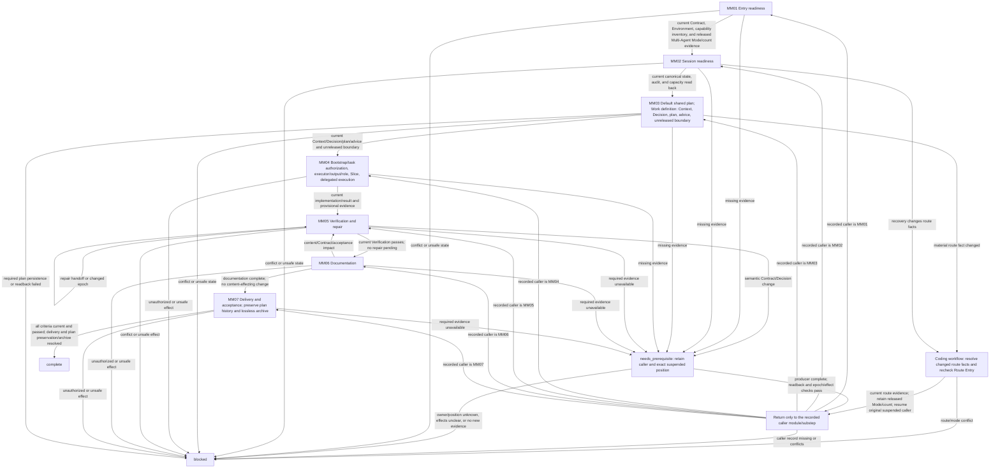

# Coding Workflow — Multi-Agent Mode

[English](coding-multi-agent.md) | [简体中文](coding-multi-agent_zh_cn.md)

This route composes the seven Layer-04 modules for a task whose released Mode is Multi-Agent Coding with a positive locked child count. It sequences module entry, preserves caller position across prerequisites, and routes changed state back to the affected module.

## Workflow map

## Ordered route checklist

Before entering MM01, inspect evidence that the Coding workflow completed Contract, Environment, capability inventory, Mode, and Route Entry. Do not repeat those gates. The route requires a positive locked child count; a reserved count alone does not authorize a child. At each step, call only its linked module; preserve the exact module checkpoint and completed effects when a prerequisite suspends work. Resume at the returned position. Never replay earlier effects or restart the route because a prerequisite was missing.

1. **MM01 — Entry readiness.** Call [Entry Readiness](modules/entry-readiness.md) with current Contract, Environment, capability inventory, released Multi-Agent Mode, positive locked count, and authorized route evidence. Continue only when all entry evidence is current and consistent. Return missing prerequisites to their semantic owner and retain MM01; block conflicts or unsafe state.
2. **MM02 — Session readiness.** Call [Session Readiness](modules/session-readiness.md) to confirm canonical authority/state, audit, and applicable capacity readback. Recovery changes must follow the module's canonical readback before audit sequence; do not reopen Mode or repeat completed prompts. Continue only with current Session, audit, and allocation evidence; retain its suspended position on `needs_prerequisite`, and block unresolved authority or readback failures.
3. **MM03 — Work definition.** Call [Work Definition](modules/work-definition.md) to resolve sourced Context, Decision, planning output, applicable advice, and the unreleased boundary. Continue only with current source facts and a Contract-consistent Decision/plan. Return missing facts or decisions to their semantic owners and resume MM03. This module does not authorize the actual delegated task, reserve a role, release a Slice, create a child, or dispatch. Require the default shared plan identity/readback or documented persistence-restriction exception from that module before execution. Missing required plan evidence blocks; no explicit planning request is needed.
4. **MM04 — Delegated execution.** Call [Delegated Execution](modules/delegated-execution.md) with MM01–MM03 evidence and continuation/effect state. DE01–DE04 own Bootstrap assessment, actual-task authorization, executor/output decisions, conditional role reservation, and the shared recovery/Slice gate before any creation/dispatch. Later module checkpoints own conditional child creation/dispatch, explicit Worker memo disposition, implementation/result, and Control. Continue only with current implementation/result and provisional evidence. A resumed bundle retains recorded effects and memo value; a new bundle receives its explicit memo value at DE04. Preserve pending-child, Control, and next-Slice positions; do not replay creation or dispatch. Carry the shared plan identity and current evidence; the module checks access and updates before dependent work/reporting, including requirement amendments.
5. **MM05 — Verification and repair.** Call [Verification and Repair](modules/verification-repair.md) against the exact current fingerprint and acceptance conditions. Complete required independent verification only when the Contract requires it and current independence evidence confirms availability; a Worker result is implementation evidence only. If required independence is unavailable, suspend dependent effects at MM05; same-Session checks cannot substitute. Continue only when required checks pass on current epochs and no repair remains. A repair returns through handoff to current Verification; semantic Contract/Decision changes return to the caller. Do not accept stale evidence after changed implementation, documentation, or Git metadata dimensions.
6. **MM06 — Documentation.** Call [Documentation](modules/documentation.md) with current Verification, Contract, and before fingerprints. The module determines applicable output, requires authorization/source/path when output applies, handles requested Memory with readback, classifies impact, and runs checks. Continue only with its current documentation result. If a changed content/Contract/acceptance dimension requires re-verification, return to MM05, then resume the suspended MM06 substep and complete its current impact/checks before entering MM07.
7. **MM07 — Delivery and acceptance.** Call [Delivery and Acceptance](modules/delivery-acceptance.md) with current Contract criteria, verification evidence, epochs, and any exact authorized Git intent. Continue only when every applicable criterion maps to current passing evidence and requested delivery is resolved. Require the module's complete-plan preservation comparison before completion/archive and its identical-content archive readback; a final summary cannot replace accumulated history. The module may archive only a matching completed active plan after Acceptance evidence passes and preservation is confirmed. Missing criteria/evidence return to the semantic owner and recorded position; preservation mismatch, failure, conflict, or unauthorized effects block.

## Prerequisite return map

Resolve only the missing item at its producer/recheck location. Preserve the original suspended module/substep, completed effects, and relevant epochs; if the producer also suspends, keep a nested continuation in the existing caller context. After readback and epoch/effect rechecks, resume only the original caller position. Contract/Environment/Mode evidence gaps require missing evidence completion; recheck Route Entry only if material route facts change, then return to the original pending position with locked Mode/count retained. Never replay earlier effects or reopen released Mode/count. Unknown owner/position/effects, no progress, or unrecoverable effects block dependent work.

| Missing prerequisite | Producer/recheck location | Resume after readback |
| --- | --- | --- |
| Contract/acceptance criteria | Coding workflow Contract owner; complete missing evidence. | Original suspended MM module/substep; recheck Route Entry only if material route facts changed. |
| Environment/capability inventory | Corresponding Environment/capability owner; complete missing evidence. | Original suspended MM module/substep; recheck Route Entry only if material route facts changed. |
| Route Entry evidence or changed route fact | Route Entry owner, only for material fact changes; keep released Mode/count. | Original suspended MM module/substep if the route remains valid; otherwise block. |
| Released Multi-Agent Mode/count evidence | Existing Mode owner and locked record readback; do not repeat a released choice. | Original suspended MM module/substep only when current Multi-Agent mode and positive count are confirmed; conflict blocks. |
| Session state, authority, audit, or capacity | MM02 Session owners, including canonical state readback before audit/capacity reuse. | Original suspended MM module/substep after readback; if MM02 itself is caller, resume its recorded producer substep. |
| Context, Decision, plan, or advice | MM03 WD owners; resolve only the missing substep. | Original suspended MM module/substep; e.g. MM07 returns to MM07 after WD evidence is read back. |
| Bootstrap, task authorization, executor/output, role, Slice, or Control | MM04 DE01–DE08 owners; do not replay completed allocation/dispatch effects. | Original suspended MM module/substep after result readback and effect/epoch checks. |
| Verification, repair diagnosis, or handoff | MM05 VR owners; preserve current dimensions and repair effects. | Original suspended MM module/substep after current evidence; MM06 returns to its suspended DOC substep after verification. |
| Documentation impact, Memory readback, or checks | MM06 DOC owners; after a VR return, finish the suspended DOC substep. | Original suspended MM module/substep after readback and impact/check completion. |
| Git target/effect, Acceptance criteria, or plan archive | MM07 DA owners; archive only after all criteria pass and required readback. | Original suspended MM module/substep after producer evidence is read back. |
## Mode boundary

Use only the already released Multi-Agent mode and positive locked count. Allocation, creation, dispatch, reuse, memo, and child lifecycle are governed by the composed lower-layer owners inside the called modules; this route only orders those modules.

## Related concepts

- [Entry Readiness](modules/entry-readiness.md)
- [Delegated Execution](modules/delegated-execution.md)
- [Verification and Repair](modules/verification-repair.md)
