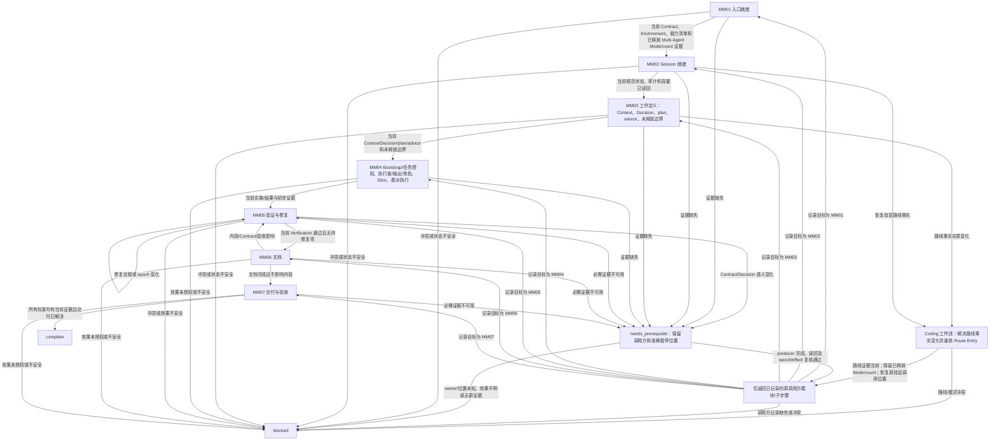

# Coding 工作流 — Multi-Agent 模式

[English](coding-multi-agent.md) | [简体中文](coding-multi-agent_zh_cn.md)

本路线为已释放 Multi-Agent Coding 且锁定正数 child count 的任务组合七个 Layer-04 模块。它安排模块入口，在前置缺失时保留调用方位置，并将状态变化返回受影响的模块。

## 工作流路线图

## 路线顺序检查清单

进入 MM01 前，检查 Coding 工作流已完成 Contract、Environment、能力清单、Mode 和 Route Entry 的证据。不得重复这些门禁。本路线要求正数锁定 child count；预留数量本身不授权创建子代理。每一步只调用所链接的模块；前置导致暂停时，保留准确模块检查点和已完成效果，并从返回位置恢复。不得重放先前效果，也不得因缺少前置而重启整条路线。

1. **MM01 — 入口就绪。** 使用当前 Contract、Environment、能力清单、已释放 Multi-Agent Mode、正数锁定数量及授权路线证据，调用[入口就绪模块](modules/entry-readiness_zh_cn.md)。仅在入口证据当前且一致时继续。缺失前置交语义 owner 并保留 MM01；冲突或状态不安全时阻塞。
2. **MM02 — Session 就绪。** 调用[Session 就绪模块](modules/session-readiness_zh_cn.md)，确认规范 authority/state、审计及适用的容量读回。恢复改变事实时，遵循模块要求的规范读回先于审计顺序；不得重开 Mode 或重复已完成提问。仅在 Session、审计和 allocation 证据当前时继续；`needs_prerequisite` 时保留暂停位置，authority 或读回失败未解决时阻塞。
3. **MM03 — 工作定义。** 调用[工作定义模块](modules/work-definition_zh_cn.md)，解决来源明确的 Context、Decision、规划输出、适用 advice 和未释放边界。仅在来源事实以及符合 Contract 的 Decision/plan 当前有效时继续。缺失事实/决定交语义 owner 后恢复 MM03。该模块不授权实际委派任务、不预留角色、不释放 Slice、不创建或派发子代理。
4. **MM04 — 委派执行。** 带上 MM01–MM03 证据及 continuation/effect 状态，调用[委派执行模块](modules/delegated-execution_zh_cn.md)。DE01–DE04 负责 Bootstrap 评估、实际任务授权、执行者/输出决策、条件角色预留以及创建/派发前共用的恢复/Slice 门禁。后续检查点负责条件子代理创建/派发、显式 Worker memo 处置、实施/结果及 Control。仅在当前实施/结果和初步证据齐备时继续。恢复既有 bundle 时保留已记录效果和 memo 值；新 bundle 在 DE04 明确 memo 值。保留等待子代理、Control 和下一 Slice 的位置；不得重放创建或派发。
5. **MM05 — 验证与修复。** 针对准确当前指纹和验收条件调用[验证与修复模块](modules/verification-repair_zh_cn.md)。只有 Contract 要求独立验证且当前独立性证据确认可用时，才完成独立验证；Worker 结果仅是实施证据。必需验证者证据待补时暂停依赖效果；若无法取得获授权的独立验证者，则阻塞这些效果。同 Session 逻辑检查不可替代。仅当必需检查在当前 epoch 通过且没有待修复项时继续。修复经交接返回当前 Verification；Contract/Decision 语义变化交调用方。实施、文档或 Git metadata 维度改变后不得使用过期证据。
6. **MM06 — 文档。** 带上当前 Verification、Contract 和写前指纹，调用[文档模块](modules/documentation_zh_cn.md)。该模块判断适用输出，输出适用时要求授权/来源/路径，处理请求 Memory 的读回、影响分类和检查。仅在当前文档结果齐备时继续。内容/Contract/验收变化需要重验时返回 MM05；受影响 epoch 通过后，恢复挂起的 MM06 子步骤，完成当前影响分类和文档检查后再进入 MM07。
7. **MM07 — 交付与验收。** 带上当前 Contract 标准、验证证据、epoch 和任何准确且获授权的 Git 意图，调用[交付与验收模块](modules/delivery-acceptance_zh_cn.md)。仅当每项适用标准都有当前通过证据且请求交付已解决时继续。只有验收证据通过且读回确认后，该模块才可归档匹配的已完成 active plan。缺少标准/证据时返回语义 owner 和记录位置；失败、冲突或效果未授权时阻塞。

## 前置返回映射

仅在其 producer/recheck 位置补齐缺失项。保留原挂起模块/子步骤、已完成效果和相关 epoch；若 producer 也暂停，则在现有调用方上下文保留嵌套 continuation。读回结果并重核 epoch/effect 后，只恢复原调用方位置。Contract/Environment/Mode 证据缺口仅需补齐缺失证据；只有路线事实实质变化时才重核 Route Entry，然后在保留锁定 Mode/count 的情况下返回原挂起位置。不得重放前序效果或重开已释放 Mode/count。owner/位置/效果未知、无进展或效果不可恢复时阻塞依赖工作。

| 缺失前置 | producer/recheck 位置 | 读回后恢复位置 |
| --- | --- | --- |
| Contract/验收标准 | Coding 工作流 Contract owner；仅补齐缺失证据。 | 原挂起 MM 模块/子步骤；只有路线事实实质变化时才重核 Route Entry。 |
| Environment/能力清单 | 对应 Environment/能力 owner；仅补齐缺失证据。 | 原挂起 MM 模块/子步骤；只有路线事实实质变化时才重核 Route Entry。 |
| Route Entry 证据或已变化的路线事实 | 仅对实质变化事实调用 Route Entry owner；保留已释放 Mode/count。 | 路线仍有效时恢复原挂起 MM 模块/子步骤；否则阻塞。 |
| 已释放 Multi-Agent Mode/count 证据 | 使用既有 Mode owner 和锁定记录读回；不得重复已释放选择。 | 仅在当前 Multi-Agent mode 和正数数量得到确认后恢复原挂起位置；冲突时阻塞。 |
| Session state、authority、审计或容量 | MM02 Session owners；复用审计/容量前先完成 canonical state 读回。 | 读回后恢复原挂起 MM 模块/子步骤；若调用方本身是 MM02，则恢复其记录的 producer 子步骤。 |
| Context、Decision、plan 或 advice | MM03 WD owners；只解决缺失子步骤。 | 原挂起 MM 模块/子步骤；例如 MM07 在 WD 证据读回后仍恢复 MM07。 |
| Bootstrap、任务授权、执行者/输出、角色、Slice 或 Control | MM04 DE01–DE08 owners；不得重放已完成的分配/派发效果。 | 结果读回并核对 effect/epoch 后恢复原挂起位置。 |
| Verification、修复诊断或 handoff | MM05 VR owners；保留当前维度和修复效果。 | 当前证据完成后恢复原挂起位置；MM06 在验证返回后恢复其挂起 DOC 子步骤。 |
| 文档影响、Memory 读回或检查 | MM06 DOC owners；VR 返回后完成挂起的 DOC 子步骤。 | 读回、影响分类及检查完成后恢复原挂起位置。 |
| Git target/effect、Acceptance 标准或计划归档 | MM07 DA owners；仅在全部标准通过并完成所需读回后归档。 | producer 证据读回后恢复原挂起 MM 模块/子步骤。 |
## Mode 边界

只使用已释放的 Multi-Agent mode 和正数锁定数量。角色分配、创建、派发、复用、memo 和子代理生命周期由所调用模块组合的底层 owners 管理；本路线只负责模块顺序。

## 相关概念

- [入口就绪模块](modules/entry-readiness_zh_cn.md)
- [委派执行模块](modules/delegated-execution_zh_cn.md)
- [验证与修复模块](modules/verification-repair_zh_cn.md)
