# Coding 工作流——多代理模式

[English](coding-multi-agent.md) | [简体中文](coding-multi-agent_zh_cn.md)

本路线由 Coding 工作流选择；只有模式检查点放行多代理 Coding 后才有效。进入路线前，Mode 检查点只消费模式确认、数量门禁、重新进入与状态记录；职责分配、子代理创建、派发、复用和生命周期在对应编号步骤按需加载。

## 工作流路线图

```mermaid
flowchart TD
    M01["01 Contract / 契约"]
    M02["02 Environment / 环境、能力与 Enhanced 选择"]
    D_ENHANCED{"是否需要可选 Enhanced 操作？"}
    D_ENHANCED_HOST{"可信身份及操作必需守卫均已验证？"}
    ACT_NATIVE["Native 候选路径；使用前核验既有 Enhanced 权威"]
    M03["03 Mode / 模式与数量"]
    M04["04 Session / 状态与审计解决"]
    D_ROOT_STORE{"是否选择 Enhanced Root store，且身份、守卫和 Schema 均有效？"}
    ACT_ROOT_OPEN["通过 Session 边界后打开或恢复 Root store；Root 记录实际审计结果前保持 pending"]
    D_AUTHORITY_TRANSFER{"是否需将既有规范 Enhanced 记录转回 Native？"}
    ACT_NATIVE_TRANSFER["冻结 Enhanced 写入者和在途操作，并写入读回完整规范记录"]
    D_NATIVE_RECON{"Native 当前是否为规范权威，或 Root 对账是否未决？"}
    ACT_NATIVE_RECON["审阅完整集合；确认精确比较，或裁决受支持差异"]
    ACT_RECOVERY_RECHECK["重核 Contract、当前 Context 和 Decision；读回当前规范审计记录，不重开 Mode 或重复已完成提问"]
    D_AUDIT_CONFIG{"复用有效显式／已完成配置、恢复 pending 提问，还是仅在 unasked 时询问？"}
    ACT_AUDIT_PROMPT["仅在 unasked 时调用固定审计问题；记录实际提问时间与截止时间"]
    D_AUDIT_REPLY{"有效答复、无效/歧义答复、已验证超时或不可用？"}
    ACT_AUDIT_REPLY["记录有效答复；仅更新所选 Root 字段"]
    ACT_AUDIT_CLARIFY["仅澄清无效/歧义字段；保留 pending 提问"]
    D_AUDIT_CORRECTION{"有效更正、仍无效/歧义或明确选择默认值？"}
    ACT_AUDIT_DEFAULT["记录 Root 明确选择 balanced/milestone_only；保留 Worker 值和超时历史"]
    ACT_AUDIT_WAIT["截止前等待；保留 pending 状态"]
    ACT_AUDIT_TIMEOUT["无回复且实际经过>=60秒；Root 默认 balanced/milestone_only；保留 Worker 值，缺失才补 full"]
    ACT_AUDIT_CONFIRM["确认所选规范 Root 审计记录并读回后才离开 Session"]
    M05["05 Allocation / 只核验未分配容量"]
    M06["06 Context / 来源与决策上下文"]
    M07["07 Decision / 规划、Bootstrap 与建议选择"]
    M08["08 Slice / 放行具体 Interaction Slice"]
    M09["09 Child Creation / 使用已预留职责、effort 和当前 Hash"]
    D_WORKER_STORE{"是否选择 Enhanced 且真实子代理身份已绑定到已放行 allocation？"}
    ACT_WORKER_OPEN["仅在身份绑定且 Schema 核验后初始化或恢复该 Worker 自身 store"]
    D_CONTEXT_GEN{"未决后续判断是否需要已审阅上下文？"}
    ACT_CONTEXT_GEN["根据带来源事实生成有界上下文；审阅来源、相关性和精确输入哈希"]
    ACT_CONTEXT_DIRECT["使用直接 owner 和已核实事实；跳过已确定建议，或直接复核生成失败"]
    ACT_TASK_ASSIGN["应用 Task Assignment；明确指令或上下文不可用时跳过对应建议，依据直接事实"]
    D_EXECUTOR{"是否依据当前任务、Session 和权限事实确定执行主体？"}
    D_CHILD_POOL{"当前会话中是否有合适的子代理？"}
    ACT_CHILD_DIRECT["直接使用明确、唯一或筛选后唯一空闲候选；重新核验身份和权限"]
    ACT_CHILD_ADVICE["至少 2 个空闲候选时，优先合适空闲 Primary；否则比较任务相关上下文"]
    ACT_CHILD_REVIEW["依据当前职责、能力、权限、身份和可用性审阅建议"]
    ACT_CHILD_WAIT["合适现有子代理忙碌时等待；空闲后重新核验"]
    D_OUTPUT_EXPLICIT{"用户是否已明确由谁生成或是否生成此输出？"}
    ACT_OUTPUT_ADVICE["依据 Output Token 路由独立评估直接输出规模"]
    D_OUTPUT_RESULT{"输出规模判断结果？"}
    ACT_OUTPUT_CHILD["大输出：使用合适的空闲现有子代理"]
    ACT_OUTPUT_HOLD["大输出且没有空闲子代理：挂起；输出建议本身不授权创建"]
    ACT_OUTPUT_WAIT["保持所请求输出待处理，直到合适子代理空闲"]
    ACT_OUTPUT_NO["不是大输出：Root 可在其他门禁通过后执行"]
    D_NEW_CHILD{"Task Assignment 是否独立要求创建新子代理？"}
    D_INDEPENDENT_CHILD{"Task Assignment 是否独立确认此已授权任务需要新子代理？"}
    ACT_ROLE_NA["职责选择不适用：无需新子代理；记录原因"]
    D_ROLE_SELECT{"用户是否明确要求创建子代理或指定职责？"}
    ACT_ROLE_ADVICE["根据已审阅上下文和当前会话状态选择一个受维护职责"]
    ACT_ROLE_REVIEW["Root 核实职责匹配、当前会话唯一性、权限和直接事实兜底"]
    D_ROLE_CAPACITY{"是否有锁定名额且另一职责仍未占用？"}
    ACT_ROLE_RESERVE["在放行 Slice 前，于获准名额中预留唯一职责"]
    ACT_BUDGET_APPROVAL["请求用户明确批准为不同职责精确增加 1 个名额"]
    M10["10 Dispatch / 按预设展示预览或全文；无子代理时不适用"]
    M11["11 Implementation / Worker 输出与 Control 建议"]
    M12["12 Verification / 建议与当前报告"]
    M13["13 Repair / 处置与重新验证"]
    M14["14 Documentation / 父代理撰写与影响"]
    M15["15 Git / 读取实际交接并应用审计预设"]
    M16["16 Acceptance / 验收"]
    D_PLAN{"用户目标是否要求规划、探索或制定／输出／更新计划？"}
    ACT_PLAN["持久化并读回核验计划 Memory"]
    D_PLAN_SAVED{"计划 Memory 是否写入并读回核验？"}
    D_ARCHIVE{"是否存在本任务对应的活动计划 Memory？"}
    ACT_ARCHIVE["移至归档并读回核验"]
    D_ARCHIVED{"归档计划是否已核验？"}
    D_BOOT{"当前事实是否满足 Bootstrap/Refresh 触发条件？"}
    ACT_BOOT_PLAN["仅在满足触发条件时规划；M07 再选择/预留职责；此处不创建代理"]
    D_PLAN_MATCH{"是否存在相关活动计划？"}
    ACT_PLAN_SCAN["列出活动 plans/ 计划"]
    ACT_PLAN_READ["读取并核对匹配计划"]
    D_RULE_ACCESS{"是否选择有界的当前规则读取？"}
    ACT_RULE_CONTEXT["读取所选当前节点及其映射的 owner 标题"]
    ACT_RULE_DIRECT["核验直接 owner 正文及必需引用"]
    ACT_INITIAL_CLASSIFY["从直接 owner 确认意图/输出分类；授权 Root 前建议不适用"]
    D_DECISION_ADVICE{"是否为当前 Decision 问题使用可选建议？"}
    ACT_DECISION_ADVICE["仅将类型化建议作为输入；过期/失败时回到直接 owner"]
    ACT_DECISION_DIRECT["规划/放行前核验直接 owner 和当前事实"]
    D_CONTROL_ADVICE{"是否使用可选 Control 建议？"}
    ACT_CONTROL_ADVICE["仅将建议作为输入；过期/失败时回到直接 owner"]
    ACT_CONTROL_DIRECT["核验当前证据并通过可信路径选择显式结果"]
    D_EPOCH_ADVICE{"是否使用可选覆盖维度建议？"}
    ACT_EPOCH_ADVICE["仅审阅覆盖建议；过期/失败时回到直接 owner"]
    ACT_EPOCH_DIRECT["核验当前 fingerprint 并运行必需验证"]
    D_RECON{"是否仍需事实？"}
    ACT_RECON_PLAN["规划有界侦察，不放行实现"]
    D_MEMO{"子代理输出符合条件？若是，是否启用 Memo？"}
    ACT_MEMO["核验具名 Memory 与写入能力"]
    D_CONTROL{"控制：继续／修订／停止"}
    D_RECOVERY_GATE{"下一 Slice 前，floor 后的 Control Continue 对当前 Control 规则和相关 Epoch 是否仍有效？"}
    D_VERIFY{"当前 Epoch 是否通过？"}
    D_DOC{"文档是否改变内容或 Contract？"}
    D_GIT{"Git 是否已授权并验证？"}
    BLOCK["阻塞：报告缺失条件"]
    DONE["完成验收"]
    M01 --> ACT_INITIAL_CLASSIFY
    ACT_INITIAL_CLASSIFY -- 已核验直接来源／Root 前建议不适用 --> M02
    ACT_INITIAL_CLASSIFY -- 必需来源不可用 --> BLOCK
    M02 --> D_ENHANCED
    D_ENHANCED -- 否／Native 默认／不适用 --> M03
    D_ENHANCED -- 是／需要 Enhanced --> D_ENHANCED_HOST
    D_ENHANCED_HOST -- 已验证 --> M03
    D_ENHANCED_HOST -- Native 候选路径；使用前核验既有 Enhanced 权威 --> ACT_NATIVE
    ACT_NATIVE --> M03
    D_ENHANCED_HOST -- 必需能力缺失或未知 --> BLOCK
    M03 --> M04
    M04 --> D_ROOT_STORE
    D_ROOT_STORE -- Enhanced 已选择；当前身份和 Schema 已核验 --> D_NATIVE_RECON
    D_ROOT_STORE -- Native／未选择 Enhanced／核验既有规范权威 --> D_AUTHORITY_TRANSFER
    D_ROOT_STORE -- 必需身份、守卫或 Schema 不可用 --> BLOCK
    ACT_ROOT_OPEN -- 打开或核验失败 --> BLOCK
    ACT_ROOT_OPEN -- 对账后打开或恢复 --> D_AUDIT_CONFIG
    D_AUTHORITY_TRANSFER -- 从未有 Enhanced 权威／不适用 --> D_AUDIT_CONFIG
    D_AUTHORITY_TRANSFER -- 已有 Enhanced 权威；转移获准且已核验 --> ACT_NATIVE_TRANSFER
    D_AUTHORITY_TRANSFER -- 历史、冻结或读回未知／失败 --> BLOCK
    ACT_NATIVE_TRANSFER -- 完整记录已冻结、写入并读回 --> D_AUDIT_CONFIG
    ACT_NATIVE_TRANSFER -- 不完整或结果不确定 --> BLOCK
    D_NATIVE_RECON -- 无 Native 历史／不适用 --> ACT_ROOT_OPEN
    D_NATIVE_RECON -- 先前裁决仍当前；无未决比较 --> D_AUDIT_CONFIG
    D_NATIVE_RECON -- 存在未决 Native 历史或比较 --> ACT_NATIVE_RECON
    ACT_NATIVE_RECON -- 精确比较已确认 --> D_AUDIT_CONFIG
    ACT_NATIVE_RECON -- 实质差异已裁决并提交；重核 Contract --> ACT_RECOVERY_RECHECK
    ACT_NATIVE_RECON -- 差异不受支持或审阅不完整 --> BLOCK
    ACT_RECOVERY_RECHECK -- Contract 已重核；确认当前规范审计记录 --> D_AUDIT_CONFIG
    D_AUDIT_CONFIG -- 是／迁移后复用 --> ACT_AUDIT_CONFIRM
    D_AUDIT_CONFIG -- unasked／仅首次符合条件时询问 --> ACT_AUDIT_PROMPT
    D_AUDIT_CONFIG -- pending／尚无答复；恢复原截止时间 --> D_AUDIT_REPLY
    D_AUDIT_CONFIG -- pending／已观察到无效答复 --> D_AUDIT_CORRECTION
    D_AUDIT_CONFIG -- 配置无效／定向澄清 --> ACT_AUDIT_CLARIFY
    D_AUDIT_CONFIG -- 不可用／未解决的 schema 冲突 --> BLOCK
    ACT_AUDIT_PROMPT --> D_AUDIT_REPLY
    D_AUDIT_REPLY -- 有效实际答复 --> ACT_AUDIT_REPLY
    ACT_AUDIT_REPLY --> ACT_AUDIT_CONFIRM
    D_AUDIT_REPLY -- 无效／歧义答复 --> ACT_AUDIT_CLARIFY
    ACT_AUDIT_CLARIFY -- 沿用原问题／原截止时间 --> D_AUDIT_CORRECTION
    D_AUDIT_CORRECTION -- 有效更正 --> ACT_AUDIT_REPLY
    D_AUDIT_CORRECTION -- 仍无效／歧义 --> ACT_AUDIT_CLARIFY
    D_AUDIT_CORRECTION -- 用户明确选择默认值 --> ACT_AUDIT_DEFAULT
    ACT_AUDIT_DEFAULT --> ACT_AUDIT_CONFIRM
    D_AUDIT_REPLY -- pending／尚未到期 --> ACT_AUDIT_WAIT
    ACT_AUDIT_WAIT -- 检查答复／保留截止时间 --> D_AUDIT_REPLY
    D_AUDIT_REPLY -- 无回复／实际经过>=60秒 --> ACT_AUDIT_TIMEOUT
    ACT_AUDIT_TIMEOUT --> ACT_AUDIT_CONFIRM
    ACT_AUDIT_CONFIRM -- 规范 Root 审计记录已确认并读回 --> M05
    ACT_AUDIT_CONFIRM -- 规范记录缺失或未确认 --> BLOCK
    D_AUDIT_REPLY -- 提问或计时不可用 --> BLOCK
    M05 --> M06
    M06 --> D_RULE_ACCESS
    D_RULE_ACCESS -- 是／选择有界读取 --> ACT_RULE_CONTEXT
    D_RULE_ACCESS -- 否／直接来源／不适用 --> ACT_RULE_DIRECT
    ACT_RULE_CONTEXT -- 已读取或不可用／直接回退 --> ACT_RULE_DIRECT
    ACT_RULE_DIRECT -- 已核验当前 owner 与必需引用 --> ACT_PLAN_SCAN
    ACT_RULE_DIRECT -- 必需 owner 不可用 --> BLOCK
    ACT_PLAN_SCAN --> D_PLAN_MATCH
    ACT_PLAN_SCAN -- 失败／不可用 --> BLOCK
    D_PLAN_MATCH -- 是 --> ACT_PLAN_READ
    D_PLAN_MATCH -- 无／不适用 --> D_CONTEXT_GEN
    ACT_PLAN_READ --> D_CONTEXT_GEN
    ACT_PLAN_READ -- 失败／不可用 --> BLOCK
    D_CONTEXT_GEN -- 未决建议需要上下文 --> ACT_CONTEXT_GEN
    D_CONTEXT_GEN -- 明确指令已定分支／无需建议：不适用 --> ACT_CONTEXT_DIRECT
    ACT_CONTEXT_GEN -- 上下文已审阅且精确输入哈希仍当前 --> M07
    ACT_CONTEXT_GEN -- 失败／证据不足；仅直接复核 --> ACT_CONTEXT_DIRECT
    ACT_CONTEXT_DIRECT -- 已核实事实足够／遵循明确指令 --> M07
    ACT_CONTEXT_DIRECT -- 必需事实缺失或冲突 --> BLOCK
    M07 --> D_DECISION_ADVICE
    D_DECISION_ADVICE -- 是／明确启用且与当前问题相关 --> ACT_DECISION_ADVICE
    D_DECISION_ADVICE -- 否／Native／关闭／不可用／不适用 --> ACT_DECISION_DIRECT
    ACT_DECISION_ADVICE -- 建议当前或失败／直接核验 --> ACT_DECISION_DIRECT
    ACT_DECISION_DIRECT -- 已核验 owner 和事实 --> D_PLAN
    ACT_DECISION_DIRECT -- 必需 owner 或证据不可用 --> BLOCK
    D_PLAN -- 是 --> ACT_PLAN
    D_PLAN -- 无计划文档／不适用 --> D_RECON
    ACT_PLAN --> D_PLAN_SAVED
    D_PLAN_SAVED -- 是 --> D_RECON
    D_PLAN_SAVED -- 失败／不可用 --> BLOCK
    D_RECON -- 需要 --> ACT_RECON_PLAN
    ACT_RECON_PLAN --> D_BOOT
    D_RECON -- 不需要 --> D_BOOT
    D_BOOT -- 当前事实证明需要 Bootstrap/Refresh --> ACT_BOOT_PLAN
    ACT_BOOT_PLAN -- 仅规划；不提前预留职责 --> ACT_TASK_ASSIGN
    D_BOOT -- 不满足触发条件／记录不适用原因 --> ACT_TASK_ASSIGN
    ACT_TASK_ASSIGN --> D_EXECUTOR
    D_EXECUTOR -- root --> D_OUTPUT_EXPLICIT
    D_EXECUTOR -- sub_agent --> D_CHILD_POOL
    D_EXECUTOR -- 证据不足／未决 --> BLOCK
    D_CHILD_POOL -- 明确指定且空闲、唯一合格空闲或筛选后唯一空闲 --> ACT_CHILD_DIRECT
    D_CHILD_POOL -- 至少 2 个合格空闲候选 --> ACT_CHILD_ADVICE
    D_CHILD_POOL -- 合适子代理忙碌；先评估输出再等待 --> D_OUTPUT_EXPLICIT
    D_CHILD_POOL -- 没有合适现有子代理；可能需要创建新代理 --> D_OUTPUT_EXPLICIT
    D_CHILD_POOL -- 身份、能力或权限不确定 --> BLOCK
    ACT_CHILD_ADVICE --> ACT_CHILD_REVIEW
    ACT_CHILD_REVIEW -- 已确认当前合适空闲候选；应用 Primary/上下文偏好 --> ACT_CHILD_DIRECT
    ACT_CHILD_REVIEW -- 建议 API 失败；合格 Primary 忙碌；先评估输出再等待 --> D_OUTPUT_EXPLICIT
    ACT_CHILD_REVIEW -- 事实过期或无安全候选 --> BLOCK
    ACT_CHILD_DIRECT --> D_OUTPUT_EXPLICIT
    ACT_CHILD_WAIT -- 候选变为空闲；重新核实当前事实 --> D_CHILD_POOL
    D_OUTPUT_EXPLICIT -- 用户明确指令；跳过对应建议 --> D_NEW_CHILD
    D_OUTPUT_EXPLICIT -- 没有明确指令；评估直接输出 --> ACT_OUTPUT_ADVICE
    ACT_OUTPUT_ADVICE --> D_OUTPUT_RESULT
    D_OUTPUT_RESULT -- no --> ACT_OUTPUT_NO
    D_OUTPUT_RESULT -- yes／有合适空闲子代理 --> ACT_OUTPUT_CHILD
    D_OUTPUT_RESULT -- yes／没有合适空闲子代理 --> ACT_OUTPUT_HOLD
    D_OUTPUT_RESULT -- 证据不足 --> BLOCK
    ACT_OUTPUT_NO --> D_NEW_CHILD
    ACT_OUTPUT_CHILD --> ACT_ROLE_NA
    ACT_OUTPUT_HOLD -- Task Assignment 独立确认创建需要 --> D_INDEPENDENT_CHILD
    ACT_OUTPUT_HOLD -- 无独立创建需要；保持待处理 --> ACT_OUTPUT_WAIT
    ACT_OUTPUT_WAIT -- 合适候选变为空闲；重新评估输出 --> ACT_OUTPUT_ADVICE
    D_INDEPENDENT_CHILD -- 是／经职责、预算、Slice 和创建门禁继续 --> D_ROLE_SELECT
    D_INDEPENDENT_CHILD -- 否／输出建议本身不授权创建；保持待处理 --> ACT_OUTPUT_WAIT
    D_NEW_CHILD -- 是／Assignment 独立需要新子代理 --> D_ROLE_SELECT
    D_NEW_CHILD -- 否／合适现有子代理忙碌 --> ACT_CHILD_WAIT
    D_NEW_CHILD -- 否／Root 或合适子代理空闲：不适用 --> ACT_ROLE_NA
    D_ROLE_SELECT -- 用户明确要求创建／指定职责；跳过职责建议 --> ACT_ROLE_REVIEW
    D_ROLE_SELECT -- 无明确职责；已有审阅上下文 --> ACT_ROLE_ADVICE
    D_ROLE_SELECT -- 上下文生成失败但直接事实足够；不发下游建议 --> ACT_ROLE_REVIEW
    ACT_ROLE_ADVICE -- 建议成功、失败或证据不足；交 Root 审阅 --> ACT_ROLE_REVIEW
    ACT_ROLE_REVIEW -- 职责与当前事实已确认 --> D_ROLE_CAPACITY
    ACT_ROLE_REVIEW -- 职责、事实或权限未决 --> BLOCK
    D_ROLE_CAPACITY -- 有锁定未分配名额；另一职责可用 --> ACT_ROLE_RESERVE
    D_ROLE_CAPACITY -- 无空闲名额；另一职责仍可用 --> ACT_BUDGET_APPROVAL
    D_ROLE_CAPACITY -- 所有职责已占用或没有适合职责 --> BLOCK
    ACT_BUDGET_APPROVAL -- 用户经 Count Gate 明确批准精确 +1 --> ACT_ROLE_RESERVE
    ACT_BUDGET_APPROVAL -- 未批准、不可用或批准超出 +1 --> BLOCK
    ACT_ROLE_RESERVE -- 唯一职责已记录；创建后仍保持占用 --> D_RECOVERY_GATE
    ACT_ROLE_RESERVE -- 状态过期／冲突或预留失败 --> BLOCK
    ACT_ROLE_NA --> D_RECOVERY_GATE
    D_RECOVERY_GATE -- 无恢复 floor／不适用，或 floor 后 Continue 对当前 Control 规则和相关 Epoch 仍有效 --> M08
    D_RECOVERY_GATE -- 需要新的当前 Continue --> D_CONTROL_ADVICE
    M08 --> M09
    M09 -- 已使用预留职责创建子代理且身份已绑定 --> D_WORKER_STORE
    D_WORKER_STORE -- 已选择 Enhanced；身份已绑定；守卫有效 --> ACT_WORKER_OPEN
    D_WORKER_STORE -- Native／未选择 Enhanced／不适用 --> D_MEMO
    ACT_WORKER_OPEN --> D_MEMO
    ACT_WORKER_OPEN -- 打开或核验失败 --> BLOCK
    D_WORKER_STORE -- 必需身份、守卫或 Schema 不可用 --> BLOCK
    M09 -- 无符合条件的输出：Not applicable --> D_MEMO
    M09 -- 必需证据或足够 effort 不可用、指纹或决策输入 Hash 过期/不匹配，或创建门禁失败 --> BLOCK
    M10 -- 任务授权与正文可见／无额外消息：N/A --> M11
    M10 -- 授权或正文检查失败 --> BLOCK
    D_MEMO -- 启用 --> ACT_MEMO
    ACT_MEMO --> M10
    D_MEMO -- 关闭／不适用 --> M10
    M11 --> D_CONTROL_ADVICE
    D_CONTROL_ADVICE -- 是／明确启用 --> ACT_CONTROL_ADVICE
    D_CONTROL_ADVICE -- 否／Native／关闭／不可用／不适用 --> ACT_CONTROL_DIRECT
    ACT_CONTROL_ADVICE -- 建议当前或失败／直接核验 --> ACT_CONTROL_DIRECT
    ACT_CONTROL_DIRECT -- 已选择可信显式结果 --> D_CONTROL
    ACT_CONTROL_DIRECT -- 必需 owner 或关键证据不可取得 --> BLOCK
    M11 -- 实际返回正文/必需可见证据缺失或仅状态 --> BLOCK
    D_CONTROL -- Continue／Evidence-on-Demand（可补证据暂停） --> M06
    D_CONTROL -- 修订 --> M07
    D_CONTROL -- 已完成／仅限正常实现后；不存在待放行的恢复 Slice --> M12
    D_CONTROL -- 停止 --> BLOCK
    M12 -- verifier 通信可见／无需子代理 verifier：N/A --> D_EPOCH_ADVICE
    D_EPOCH_ADVICE -- 是／明确启用 --> ACT_EPOCH_ADVICE
    D_EPOCH_ADVICE -- 否／Native／关闭／不可用／不适用 --> ACT_EPOCH_DIRECT
    ACT_EPOCH_ADVICE -- 覆盖提示或失败／直接验证 --> ACT_EPOCH_DIRECT
    ACT_EPOCH_DIRECT -- 已核验当前证据 --> D_VERIFY
    ACT_EPOCH_DIRECT -- 必需证据不可用 --> BLOCK
    M12 -- 实际请求/报告正文或必需可见证据缺失／仅状态 --> BLOCK
    D_VERIFY -- 可修复 --> M13
    D_VERIFY -- 通过 --> M14
    D_VERIFY -- 必需证据不可用 --> BLOCK
    M13 -- 修复通信可见／无子代理通信：N/A --> M12
    M13 -- 实际修复正文或必需可见证据缺失／仅状态 --> BLOCK
    M14 -- 父级文档完成／无需文档子代理：N/A --> D_DOC
    M14 -- 必需的父级证据不可用 --> BLOCK
    D_DOC -- 内容变化 --> M12
    D_DOC -- 契约变化 --> M07
    D_DOC -- 无变化／不适用 --> M15
    M15 -- Git 通信可见／无 Git 子代理：N/A --> D_GIT
    M15 -- 实际 Git 正文或必需可见证据缺失／仅状态 --> BLOCK
    D_GIT -- 获授权／不适用 --> M16
    D_GIT -- 未授权 --> BLOCK
    M16 --> D_ARCHIVE
    D_ARCHIVE -- 是 --> ACT_ARCHIVE
    D_ARCHIVE -- 无／不适用 --> DONE
    ACT_ARCHIVE --> D_ARCHIVED
    D_ARCHIVED -- 是 --> DONE
    D_ARCHIVED -- 否／失败／不可用 --> BLOCK
```


编号节点与下方唯一路线顺序检查清单一一对应。未触发的条件概念记录 `Not applicable` 原因；路线图只负责概念选择和排序，具体动作、证据与失败处理以清单及同语言 owner 为准。

## 模式 Contract

- Worker 仅接收一个已放行 Interaction Slice，并通过父级返回；不得创建递归层级或将其他 Worker 进度视为权限。
- 模式/数量由 Mode checkpoint 与 M03 owners 负责；角色、Slice、创建、派发、复用和生命周期边界分别在 M07–M10 的链接 owner 处消费。
- 用户级禁止事项持续适用；与已锁定模式/数量冲突时阻塞并报告，不静默切换路线或模拟多代理行为。

## 组合输入

在编号检查点读取各 owner。下方清单在实际消费步骤提供同语言链接、动作、证据和失败边界；条件性交换/memo/代码结构 owner 仅在对应触发时读取，本节不是预加载目录。

## 职责边界

职责 ownership 见[Session 职责归属](../layer-01-fundamental-concepts/session-runtime/session-role-ownership_zh_cn.md)；本路线只增加下方的多代理条件。

## 本路线的运行环境要求

使用[运行环境能力清单](../layer-02-workflow-concepts/entry-and-context/environment-capability-inventory_zh_cn.md)提供的能力清单和共用运行规则，包括[运行环境与模型厂商支持](../layer-01-fundamental-concepts/session-runtime/runtime-provider-support_zh_cn.md)中的模型绑定。只有任务记录和已发布切片所需能力均暴露时才能继续。Worker 只能向直接父级返回，不能创建/管理其他 Agent 或联系任意线程。

## 路线顺序检查清单

按编号顺序执行每一阶段。对每个链接的 owner，核对适用动作和通过条件，记录结果及证据；必需结果缺失时停止。条件动作不适用时，逐项记录 `Not applicable` 及原因；存在链接或早期摘要不等于已经完成检查。Coding 选择器已在进入路线前完成第 1–3 阶段：核查其放行证据，不重复运行门禁。根父级负责语义决策并控制每次放行；Worker 只能向该父级返回。

1. **Contract 与共用协议。** 确认 [Contract 检查点](../layer-02-workflow-concepts/entry-and-context/contract_zh_cn.md)明确目标、用户/运行环境/仓库/权限/安全硬约束、已授权影响、已定决策、未解决问题和验收条件。应用[共享协议](../../share/shared-protocols_zh_cn.md)：维护一份当前 Semantic Contract，区分已观察事实与假设，保持稳定前缀并以小幅增量发送有界修订，使用仅向父级返回的路径及按审计预设选择的 Dispatch Preview 或完整安全正文；必需上下文或返回路径不可用时停止依赖切片。不得把未解决的问题当作派发授权。 使用建议前，必须从直接 owner 确认任务意图和符合条件的输出分类；Mode、Session 和已授权 Root 上下文通过前，将建议标记为 `Not applicable`。
2. **环境与能力。** 在[环境](../layer-02-workflow-concepts/entry-and-context/environment_zh_cn.md)和[能力清单](../layer-02-workflow-concepts/entry-and-context/environment-capability-inventory_zh_cn.md)核实唯一运行环境，并记录当前任务所需能力。调用[Enhanced 路径选择](../layer-03-workflow-checkpoints/enhanced-path-selection_zh_cn.md)：Native/`Not applicable` 可继续且不初始化 Enhanced；选择 Enhanced 必须有当前资格、身份和守卫证据。证据缺失时阻塞依赖分支。 使用[Enhanced Workflow Availability](../layer-01-fundamental-concepts/enhanced-native-state/enhanced-workflow-availability_zh_cn.md)和[Enhanced Host Binding](../layer-01-fundamental-concepts/enhanced-native-state/enhanced-host-binding_zh_cn.md)核验资格/身份守卫；记录证据或 Native `Not applicable`，必需能力未知时阻塞。
3. **模式、数量与记录。** 确认[模式](../layer-02-workflow-concepts/entry-and-context/mode_zh_cn.md)放行 Multi-Agent；根据[模式确认](../layer-01-fundamental-concepts/delegation/delegation-mode-confirmation_zh_cn.md)、[数量门禁](../layer-01-fundamental-concepts/delegation/delegation-mode-count-gate_zh_cn.md)、[状态记录](../layer-01-fundamental-concepts/delegation/delegation-state-record_zh_cn.md)与[重新进入](../layer-01-fundamental-concepts/delegation/delegation-mode-reentry_zh_cn.md)，核对已锁定正整数数量、`gate_status: released` 和恰好 `child_count` 个初始 `agent: unbound`、`role: unassigned`、`slice_status: pending` 的预留名额。此时只放行路线与数量预算，不授权任何具体 Slice 或 Child Creation；后续指令沿用锁定拓扑。缺少必需记录或能力则阻塞。Session 通过且存在已授权 Root 状态前，不得请求语义建议；遵循这些既有 owner，建议不得覆盖已锁定的 Mode/count。
   - 核对[路线入口](../layer-03-workflow-checkpoints/route-entry_zh_cn.md)依据已释放 Mode 证据返回了本路线。结果不匹配、缺失或前置条件未解决时，阻塞执行并返回 Coding 入口。
4. **Session 角色与 Context Firewall。** Mode 通过后，调用[Session 状态解决](../layer-03-workflow-checkpoints/session-state-resolution_zh_cn.md)核验规范权威、已触发的对账/转移、身份/角色/firewall/schema 守卫、有守卫的 Root 打开/恢复及 state 回读。仅将已核实的当前记录和 allocation 证据传给后续步骤；权威、必需守卫、schema 或回读未知时阻塞依赖工作。随后仅调用一次[Session 审计解决](../layer-03-workflow-checkpoints/session-audit-resolution_zh_cn.md)并核验审计设置/回读；提问、计时、守卫或回读不可用时阻塞。在必需边界应用[推理摘要可见性](../layer-01-fundamental-concepts/session-runtime/reasoning-summary-visibility_zh_cn.md)。语义决策和最终验收由输入侧阶段负责；未分配的角色不是独立 Session。 通过[Session Model](../layer-01-fundamental-concepts/session-runtime/session-model_zh_cn.md)、[Session Role Ownership](../layer-01-fundamental-concepts/session-runtime/session-role-ownership_zh_cn.md)、[Session Context Firewall](../layer-01-fundamental-concepts/session-runtime/session-context-firewall_zh_cn.md)和[Delegation State Record](../layer-01-fundamental-concepts/delegation/delegation-state-record_zh_cn.md)确认边界。Enhanced 状态核验[Enhanced State Store](../layer-01-fundamental-concepts/enhanced-native-state/enhanced-state-store_zh_cn.md)和[Enhanced Schema Migrations](../layer-01-fundamental-concepts/enhanced-native-state/enhanced-schema-migrations_zh_cn.md)；仅在触发时评估[Native Reconciliation](../layer-01-fundamental-concepts/enhanced-native-state/native-reconciliation_zh_cn.md)和[Native Authority Transfer](../layer-01-fundamental-concepts/enhanced-native-state/native-authority-transfer_zh_cn.md)，返回权威/读回证据或 `Not applicable`。使用[Session Audit Visibility](../layer-01-fundamental-concepts/session-runtime/session-audit-visibility_zh_cn.md)确认审计字段语义；守卫/读回缺失时阻塞。
5. **仅核验预留容量。** Native 实质恢复后，重新读取当前 allocation，再依赖既有子代理分配；不得重建身份或臆测缺失历史。选择 Enhanced 时，通过[增强状态存储](../layer-01-fundamental-concepts/enhanced-native-state/enhanced-state-store_zh_cn.md)核验现有 Root 记录与 allocation；Native 模式读取 parent context 规范记录。只读取有界当前状态。应用[委派数量门禁](../layer-01-fundamental-concepts/delegation/delegation-mode-count-gate_zh_cn.md)和[子代理职责分配](../layer-01-fundamental-concepts/delegation/delegation-child-role-allocation_zh_cn.md)，确认已锁定正数容量、当前已占用职责及真实未分配名额。M05 只核验并保留未分配容量：此处不选择或预留职责、不放行 Slice，也不创建子代理。保持未分配名额为 `agent: unbound`、`role: unassigned`、`slice_status: pending`；不得回收已创建子代理的名额。只有在 M06–M07 核实当前事实并由 Root 授权 proposed task 后，才判断是否需要 Context Bootstrap/Refresh；规划该任务不等于提前预留职责。状态缺失或不一致时阻塞依赖工作；容量不足只能在 M07 走明确预算门禁，不得自动扩额。
6. **上下文与传递。** 在[Context](../layer-02-workflow-concepts/entry-and-context/context_zh_cn.md)刷新实质恢复影响的事实，并仅读取有界当前 Root state。调用[上下文来源选择](../layer-03-workflow-checkpoints/context-source-selection_zh_cn.md)处理活动计划、可复用项目 Memory、规则查询及独立触发的交换/交接；该检查点返回带来源的当前事实、`Not applicable` 原因，或因必需上下文缺失阻塞依赖工作。下游建议需要审阅背景时，调用[决策上下文选择](../layer-03-workflow-checkpoints/decision-context-selection_zh_cn.md)；不得发送过期或未经核实的上下文。Worker memo/交换/交接遵循[工作流 Context Exchange](../layer-01-fundamental-concepts/context-exchange/context-exchange_zh_cn.md)、[Context Exchange 工作区边界](../layer-01-fundamental-concepts/context-exchange/context-exchange-workspace-boundary_zh_cn.md)和[Context Exchange Handoff](../layer-01-fundamental-concepts/context-exchange/context-exchange-handoff_zh_cn.md)：仅处理任务触发的记录，核验必需的持久化 Memory 证据；不可用时阻塞依赖工作，owner 要求的持久记录不得回退为文件。无交换/交接触发时记录原因。Context ID 不授予创建 Agent 的权限。 生成背景时应用[Decision Context Generation](../layer-01-fundamental-concepts/execution-planning/decision-context-generation_zh_cn.md)；[Session Context Firewall](../layer-01-fundamental-concepts/session-runtime/session-context-firewall_zh_cn.md)、[LSP MCP Tools](../layer-01-fundamental-concepts/session-runtime/LSP-MCP-Tools_zh_cn.md)和[Enhanced Rule Context](../layer-01-fundamental-concepts/enhanced-native-state/enhanced-rule-context_zh_cn.md)仅按所述触发使用。返回有来源且新鲜的事实，关键缺口时阻塞。 在此步骤并列链接[Decisions Advisory](../layer-01-fundamental-concepts/execution-planning/decisions-advisory_zh_cn.md)与 Decision Context Selection；这是独立的五节点建议门禁，未经授权时记录 `Not applicable`，不得启用。Worker memo 条件触发时链接[Content Memo Dispatch](../layer-01-fundamental-concepts/context-exchange/content-memo-dispatch_zh_cn.md)和[Content Memo Lifecycle](../layer-01-fundamental-concepts/context-exchange/content-memo-lifecycle_zh_cn.md)，触发时核验 Memory 证据，否则记录 `Not applicable` 及触发理由。实际 memo 派发仍在 M10。保留普通项目 Memory 和活动计划要求。
7. **决策与两级规划。** Native 实质恢复后，重新评估当前 Decision 和 Contract，再授权下一 Slice；不得重开已锁定 Mode 或重复已完成的审计提问。在 [Decision](../layer-02-workflow-concepts/decision-and-execution/decision_zh_cn.md)说明实质问题、事实、约束、选项、选定方向、舍弃方案、授权路径/修改和未发布边界。应用[决策门禁](../layer-01-fundamental-concepts/execution-planning/execution-decision-gate_zh_cn.md)：除非符合简单快速路径，否则先形成包含 Problem、Known facts、Assumptions and unknowns、Decision questions、Solution envelope、Risks、Acceptance 和 Stages/checkpoints 的简洁 Decision Brief；实质选择未定时只发布侦察。用[执行规划](../layer-01-fundamental-concepts/execution-planning/execution-planning_zh_cn.md)安排有界检查、实现和聚焦检查，并写明预期证据。分配任何子代理或实质派发前，确认 Contract 允许一个具体切片。
   - **下层规则与结果。** 按[Task Assignment](../layer-01-fundamental-concepts/execution-planning/task-assignment_zh_cn.md)核验执行者与候选资格，并按[Output Token Routing](../layer-01-fundamental-concepts/execution-planning/output-token-routing_zh_cn.md)独立核验输出处置；未解决结果阻塞依赖切片。计划意图触发时，按[计划 Memory 生命周期](../layer-01-fundamental-concepts/execution-planning/planning-intent-plan-memory-lifecycle_zh_cn.md)要求持久化及回读证据，否则记录有理由的 `Not applicable`。[Decisions Advisory](../layer-01-fundamental-concepts/execution-planning/decisions-advisory_zh_cn.md)的可选阶段建议仅在已启用、获授权、相关且绑定当前时使用；否则记录不适用或直接判断，必需证据不足则阻塞。
   - **规划与 Bootstrap 决策。** 首先调用[规划输出选择](../layer-03-workflow-checkpoints/planning-output-selection_zh_cn.md)，要求计划存储读回证据或有目标证据的 `Not applicable`；失败时阻塞依赖工作。M06 提供当前事实、M07 确认 Decision 后，Root 授权当前任务范围，作为 Bootstrap 评估输入。然后调用[Bootstrap 选择](../layer-03-workflow-checkpoints/bootstrap-selection_zh_cn.md)：记录任务/职责/slot/Memory 事实及触发/跳过证据，再返回有界的拟议 Bootstrap/Refresh 任务或 `Not applicable`；该评估只提出建议，不预留职责或释放 Slice。
   - **Root 授权实际任务。** Bootstrap 返回拟议任务或 `Not applicable` 后，Root 重新核对当前 Context 和 Decision，并明确授权实际任务：适用时使用有界的 Bootstrap/Refresh 任务，否则使用原当前任务。若 Bootstrap 提出不同的辅助任务，须在执行者选择或角色预留前单独审查并授权。界定目标、范围、交付物、权限和未发布边界；该任务不同于 M08 才放行的子代理专属 Interaction Slice。
   - **Decision 建议。** Root 授权且当前上下文已建立后，调用[建议选择](../layer-03-workflow-checkpoints/advisory-selection_zh_cn.md)；在使用任何建议前，返回当前建议审阅、有证据的 `Not applicable` 或阻塞。
   - **执行者、输出和角色决策。** Root 授权实际任务后，分别调用[执行者选择](../layer-03-workflow-checkpoints/executor-selection_zh_cn.md)和[输出路线选择](../layer-03-workflow-checkpoints/output-route-selection_zh_cn.md)，记录当前证据/结果或 `Not applicable`。仅当 Executor Selection 返回 `new-executor-needed` 且 Output Route Selection 已处置 Root 直接输出时，调用[角色预留](../layer-03-workflow-checkpoints/role-reservation_zh_cn.md)；否则说明 `Not applicable` 原因。输出建议不授权创建；此处任何决定均不放行 Slice。 仅当上述角色预留条件成立时，应用[Child Role Selection](../layer-01-fundamental-concepts/delegation/child-role-selection_zh_cn.md)、[Child Role Allocation](../layer-01-fundamental-concepts/delegation/delegation-child-role-allocation_zh_cn.md)、[Delegation Count Gate](../layer-01-fundamental-concepts/delegation/delegation-mode-count-gate_zh_cn.md)和[Delegation State Record](../layer-01-fundamental-concepts/delegation/delegation-state-record_zh_cn.md)；核验当前职责/slot/容量/状态证据或记录有理由的 `Not applicable`，必需证据缺失或不一致时阻塞。


8. **切片与阶段放行。** 放行下一 Slice 前，按[Native 对账](../layer-01-fundamental-concepts/enhanced-native-state/native-reconciliation_zh_cn.md)执行条件门禁：恢复后必须有 floor 后且对当前 Control 规则和相关 Epoch 仍有效的 `Continue`。若缺失或过期，通过现有 Control 分支重新核验；`Amend` 后先重新检查当前 Context 和 Decision，再回到 Control。`Stop` 会阻塞。无 recovery floor 时记录 `Not applicable` 及原因。Enhanced 状态下，仅通过携带预期 Revision 与幂等键的类型化 Root 转换持久化具体 Slice，并在子代理操作前核验返回状态；遵循[增强状态存储](../layer-01-fundamental-concepts/enhanced-native-state/enhanced-state-store_zh_cn.md)及[增强 Schema 迁移](../layer-01-fundamental-concepts/enhanced-native-state/enhanced-schema-migrations_zh_cn.md)，Schema 不兼容时不得写入。Native 模式按原 owner 更新 parent context 规范记录。 按[执行控制](../layer-01-fundamental-concepts/execution-control/execution-control_zh_cn.md)写明 `Objective`、`Authorized scope/mutations`、`Return conditions` 和 `Unreleased boundary`；有依赖关系的写操作按顺序发布。对高不确定性工作应用[执行阶段反馈](../layer-01-fundamental-concepts/execution-control/execution-stage-feedback_zh_cn.md)：预先声明短小、产出证据的阶段，将常规机械操作留在阶段内，只在实质边界返回压缩 Progress Signals。新的语义选择返回第 7 阶段。 只有 Context 和 Decision 已确认具体任务，才将其 allocation 标记为 `slice_status: released`。此门禁分类已放行输出：只有实际代码/配置实现或本 Skill 指令/参考文档编写编辑符合创建条件；普通非 Skill 文档始终由父级编写，即使同时存在代码修改也一样。没有符合条件的输出时，记录 `Not applicable` 及原因，保留未绑定名额且不得初始化子代理。
   - **具体 Interaction Slice 放行。** 仅在 M06–M07 已核实当前事实并授权任务后，才释放子代理专属 Slice。若选择新子代理，确认 Role Reservation 已返回唯一角色预留及容量证据，再于 M08 放行；否则阻塞并返回 M07。Output hold 本身不授权放行。按已链接的 Slice owner 核验目标、范围、路径和返回条件。没有适用的子代理 Slice 时，记录 `Not applicable` 及原因。
9. **条件创建子代理及生命周期。** 仅当第 8 步已放行符合条件的代码/配置或 Skill 文档输出，且 M07 返回当前唯一角色预留后，应用[Delegation State Record](../layer-01-fundamental-concepts/delegation/delegation-state-record_zh_cn.md)、[Child Creation](../layer-01-fundamental-concepts/delegation/delegation-child-creation_zh_cn.md)和[Runtime and Model Provider Support](../layer-01-fundamental-concepts/session-runtime/runtime-provider-support_zh_cn.md)。核实已放行任务/Slice、预留角色/名额、锁定或明确批准的容量、创建能力、权限、上下文、返回条件及必需运行时/effort 证据。M09 不得重新选择或预留角色；M07 已完成角色决策。仅创建获授权子代理，并记录其真实身份/allocation。选择 Enhanced 持久化时，只有身份绑定且 Schema/守卫兼容后才打开 Worker store；否则记录 `Not applicable`。遵循[Enhanced State Store](../layer-01-fundamental-concepts/enhanced-native-state/enhanced-state-store_zh_cn.md)、[Enhanced Schema Migrations](../layer-01-fundamental-concepts/enhanced-native-state/enhanced-schema-migrations_zh_cn.md)、[Child Lifecycle](../layer-01-fundamental-concepts/delegation/delegation-child-lifecycle_zh_cn.md)和[Child Message Visibility](../layer-01-fundamental-concepts/delegation/delegation-child-message-visibility_zh_cn.md)，核验状态、等待、复用和实际正文证据。绝不创建替代子代理。放行、能力、权限、运行时、身份或 Schema 证据缺失时阻塞创建。没有符合条件的子代理输出时记录 `Not applicable` 并保留名额未绑定。 新建子代理时，确认创建绑定及 effort 选择受支持且适用，并按 runtime owner 核验当前 Slice 指纹及输入/政策证据；证据缺失、过期或不匹配时阻塞创建。沿用已创建子代理时，将新建检查记录为 `Not applicable` 并继续 M10；不得要求其现有 slot 处于未绑定状态。
10. **条件派发、Worker 记录和 memo。** 仅在第 8 步放行符合条件的输出且第 9 步创建或恢复已分配子代理后，应用[Child Dispatch](../layer-01-fundamental-concepts/delegation/delegation-child-dispatch_zh_cn.md)、[Worker Boundary](../layer-01-fundamental-concepts/delegation/delegation-worker-boundary_zh_cn.md)和[Content Memo Dispatch](../layer-01-fundamental-concepts/context-exchange/content-memo-dispatch_zh_cn.md)。每个任务包都明确设置 `write_content_memo: true | false`；为 true 时遵循[Content Memo](../layer-01-fundamental-concepts/context-exchange/content-memo_zh_cn.md)及[Content Memo Lifecycle](../layer-01-fundamental-concepts/context-exchange/content-memo-lifecycle_zh_cn.md)，使用具名 Worker memo 条目，且仅记录稳定事实/证据/修改路径。不得存储秘密、完整 transcript/diff 或命令日志；必需 Memory 不可用时不得回退文件。为 false 或不适用时说明原因，不创建无操作 Worker。遵守逻辑所有权，不宣称具备技术隔离。每条实际消息都按[Child Message Visibility](../layer-01-fundamental-concepts/delegation/delegation-child-message-visibility_zh_cn.md)处理：完整读取实际返回后方可依赖，并按配置预设展示证据；正文不完整/缺失或必需审计证据缺失时阻塞依赖工作。每次派发/follow-up 重新核验授权、已放行范围、返回条件和当前上下文；创建后不重复核验模型/effort。
11. **条件 Worker 实现与 Control。** 子代理切片符合条件时，在[Implementation](../layer-02-workflow-concepts/decision-and-execution/implementation_zh_cn.md)要求 Worker 重读已放行目标/范围/返回条件，仅检查必要文件，作最小获授权变更，并返回修改路径/证据/问题/未发布边界。仅在需要代码结构时加载[LSP MCP Tools](../layer-01-fundamental-concepts/session-runtime/LSP-MCP-Tools_zh_cn.md)，否则记录 `Not applicable`；必需关系仍未核实时阻塞。在[Control](../layer-02-workflow-concepts/decision-and-execution/control_zh_cn.md)，父级记录必要的状态/发现/变更/验证/问题/需求/边界证据并选择明确结果。获授权 follow-up 复用同一子代理；锁定数量后不得替换失败子代理。实际消息正文和审计证据遵循[子代理消息可见性](../layer-01-fundamental-concepts/delegation/delegation-child-message-visibility_zh_cn.md)。调用[建议选择](../layer-03-workflow-checkpoints/advisory-selection_zh_cn.md)处置可选 Control 建议并直接审阅 owner。下一已批准切片返回第 6–11 步；Evidence-on-Demand 仅为中间状态。 应用[Decisions Advisory](../layer-01-fundamental-concepts/execution-planning/decisions-advisory_zh_cn.md)，并保留其当前资格/使用证据或 `Not applicable` 原因；建议未经授权、过期或失败时保持禁用。
12. **最终状态验证。** 在[Verification](../layer-02-workflow-concepts/verification-and-repair/verification_zh_cn.md)记录当前指纹和验收条件，并运行必需的整体及定向检查。应用[Verification independence](../layer-02-workflow-concepts/verification-and-repair/verification-independence_zh_cn.md)、[Verification reporting](../layer-02-workflow-concepts/verification-and-repair/verification-reporting_zh_cn.md)和[Verification epoch](../layer-02-workflow-concepts/verification-and-repair/verification-epoch_zh_cn.md)处理当前证据、维度及变更 epoch 边界；需要时使用已分配 verifier。verifier 请求/报告正文及审计证据遵循[子代理消息可见性](../layer-01-fundamental-concepts/delegation/delegation-child-message-visibility_zh_cn.md)。调用[建议选择](../layer-03-workflow-checkpoints/advisory-selection_zh_cn.md)处置可选 Verification/Epoch 建议；对照指纹和直接 owner 要求后运行必需检查。缺少必需独立性或证据时阻塞验收。 应用[Decisions Advisory](../layer-01-fundamental-concepts/execution-planning/decisions-advisory_zh_cn.md)，并保留其当前资格/使用证据或 `Not applicable` 原因；建议未经授权、过期或失败时保持禁用。
13. **修复与重新验证。** 将具体失败证据、受影响路径和最小候选提交给[修复处置](../layer-03-workflow-checkpoints/repair-disposition_zh_cn.md)。应用[Repair](../layer-02-workflow-concepts/verification-and-repair/repair_zh_cn.md)、[Repair Scope Gate](../layer-02-workflow-concepts/verification-and-repair/repair-scope-gate_zh_cn.md)、[Repair Execution](../layer-02-workflow-concepts/verification-and-repair/repair-execution_zh_cn.md)和[Repair Verification Handoff](../layer-02-workflow-concepts/verification-and-repair/repair-verification-handoff_zh_cn.md)，执行获授权窄修复并提交当前交接证据。安全时复用同一子代理；锁定数量后绝不替换。遵循[子代理生命周期/复用](../layer-01-fundamental-concepts/delegation/delegation-child-reuse-replacement_zh_cn.md)和[子代理消息可见性](../layer-01-fundamental-concepts/delegation/delegation-child-message-visibility_zh_cn.md)；实际修复消息不完整时阻塞交接。无具体失败时为 `Not applicable`；重大决策返回第 1/7 步，变更 epoch 在依赖工作前返回第 12 步。
14. **父级所有的普通文档。** Root 父级编写普通非 Skill 文档/评论；不占用子代理名额。在[Documentation](../layer-02-workflow-concepts/completion-and-effects/documentation_zh_cn.md)确认获准路径、受众、来源证据及持久知识请求。向[文档影响](../layer-03-workflow-checkpoints/documentation-impact_zh_cn.md)提供变更前后指纹、受影响维度证据、必需检查及证据复用信息；按其 Verification 返回结果处理，影响未知则阻塞。同步语言镜像并运行适用文档检查。行为/Contract/验收变化返回实现/内容 Verification。子代理撰写 Skill 文档须由父级审阅；普通文档始终由父级拥有。 仅当获准输出包含可复用 Agent 项目知识，或用户明确要求跨会话 note 时，使用[LSP MCP Tools](../layer-01-fundamental-concepts/session-runtime/LSP-MCP-Tools_zh_cn.md)按既有名称/子目录意图保存，并确认持久化结果；必需能力不可用或写入失败时，阻塞该请求的输出。否则记录 `Not applicable`。仓库文档/评论保留在获准仓库路径。 按[Verification Epoch](../layer-02-workflow-concepts/verification-and-repair/verification-epoch_zh_cn.md)核验受影响维度、推进变更 epoch，并只复用已证明未变化维度的证据；过期或缺失的必需证据阻塞验收。
15. **Git 影响。** 在 [Git](../layer-02-workflow-concepts/completion-and-effects/git_zh_cn.md)确认准确仓库、worktree、分支/ref、远端、操作和授权。检查状态/历史，保留无关改动，确认暂存/提交内容与最新已验证的内容及文档指纹一致。索引/提交/分支/历史变化属于 Git 元数据变化；commit、push、Issue、PR 等影响分别确认授权。目标不明、冲突、权限缺失或内容未经验证时停止。没有 Git 工作时记录原因。使用 Git Worker 时，按[子代理消息可见性](../layer-01-fundamental-concepts/delegation/delegation-child-message-visibility_zh_cn.md)执行：按配置预设展示预览或完整安全任务正文，依赖前完整读取实际返回正文并按预设展示。实际 Git 指令/结果正文不可取得或不完整，或预设要求的可见证据缺失时，阻塞依赖 Git 工作；按预设进行的简洁展示不构成缺失。由父级继续处理或未分配 Git Worker 时，记录 Not applicable 及原因。
16. **验收。** 在 [Acceptance](../layer-02-workflow-concepts/completion-and-effects/acceptance_zh_cn.md)把每项 Contract 验收条件映射到最新实现/内容、文档和 Git 元数据 epoch 的当前证据。核对路径/影响是否在范围内；分别报告通过、失败、未运行、不可用、假设和用户授权项及剩余风险。若本路线有已确认属于当前已完成任务的活动 plan Memory，应用[规划意图下的计划 Memory 生命周期](../layer-01-fundamental-concepts/execution-planning/planning-intent-plan-memory-lifecycle_zh_cn.md)将其归档到匹配名称，并核验活动名称已不存在且归档可读；必需归档/核验失败时阻塞完成。若没有匹配且属于当前已完成任务的活动计划，记录 `Not applicable` 及原因。只有必需事项和边界均已解决，才能报告 `COMPLETE`。 应用[Verification Epoch](../layer-02-workflow-concepts/verification-and-repair/verification-epoch_zh_cn.md)，确认验收指纹及变更维度的证据仍为当前。

第 8–10 阶段的每个已发布 Worker 任务包都显式写明以下字段：

```text
Owner: Primary Output | Documentation/Comments & Git Operations | Change Verification
Objective: ...
Authorized scope/mutations: ...
write_content_memo: true | false
Return conditions: ...
Unreleased boundary: ...
```

## 完成

执行根 Coding 完成门禁，处理文档、Git 和最终验收。最终报告必须区分真实独立 Session 与同一 Session 的逻辑阶段，并把每个验收条件映射到当前证据。
## 相关概念

- [共享协议](../../share/shared-protocols_zh_cn.md)——定位共用 Session 约定。
- [Session 职责归属](../layer-01-fundamental-concepts/session-runtime/session-role-ownership_zh_cn.md)——定位父级与 Worker 的职责。
