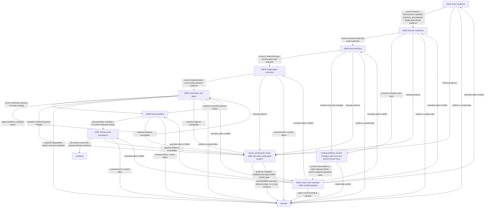

# Coding Workflow — Single-Agent Mode

[English](coding-single-agent.md) | [简体中文](coding-single-agent_zh_cn.md)

This route composes the seven Layer-04 modules for a task whose released Mode is Single-Agent Coding. It sequences module entry, preserves caller position across prerequisites, and routes changed state back to the affected module.

## Workflow map

## Ordered route checklist

Before entering SM01, inspect evidence that the Coding workflow completed Contract, Environment, capability inventory, Mode, and Route Entry. Do not repeat those gates. The route is valid only for released Single-Agent Coding and stays in the current Session. At each step, call only its linked module; preserve the exact module checkpoint and completed effects when a prerequisite suspends work. Resume at the returned position. Never replay earlier effects or restart the route because a prerequisite was missing.

1. **SM01 — Entry readiness.** Call [Entry Readiness](modules/entry-readiness.md) with the current Contract, Environment, capability inventory, released Single-Agent Mode, and authorized route evidence. Continue only when all entry evidence is current and consistent. Return missing prerequisites to their semantic owner and retain SM01; block conflicts or unsafe state.
2. **SM02 — Session readiness.** Call [Session Readiness](modules/session-readiness.md) to confirm canonical authority/state and readback before consuming audit results. Continue only with current Session and audit evidence. If recovery changes facts, use the module's recheck/readback sequence without reopening Mode or repeating completed prompts; preserve its suspended position on `needs_prerequisite`, and block unresolved authority or readback failures.
3. **SM03 — Work definition.** Call [Work Definition](modules/work-definition.md) to resolve current Context, Decision, planning output, and bounded authorized work. Continue only with current sourced facts, accepted decisions, and the unreleased boundary. Resolve missing facts/decisions at their owner and resume SM03; material authorization or Contract changes return to the caller for route review.
4. **SM04 — Single-Agent execution.** Call [Single-Agent Execution](modules/single-execution.md) with SM01–SM03 evidence and continuation/effect state. Continue only with a current implementation result and provisional evidence. This module owns executor/output resolution, Slice release, implementation, stage feedback, and Control. It cannot create or dispatch a child. Preserve its Control continuation and resume position for any evidence request, amendment, or next Slice.
5. **SM05 — Verification and repair.** Call [Verification and Repair](modules/verification-repair.md) against the exact current fingerprint and acceptance conditions. Complete required independent verification only when the Contract requires it and current independence evidence confirms availability. Same-Session logical checks cannot substitute. Suspend dependent effects while required verifier evidence is pending; if no authorized independent verifier can be obtained, block those effects. Continue only when all required checks pass on current epochs and no repair remains. A repair returns through the module's handoff to current Verification; a semantic Contract/Decision change returns to the caller. Do not accept stale evidence after changed implementation, documentation, or Git metadata dimensions.
6. **SM06 — Documentation.** Call [Documentation](modules/documentation.md) with current Verification, Contract, and before fingerprints. The module determines applicable output, requires its authorization/source/path, handles requested Memory with readback, classifies impact, and runs checks. Continue only with its current documentation result. If a changed content/Contract/acceptance dimension requires re-verification, return to SM05; after the affected epoch passes, resume the suspended SM06 substep and finish its current impact classification and checks before entering SM07.
7. **SM07 — Delivery and acceptance.** Call [Delivery and Acceptance](modules/delivery-acceptance.md) with current Contract criteria, verification evidence, epochs, and any exact authorized Git intent. Continue only when every applicable criterion maps to current passing evidence and requested delivery is resolved. The module may archive only a matching completed active plan after Acceptance evidence passes and readback confirms it. Missing criteria/evidence return to the semantic owner and recorded position; failure, conflict, or unauthorized effects block.

## Prerequisite return map

Resolve only the missing item at its producer/recheck location. Keep the original caller module/substep and its completed effects as a continuation stack entry; if resolving the prerequisite itself suspends, preserve that producer continuation too. After producer completion, read back its evidence and recheck relevant epochs/effects, then resume only the original caller position, not the producer position or the next route module. Do not replay effects, reopen released Mode, or repeat a completed prompt. Contract/Environment/Mode evidence gaps are read-only completion at the existing owner; re-enter Route Entry only when material route facts change, then return to the original caller while retaining the locked Mode. Unknown producer/position/effects or a loop with no new evidence blocks dependent work.

| Missing prerequisite | Producer/recheck location | Resume after readback |
| --- | --- |
| Contract or acceptance scope | Coding workflow Contract checkpoint; fill missing evidence only. | Original suspended module/substep, such as SM07; do not start at SM01. |
| Environment/capability inventory | Environment and capability-inventory owners; read/complete missing inventory only. | Original suspended module/substep; Route Entry only if a material route fact changed. |
| Route Entry evidence or material route fact | Route Entry owner, only for changed route facts; do not repeat a locked Mode choice. | Original suspended module/substep if the route remains valid; otherwise block the invalid route. |
| Released Mode evidence missing or inconsistent | Existing Mode owner and locked record readback; do not ask again for a released choice. | Original suspended module/substep when Single-Agent evidence is current; conflict blocks. |
| Session state, authority, or audit | SM02's SR02/SR03 and the specific Session/state/audit owner returned by it. | Original suspended module/substep after Session evidence is read back; SM02 itself resumes its producer substep if that is the suspended caller. |
| Context, Decision, planning output, or advice | SM03's WD01–WD03 and the specific Context/Decision/planning/advice owner. | Original suspended module/substep after evidence is current; a caller at SM07 returns to SM07, not SM03. |
| Executor/output, Slice, feedback, or Control | SM04's SE01–SE05 and the responsible owner. | Original suspended module/substep; a caller at SM07 returns to SM07, not SM04. |
| Verification, repair diagnosis, or handoff | SM05's VR01–VR05 and the responsible owner. | Original suspended module/substep after current evidence/handoff; SM06 returns to its suspended DOC substep after verification. |
| Documentation impact, Memory readback, or required checks | SM06's DOC01–DOC06 and the specific Documentation/Memory/check owner. | Original suspended module/substep, including DOC after a verification return. |
| Git target/effect or Acceptance criteria/archive | SM07's DA02–DA05 and the Git/Acceptance/plan owner. | Original suspended DA substep after the producer evidence is read back. |

## Mode boundary

All phases remain within the current Session; never create another Session. Treat Input-side Reasoning, Primary Output, and verification as logical phases. Claim independent verification only when the applicable Verification owner confirms the requirement through current evidence; if required independence is unavailable, block dependent effects.

## Related concepts

- [Entry Readiness](modules/entry-readiness.md)
- [Single-Agent Execution](modules/single-execution.md)
- [Verification and Repair](modules/verification-repair.md)
