# Coding Workflow — Single-Agent Mode

[English](coding-single-agent.md) | [简体中文](coding-single-agent_zh_cn.md)

This route is selected by the Coding workflow and is valid only after the Mode checkpoint releases Single-Agent Coding. Before execution, the checkpoint composes the [delegation state record](../layer-01-fundamental-concepts/delegation/delegation-state-record.md), [mode confirmation](../layer-01-fundamental-concepts/delegation/delegation-mode-confirmation.md), [mode/count gate](../layer-01-fundamental-concepts/delegation/delegation-mode-count-gate.md), and [mode re-entry](../layer-01-fundamental-concepts/delegation/delegation-mode-reentry.md) references.

## Workflow map

```mermaid
flowchart TD
    S01["01 Contract"]
    S02["02 Environment / Enhanced selection"]
    D_ENHANCED{"Optional Enhanced operation needed?"}
    D_ENHANCED_HOST{"Trusted identity and required operation guards verified?"}
    ACT_NATIVE["Native candidate; verify prior Enhanced authority before use"]
    S03["03 Mode"]
    S04["04 Session / state and audit resolution"]
    D_ROOT_STORE{"Enhanced Root store selected and its identity, guards, and schema are valid?"}
    ACT_ROOT_OPEN["Open or resume Root store after Session boundary; retain audit as pending until Root records its actual resolution"]
    D_AUTHORITY_TRANSFER{"Does a previously canonical Enhanced record require transfer back to Native?"}
    ACT_NATIVE_TRANSFER["Freeze Enhanced writers; settle in-flight operations; write and read back the complete canonical record"]
    D_NATIVE_RECON{"Is Native currently canonical, or is a Root comparison unresolved?"}
    ACT_NATIVE_RECON["Review the full set; confirm an exact comparison or resolve supported differences"]
    ACT_RECOVERY_RECHECK["Within S04, recheck S01 Contract, S05 current Context, and S06 Decision; re-establish state without reopening Mode or repeating a completed prompt"]
    ACT_STATE_READBACK["Confirm the current canonical Session state and read it back before audit resolution"]
    D_AUDIT_CONFIG{"Reuse valid explicit/completed settings, resume pending prompt, or ask if unasked?"}
    ACT_AUDIT_PROMPT["Ask fixed audit question only if unasked; record actual prompt and deadline"]
    D_AUDIT_REPLY{"Valid reply, invalid/ambiguous reply, verified timeout, or unavailable?"}
    ACT_AUDIT_REPLY["Record valid reply; update only selected Root fields"]
    ACT_AUDIT_CLARIFY["Clarify only invalid/ambiguous fields; retain pending prompt"]
    D_AUDIT_CORRECTION{"Valid correction, still invalid/ambiguous, or explicit default?"}
    ACT_AUDIT_DEFAULT["Record explicit Root balanced/milestone_only; preserve Worker value and timeout history"]
    ACT_AUDIT_WAIT["Wait before deadline; preserve pending state"]
    ACT_AUDIT_TIMEOUT["No reply and actual elapsed time >=60s; default Root balanced/milestone_only; preserve Worker or fill full"]
    ACT_AUDIT_CONFIRM["Confirm the selected canonical Root audit record and read it back before leaving Session"]
    S05["05 Context / source and decision context"]
    S06["06 Decision / plan output and advice"]
    S07["07 Implementation / language-server code structure"]
    S08["08 Stage Feedback"]
    S09["09 Control / advisory selection"]
    S10["10 Verification / advisory selection"]
    S11["11 Repair / disposition and reverify"]
    D_REPAIR{"Repair outcome: narrow repair, material Contract change, material Decision change, or blocked evidence?"}
    S12["12 Documentation / impact and reverify"]
    S13["13 Git"]
    S14["14 Acceptance"]
    D_PLAN{"User goal requests planning, exploration, or producing/updating a plan?"}
    ACT_PLAN["Persist and read-verify plan Memory"]
    D_PLAN_SAVED{"Plan Memory saved and read-verified?"}
    D_ARCHIVE{"Active plan Memory for this task exists?"}
    ACT_ARCHIVE["Move plan to archive and read-verify"]
    D_ARCHIVED{"Archived plan verified?"}
    D_PLAN_MATCH{"Relevant active plan exists?"}
    ACT_PLAN_SCAN["List active plans/"]
    ACT_PLAN_READ["Read and check matching plan"]
    D_RULE_ACCESS{"Select bounded current rule lookup?"}
    ACT_RULE_CONTEXT["Read selected current node and mapped owner heading"]
    ACT_RULE_DIRECT["Confirm direct owner text and required references"]
    ACT_INITIAL_CLASSIFY["Use direct owners for intent/output classification; advice N/A before authorized Root"]
    D_DECISION_ADVICE{"Use optional advice for a current Decision question?"}
    ACT_DECISION_ADVICE["Review typed advice only as input; stale/failure falls back"]
    ACT_DECISION_DIRECT["Confirm direct owner and current facts before planning/release"]
    D_CONTROL_ADVICE{"Use optional Control advice?"}
    ACT_CONTROL_ADVICE["Review advice only as input; stale/failure falls back"]
    ACT_CONTROL_DIRECT["Confirm current evidence and choose explicit trusted outcome"]
    D_EPOCH_ADVICE{"Use optional coverage-dimension advice?"}
    ACT_EPOCH_ADVICE["Review coverage suggestion only; stale/failure falls back"]
    ACT_EPOCH_DIRECT["Confirm current fingerprints and run required verification"]
    D_RECON{"More facts required?"}
    ACT_RECON["Current Session: bounded reconnaissance"]
    D_CONTEXT_GEN{"Does an unresolved downstream decision need reviewed context?"}
    ACT_CONTEXT_GEN["Generate bounded context from provenance-labeled facts; Root reviews fidelity, relevance, and exact input hash"]
    ACT_CONTEXT_DIRECT["Use verified facts and direct owners; skip settled advice or review generation failure"]
    D_TASK_ASSIGN{"Is executor direction consistent with locked Single-Agent mode?"}
    ACT_EXECUTOR_ROOT["Root is the local deterministic executor; no executor advice"]
    ACT_EXECUTOR_CONFLICT["Explicit sub_agent conflicts with Single-Agent mode; return for review, no silent Root fallback"]
    D_OUTPUT_EXPLICIT{"Did explicit user instruction settle Root/output routing?"}
    ACT_OUTPUT_ADVICE["Assess each direct Root output independently under Output Token Routing"]
    D_OUTPUT_RESULT{"Output-size assessment?"}
    ACT_OUTPUT_NO["No: Root may proceed subject to other gates"]
    ACT_OUTPUT_HOLD["Yes: hold and report Single-Agent topology boundary; do not invent a child or task-reframing route"]
    ACT_OUTPUT_DIRECT["On insufficient evidence or advice failure, review verified facts under the owner; never default Root"]
    D_CONTROL{"Control: Continue / Amend / Stop"}
    D_RECOVERY_GATE{"Before the next slice, is post-floor Control Continue current for the Control rule and relevant Epochs?"}
    D_VERIFY{"Current epoch passed?"}
    D_DOC{"Documentation changed content or Contract?"}
    D_GIT{"Git authorized and verified?"}
    BLOCK["Blocked: report missing boundary"]
    DONE["Acceptance complete"]
S01 --> ACT_INITIAL_CLASSIFY
    ACT_INITIAL_CLASSIFY -- direct sources confirmed / advice N/A before Root --> S02
    ACT_INITIAL_CLASSIFY -- required source unavailable --> BLOCK
    S02 --> D_ENHANCED
    D_ENHANCED -- no / Native default / N/A --> S03
    D_ENHANCED -- yes / Enhanced needed --> D_ENHANCED_HOST
    D_ENHANCED_HOST -- verified --> S03
    D_ENHANCED_HOST -- Native candidate; verify prior Enhanced authority before use --> ACT_NATIVE
    ACT_NATIVE --> S03
    D_ENHANCED_HOST -- required capability missing or unknown --> BLOCK
    S03 --> S04
    S04 --> D_ROOT_STORE
    D_ROOT_STORE -- Enhanced selected; current identity and schema verified --> D_NATIVE_RECON
    D_ROOT_STORE -- Native / Enhanced not selected / check existing authority --> D_AUTHORITY_TRANSFER
    D_ROOT_STORE -- required identity, guard, or schema unavailable --> BLOCK
    ACT_ROOT_OPEN -- open or validation failed --> BLOCK
    ACT_ROOT_OPEN -- open or resume Root store --> ACT_STATE_READBACK
    D_AUTHORITY_TRANSFER -- no prior Enhanced authority / N/A --> ACT_STATE_READBACK
    D_AUTHORITY_TRANSFER -- prior Enhanced authority; transfer authorized and verified --> ACT_NATIVE_TRANSFER
    D_AUTHORITY_TRANSFER -- history, freeze, or readback unknown / failed --> BLOCK
    ACT_NATIVE_TRANSFER -- complete record frozen, copied, and read back --> ACT_STATE_READBACK
    ACT_NATIVE_TRANSFER -- incomplete or indeterminate --> BLOCK
    D_NATIVE_RECON -- no Native history / N/A --> ACT_ROOT_OPEN
    D_NATIVE_RECON -- prior resolution current; no unresolved comparisons --> ACT_STATE_READBACK
    D_NATIVE_RECON -- unresolved Native history or comparison --> ACT_NATIVE_RECON
    ACT_NATIVE_RECON -- exact comparison confirmed --> ACT_STATE_READBACK
    ACT_NATIVE_RECON -- material resolution committed; recheck Contract --> ACT_RECOVERY_RECHECK
    ACT_NATIVE_RECON -- unsupported difference or incomplete review --> BLOCK
    ACT_RECOVERY_RECHECK -- Within S04, recheck S01 Contract, S05 current Context, and S06 Decision; re-establish canonical state --> ACT_STATE_READBACK
    ACT_STATE_READBACK -- current canonical state confirmed and read back --> D_AUDIT_CONFIG
    ACT_STATE_READBACK -- required state or readback unavailable / failed --> BLOCK
    D_AUDIT_CONFIG -- yes / migration reuse --> ACT_AUDIT_CONFIRM
    D_AUDIT_CONFIG -- unasked / first eligible question only --> ACT_AUDIT_PROMPT
    D_AUDIT_CONFIG -- pending / no reply observed; resume original deadline --> D_AUDIT_REPLY
    D_AUDIT_CONFIG -- pending / invalid reply already observed --> D_AUDIT_CORRECTION
    D_AUDIT_CONFIG -- invalid config / focused clarification --> ACT_AUDIT_CLARIFY
    D_AUDIT_CONFIG -- unavailable / unresolved schema conflict --> BLOCK
    ACT_AUDIT_PROMPT --> D_AUDIT_REPLY
    D_AUDIT_REPLY -- valid actual reply --> ACT_AUDIT_REPLY
    ACT_AUDIT_REPLY --> ACT_AUDIT_CONFIRM
    D_AUDIT_REPLY -- invalid / ambiguous reply --> ACT_AUDIT_CLARIFY
    ACT_AUDIT_CLARIFY -- same prompt / original deadline --> D_AUDIT_CORRECTION
    D_AUDIT_CORRECTION -- valid correction --> ACT_AUDIT_REPLY
    D_AUDIT_CORRECTION -- still invalid / ambiguous --> ACT_AUDIT_CLARIFY
    D_AUDIT_CORRECTION -- explicit default choice --> ACT_AUDIT_DEFAULT
    ACT_AUDIT_DEFAULT --> ACT_AUDIT_CONFIRM
    D_AUDIT_REPLY -- pending / before deadline --> ACT_AUDIT_WAIT
    ACT_AUDIT_WAIT -- check reply / retain deadline --> D_AUDIT_REPLY
    D_AUDIT_REPLY -- no reply / actual elapsed >=60s --> ACT_AUDIT_TIMEOUT
    ACT_AUDIT_TIMEOUT --> ACT_AUDIT_CONFIRM
    ACT_AUDIT_CONFIRM -- canonical Root audit record confirmed and read back --> S05
    ACT_AUDIT_CONFIRM -- canonical record missing or not confirmed --> BLOCK
    D_AUDIT_REPLY -- prompt or timing unavailable --> BLOCK
    S05 --> D_RULE_ACCESS
    D_RULE_ACCESS -- yes / bounded lookup selected --> ACT_RULE_CONTEXT
    D_RULE_ACCESS -- no / direct source / N/A --> ACT_RULE_DIRECT
    ACT_RULE_CONTEXT -- loaded or unavailable / direct fallback --> ACT_RULE_DIRECT
    ACT_RULE_DIRECT -- current owner and required references confirmed --> ACT_PLAN_SCAN
    ACT_RULE_DIRECT -- required owner unavailable --> BLOCK
    ACT_PLAN_SCAN --> D_PLAN_MATCH
    ACT_PLAN_SCAN -- failed / unavailable --> BLOCK
    D_PLAN_MATCH -- yes --> ACT_PLAN_READ
    D_PLAN_MATCH -- no / N/A --> D_RECON
    ACT_PLAN_READ --> D_RECON
    ACT_PLAN_READ -- failed / unavailable --> BLOCK
    D_RECON -- yes --> ACT_RECON
    ACT_RECON --> S05
    D_RECON -- no / N/A --> D_CONTEXT_GEN
    D_CONTEXT_GEN -- unresolved downstream decision needs background --> ACT_CONTEXT_GEN
    D_CONTEXT_GEN -- explicit direction settles choices / no downstream advice: N/A --> ACT_CONTEXT_DIRECT
    ACT_CONTEXT_GEN -- reviewed context and exact input hash are current --> S06
    ACT_CONTEXT_GEN -- failed / insufficient facts; direct review only --> ACT_CONTEXT_DIRECT
    ACT_CONTEXT_DIRECT -- verified facts suffice / explicit instruction honored --> S06
    ACT_CONTEXT_DIRECT -- essential facts unavailable or conflicting --> BLOCK
    S06 --> D_DECISION_ADVICE
    D_DECISION_ADVICE -- yes / explicitly enabled and relevant --> ACT_DECISION_ADVICE
    D_DECISION_ADVICE -- no / Native / disabled / unavailable / N/A --> ACT_DECISION_DIRECT
    ACT_DECISION_ADVICE -- current advice or failure / direct review --> ACT_DECISION_DIRECT
    ACT_DECISION_DIRECT -- owner and facts confirmed --> D_PLAN
    ACT_DECISION_DIRECT -- required owner or evidence unavailable --> BLOCK
    D_PLAN -- yes --> ACT_PLAN
    D_PLAN -- no / N/A --> D_RECOVERY_GATE
    ACT_PLAN --> D_PLAN_SAVED
    D_PLAN_SAVED -- yes --> D_RECOVERY_GATE
    D_PLAN_SAVED -- no / unavailable --> BLOCK
    D_RECOVERY_GATE -- no recovery floor / N/A or post-floor Continue is current for Control rule and relevant Epochs --> D_TASK_ASSIGN
    D_RECOVERY_GATE -- fresh or current Continue required --> D_CONTROL_ADVICE
    D_TASK_ASSIGN -- explicit Root or no conflicting executor direction; local deterministic route --> ACT_EXECUTOR_ROOT
    D_TASK_ASSIGN -- explicit sub_agent conflicts with locked Single; return for review --> ACT_EXECUTOR_CONFLICT
    ACT_EXECUTOR_CONFLICT -- unresolved conflict; block without silent Root fallback --> BLOCK
    ACT_EXECUTOR_ROOT --> D_OUTPUT_EXPLICIT
    D_OUTPUT_EXPLICIT -- explicit Root/output direction; skip matching advice --> S07
    D_OUTPUT_EXPLICIT -- route unsettled; assess output independently --> ACT_OUTPUT_ADVICE
    ACT_OUTPUT_ADVICE -- assessment result --> D_OUTPUT_RESULT
    ACT_OUTPUT_ADVICE -- unavailable or failed; direct owner review only --> ACT_OUTPUT_DIRECT
    D_OUTPUT_RESULT -- no / verified current facts --> ACT_OUTPUT_NO
    D_OUTPUT_RESULT -- yes / unresolved route; Single-Agent topology boundary --> ACT_OUTPUT_HOLD
    D_OUTPUT_RESULT -- insufficient evidence / conflicting facts --> ACT_OUTPUT_DIRECT
    ACT_OUTPUT_DIRECT -- verified facts establish no --> ACT_OUTPUT_NO
    ACT_OUTPUT_DIRECT -- verified facts establish yes --> ACT_OUTPUT_HOLD
    ACT_OUTPUT_DIRECT -- facts missing, conflicting, or still unresolved --> BLOCK
    ACT_OUTPUT_NO --> S07
    ACT_OUTPUT_HOLD -- hold and report topology boundary; stop before output --> BLOCK
    S07 --> S08
    S08 --> S09
    S09 --> D_CONTROL_ADVICE
    D_CONTROL_ADVICE -- yes / explicitly enabled --> ACT_CONTROL_ADVICE
    D_CONTROL_ADVICE -- no / Native / disabled / unavailable / N/A --> ACT_CONTROL_DIRECT
    ACT_CONTROL_ADVICE -- current advice or failure / direct review --> ACT_CONTROL_DIRECT
    ACT_CONTROL_DIRECT -- explicit trusted outcome selected --> D_CONTROL
    ACT_CONTROL_DIRECT -- required owner or essential evidence unobtainable --> BLOCK
    D_CONTROL -- Continue / Evidence-on-Demand (retrievable evidence pause) --> S05
    D_CONTROL -- amend --> S06
    D_CONTROL -- done / normal post-implementation only; no recovery Slice pending --> S10
    D_CONTROL -- stop --> BLOCK
    S10 --> D_EPOCH_ADVICE
    D_EPOCH_ADVICE -- yes / explicitly enabled --> ACT_EPOCH_ADVICE
    D_EPOCH_ADVICE -- no / Native / disabled / unavailable / N/A --> ACT_EPOCH_DIRECT
    ACT_EPOCH_ADVICE -- coverage hint or failure / direct verification --> ACT_EPOCH_DIRECT
    ACT_EPOCH_DIRECT -- current evidence confirmed --> D_VERIFY
    ACT_EPOCH_DIRECT -- required evidence unavailable --> BLOCK
    D_VERIFY -- repairable --> S11
    D_VERIFY -- passed --> S12
    D_VERIFY -- required evidence unavailable --> BLOCK
    S11 --> D_REPAIR
    D_REPAIR -- narrow repair complete with handoff and new fingerprint, or evidence-backed no-failure N/A --> S10
    D_REPAIR -- material Contract change; renew Contract --> S01
    D_REPAIR -- material Decision change within Contract; renew Decision --> S06
    D_REPAIR -- required diagnosis, authorization, scope, or handoff unavailable --> BLOCK
    S12 --> D_DOC
    D_DOC -- content change --> S10
    D_DOC -- Contract change --> S06
    D_DOC -- no change / N/A --> S13
    S13 --> D_GIT
    D_GIT -- authorized / N/A --> S14
    D_GIT -- no permission --> BLOCK
    S14 --> D_ARCHIVE
    D_ARCHIVE -- yes --> ACT_ARCHIVE
    D_ARCHIVE -- no / N/A --> DONE
    ACT_ARCHIVE --> D_ARCHIVED
    D_ARCHIVED -- yes --> DONE
    D_ARCHIVED -- no / failed / unavailable --> BLOCK
```

Numbered nodes match the sole ordered checklist below. Record the `Not applicable` reason for a skipped conditional concept. The map selects and orders concepts; the checklist and same-language owner links provide concrete actions, evidence, and failure handling.

## Mode contract

- Keep all work in the current Session; do not create another Agent/Session or claim an independent verifier on this route.
- Mode/count/state policy belongs to the Mode checkpoint and owners consumed at stage 3; this section states only the route boundary.
- Treat Input-side Reasoning, Primary Output, documentation, and checks as logical phases within one Session.
- User prohibitions remain active. A conflict with locked mode blocks and is reported; do not silently change mode.

## Composed inputs

Read each owner at its numbered consuming step. The checklist below supplies same-language links, actions, evidence, and failure boundaries there; this section is not a preload catalog.

## Responsibility boundary in the current Session

Use the role ownership defined in [session role ownership](../layer-01-fundamental-concepts/session-runtime/session-role-ownership.md); this route runs those roles as logical phases in one Session and cannot provide an independent verifier.

## Route-specific environment requirements

Use the inventory and shared runtime rules from the [Environment capability inventory](../layer-02-workflow-concepts/entry-and-context/environment-capability-inventory.md). This route keeps all phases in the current Session; it does not create independent Sessions or Worker return paths. If a required capability is unavailable, stop the slice and report it.

## Ordered route checklist

L3 checkpoint owners define semantic outcomes; this checklist maps each result to its numbered route stage and next action. Run every numbered stage in order in the current Session. For every linked owner, check its applicable actions and pass condition, record the result and evidence, and stop when a required result is missing. Record `Not applicable` with a reason for each conditional action; a link or an earlier summary is not proof that its check was completed. The Coding selector completed stages 1–3 before route entry: inspect their released evidence without repeating the gates.

1. **Contract and common protocol.** Confirm the [Contract checkpoint](../layer-02-workflow-concepts/entry-and-context/contract.md) has an explicit goal, hard user/runtime/repository/permission/safety limits in `ACTIVE_CONSTRAINTS`, authorized effects, settled decisions, open questions, and acceptance conditions. Apply the [shared protocols](../../share/shared-protocols.md): keep one current Semantic Contract, separate observed facts from assumptions, carry later changes as bounded amendments with a stable prefix and small delta, and stop the dependent slice if required context is missing. Do not turn an unresolved question into implementation authority. Before using an advisory, establish task intent and eligible output classification from their direct owners; record advisory use as `Not applicable` until Mode, Session, and authorized Root context pass.
2. **Environment and capabilities.** At [Environment](../layer-02-workflow-concepts/entry-and-context/environment.md) and [capability inventory](../layer-02-workflow-concepts/entry-and-context/environment-capability-inventory.md), confirm one runtime and record the actual capabilities needed by this task. Call [Enhanced Path Selection](../layer-03-workflow-checkpoints/enhanced-path-selection.md) to record the path decision. If no Enhanced operation is required, record Native/`Not applicable` with the reason without initializing Enhanced state. Otherwise use [Enhanced Workflow Availability](../layer-01-fundamental-concepts/enhanced-native-state/enhanced-workflow-availability.md) and [Enhanced Host Binding](../layer-01-fundamental-concepts/enhanced-native-state/enhanced-host-binding.md) to verify eligibility, trusted identity, and required guards, and retain the evidence. Unknown required capabilities or missing evidence block the dependent branch.
3. **Mode and task record.** Confirm the [Mode checkpoint](../layer-02-workflow-concepts/entry-and-context/mode.md) released exactly `Single-Agent Coding`. Check [mode confirmation](../layer-01-fundamental-concepts/delegation/delegation-mode-confirmation.md), [count gate](../layer-01-fundamental-concepts/delegation/delegation-mode-count-gate.md), and [state record](../layer-01-fundamental-concepts/delegation/delegation-state-record.md): `gate_status: released`, `child_count: 0`, `allocations: []`, and no unresolved capability block. Keep the conversation mode/count fixed under [mode re-entry](../layer-01-fundamental-concepts/delegation/delegation-mode-reentry.md); a conflicting later directive blocks dependent work until a new conversation. Never create, fork, message, hand off to, or simulate an additional Agent or Session on this route. Do not request semantic advice before Session has passed and authorized Root state exists; follow these existing owners, and do not let advice override locked Mode/count.
   - Confirm [Route Entry](../layer-03-workflow-checkpoints/route-entry.md) returned this route from released Mode evidence. A mismatch, missing result, or unresolved prerequisite blocks execution and returns to the Coding entry.
4. **Session and role boundaries.** Call [Session State Resolution](../layer-03-workflow-checkpoints/session-state-resolution.md) to establish canonical authority, complete triggered reconciliation/transfer checks, and guardedly open or resume Root; map the result to S04. All successful paths consume only verified identity, current canonical record, and readback before audit. Record Not applicable only when a conditional trigger is absent, with the observed reason. For material recovery, recheck Contract, current Context, and Decision (S01/S05/S06) within S04, then re-establish and read back canonical state; do not bypass S04, advance early to Context/Decision, or reopen Mode. Missing authority, guards, state, or readback blocks. Then call [Session Audit Resolution](../layer-03-workflow-checkpoints/session-audit-resolution.md) once to resolve audit settings and confirm canonical readback; unavailable prompt, timing, guards, or readback blocks. Apply [Reasoning Summary Visibility](../layer-01-fundamental-concepts/session-runtime/reasoning-summary-visibility.md) at required boundaries and use [Session Context Firewall](../layer-01-fundamental-concepts/session-runtime/session-context-firewall.md) to bound raw-state ingress. Keep semantic decisions and final acceptance with the input-side phase. Confirm boundaries with [Session Model](../layer-01-fundamental-concepts/session-runtime/session-model.md), [Session Role Ownership](../layer-01-fundamental-concepts/session-runtime/session-role-ownership.md), and [Delegation State Record](../layer-01-fundamental-concepts/delegation/delegation-state-record.md). For Enhanced state, check [Enhanced State Store](../layer-01-fundamental-concepts/enhanced-native-state/enhanced-state-store.md) and [Enhanced Schema Migrations](../layer-01-fundamental-concepts/enhanced-native-state/enhanced-schema-migrations.md); evaluate [Native Reconciliation](../layer-01-fundamental-concepts/enhanced-native-state/native-reconciliation.md) and [Native Authority Transfer](../layer-01-fundamental-concepts/enhanced-native-state/native-authority-transfer.md) only on trigger, returning current authority/readback evidence or `Not applicable`. Use [Session Audit Visibility](../layer-01-fundamental-concepts/session-runtime/session-audit-visibility.md) for audit-field semantics; missing guards/readback blocks.
5. **Context.** At [Context](../layer-02-workflow-concepts/entry-and-context/context.md), name the smallest question for the next slice and call [Context Source Selection](../layer-03-workflow-checkpoints/context-source-selection.md) for active plans, reusable Memory, and optional bounded rule lookup. Map its result to S05: retain sourced current facts with source pointers and freshness, record `Not applicable` with the reason when a conditional source is unnecessary, or block when essential context is unavailable. Call [Decision Context Selection](../layer-03-workflow-checkpoints/decision-context-selection.md) when downstream advice needs reviewed background; load [Decision Context Generation](../layer-01-fundamental-concepts/execution-planning/decision-context-generation.md) for generated-context inputs, review/hash evidence, or `Not applicable`. Do not send stale or unverified context. Material Native recovery returns here to refresh affected facts. If no reconnaissance/recovery is needed, record why. At this step, [Session Context Firewall](../layer-01-fundamental-concepts/session-runtime/session-context-firewall.md) bounds ingress; [LSP MCP Tools](../layer-01-fundamental-concepts/session-runtime/LSP-MCP-Tools.md) and [Enhanced Rule Context](../layer-01-fundamental-concepts/enhanced-native-state/enhanced-rule-context.md) apply only to their triggers. Return sourced/fresh facts or block essential gaps. Link [Decisions Advisory](../layer-01-fundamental-concepts/execution-planning/decisions-advisory.md) in this step to distinguish its independent five-node advice gate; without authorization, record `Not applicable` and do not enable it. Worker memo and cross-Worker conditions are `Not applicable` in Single-Agent mode because this route has no Workers; record that reason and do not load or operate child-specific owners.
6. **Decision and two-level plan.** Map the L3 decision result to S06; retain the Contract-consistent decision, authorized scope, and unreleased boundary. After material Native recovery, re-evaluate the current Decision and Contract before authorizing a next Slice; do not reopen locked Mode or repeat a completed audit question. At [Decision](../layer-02-workflow-concepts/decision-and-execution/decision.md), state the material question, facts, constraints, options, chosen direction, rejected alternatives, authorized paths/mutations, and unreleased boundary. Apply the [decision gate](../layer-01-fundamental-concepts/execution-planning/execution-decision-gate.md): prepare a concise Decision Brief with Problem, Known facts, Assumptions and unknowns, Decision questions, Solution envelope, Risks, Acceptance, and Stages/checkpoints unless the task qualifies for its simple fast path; release only reconnaissance while a material choice is open. Use [execution planning](../layer-01-fundamental-concepts/execution-planning/execution-planning.md) to order bounded inspection, implementation, and focused checks with expected evidence. Confirm the Contract permits the chosen direction before releasing one slice. Use [Task Assignment](../layer-01-fundamental-concepts/execution-planning/task-assignment.md), [Output Token Routing](../layer-01-fundamental-concepts/execution-planning/output-token-routing.md), [Planning Intent Plan Memory Lifecycle](../layer-01-fundamental-concepts/execution-planning/planning-intent-plan-memory-lifecycle.md), and [Decisions Advisory](../layer-01-fundamental-concepts/execution-planning/decisions-advisory.md) here. Confirm executor/candidate evidence, disposition each direct Root output, verify plan persistence/readback evidence or `Not applicable`, and record advisory eligibility/use or `Not applicable`; missing or stale required evidence blocks release.
   - **Executor and output route.** Call [Executor Selection](../layer-03-workflow-checkpoints/executor-selection.md) and [Output Route Selection](../layer-03-workflow-checkpoints/output-route-selection.md) independently. Apply their Single-Agent disposition: explicit `sub_agent` conflicts with locked mode and blocks for review; output `yes` holds and reports the topology boundary. Record evidence or `Not applicable`; neither decision releases a Slice.
   - **Applicable workflow decision:** [Planning output selection](../layer-03-workflow-checkpoints/planning-output-selection.md) returns plan/readback evidence, evidence-based `Not applicable`, or a block. [Advisory selection](../layer-03-workflow-checkpoints/advisory-selection.md) returns stage advice review or `Not applicable`; advice does not authorize work.
7. **Interaction Slice and implementation.** Before the next implementation tranche, apply the conditional gate in [Native Reconciliation](../layer-01-fundamental-concepts/enhanced-native-state/native-reconciliation.md): if a recovery floor exists, require a post-floor `Continue` current for the Control rule and relevant Epochs. If missing or stale, return through the existing Control branch; after `Amend`, recheck current Context and Decision before Control. `Stop` blocks. With no recovery floor, record this gate as `Not applicable` and why. For Enhanced state, persist authorized implementation progress only through typed Root operations with expected Revision and idempotency key; verify returned state before continuing. Apply [Enhanced State Store](../layer-01-fundamental-concepts/enhanced-native-state/enhanced-state-store.md) and [Enhanced Schema Migrations](../layer-01-fundamental-concepts/enhanced-native-state/enhanced-schema-migrations.md); incompatible schema blocks dependent writes. Native mode updates the canonical parent-context record under its owner. Use [execution control](../layer-01-fundamental-concepts/execution-control/execution-control.md) to state `Objective`, `Authorized scope/mutations`, `Return conditions`, and `Unreleased boundary`. At [Implementation](../layer-02-workflow-concepts/decision-and-execution/implementation.md), re-read that release and inspect only needed files. When understanding code structure is needed, apply [project-memory and code-structure capability](../layer-01-fundamental-concepts/session-runtime/LSP-MCP-Tools.md): use available language-server queries and retain exact symbol/path pointers as evidence. If the capability or required language semantics are unavailable, state the limitation and use targeted text search and small reads; do not claim LSP evidence, and block if the required relationship remains unverified. If code-structure queries are not needed, record `Not applicable` and why. Then make the smallest authorized change, exclude unrelated cleanup and external effects, run focused provisional checks, and return changed paths, evidence, issues, and the still-unreleased boundary. Provisional checks are not final acceptance.
8. **Stage feedback.** Apply [execution stage feedback](../layer-01-fundamental-concepts/execution-control/execution-stage-feedback.md) when uncertainty requires bounded evidence-producing stages. At material observations, retain only compressed status, findings, changed scope, verification, issue, and need; keep routine reads, edits, and repeated checks inside the approved stage. Send a new material choice back to stage 6 before more implementation.
9. **Control boundary.** At [Control](../layer-02-workflow-concepts/decision-and-execution/control.md), record required status/findings/change/verification/issue/need/boundary evidence; inspect material risk/scope/effect changes and choose Continue, Amend, Stop, or Evidence-on-Demand. Continue only within the envelope; amend Contract and Decision before crossing it. Return for another approved slice via stages 5–9. Evidence-on-Demand returns here for a final outcome. Call [Advisory selection](../layer-03-workflow-checkpoints/advisory-selection.md) for optional Control advice applicability/freshness; decide from current Control owner/evidence and persist only the selected outcome through the trusted transition. Apply [Decisions Advisory](../layer-01-fundamental-concepts/execution-planning/decisions-advisory.md). Retain Decisions Advisory eligibility/use disposition and current evidence, or `Not applicable` with reason; stale, failed, or unauthorized advice remains disabled.
10. **Final-state verification.** At [Verification](../layer-02-workflow-concepts/verification-and-repair/verification.md), capture final fingerprint and acceptance conditions, then run required holistic and targeted checks. Apply [Verification independence](../layer-02-workflow-concepts/verification-and-repair/verification-independence.md), [Verification reporting](../layer-02-workflow-concepts/verification-and-repair/verification-reporting.md), and [Verification epoch](../layer-02-workflow-concepts/verification-and-repair/verification-epoch.md) for current evidence, dimensions, and changed-epoch boundaries; same-Session checks are logical only. Call [Advisory selection](../layer-03-workflow-checkpoints/advisory-selection.md) for optional Verification/Epoch suggestion disposition; compare with current fingerprints and direct-owner requirements, then run required checks. Missing independence or evidence blocks dependent effects. Apply [Decisions Advisory](../layer-01-fundamental-concepts/execution-planning/decisions-advisory.md). Retain Decisions Advisory eligibility/use disposition and current evidence, or `Not applicable` with reason; stale, failed, or unauthorized advice remains disabled.
11. **Repair only after concrete failure.** Map the [Repair disposition](../layer-03-workflow-checkpoints/repair-disposition.md) result to S11 and D_REPAIR. Require concrete failure evidence, affected paths, and the smallest candidate before a narrow repair; no concrete failure is Not applicable only with its evidence basis. This evidence-backed no-failure result returns to S10 to confirm the current epoch. Follow [Repair](../layer-02-workflow-concepts/verification-and-repair/repair.md), [Repair Scope Gate](../layer-02-workflow-concepts/verification-and-repair/repair-scope-gate.md), [Repair Execution](../layer-02-workflow-concepts/verification-and-repair/repair-execution.md), and [Repair Verification Handoff](../layer-02-workflow-concepts/verification-and-repair/repair-verification-handoff.md). A completed authorized repair with handoff and new fingerprint returns to S10 for changed-epoch verification; material Contract change returns to S01, and material Decision change within Contract returns to S06 after confirming Contract remains valid. Missing diagnosis, authorization, scope, or handoff blocks.
12. **Documentation.** At [Documentation](../layer-02-workflow-concepts/completion-and-effects/documentation.md), retain parent ownership, approved paths, source evidence, and requested persistent-knowledge handling. Call [Documentation impact](../layer-03-workflow-checkpoints/documentation-impact.md) with before/after fingerprints, affected-dimension evidence, required checks, and evidence reuse; follow its Verification return or block on unknown impact. Synchronize maintained language mirrors, advance documentation epoch, and run applicable Markdown/link/scope checks. If content changes behavior, Contract, or acceptance, return to implementation/content Verification; otherwise retain valid evidence. Report unavailable checks. Only when approved output includes reusable Agent project knowledge or the user explicitly requests a cross-session note, use [LSP MCP Tools](../layer-01-fundamental-concepts/session-runtime/LSP-MCP-Tools.md) to save it under the existing name/subdirectory intent and confirm the persisted result; if required capability is unavailable or writing fails, block that requested output. Otherwise record `Not applicable`. Under [Verification Epoch](../layer-02-workflow-concepts/verification-and-repair/verification-epoch.md), confirm affected dimensions, advance changed epochs, and reuse evidence only for dimensions proven unchanged; stale or missing required evidence blocks acceptance.
13. **Git effects.** At [Git](../layer-02-workflow-concepts/completion-and-effects/git.md), confirm the exact repository, worktree, branch/ref, remote, operation, and authorization. Inspect status/history, preserve unrelated changes, and confirm staged/committed content matches the latest verified content and documentation fingerprints. Treat index/commit/branch/history changes as Git metadata changes; keep commit, push, Issue, PR, and other effects separately authorized. Stop on ambiguous target, conflict, missing permission, or unverified content. If no Git work applies, record why.
14. **Acceptance.** At [Acceptance](../layer-02-workflow-concepts/completion-and-effects/acceptance.md), map every Contract criterion to current evidence for the latest implementation/content, documentation, and Git metadata epochs. Check paths/effects against scope; report passed, failed, not-run, unavailable, assumed, and user-authorized items separately with residual risks. If this route has an active plan Memory confirmed to belong to the task being completed, apply [Planning Intent Plan Memory Lifecycle](../layer-01-fundamental-concepts/execution-planning/planning-intent-plan-memory-lifecycle.md) to archive it under the matching archive name and verify the active name is absent and archive is readable; block completion if required archive/verification fails. If no matching active plan belongs to the task being completed, record `Not applicable` and why. Report `COMPLETE` only when every required item and boundary is resolved; identify this route as Single-Agent and the checks as same-Session where applicable. Apply [Verification Epoch](../layer-02-workflow-concepts/verification-and-repair/verification-epoch.md) to confirm evidence remains current for accepted fingerprints and changed dimensions.

## Verification limitation

For a material change, the Contract or risk assessment may require an independent Change Verification Session. Single-Agent mode cannot create or claim an independent verifier Session, so independent verification is unavailable on this route. Run the strongest allowed checks in the current Session, report that the result is not independent verification, and do not release dependent external Git effects while the required boundary remains unresolved.

For trivial behavior-preserving or documentation-only work, use the applicable fast path and run: `rg` for stale paths/names referenced by the changed files; a Markdown/link review covering changed local targets; `git diff --check`; `python3 scripts/check-multilingual-docs.py`; and a manual check that each changed rule still agrees with the selected Contract and route. Record each command or review result and its pass condition.

## Completion

Apply the root Coding completion gate. The final report must identify the work as Single-Agent, distinguish provisional checks from final checks, state any unavailable independent verification, and map every acceptance criterion to current evidence.
## Related concepts

- [Shared protocols](../../share/shared-protocols.md) — locate common Session conventions.
- [Session role ownership](../layer-01-fundamental-concepts/session-runtime/session-role-ownership.md) — locate phase responsibilities.
