# Coding 工作流——单代理模式

[English](coding-single-agent.md) | [简体中文](coding-single-agent_zh_cn.md)

本路线由 Coding 工作流选择；只有模式检查点放行单代理 Coding 后才有效。执行前，该检查点组合[委派状态记录](../layer-01-fundamental-concepts/delegation/delegation-state-record_zh_cn.md)、[模式确认](../layer-01-fundamental-concepts/delegation/delegation-mode-confirmation_zh_cn.md)、[模式/数量门禁](../layer-01-fundamental-concepts/delegation/delegation-mode-count-gate_zh_cn.md)和[模式重新进入](../layer-01-fundamental-concepts/delegation/delegation-mode-reentry_zh_cn.md) reference。

## 工作流路线图

```mermaid
flowchart TD
    S01["01 Contract / 契约"]
    S02["02 Environment / 环境、能力与 Enhanced 选择"]
    D_ENHANCED{"是否需要可选 Enhanced 操作？"}
    D_ENHANCED_HOST{"可信身份及操作必需守卫均已验证？"}
    ACT_NATIVE["Native 候选路径；使用前核验既有 Enhanced 权威"]
    S03["03 Mode / 模式与数量"]
    S04["04 Session / 状态与审计解决"]
    D_ROOT_STORE{"是否选择 Enhanced Root store，且身份、守卫和 Schema 均有效？"}
    ACT_ROOT_OPEN["通过 Session 边界后打开或恢复 Root store；Root 记录实际审计结果前保持 pending"]
    D_AUTHORITY_TRANSFER{"是否需将既有规范 Enhanced 记录转回 Native？"}
    ACT_NATIVE_TRANSFER["冻结 Enhanced 写入者和在途操作，并写入读回完整规范记录"]
    D_NATIVE_RECON{"Native 当前是否为规范权威，或 Root 对账是否未决？"}
    ACT_NATIVE_RECON["审阅完整集合；确认精确比较，或裁决受支持差异"]
    ACT_RECOVERY_RECHECK["在 S04 内重核 S01 Contract、S05 当前 Context 和 S06 Decision；重建 state，不重开 Mode 或重复已完成提问"]
    ACT_STATE_READBACK["在审计解析前确认并读回当前规范 Session state"]
    D_AUDIT_CONFIG{"复用有效显式／已完成配置、恢复 pending 提问，还是仅在 unasked 时询问？"}
    ACT_AUDIT_PROMPT["仅在 unasked 时调用固定审计问题；记录实际提问时间与截止时间"]
    D_AUDIT_REPLY{"有效答复、无效/歧义答复、已验证超时或不可用？"}
    ACT_AUDIT_REPLY["记录有效答复；仅更新所选 Root 字段"]
    ACT_AUDIT_CLARIFY["仅澄清无效/歧义字段；保留 pending 提问"]
    D_AUDIT_CORRECTION{"有效更正、仍无效/歧义或明确选择默认值？"}
    ACT_AUDIT_DEFAULT["记录 Root 明确选择 balanced/milestone_only；保留 Worker 值和超时历史"]
    ACT_AUDIT_WAIT["截止前等待；保留 pending 状态"]
    ACT_AUDIT_TIMEOUT["无回复且实际经过>=60秒；Root 默认 balanced/milestone_only；保留 Worker 值，缺失才补 full"]
    ACT_AUDIT_CONFIRM["确认所选规范 Root 审计记录并读回后才离开 Session"]
    S05["05 Context / 来源与决策上下文"]
    S06["06 Decision / 规划输出与建议"]
    S07["07 Implementation / 语言服务器代码结构"]
    S08["08 Stage Feedback / 阶段反馈"]
    S09["09 Control / 建议选择"]
    S10["10 Verification / 建议选择"]
    S11["11 Repair / 处置与重新验证"]
    D_REPAIR{"修复结果：窄修复、Contract 重大变化、Decision 重大变化或证据阻塞？"}
    S12["12 Documentation / 影响与重新验证"]
    S13["13 Git / 版本控制"]
    S14["14 Acceptance / 验收"]
    D_PLAN{"用户目标是否要求规划、探索或制定／输出／更新计划？"}
    ACT_PLAN["持久化并读回核验计划 Memory"]
    D_PLAN_SAVED{"计划 Memory 是否写入并读回核验？"}
    D_ARCHIVE{"是否存在本任务对应的活动计划 Memory？"}
    ACT_ARCHIVE["移至归档并读回核验"]
    D_ARCHIVED{"归档计划是否已核验？"}
    D_PLAN_MATCH{"是否存在相关活动计划？"}
    ACT_PLAN_SCAN["列出活动 plans/ 计划"]
    ACT_PLAN_READ["读取并核对匹配计划"]
    D_RULE_ACCESS{"是否选择有界的当前规则读取？"}
    ACT_RULE_CONTEXT["读取所选当前节点及其映射的 owner 标题"]
    ACT_RULE_DIRECT["核验直接 owner 正文及必需引用"]
    ACT_INITIAL_CLASSIFY["从直接 owner 确认意图/输出分类；授权 Root 前建议不适用"]
    D_DECISION_ADVICE{"是否为当前 Decision 问题使用可选建议？"}
    ACT_DECISION_ADVICE["仅将类型化建议作为输入；过期/失败时回到直接 owner"]
    ACT_DECISION_DIRECT["规划/放行前核验直接 owner 和当前事实"]
    D_CONTROL_ADVICE{"是否使用可选 Control 建议？"}
    ACT_CONTROL_ADVICE["仅将建议作为输入；过期/失败时回到直接 owner"]
    ACT_CONTROL_DIRECT["核验当前证据并通过可信路径选择显式结果"]
    D_EPOCH_ADVICE{"是否使用可选覆盖维度建议？"}
    ACT_EPOCH_ADVICE["仅审阅覆盖建议；过期/失败时回到直接 owner"]
    ACT_EPOCH_DIRECT["核验当前 fingerprint 并运行必需验证"]
    D_RECON{"是否仍需事实？"}
    ACT_RECON["当前 Session 有界侦察"]
    D_CONTEXT_GEN{"未决的下游决策是否需要审阅后的上下文？"}
    ACT_CONTEXT_GEN["用带来源标签的有界事实生成上下文；Root 审阅准确性、相关性和精确输入 Hash"]
    ACT_CONTEXT_DIRECT["使用已核实事实和直接 owner；跳过已定建议或审阅生成失败"]
    D_TASK_ASSIGN{"执行主体指令是否符合已锁定的 Single-Agent 模式？"}
    ACT_EXECUTOR_ROOT["Root 是本地确定性执行主体；不请求执行主体建议"]
    ACT_EXECUTOR_CONFLICT["明确 sub_agent 与 Single-Agent 模式冲突；交 Root 审阅，不得静默回退 Root"]
    D_OUTPUT_EXPLICIT{"用户是否已明确决定 Root/输出路由？"}
    ACT_OUTPUT_ADVICE["按 Output Token 路由独立评估每项 Root 直接输出"]
    D_OUTPUT_RESULT{"输出规模评估结果？"}
    ACT_OUTPUT_NO["no：Root 可在满足其他门禁后继续"]
    ACT_OUTPUT_HOLD["yes：挂起并报告 Single-Agent 拓扑边界；不得臆造子代理或任务重构路径"]
    ACT_OUTPUT_DIRECT["证据不足或建议失败时，依据 owner 审阅已核实事实；不得默认选择 Root"]
    D_CONTROL{"控制：继续／修订／停止"}
    D_RECOVERY_GATE{"下一 Slice 前，floor 后的 Control Continue 对当前 Control 规则和相关 Epoch 是否仍有效？"}
    D_VERIFY{"当前 Epoch 是否通过？"}
    D_DOC{"文档是否改变内容或 Contract？"}
    D_GIT{"Git 是否已授权并验证？"}
    BLOCK["阻塞：报告缺失条件"]
    DONE["完成验收"]
S01 --> ACT_INITIAL_CLASSIFY
    ACT_INITIAL_CLASSIFY -- 已核验直接来源／Root 前建议不适用 --> S02
    ACT_INITIAL_CLASSIFY -- 必需来源不可用 --> BLOCK
    S02 --> D_ENHANCED
    D_ENHANCED -- 否／Native 默认／不适用 --> S03
    D_ENHANCED -- 是／需要 Enhanced --> D_ENHANCED_HOST
    D_ENHANCED_HOST -- 已验证 --> S03
    D_ENHANCED_HOST -- Native 候选路径；使用前核验既有 Enhanced 权威 --> ACT_NATIVE
    ACT_NATIVE --> S03
    D_ENHANCED_HOST -- 必需能力缺失或未知 --> BLOCK
    S03 --> S04
    S04 --> D_ROOT_STORE
    D_ROOT_STORE -- Enhanced 已选择；当前身份和 Schema 已核验 --> D_NATIVE_RECON
    D_ROOT_STORE -- Native／未选择 Enhanced／核验既有规范权威 --> D_AUTHORITY_TRANSFER
    D_ROOT_STORE -- 必需身份、守卫或 Schema 不可用 --> BLOCK
    ACT_ROOT_OPEN -- 打开或核验失败 --> BLOCK
    ACT_ROOT_OPEN -- 对账后打开或恢复 --> ACT_STATE_READBACK
    D_AUTHORITY_TRANSFER -- 从未有 Enhanced 权威／不适用 --> ACT_STATE_READBACK
    D_AUTHORITY_TRANSFER -- 已有 Enhanced 权威；转移获准且已核验 --> ACT_NATIVE_TRANSFER
    D_AUTHORITY_TRANSFER -- 历史、冻结或读回未知／失败 --> BLOCK
    ACT_NATIVE_TRANSFER -- 完整记录已冻结、写入并读回 --> ACT_STATE_READBACK
    ACT_NATIVE_TRANSFER -- 不完整或结果不确定 --> BLOCK
    D_NATIVE_RECON -- 无 Native 历史／不适用 --> ACT_ROOT_OPEN
    D_NATIVE_RECON -- 先前裁决仍当前；无未决比较 --> ACT_STATE_READBACK
    D_NATIVE_RECON -- 存在未决 Native 历史或比较 --> ACT_NATIVE_RECON
    ACT_NATIVE_RECON -- 精确比较已确认 --> ACT_STATE_READBACK
    ACT_NATIVE_RECON -- 实质差异已裁决并提交；重核 Contract --> ACT_RECOVERY_RECHECK
    ACT_NATIVE_RECON -- 差异不受支持或审阅不完整 --> BLOCK
    ACT_RECOVERY_RECHECK -- 在 S04 内重核 S01 Contract、S05 当前 Context 和 S06 Decision；重建规范 state --> ACT_STATE_READBACK
    ACT_STATE_READBACK -- 当前规范 state 已确认并读回 --> D_AUDIT_CONFIG
    ACT_STATE_READBACK -- 必需 state 或读回不可用／失败 --> BLOCK
    D_AUDIT_CONFIG -- 是／迁移后复用 --> ACT_AUDIT_CONFIRM
    D_AUDIT_CONFIG -- unasked／仅首次符合条件时询问 --> ACT_AUDIT_PROMPT
    D_AUDIT_CONFIG -- pending／尚无答复；恢复原截止时间 --> D_AUDIT_REPLY
    D_AUDIT_CONFIG -- pending／已观察到无效答复 --> D_AUDIT_CORRECTION
    D_AUDIT_CONFIG -- 配置无效／定向澄清 --> ACT_AUDIT_CLARIFY
    D_AUDIT_CONFIG -- 不可用／未解决的 schema 冲突 --> BLOCK
    ACT_AUDIT_PROMPT --> D_AUDIT_REPLY
    D_AUDIT_REPLY -- 有效实际答复 --> ACT_AUDIT_REPLY
    ACT_AUDIT_REPLY --> ACT_AUDIT_CONFIRM
    D_AUDIT_REPLY -- 无效／歧义答复 --> ACT_AUDIT_CLARIFY
    ACT_AUDIT_CLARIFY -- 沿用原问题／原截止时间 --> D_AUDIT_CORRECTION
    D_AUDIT_CORRECTION -- 有效更正 --> ACT_AUDIT_REPLY
    D_AUDIT_CORRECTION -- 仍无效／歧义 --> ACT_AUDIT_CLARIFY
    D_AUDIT_CORRECTION -- 用户明确选择默认值 --> ACT_AUDIT_DEFAULT
    ACT_AUDIT_DEFAULT --> ACT_AUDIT_CONFIRM
    D_AUDIT_REPLY -- pending／尚未到期 --> ACT_AUDIT_WAIT
    ACT_AUDIT_WAIT -- 检查答复／保留截止时间 --> D_AUDIT_REPLY
    D_AUDIT_REPLY -- 无回复／实际经过>=60秒 --> ACT_AUDIT_TIMEOUT
    ACT_AUDIT_TIMEOUT --> ACT_AUDIT_CONFIRM
    ACT_AUDIT_CONFIRM -- 规范 Root 审计记录已确认并读回 --> S05
    ACT_AUDIT_CONFIRM -- 规范记录缺失或未确认 --> BLOCK
    D_AUDIT_REPLY -- 提问或计时不可用 --> BLOCK
    S05 --> D_RULE_ACCESS
    D_RULE_ACCESS -- 是／选择有界读取 --> ACT_RULE_CONTEXT
    D_RULE_ACCESS -- 否／直接来源／不适用 --> ACT_RULE_DIRECT
    ACT_RULE_CONTEXT -- 已读取或不可用／直接回退 --> ACT_RULE_DIRECT
    ACT_RULE_DIRECT -- 已核验当前 owner 与必需引用 --> ACT_PLAN_SCAN
    ACT_RULE_DIRECT -- 必需 owner 不可用 --> BLOCK
    ACT_PLAN_SCAN --> D_PLAN_MATCH
    ACT_PLAN_SCAN -- 失败／不可用 --> BLOCK
    D_PLAN_MATCH -- 是 --> ACT_PLAN_READ
    D_PLAN_MATCH -- 无／不适用 --> D_RECON
    ACT_PLAN_READ --> D_RECON
    ACT_PLAN_READ -- 失败／不可用 --> BLOCK
    D_RECON -- 需要 --> ACT_RECON
    ACT_RECON --> S05
    D_RECON -- 不需要／不适用 --> D_CONTEXT_GEN
    D_CONTEXT_GEN -- 未决的下游决策需要背景 --> ACT_CONTEXT_GEN
    D_CONTEXT_GEN -- 明确指令已定分支／无需下游建议：不适用 --> ACT_CONTEXT_DIRECT
    ACT_CONTEXT_GEN -- 上下文已审阅且精确输入 Hash 仍当前 --> S06
    ACT_CONTEXT_GEN -- 失败／事实不足；仅直接审阅 --> ACT_CONTEXT_DIRECT
    ACT_CONTEXT_DIRECT -- 已核实事实足够／遵循明确指令 --> S06
    ACT_CONTEXT_DIRECT -- 必需事实缺失或冲突 --> BLOCK
    S06 --> D_DECISION_ADVICE
    D_DECISION_ADVICE -- 是／明确启用且与当前问题相关 --> ACT_DECISION_ADVICE
    D_DECISION_ADVICE -- 否／Native／关闭／不可用／不适用 --> ACT_DECISION_DIRECT
    ACT_DECISION_ADVICE -- 建议当前或失败／直接核验 --> ACT_DECISION_DIRECT
    ACT_DECISION_DIRECT -- 已核验 owner 和事实 --> D_PLAN
    ACT_DECISION_DIRECT -- 必需 owner 或证据不可用 --> BLOCK
    D_PLAN -- 是 --> ACT_PLAN
    D_PLAN -- 无计划文档／不适用 --> D_RECOVERY_GATE
    ACT_PLAN --> D_PLAN_SAVED
    D_PLAN_SAVED -- 是 --> D_RECOVERY_GATE
    D_PLAN_SAVED -- 失败／不可用 --> BLOCK
    D_RECOVERY_GATE -- 无恢复 floor／不适用，或 floor 后 Continue 对当前 Control 规则和相关 Epoch 仍有效 --> D_TASK_ASSIGN
    D_RECOVERY_GATE -- 需要新的当前 Continue --> D_CONTROL_ADVICE
    D_TASK_ASSIGN -- 用户明确指定 Root 或无冲突执行主体指令；本地确定性路由 --> ACT_EXECUTOR_ROOT
    D_TASK_ASSIGN -- 明确 sub_agent 与已锁定 Single 冲突；交 Root 审阅 --> ACT_EXECUTOR_CONFLICT
    ACT_EXECUTOR_CONFLICT -- 冲突未解决；阻塞且不得静默回退 Root --> BLOCK
    ACT_EXECUTOR_ROOT --> D_OUTPUT_EXPLICIT
    D_OUTPUT_EXPLICIT -- Root/输出指令已明确决定路由；跳过对应建议 --> S07
    D_OUTPUT_EXPLICIT -- 输出路由未定；独立评估输出 --> ACT_OUTPUT_ADVICE
    ACT_OUTPUT_ADVICE -- 得到评估结果 --> D_OUTPUT_RESULT
    ACT_OUTPUT_ADVICE -- 不可用或失败；仅直接审阅 owner --> ACT_OUTPUT_DIRECT
    D_OUTPUT_RESULT -- no／当前事实已核实 --> ACT_OUTPUT_NO
    D_OUTPUT_RESULT -- yes／路由未定；Single-Agent 拓扑边界 --> ACT_OUTPUT_HOLD
    D_OUTPUT_RESULT -- 证据不足／事实冲突 --> ACT_OUTPUT_DIRECT
    ACT_OUTPUT_DIRECT -- 已核实事实支持 no --> ACT_OUTPUT_NO
    ACT_OUTPUT_DIRECT -- 已核实事实支持 yes --> ACT_OUTPUT_HOLD
    ACT_OUTPUT_DIRECT -- 事实缺失、冲突或仍未决 --> BLOCK
    ACT_OUTPUT_NO --> S07
    ACT_OUTPUT_HOLD -- 挂起并报告拓扑边界；不得继续输出 --> BLOCK
    S07 --> S08
    S08 --> S09
    S09 --> D_CONTROL_ADVICE
    D_CONTROL_ADVICE -- 是／明确启用 --> ACT_CONTROL_ADVICE
    D_CONTROL_ADVICE -- 否／Native／关闭／不可用／不适用 --> ACT_CONTROL_DIRECT
    ACT_CONTROL_ADVICE -- 建议当前或失败／直接核验 --> ACT_CONTROL_DIRECT
    ACT_CONTROL_DIRECT -- 已选择可信显式结果 --> D_CONTROL
    ACT_CONTROL_DIRECT -- 必需 owner 或关键证据不可取得 --> BLOCK
    D_CONTROL -- Continue／Evidence-on-Demand（可补证据暂停） --> S05
    D_CONTROL -- 修订 --> S06
    D_CONTROL -- 已完成／仅限正常实现后；不存在待放行的恢复 Slice --> S10
    D_CONTROL -- 停止 --> BLOCK
    S10 --> D_EPOCH_ADVICE
    D_EPOCH_ADVICE -- 是／明确启用 --> ACT_EPOCH_ADVICE
    D_EPOCH_ADVICE -- 否／Native／关闭／不可用／不适用 --> ACT_EPOCH_DIRECT
    ACT_EPOCH_ADVICE -- 覆盖提示或失败／直接验证 --> ACT_EPOCH_DIRECT
    ACT_EPOCH_DIRECT -- 已核验当前证据 --> D_VERIFY
    ACT_EPOCH_DIRECT -- 必需证据不可用 --> BLOCK
    D_VERIFY -- 可修复 --> S11
    D_VERIFY -- 通过 --> S12
    D_VERIFY -- 必需证据不可用 --> BLOCK
    S11 --> D_REPAIR
    D_REPAIR -- 窄修复已完成且有 handoff 和新指纹，或有依据的无失败 N/A --> S10
    D_REPAIR -- Contract 重大变化；重核 Contract --> S01
    D_REPAIR -- Contract 内 Decision 重大变化；重核 Decision --> S06
    D_REPAIR -- 必需诊断、授权、范围或 handoff 不可用 --> BLOCK
    S12 --> D_DOC
    D_DOC -- 内容变化 --> S10
    D_DOC -- 契约变化 --> S06
    D_DOC -- 无变化／不适用 --> S13
    S13 --> D_GIT
    D_GIT -- 获授权／不适用 --> S14
    D_GIT -- 未授权 --> BLOCK
    S14 --> D_ARCHIVE
    D_ARCHIVE -- 是 --> ACT_ARCHIVE
    D_ARCHIVE -- 无／不适用 --> DONE
    ACT_ARCHIVE --> D_ARCHIVED
    D_ARCHIVED -- 是 --> DONE
    D_ARCHIVED -- 否／失败／不可用 --> BLOCK
```

编号节点与下方唯一路线顺序检查清单一一对应。未触发的条件概念记录 `Not applicable` 原因；路线图只负责概念选择和排序，具体动作、证据与失败处理以清单及同语言 owner 为准。

## 模式 Contract

- 本路线在当前 Session 运行；Single-Agent 不创建额外 Agent/Session，也不提供独立 verifier。
- 模式、数量和状态政策由 Mode checkpoint 及第 3 步链接的 owners 负责；此处只说明路线角色边界。
- 将输入侧推理、主要输出、文档和检查视为逻辑阶段，不视为不同 Agent。
- 用户级禁止事项持续适用；与已锁定模式冲突时阻塞并报告，不静默改变模式。

## 组合输入

在编号检查点读取各 owner。下方清单在实际消费步骤提供同语言链接、动作、证据和失败边界；本节不是预加载目录。

## 当前 Session 中的职责边界

职责 ownership 见[Session 职责归属](../layer-01-fundamental-concepts/session-runtime/session-role-ownership_zh_cn.md)；本路线在一个 Session 中执行逻辑阶段，无法提供独立 verifier。

## 本路线的运行环境要求

使用[运行环境能力清单](../layer-02-workflow-concepts/entry-and-context/environment-capability-inventory_zh_cn.md)提供的能力清单和共用运行规则。本路线将所有阶段保留在当前 Session，不创建独立 Session 或 Worker 返回路径。所需能力不可用时，停止切片并报告。

## 路线顺序检查清单

L3 检查点 owner 定义语义结果；本清单将每个结果映射到编号路线阶段及后续动作。在当前 Session 中按编号顺序执行每一阶段。对每个链接的 owner，核对适用动作和通过条件，记录结果及证据；必需结果缺失时停止。条件动作不适用时，逐项记录 `Not applicable` 及原因；存在链接或早期摘要不等于已经完成检查。Coding 选择器已在进入路线前完成第 1–3 阶段：核查其放行证据，不重复运行门禁。

1. **Contract 与共用协议。** 确认 [Contract 检查点](../layer-02-workflow-concepts/entry-and-context/contract_zh_cn.md)明确目标、`ACTIVE_CONSTRAINTS` 中的用户/运行环境/仓库/权限/安全硬约束、已授权影响、已定决策、未解决问题和验收条件。应用[共享协议](../../share/shared-protocols_zh_cn.md)：维护一份当前 Semantic Contract，区分已观察事实与假设，后续变化保持稳定前缀并以小幅增量修订；必需上下文缺失时停止依赖切片。不得把未解决的问题当作实现授权。 使用建议前，必须从直接 owner 确认任务意图和符合条件的输出分类；Mode、Session 和已授权 Root 上下文通过前，将建议标记为 `Not applicable`。
2. **环境与能力。** 在[环境](../layer-02-workflow-concepts/entry-and-context/environment_zh_cn.md)和[能力清单](../layer-02-workflow-concepts/entry-and-context/environment-capability-inventory_zh_cn.md)核实唯一运行环境，并记录当前任务所需的实际能力。调用[Enhanced 路径选择](../layer-03-workflow-checkpoints/enhanced-path-selection_zh_cn.md)记录路径决定。若无需 Enhanced 操作，记录 Native/`Not applicable` 及原因，不初始化 Enhanced 状态；否则使用[Enhanced Workflow Availability](../layer-01-fundamental-concepts/enhanced-native-state/enhanced-workflow-availability_zh_cn.md)和[Enhanced Host Binding](../layer-01-fundamental-concepts/enhanced-native-state/enhanced-host-binding_zh_cn.md)核验资格、可信身份和必需守卫，并保留证据。必需能力未知或证据缺失时阻塞依赖分支。
3. **模式与任务记录。** 确认[模式检查点](../layer-02-workflow-concepts/entry-and-context/mode_zh_cn.md)只放行 `Single-Agent Coding`。核对[模式确认](../layer-01-fundamental-concepts/delegation/delegation-mode-confirmation_zh_cn.md)、[数量门禁](../layer-01-fundamental-concepts/delegation/delegation-mode-count-gate_zh_cn.md)和[状态记录](../layer-01-fundamental-concepts/delegation/delegation-state-record_zh_cn.md)：`gate_status: released`、`child_count: 0`、`allocations: []`，且没有未解决的能力阻塞。依据[模式重新进入](../layer-01-fundamental-concepts/delegation/delegation-mode-reentry_zh_cn.md)保持本次会话模式/数量不变；后续冲突指令阻塞依赖工作，直到新会话。本路线不得创建、派生、发送消息、移交或模拟额外 Agent 或 Session。Session 通过且存在已授权 Root 状态前，不得请求语义建议；遵循这些既有 owner，建议不得覆盖已锁定的 Mode/count。
   - 核对[路线入口](../layer-03-workflow-checkpoints/route-entry_zh_cn.md)依据已释放 Mode 证据返回了本路线。结果不匹配、缺失或前置条件未解决时，阻塞执行并返回 Coding 入口。
4. **Session 与角色边界。** 调用[Session 状态解决](../layer-03-workflow-checkpoints/session-state-resolution_zh_cn.md)确定规范权威、完成已触发的对账/转移核验，并有守卫地打开或恢复 Root；结果映射到 S04。所有成功路径均须先核实身份、当前规范记录并读回，才能进入审计。仅当条件触发器缺失时，才记录 Not applicable 及观察到的原因。实质恢复时，在 S04 内重核 Contract、当前 Context 和 Decision（S01/S05/S06），重建规范 state 并读回；不得绕过 S04、提前进入 Context/Decision 或重开 Mode。必需权威、守卫、state 或读回不可用时阻塞。随后调用[Session 审计解决](../layer-03-workflow-checkpoints/session-audit-resolution_zh_cn.md)一次，确认审计设置及规范读回；提示、计时、守卫或读回不可用时阻塞。 在必需边界应用[推理摘要可见性](../layer-01-fundamental-concepts/session-runtime/reasoning-summary-visibility_zh_cn.md)，并应用[Session 上下文防火墙](../layer-01-fundamental-concepts/session-runtime/session-context-firewall_zh_cn.md)约束原始状态入口。语义决策和最终验收由输入侧阶段负责。 通过[Session Model](../layer-01-fundamental-concepts/session-runtime/session-model_zh_cn.md)、[Session Role Ownership](../layer-01-fundamental-concepts/session-runtime/session-role-ownership_zh_cn.md)和[Delegation State Record](../layer-01-fundamental-concepts/delegation/delegation-state-record_zh_cn.md)确认边界。Enhanced 状态核验[Enhanced State Store](../layer-01-fundamental-concepts/enhanced-native-state/enhanced-state-store_zh_cn.md)和[Enhanced Schema Migrations](../layer-01-fundamental-concepts/enhanced-native-state/enhanced-schema-migrations_zh_cn.md)；仅在触发时评估[Native Reconciliation](../layer-01-fundamental-concepts/enhanced-native-state/native-reconciliation_zh_cn.md)和[Native Authority Transfer](../layer-01-fundamental-concepts/enhanced-native-state/native-authority-transfer_zh_cn.md)，返回当前权威/读回证据或 `Not applicable`。使用[Session Audit Visibility](../layer-01-fundamental-concepts/session-runtime/session-audit-visibility_zh_cn.md)确认审计字段语义；守卫/读回缺失时阻塞。
5. **上下文。** 在[Context](../layer-02-workflow-concepts/entry-and-context/context_zh_cn.md)确定下一 Slice 所需的最小问题，并调用[上下文来源选择](../layer-03-workflow-checkpoints/context-source-selection_zh_cn.md)处理活动计划、可复用 Memory 和可选有界规则查询。将其结果映射到 S05：保留带来源指针/新鲜度的当前事实；条件来源无需使用时记录 `Not applicable` 及原因；必需上下文不可用时阻塞。若下游建议需要审阅背景，再调用[决策上下文选择](../layer-03-workflow-checkpoints/decision-context-selection_zh_cn.md)，按[Decision Context Generation](../layer-01-fundamental-concepts/execution-planning/decision-context-generation_zh_cn.md)核验背景、来源与当前绑定证据；不得发送过期或未经核实的上下文。Native 实质恢复后返回此处刷新受影响事实。若无需侦察/恢复，记录原因。 本步骤用[Session Context Firewall](../layer-01-fundamental-concepts/session-runtime/session-context-firewall_zh_cn.md)约束输入；[LSP MCP Tools](../layer-01-fundamental-concepts/session-runtime/LSP-MCP-Tools_zh_cn.md)和[Enhanced Rule Context](../layer-01-fundamental-concepts/enhanced-native-state/enhanced-rule-context_zh_cn.md)仅按各自触发条件使用。返回有来源且新鲜的事实，关键缺口时阻塞。 在此步骤链接[Decisions Advisory](../layer-01-fundamental-concepts/execution-planning/decisions-advisory_zh_cn.md)，用于区分其独立的五节点建议门禁；未经授权时记录 `Not applicable`，不得启用。Single-Agent 模式下，Worker memo 与跨 Worker 条件均为 `Not applicable`，因为本路线没有 Worker；记录该原因，不加载或操作子代理专用 owner。
6. **决策与两级规划。** 将 L3 决策结果映射到 S06；保留符合 Contract 的决策、授权范围和未发布边界。Native 实质恢复后，重新评估当前 Decision 和 Contract，再授权下一 Slice；不得重开已锁定 Mode 或重复已完成的审计提问。 在 [Decision](../layer-02-workflow-concepts/decision-and-execution/decision_zh_cn.md)说明实质问题、事实、约束、选项、选定方向、舍弃方案、授权路径/修改和未发布边界。应用[决策门禁](../layer-01-fundamental-concepts/execution-planning/execution-decision-gate_zh_cn.md)：除非任务符合简单快速路径，否则先形成包含 Problem、Known facts、Assumptions and unknowns、Decision questions、Solution envelope、Risks、Acceptance 和 Stages/checkpoints 的简洁 Decision Brief；实质选择未定时只发布侦察。用[执行规划](../layer-01-fundamental-concepts/execution-planning/execution-planning_zh_cn.md)安排有界检查、实现和聚焦检查，并写明预期证据。放行一个切片前确认所选方向符合 Contract。 在此步骤依据[Task Assignment](../layer-01-fundamental-concepts/execution-planning/task-assignment_zh_cn.md)、[Output Token Routing](../layer-01-fundamental-concepts/execution-planning/output-token-routing_zh_cn.md)、[Planning Intent Plan Memory Lifecycle](../layer-01-fundamental-concepts/execution-planning/planning-intent-plan-memory-lifecycle_zh_cn.md)和[Decisions Advisory](../layer-01-fundamental-concepts/execution-planning/decisions-advisory_zh_cn.md)。核实执行者/候选证据、处置每项 Root 直接输出、核验计划持久化/回读证据或 `Not applicable`，并记录建议资格/使用证据或 `Not applicable`；必需证据缺失或过期时阻塞放行。
   - **执行者与输出路径。** 分别调用[执行者选择](../layer-03-workflow-checkpoints/executor-selection_zh_cn.md)和[输出路线选择](../layer-03-workflow-checkpoints/output-route-selection_zh_cn.md)。遵循其 Single-Agent 处置：明确 `sub_agent` 与锁定模式冲突时阻塞并复核；输出 `yes` 时挂起并报告拓扑边界。记录证据或 `Not applicable`；两项决定均不释放 Slice。
   - **适用工作流决策：** [规划输出选择](../layer-03-workflow-checkpoints/planning-output-selection_zh_cn.md)返回计划/读回证据、有目标证据的 `Not applicable` 或阻塞。[建议选择](../layer-03-workflow-checkpoints/advisory-selection_zh_cn.md)返回阶段建议审阅结果或 `Not applicable`；建议不授权工作。
7. **Interaction Slice 与实现。** 开始下一实现阶段前，按[Native 对账](../layer-01-fundamental-concepts/enhanced-native-state/native-reconciliation_zh_cn.md)执行条件恢复门禁：存在 recovery floor 时，必须有 floor 后且对当前 Control 规则和相关 Epoch 仍有效的 `Continue`。若缺失或过期，通过现有 Control 分支重新核验；`Amend` 后先重新检查当前 Context 和 Decision，再回到 Control。`Stop` 会阻塞。无 recovery floor 时记录 `Not applicable` 及原因。Enhanced 状态下，仅通过带预期 Revision 和幂等键的类型化 Root 操作持久化获准的实现进度，并在继续前核验返回状态。遵循[增强状态存储](../layer-01-fundamental-concepts/enhanced-native-state/enhanced-state-store_zh_cn.md)及[增强 Schema 迁移](../layer-01-fundamental-concepts/enhanced-native-state/enhanced-schema-migrations_zh_cn.md)；Schema 不兼容时阻塞依赖写入。Native 模式按其 owner 更新 parent context 规范记录。按[执行控制](../layer-01-fundamental-concepts/execution-control/execution-control_zh_cn.md)写明 `Objective`、`Authorized scope/mutations`、`Return conditions` 和 `Unreleased boundary`。在 [Implementation](../layer-02-workflow-concepts/decision-and-execution/implementation_zh_cn.md)重新读取放行内容并只查看必需文件。需要理解代码结构时，应用[项目 Memory 与代码结构能力](../layer-01-fundamental-concepts/session-runtime/LSP-MCP-Tools_zh_cn.md)：使用可用的语言服务器查询，并将准确符号/路径指针保留为证据。能力或所需语言语义不可用时，说明限制并使用定向文本搜索和小范围读取；不得声称获得 LSP 证据；必需关系仍无法核实时阻塞。无需查询代码结构时，记录 `Not applicable` 及原因。随后实施最小授权改动，排除无关清理和外部影响，运行聚焦临时检查，并返回修改路径、证据、问题及仍未发布的边界。临时检查不是最终验收。
8. **阶段反馈。** 不确定性需要有界、产出证据的阶段时，应用[执行阶段反馈](../layer-01-fundamental-concepts/execution-control/execution-stage-feedback_zh_cn.md)。在实质性观察点只保留压缩后的状态、发现、改动范围、验证、问题和需求；常规读取、修改和重复检查留在获准阶段内。出现新的实质选择时先返回第 6 阶段。
9. **控制边界。** 在[Control](../layer-02-workflow-concepts/decision-and-execution/control_zh_cn.md)记录必要的状态/发现/变更/验证/问题/需求/边界证据；检查实质风险/范围/副作用变化，并选择 Continue、Amend、Stop 或 Evidence-on-Demand。仅在当前边界内 Continue；跨界前先修订 Contract 和 Decision。下一已批准切片返回第 5–9 步。Evidence-on-Demand 返回此处再确定最终结果。调用[建议选择](../layer-03-workflow-checkpoints/advisory-selection_zh_cn.md)处理可选 Control 建议的适用性/新鲜度；依据当前 Control owner/证据决策，并仅通过可信转换持久化所选结果。应用[Decisions Advisory](../layer-01-fundamental-concepts/execution-planning/decisions-advisory_zh_cn.md)。 保留 Decisions Advisory 资格/使用处置及当前证据；或记录 `Not applicable` 及原因。建议过期、失败或未经授权时保持禁用。
10. **最终状态验证。** 在[Verification](../layer-02-workflow-concepts/verification-and-repair/verification_zh_cn.md)记录最终指纹和验收条件，并运行必需的整体及定向检查。应用[Verification independence](../layer-02-workflow-concepts/verification-and-repair/verification-independence_zh_cn.md)、[Verification reporting](../layer-02-workflow-concepts/verification-and-repair/verification-reporting_zh_cn.md)和[Verification epoch](../layer-02-workflow-concepts/verification-and-repair/verification-epoch_zh_cn.md)处理当前证据、维度和变更 epoch 边界；同一 Session 检查仅属逻辑验证。调用[建议选择](../layer-03-workflow-checkpoints/advisory-selection_zh_cn.md)处置可选 Verification/Epoch 建议；将建议与当前指纹及直接 owner 要求比较后运行必需检查。缺少独立性或证据时阻塞依赖副作用。应用[Decisions Advisory](../layer-01-fundamental-concepts/execution-planning/decisions-advisory_zh_cn.md)。 保留 Decisions Advisory 资格/使用处置及当前证据；或记录 `Not applicable` 及原因。建议过期、失败或未经授权时保持禁用。
11. **仅在具体失败后修复。** 将[修复处置](../layer-03-workflow-checkpoints/repair-disposition_zh_cn.md)结果映射到 S11 和 D_REPAIR。窄修复前要求具体失败证据、受影响路径和最小候选；无具体失败仅在有证据依据时记为 Not applicable。有证据依据的无失败结果也返回 S10 确认当前 epoch。遵循[Repair](../layer-02-workflow-concepts/verification-and-repair/repair_zh_cn.md)、[Repair Scope Gate](../layer-02-workflow-concepts/verification-and-repair/repair-scope-gate_zh_cn.md)、[Repair Execution](../layer-02-workflow-concepts/verification-and-repair/repair-execution_zh_cn.md)和[Repair Verification Handoff](../layer-02-workflow-concepts/verification-and-repair/repair-verification-handoff_zh_cn.md)。获准修复完成且具备 handoff 和新指纹后返回 S10 核验变更 epoch；Contract 重大变化返回 S01，Contract 仍有效时的 Decision 重大变化返回 S06 并确认 Contract 仍有效。缺少诊断、授权、范围或 handoff 时阻塞。
12. **文档。** 在[Documentation](../layer-02-workflow-concepts/completion-and-effects/documentation_zh_cn.md)保留父级所有权、获准路径、来源证据和获请求的持久知识处理。向[文档影响](../layer-03-workflow-checkpoints/documentation-impact_zh_cn.md)提供变更前后指纹、受影响维度证据、必需检查和证据复用信息；按其 Verification 返回结果处理，影响未知则阻塞。同步受维护的语言镜像，推进文档 epoch，并运行适用的 Markdown/链接/范围检查。若内容改变行为、Contract 或验收，返回实现/内容 Verification；否则保留有效证据。报告不可运行的检查。 仅当获准输出包含可复用 Agent 项目知识，或用户明确要求跨会话 note 时，使用[LSP MCP Tools](../layer-01-fundamental-concepts/session-runtime/LSP-MCP-Tools_zh_cn.md)按既有名称/子目录意图保存，并确认持久化结果；必需能力不可用或写入失败时，阻塞该请求的输出。否则记录 `Not applicable`。 按[Verification Epoch](../layer-02-workflow-concepts/verification-and-repair/verification-epoch_zh_cn.md)核验受影响维度、推进变更 epoch，并只复用已证明未变化维度的证据；过期或缺失的必需证据阻塞验收。
13. **Git 影响。** 在 [Git](../layer-02-workflow-concepts/completion-and-effects/git_zh_cn.md)确认准确仓库、worktree、分支/ref、远端、操作和授权。检查状态/历史，保留无关改动，确认暂存/提交内容与最新已验证的内容及文档指纹一致。索引/提交/分支/历史变化属于 Git 元数据变化；commit、push、Issue、PR 等影响分别确认授权。目标不明、冲突、权限缺失或内容未经验证时停止。没有 Git 工作时记录原因。
14. **验收。** 在 [Acceptance](../layer-02-workflow-concepts/completion-and-effects/acceptance_zh_cn.md)把每项 Contract 验收条件映射到最新实现/内容、文档和 Git 元数据 epoch 的当前证据。核对路径/影响是否在范围内；分别报告通过、失败、未运行、不可用、假设和用户授权项及剩余风险。若本路线有已确认属于当前已完成任务的活动 plan Memory，应用[规划意图下的计划 Memory 生命周期](../layer-01-fundamental-concepts/execution-planning/planning-intent-plan-memory-lifecycle_zh_cn.md)将其归档到匹配名称，并核验活动名称已不存在且归档可读；必需归档/核验失败时阻塞完成。若没有匹配且属于当前已完成任务的活动计划，记录 `Not applicable` 及原因。只有必需事项和边界均已解决，才能报告 `COMPLETE`；说明本路线为 Single-Agent，并如实标注同一 Session 的检查。 应用[Verification Epoch](../layer-02-workflow-concepts/verification-and-repair/verification-epoch_zh_cn.md)，确认验收指纹及变更维度的证据仍为当前。

## 验证限制

实质性修改的 Contract 或风险评估可能要求独立的 Change Verification Session。单代理模式不能创建或声称拥有独立 verifier Session，因此该路线无法提供独立验证。此时在当前 Session 中运行允许的最强检查，明确说明结果不是独立验证，并在必需边界未解决时不发布依赖该验证的外部 Git 影响。

对于保持行为不变的简单修改或仅文档修改，使用适用的快速路径，并执行：用 `rg` 检查修改文件引用的过期路径/名称；检查修改后的 Markdown 和本地链接目标；运行 `git diff --check`；运行 `python3 scripts/check-multilingual-docs.py`；手动确认每条修改后的规则仍与选定 Contract 和路线一致。记录每条命令或审查的结果及通过条件。

## 完成

执行根 Coding 完成门禁。最终报告必须说明这是单代理工作，区分临时检查和最终检查，说明不可用的独立验证，并把每个验收条件映射到当前证据。
## 相关概念

- [共享协议](../../share/shared-protocols_zh_cn.md)——定位共用 Session 约定。
- [Session 职责归属](../layer-01-fundamental-concepts/session-runtime/session-role-ownership_zh_cn.md)——定位各阶段职责。
