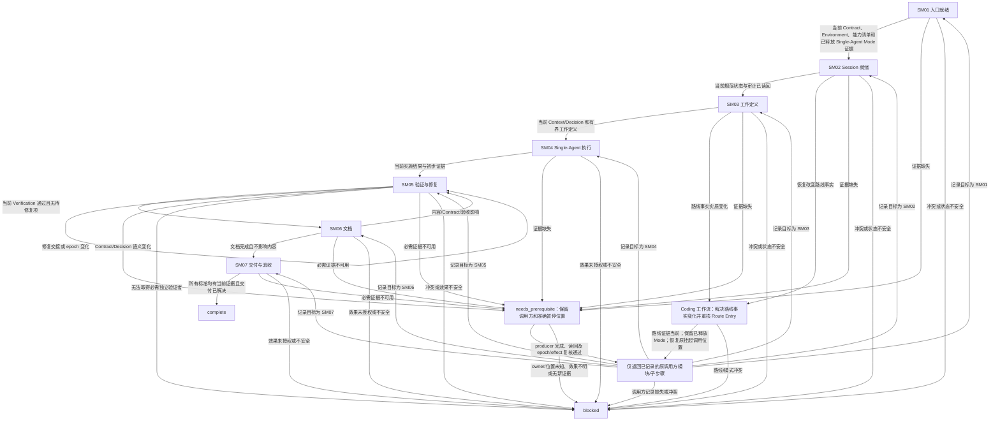

# Coding 工作流 — Single-Agent 模式

[English](coding-single-agent.md) | [简体中文](coding-single-agent_zh_cn.md)

本路线为已释放 Single-Agent Coding 模式的任务组合七个 Layer-04 模块。它安排模块入口，在前置缺失时保留调用方位置，并将状态变化返回受影响的模块。

## 工作流路线图

## 路线顺序检查清单

进入 SM01 前，检查 Coding 工作流已完成 Contract、Environment、能力清单、Mode 和 Route Entry 的证据。不得重复这些门禁。本路线仅适用于已释放的 Single-Agent Coding，且始终留在当前 Session。每一步只调用所链接的模块；前置导致暂停时，保留准确模块检查点和已完成效果，并从返回位置恢复。不得重放先前效果，也不得因缺少前置而重启整条路线。

1. **SM01 — 入口就绪。** 使用当前 Contract、Environment、能力清单、已释放的 Single-Agent Mode 和授权路线证据，调用[入口就绪模块](modules/entry-readiness_zh_cn.md)。仅在入口证据当前且一致时继续。将缺失前置送回语义对应 owner 并保留 SM01；冲突或状态不安全时阻塞。
2. **SM02 — Session 就绪。** 调用[Session 就绪模块](modules/session-readiness_zh_cn.md)，确认规范 authority/state，并在消费审计结果前完成读回。仅在 Session 和审计证据当前时继续。恢复若改变事实，遵循模块内重核/读回顺序，不重开 Mode 或重复已完成的提问；`needs_prerequisite` 时保留暂停位置，authority 或读回问题未解决时阻塞。
3. **SM03 — 工作定义。** 调用[工作定义模块](modules/work-definition_zh_cn.md)，解决当前 Context、Decision、规划输出及有界授权工作。仅在来源事实、已接受决定和未释放边界当前时继续。缺失事实/决定交其 owner 处理并恢复 SM03；授权或 Contract 实质变化时交调用方审查路线。
4. **SM04 — Single-Agent 执行。** 带上 SM01–SM03 证据及 continuation/effect 状态，调用[Single-Agent 执行模块](modules/single-execution_zh_cn.md)。仅在当前实施结果和初步证据齐备时继续。该模块负责执行者/输出解析、Slice 释放、实施、阶段反馈和 Control，不能创建或派发子代理。证据请求、修订或下一 Slice 时保留 Control continuation 和恢复位置。
5. **SM05 — 验证与修复。** 针对准确当前指纹和验收条件调用[验证与修复模块](modules/verification-repair_zh_cn.md)。只有 Contract 要求独立验证且当前独立性证据确认可用时，才完成所需独立验证。同 Session 逻辑检查不可替代。必需验证者证据待补时暂停依赖效果；若无法取得获授权的独立验证者，则阻塞这些效果。仅当所有必需检查在当前 epoch 通过且没有待修复项时继续。修复通过交接返回当前 Verification；语义 Contract/Decision 变化交调用方。实施、文档或 Git metadata 维度变化后不得接受过期证据。
6. **SM06 — 文档。** 带上当前 Verification、Contract 和写前指纹，调用[文档模块](modules/documentation_zh_cn.md)。该模块判断哪些输出适用，要求相应授权/来源/路径，完成请求的 Memory 读回、影响分类和检查。仅在当前文档结果齐备时继续。内容/Contract/验收变化需要重验时返回 SM05；受影响 epoch 通过后，恢复挂起的 SM06 子步骤，完成当前影响分类和文档检查后再进入 SM07。
7. **SM07 — 交付与验收。** 带上当前 Contract 标准、验证证据、epoch 和任何准确且获授权的 Git 意图，调用[交付与验收模块](modules/delivery-acceptance_zh_cn.md)。仅当每项适用标准都有当前通过证据且请求的交付已解决时继续。只有验收证据通过且读回确认后，该模块才可归档匹配的已完成 active plan。缺少标准/证据时返回语义 owner 和记录位置；失败、冲突或效果未授权时阻塞。

## 前置返回映射

仅在其 producer/recheck 位置补齐缺失项。把原调用方模块/子步骤及其已完成效果保留为 continuation 栈项；若补前置本身又暂停，也保留 producer continuation。producer 完成后读回证据并重核相关 epoch/效果，然后仅恢复原调用方位置，不得恢复到 producer 位置或顺跑下一模块。不得重放效果、重开已释放 Mode 或重复已完成提问。Contract/Environment/Mode 证据缺口只在现有 owner 读取/补齐；仅路线事实实质变化时重进 Route Entry，然后保留锁定 Mode 返回原调用方。producer/位置/效果未知或循环未产生新证据时，阻塞依赖工作。

| 缺失前置 | producer/recheck 位置 | 读回后恢复 |
| --- | --- |
| Contract 或验收范围 | Coding 工作流 Contract 检查点；仅补齐缺失证据。 | 原挂起模块/子步骤，例如 SM07；不得从 SM01 重跑。 |
| Environment/能力清单 | Environment 和能力清单 owners；仅读取/补齐缺失清单。 | 原挂起模块/子步骤；仅当路线事实实质变化才重核 Route Entry。 |
| Route Entry 证据或路线事实实质变化 | 仅路线事实变化时由 Route Entry owner 复核；不重复锁定 Mode。 | 同一路线仍有效则恢复原挂起模块/子步骤；否则阻塞失效路线。 |
| 已释放 Mode 证据缺失或不一致 | 既有 Mode owner 和锁定记录读回；不得再次询问已释放选择。 | Single-Agent 证据当前后恢复原挂起模块/子步骤；冲突时阻塞。 |
| Session state、authority 或审计 | SM02 的 SR02/SR03 及其返回的具体 Session/state/audit owner。 | Session 证据读回后恢复原挂起模块/子步骤；若 SM02 本身是调用方，则恢复其挂起的 producer 子步骤。 |
| Context、Decision、规划输出或 advice | SM03 的 WD01–WD03 及具体 Context/Decision/planning/advice owner。 | 证据当前后恢复原挂起模块/子步骤；例如 SM07 调用方补 Context 后回 SM07，不转到 SM03。 |
| 执行者/输出、Slice、反馈或 Control | SM04 的 SE01–SE05 及责任 owner。 | 恢复原挂起模块/子步骤；例如 SM07 调用方补齐前置后回 SM07，不转到 SM04。 |
| Verification、修复诊断或 handoff | SM05 的 VR01–VR05 及责任 owner。 | 当前证据/handoff 完成后恢复原挂起模块/子步骤；SM06 在验证返回后恢复挂起 DOC 子步骤。 |
| 文档影响、Memory 读回或必需检查 | SM06 的 DOC01–DOC06 及具体 Documentation/Memory/check owner。 | 恢复原挂起模块/子步骤，包括验证返回后的 DOC 子步骤。 |
| Git target/effect 或 Acceptance 标准/归档 | SM07 的 DA02–DA05 及 Git/Acceptance/plan owner。 | producer 证据读回后恢复原挂起 DA 子步骤。 |

## Mode 边界

所有阶段均留在当前 Session；绝不创建其他 Session。将 Input-side Reasoning、Primary Output 和验证视为同一 Session 内的逻辑阶段。只有适用 Verification owner 通过当前证据确认要求已满足时，才可声称独立验证；必需的独立性不可用时，阻塞依赖效果。

## 相关概念

- [入口就绪模块](modules/entry-readiness_zh_cn.md)
- [Single-Agent 执行模块](modules/single-execution_zh_cn.md)
- [验证与修复模块](modules/verification-repair_zh_cn.md)
