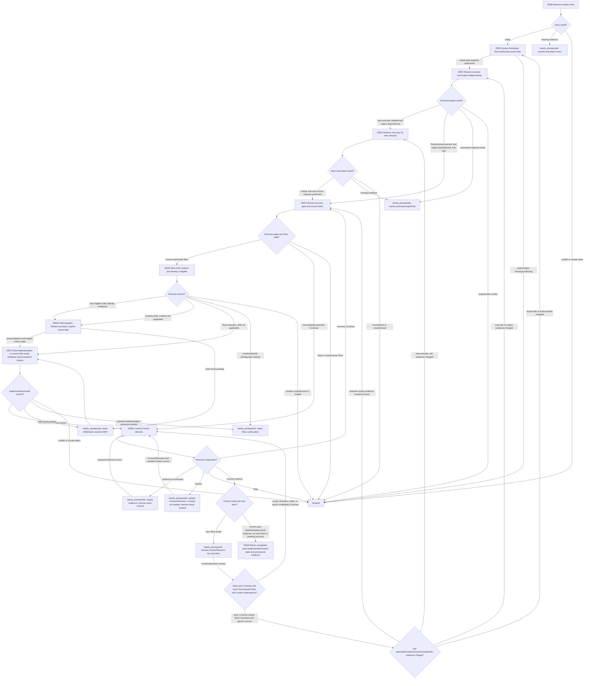

# Multi-Agent Delegated Execution Module

[English](delegated-execution.md) | [简体中文](delegated-execution_zh_cn.md)

This Layer-04 module composes Bootstrap assessment and Root task authorization, executor/output/role decisions, a current shared Slice gate, conditional child creation and dispatch, implementation/result handling, stage feedback, and Control. It returns implementation state and provisional evidence; final verification belongs to the later verification/repair workflow.

## Entry declaration

| Field | Requirement |
| --- | --- |
| Required inputs | Current authorized Contract/task, released Multi-Agent mode and positive locked count, complete current Session/audit, sourced Context and Decision, current allocation/role facts, continuation/effect state, recovery floor/Control evidence, and—only when resuming an already released Worker bundle—the explicit `write_content_memo` value recorded for that bundle. A new Worker bundle receives its explicit value at DE04. |
| Permitted effects | Assess Bootstrap and authorize the actual task; resolve executor/output/role; release and persist an authorized Slice; conditionally create/reuse a child and dispatch only that task; implement locally or receive actual child results; provide stage feedback and resolve Control. All effects remain subject to direct owners and existing authorization. |
| Results | Return `complete` only with current implementation/result state, fingerprint, provisional checks, Control disposition, and no pending recovery/next Slice; otherwise `needs_prerequisite` with continuation or `blocked`. Conditional child, role, memo, and store substeps may be `not_applicable` with an observed reason. |
| Freshness | Bind task/Slice fingerprint, Contract/Decision, canonical state and allocation revision, child identity, explicit memo value, Control rule, and relevant epochs to their sources. Material changes invalidate affected evidence and require re-entry at the affected checkpoint. |

## Workflow map

## Ordered module checklist

1. **DE00 — Resolve entry.** Call [Module Entry Resolution](../../layer-03-workflow-checkpoints/module-entry-resolution.md) with this declaration, current authorization and released route/mode/count evidence, complete Session/audit and Context/Decision evidence, allocation, prior effects, recovery status, and continuation. When resuming an already released Worker bundle, supply its recorded explicit memo value; a new bundle's value is set at DE04. `ready` permits only module checks. Missing evidence returns `needs_prerequisite` with owner/position; conflict, unsafe state, or unrecoverable effects return `blocked`.
2. **DE01 — Assess Bootstrap and authorize the actual task.** Apply [Bootstrap Selection](../../layer-03-workflow-checkpoints/bootstrap-selection.md) to current task, role, slot, and Memory facts. The proposal does not reserve a role or release a Slice. Root rechecks current Context and Decision, then explicitly authorizes the actual task: the bounded Bootstrap/Refresh task when applicable, otherwise the original task. A distinct auxiliary Bootstrap task requires separate Root authorization and carries the original task as its continuation; after the auxiliary task completes, return to DE01, separately authorize and assess the original task, and do not mark the original task complete based on the auxiliary result. Missing actual-task authorization blocks.
3. **DE02 — Resolve executor and output independently.** Apply [Task Assignment](../../layer-01-fundamental-concepts/execution-planning/task-assignment.md) and [Executor Selection](../../layer-03-workflow-checkpoints/executor-selection.md), then [Output Token Routing](../../layer-01-fundamental-concepts/execution-planning/output-token-routing.md) and [Output Route Selection](../../layer-03-workflow-checkpoints/output-route-selection.md). Continue to DE03 only when executor result is `new-executor-needed` and Root output is dispositioned. For a confirmed Root executor or confirmed existing executor/child, require output to be dispositioned, record role reservation `not_applicable` with that evidence, and continue to DE04. Unknown or unresolved required results return `needs_prerequisite`; conflict blocks. Do not treat unresolved as `not_applicable`.
4. **DE03 — Reserve a role only for a new executor.** Only on DE02's `new-executor-needed` plus dispositioned-output branch, apply [Role Reservation](../../layer-03-workflow-checkpoints/role-reservation.md), [Child Role Selection](../../layer-01-fundamental-concepts/delegation/child-role-selection.md), [Child Role Allocation](../../layer-01-fundamental-concepts/delegation/delegation-child-role-allocation.md), [Delegation Count Gate](../../layer-01-fundamental-concepts/delegation/delegation-mode-count-gate.md), and [Delegation State Record](../../layer-01-fundamental-concepts/delegation/delegation-state-record.md). Confirm a unique current reservation and capacity/allocation evidence. Missing required evidence returns `needs_prerequisite`; inconsistent or unauthorized results block. Do not reserve again for a Root or existing executor.
5. **DE04 — Apply the shared recovery gate and release the current Slice.** All actual executor branches pass this checkpoint. Apply [Execution Control](../../layer-01-fundamental-concepts/execution-control/execution-control.md), [Execution Planning](../../layer-01-fundamental-concepts/execution-planning/execution-planning.md), and [Native Reconciliation](../../layer-01-fundamental-concepts/enhanced-native-state/native-reconciliation.md). If a recovery floor exists, require a post-floor `Continue` current for the Control rule and relevant epochs; missing/stale evidence returns to DE08 before release/resume. `Stop` blocks. Confirm current child capacity/allocation when a child executor applies; for Root, record child capacity `not_applicable` with reason. Release a concrete Slice only with current Context and Decision, objective, authorized role/executor, scope/mutations, return conditions, unreleased boundary, and an explicit per-bundle `write_content_memo: true` or `false` for any newly released Worker bundle. For an already released bundle, retain and verify its recorded value rather than inventing or replacing it. For Enhanced state, conditionally apply [Enhanced State Store](../../layer-01-fundamental-concepts/enhanced-native-state/enhanced-state-store.md) and [Enhanced Schema Migrations](../../layer-01-fundamental-concepts/enhanced-native-state/enhanced-schema-migrations.md), persist with authorized typed Root operations and expected revision/idempotency where required, then read back before any child action. In Native mode, update the canonical parent-context record under its owner and confirm current state. If no recovery floor exists, record the gate `not_applicable` and why. Only eligible code/configuration implementation or authoring/editing this Skill's instructions/reference documents may use a child; ordinary non-Skill documentation remains parent-authored.
6. **DE05 — Create a new eligible child and bind identity.** For a new child only, apply [Child Creation](../../layer-01-fundamental-concepts/delegation/delegation-child-creation.md) and [Runtime and Model Provider Support](../../layer-01-fundamental-concepts/session-runtime/runtime-provider-support.md). Confirm eligible released task/Slice, unique role reservation, current capacity, capability, permissions, context, return conditions, and required runtime/effort evidence; create only the authorized child. Record and read back its real identity/allocation before identity-bound Enhanced store access or dispatch. Apply [Enhanced State Store](../../layer-01-fundamental-concepts/enhanced-native-state/enhanced-state-store.md) and [Enhanced Schema Migrations](../../layer-01-fundamental-concepts/enhanced-native-state/enhanced-schema-migrations.md) only when selected and triggered, confirming guards/schema/readback. For an existing child, record creation and new-model-binding checks `not_applicable` with the reuse evidence; preserve the same identity, do not recheck model selection, and never replace it. For a confirmed Root executor, record child creation/identity `not_applicable` with reason. All branches continue to DE07, with child branches passing through DE06.
7. **DE06 — Dispatch only on a child branch.** Apply [Child Dispatch](../../layer-01-fundamental-concepts/delegation/delegation-child-dispatch.md), [Worker Boundary](../../layer-01-fundamental-concepts/delegation/delegation-worker-boundary.md), [Child Lifecycle](../../layer-01-fundamental-concepts/delegation/delegation-child-lifecycle.md), [Child Reuse and Replacement](../../layer-01-fundamental-concepts/delegation/delegation-child-reuse-replacement.md), [Child Message Visibility](../../layer-01-fundamental-concepts/delegation/delegation-child-message-visibility.md), [Content Memo Dispatch](../../layer-01-fundamental-concepts/context-exchange/content-memo-dispatch.md), and [Content Memo Lifecycle](../../layer-01-fundamental-concepts/context-exchange/content-memo-lifecycle.md). The actual released bundle must include the full task and scope, source pointers, return conditions, exact authorized Memory name where applicable, and explicit `write_content_memo: true` or `false`; never infer a default. Dispatch only the released Slice to the bound child. When true, follow the memo owner's lifecycle and verify memo evidence; when false, do not dispatch or write that memo. Preserve actual dispatch-body evidence for every follow-up, including current authorized scope. Missing/incomplete dispatch or identity evidence blocks; a pending child result returns `needs_prerequisite` and resumes at DE07. Root execution records child dispatch/memo `not_applicable` with reason and proceeds to DE07.
8. **DE07 — Implement locally or obtain the complete actual child result.** Apply [Implementation](../../layer-02-workflow-concepts/decision-and-execution/implementation.md). For Root execution, make the smallest authorized change. For child execution, wait for and inspect the complete actual child body/result under the lifecycle and visibility owners; do not claim completion while pending or rely on an incomplete message. Apply [LSP MCP Tools](../../layer-01-fundamental-concepts/session-runtime/LSP-MCP-Tools.md) only when code-structure evidence is needed and capability is available. If required LSP semantics are unavailable, state the limitation and use targeted text search and small path-bounded reads; do not call those findings LSP evidence. Record `not_applicable` only when code-structure evidence is not needed. Block if a required relationship remains unknown. Apply [Execution Stage Feedback](../../layer-01-fundamental-concepts/execution-control/execution-stage-feedback.md) when triggered; otherwise record `not_applicable` with reason. Run focused provisional checks against the current fingerprint and return paths, effects, actual-body/result evidence, check output, and unresolved issues. This is not final verification. Root, reused-child, and newly created-child paths all pass through this checkpoint.
9. **DE08 — Resolve current Control for every executor.** Apply [Control](../../layer-02-workflow-concepts/decision-and-execution/control.md), [Execution Control](../../layer-01-fundamental-concepts/execution-control/execution-control.md), [Advisory Selection](../../layer-03-workflow-checkpoints/advisory-selection.md), and [Decisions Advisory](../../layer-01-fundamental-concepts/execution-planning/decisions-advisory.md). Consume current Progress Signal evidence for status, findings, changed scope, verification, issues, needs, and the current unreleased boundary. Use only a current trusted advisory result when eligible, enabled, and authorized; otherwise record advice `not_applicable` with reason and decide from direct evidence. Preserve each continuation:
   - Missing/stale post-floor `Continue` enters or resumes this Control check. A recovery `Continue` returns to DE04; it does not reselect or replace a reused child.
   - `Evidence-on-Demand` pauses release and returns `needs_prerequisite`; retain the same Control continuation and resume here after evidence arrives.
   - `Amend` returns `needs_prerequisite`; update the Contract and Decision under their owners, and Context when needed, then resume this same Control check and obtain a new explicit `Continue` before returning to DE04. The prior outcome does not release work.
   - `Stop` returns `blocked`.
   - A normal `Continue` with a next Slice returns `needs_prerequisite` for current Context/Decision resolution. Confirm that the prior `Continue` still covers the new bounded Slice and that state/epochs remain current. If scope, Contract, authorization, unreleased boundary, or a relevant epoch change invalidates it, resume this Control check and obtain a new explicit `Continue`. If actual task or authorization changed, recheck only that affected decision at DE01; if executor/output evidence changed, recheck those decisions at DE02 and role reservation at DE03 only if a new executor is still needed; if only the new-executor role evidence changed, recheck DE03. After those checks, resume at DE04 without replaying completed effects. Otherwise resume directly at DE04 after Context/Decision is current, reusing the existing child when applicable. With no next Slice and no pending recovery result, continue to DE09 only when current post-implementation/result evidence confirms the task is complete.
10. **DE09 — Return implementation/result state.** Return evidence that the current task implementation/result is complete, actual-task authorization, executor/output/role disposition, released Slice and current fingerprint, Root implementation or complete actual child dispatch/result evidence, memo field/value and evidence or reasoned `not_applicable`, provisional checks, current Control result/continuation, and limitations. Do not perform or claim final verification; the caller's later verification/repair workflow owns it. Root, existing-child, and new-child execution all pass through DE04, DE07, and DE08 before this return.

## Related concepts

- [Bootstrap selection](../../layer-03-workflow-checkpoints/bootstrap-selection.md)
- [Child Dispatch](../../layer-01-fundamental-concepts/delegation/delegation-child-dispatch.md)
- [Execution Control](../../layer-01-fundamental-concepts/execution-control/execution-control.md)
