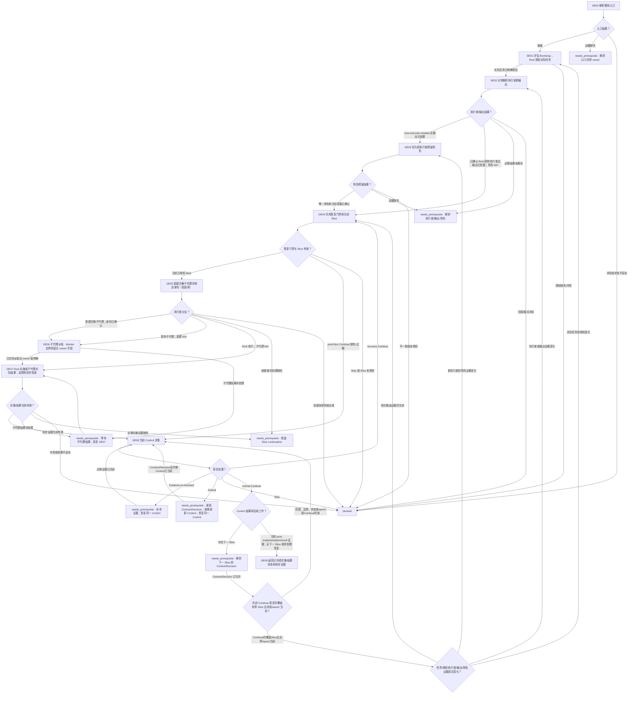

# Multi-Agent 委派执行模块

[English](delegated-execution.md) | [简体中文](delegated-execution_zh_cn.md)

本 Layer-04 模块组合 Bootstrap 评估与 Root 任务授权、执行者/输出/角色决策、所有执行者共用的当前 Slice 门禁、有条件的子代理创建与派发、实施/结果处理、阶段反馈及 Control。它返回实施状态与初步证据；最终验证属于后续验证/修复工作流。

## 入口声明

| 字段 | 要求 |
| --- | --- |
| 必需输入 | 当前已授权 Contract/任务、已释放 Multi-Agent 模式和正数锁定数量、完整且当前的 Session/审计、有来源的 Context 和 Decision、当前 allocation/角色事实、continuation/效果状态、恢复底线/Control 证据；仅在恢复既有已释放 Worker bundle 时，还须提供该 bundle 记录的显式 `write_content_memo` 值。新 Worker bundle 的显式值在 DE04 确定。 |
| 允许效果 | 评估 Bootstrap 并授权实际任务；解析执行者/输出/角色；释放和持久化已授权 Slice；有条件地创建/复用子代理并只派发该任务；本地实施或接收子代理实际结果；提供阶段反馈并解决 Control。所有效果仍受直接 owners 和现有授权约束。 |
| 结果 | 仅在返回当前实施/结果状态、指纹、初步检查、Control 处置且无待处理恢复/下一 Slice 时返回 `complete`；否则以 continuation 返回 `needs_prerequisite` 或 `blocked`。条件子代理、角色、memo 及 state store 子步骤可根据观察到的原因标为 `not_applicable`。 |
| 新鲜度 | 将任务/Slice 指纹、Contract/Decision、规范 state 与 allocation revision、子代理身份、显式 memo 值、Control 规则及相关 epoch 绑定到其来源。实质变化会使受影响证据失效，并要求从受影响检查点重新进入。 |

## 工作流路线图

## 有序模块清单

1. **DE00 — 解析入口。** 提供本声明、当前授权及已释放路线/模式/count 证据、完整 Session/审计与 Context/Decision 证据、allocation、先前效果、恢复状态及 continuation，调用[模块入口解析](../../layer-03-workflow-checkpoints/module-entry-resolution_zh_cn.md)。恢复既有已释放 Worker bundle 时，提供其记录的显式 memo 值；新 bundle 的值在 DE04 确定。`ready` 只允许模块核验。证据缺失时连同 owner/位置返回 `needs_prerequisite`；冲突、状态不安全或效果无法恢复时返回 `blocked`。
2. **DE01 — 评估 Bootstrap 并授权实际任务。** 根据当前任务、角色、名额和 Memory 事实应用[Bootstrap 选择](../../layer-03-workflow-checkpoints/bootstrap-selection_zh_cn.md)。建议不预留角色，也不释放 Slice。Root 重核当前 Context 和 Decision，然后明确授权实际任务：适用时采用有界 Bootstrap/Refresh 任务，否则采用原任务。独立辅助 Bootstrap 任务需要 Root 另行授权，并将原任务保留为 continuation；辅助任务完成后返回 DE01，单独授权并评估原任务，不得依据辅助结果将原任务标为完成。实际任务缺少授权时阻塞。
3. **DE02 — 分别解析执行者和输出。** 应用[任务分配](../../layer-01-fundamental-concepts/execution-planning/task-assignment_zh_cn.md)和[执行者选择](../../layer-03-workflow-checkpoints/executor-selection_zh_cn.md)，再应用[输出 Token 路由](../../layer-01-fundamental-concepts/execution-planning/output-token-routing_zh_cn.md)及[输出路由选择](../../layer-03-workflow-checkpoints/output-route-selection_zh_cn.md)。仅当执行者结果为 `new-executor-needed` 且 Root 输出已处置时进入 DE03。已确认 Root 执行者或已确认的现有执行者/子代理，必须先确认输出已处置，再根据该证据将角色预留记录为 `not_applicable` 并继续至 DE04。必需结果未知或未解决时返回 `needs_prerequisite`；冲突则阻塞。不得把未解决视为 `not_applicable`。
4. **DE03 — 仅为新执行者预留角色。** 仅在 DE02 的 `new-executor-needed` 且输出已处置分支，应用[角色预留](../../layer-03-workflow-checkpoints/role-reservation_zh_cn.md)、[子代理角色选择](../../layer-01-fundamental-concepts/delegation/child-role-selection_zh_cn.md)、[子代理职责分配](../../layer-01-fundamental-concepts/delegation/delegation-child-role-allocation_zh_cn.md)、[委派数量门禁](../../layer-01-fundamental-concepts/delegation/delegation-mode-count-gate_zh_cn.md)和[委派状态记录](../../layer-01-fundamental-concepts/delegation/delegation-state-record_zh_cn.md)。确认唯一且当前有效的预留，以及容量/allocation 证据。必需证据缺失时返回 `needs_prerequisite`；不一致或未授权时阻塞。不得为 Root 或现有执行者再次预留。
5. **DE04 — 应用所有执行者共用的恢复门禁并释放当前 Slice。** 所有实际执行者分支都经过此检查点。应用[执行控制](../../layer-01-fundamental-concepts/execution-control/execution-control_zh_cn.md)、[执行规划](../../layer-01-fundamental-concepts/execution-planning/execution-planning_zh_cn.md)及[Native 对账](../../layer-01-fundamental-concepts/enhanced-native-state/native-reconciliation_zh_cn.md)。存在恢复底线时，须有 post-floor `Continue` 且其 Control 规则和相关 epoch 为当前；证据缺失/过期时，释放/恢复前返回 DE08。`Stop` 阻塞。适用子代理执行时，核验当前容量/allocation；Root 执行时记录带原因的子代理容量 `not_applicable`。仅当 Context 和 Decision 当前有效，并明确目标、已授权执行者/角色、范围/修改、返回条件、未释放边界，以及每个新释放 Worker bundle 的显式 `write_content_memo: true` 或 `false` 时，才释放具体 Slice。恢复既有 bundle 时，保留并核验其记录值，不得臆造或替换。Enhanced state 条件适用时，应用[Enhanced State Store](../../layer-01-fundamental-concepts/enhanced-native-state/enhanced-state-store_zh_cn.md)及[Enhanced Schema Migrations](../../layer-01-fundamental-concepts/enhanced-native-state/enhanced-schema-migrations_zh_cn.md)，通过已授权的 typed Root 操作及所需的预期 revision/idempotency 持久化，然后在子代理行动前读回。Native 模式按其 owner 更新规范 parent-context record 并确认当前状态。无恢复底线时，记录带原因的门禁 `not_applicable`。只有合格的代码/配置实施，或编写/编辑本 Skill 指令/参考文档，才可使用子代理；普通非 Skill 文档仍由 parent 编写。
6. **DE05 — 创建新合格子代理并绑定身份。** 仅对新子代理应用[子代理创建](../../layer-01-fundamental-concepts/delegation/delegation-child-creation_zh_cn.md)和[运行环境与模型厂商支持](../../layer-01-fundamental-concepts/session-runtime/runtime-provider-support_zh_cn.md)。确认符合条件的已释放任务/Slice、唯一角色预留、当前容量、能力、权限、上下文、返回条件及必需运行环境/effort 证据；只创建已授权子代理。任何绑定身份的 Enhanced store 访问或派发前，记录并读回其真实身份/allocation。仅当选中并触发时，应用[Enhanced State Store](../../layer-01-fundamental-concepts/enhanced-native-state/enhanced-state-store_zh_cn.md)及[Enhanced Schema Migrations](../../layer-01-fundamental-concepts/enhanced-native-state/enhanced-schema-migrations_zh_cn.md)，确认守卫/schema/读回。复用现有子代理时，根据复用证据将创建和新 model-binding 检查记录为 `not_applicable`；保留相同身份，不重查模型选择，也绝不替换。已确认 Root 执行时，将子代理创建/身份记录为有原因的 `not_applicable`。所有分支进入 DE07；子代理分支先经过 DE06。
7. **DE06 — 仅在子代理分支派发。** 应用[子代理派发](../../layer-01-fundamental-concepts/delegation/delegation-child-dispatch_zh_cn.md)、[Worker 边界](../../layer-01-fundamental-concepts/delegation/delegation-worker-boundary_zh_cn.md)、[子代理生命周期](../../layer-01-fundamental-concepts/delegation/delegation-child-lifecycle_zh_cn.md)、[子代理复用与替代](../../layer-01-fundamental-concepts/delegation/delegation-child-reuse-replacement_zh_cn.md)、[子代理消息可见性](../../layer-01-fundamental-concepts/delegation/delegation-child-message-visibility_zh_cn.md)、[Content Memo Dispatch](../../layer-01-fundamental-concepts/context-exchange/content-memo-dispatch_zh_cn.md)及[Content Memo Lifecycle](../../layer-01-fundamental-concepts/context-exchange/content-memo-lifecycle_zh_cn.md)。实际已释放 bundle 必须包含完整任务与范围、来源指针、返回条件、适用时准确的授权 Memory 名称，以及显式 `write_content_memo: true` 或 `false`；不得推断默认值。只向已绑定的子代理派发已释放 Slice。为 true 时遵循 memo owner 生命周期并核验 memo 证据；为 false 时不得派发或写入该 memo。每次 follow-up 均保留实际派发正文证据和当前授权范围。派发或身份证据缺失/不完整时阻塞；子代理结果待处理时返回 `needs_prerequisite`，并从 DE07 恢复。Root 执行时，将子代理派发/memo 记录为有原因的 `not_applicable` 并进入 DE07。
8. **DE07 — 本地实施或取得完整的子代理实际结果。** 应用[实施](../../layer-02-workflow-concepts/decision-and-execution/implementation_zh_cn.md)。Root 执行时，作最小授权改动。子代理执行时，根据生命周期和可见性 owners 等待并检查完整的子代理实际正文/结果；结果待处理时不得声称完成，也不得依赖不完整消息。仅在需要代码结构证据且能力可用时应用[LSP MCP Tools](../../layer-01-fundamental-concepts/session-runtime/LSP-MCP-Tools_zh_cn.md)。所需 LSP 语义不可用时，说明限制并回退到定向文本搜索和路径范围较小的读取；不得将这些发现称为 LSP 证据。只有不需要代码结构证据时才能记录 `not_applicable`。必需关系仍未知时阻塞。触发时应用[执行阶段反馈](../../layer-01-fundamental-concepts/execution-control/execution-stage-feedback_zh_cn.md)；否则记录有原因的 `not_applicable`。根据当前指纹运行聚焦的初步检查并返回路径、效果、实际正文/结果证据、检查输出和未解决问题。这不是最终验证。Root、复用子代理及新建子代理路径都必须经过此步。
9. **DE08 — 对所有执行者解决当前 Control。** 应用[Control](../../layer-02-workflow-concepts/decision-and-execution/control_zh_cn.md)、[执行控制](../../layer-01-fundamental-concepts/execution-control/execution-control_zh_cn.md)、[建议选择](../../layer-03-workflow-checkpoints/advisory-selection_zh_cn.md)和[Decisions Advisory](../../layer-01-fundamental-concepts/execution-planning/decisions-advisory_zh_cn.md)。消费当前 Progress Signal 的 status、findings、change scope、verification、issue、need 和当前未释放边界证据。只消费当前可信、符合条件、已启用且已授权的建议；否则记录建议 `not_applicable` 和原因，并基于直接证据决策。保留各 continuation：
   - post-floor `Continue` 缺失/过期时，进入或恢复此 Control 检查。recovery `Continue` 返回 DE04；不得为复用的子代理重新选择或创建替代者。
   - `Evidence-on-Demand` 暂停释放并返回 `needs_prerequisite`；保留同一 Control continuation，证据到达后在此恢复。
   - `Amend` 返回 `needs_prerequisite`；按 owners 更新 Contract 和 Decision，并在需要时更新 Context，然后恢复同一 Control 检查并取得新的明确 `Continue`，再返回 DE04。先前结果不释放工作。
   - `Stop` 返回 `blocked`。
   - 普通 `Continue` 后若有下一 Slice，则返回 `needs_prerequisite`，解析当前 Context/Decision，并确认先前 `Continue` 仍覆盖新的有界 Slice 且状态/epoch 当前。若范围、Contract、授权、未释放边界或相关 epoch 变化使其失效，则恢复此 Control 检查并取得新的明确 `Continue`。若实际任务或授权变化，在 DE01 仅重核受影响决策；若执行者/输出证据变化，在 DE02 重核这些决策，且仅当仍需要新执行者时才在 DE03重核角色预留；若仅新执行者的角色证据变化，则在 DE03 重核。检查完成后从 DE04 恢复，不重放已完成效果。否则在 Context/Decision 当前后直接从 DE04 恢复，适用时复用现有子代理。若没有下一 Slice 且没有待处理恢复结果，只有当前 post-implementation/result 证据确认任务已完成后才进入 DE09。
10. **DE09 — 返回实施/结果状态。** 返回证据证明当前任务实施/结果已完成、实际任务授权、执行者/输出/角色处置、已释放 Slice 与当前指纹、Root 实施或完整的子代理实际派发/结果证据、memo 字段/值及证据或有依据的 `not_applicable`、初步检查、当前 Control 结果/continuation 和限制。不得执行或声称最终验证；调用方后续验证/修复工作流负责最终验证。Root、现有子代理及新建子代理执行路径在返回前都必须经过 DE04、DE07 和 DE08。

## 相关概念

- [Bootstrap 选择](../../layer-03-workflow-checkpoints/bootstrap-selection_zh_cn.md)
- [子代理派发](../../layer-01-fundamental-concepts/delegation/delegation-child-dispatch_zh_cn.md)
- [执行控制](../../layer-01-fundamental-concepts/execution-control/execution-control_zh_cn.md)
