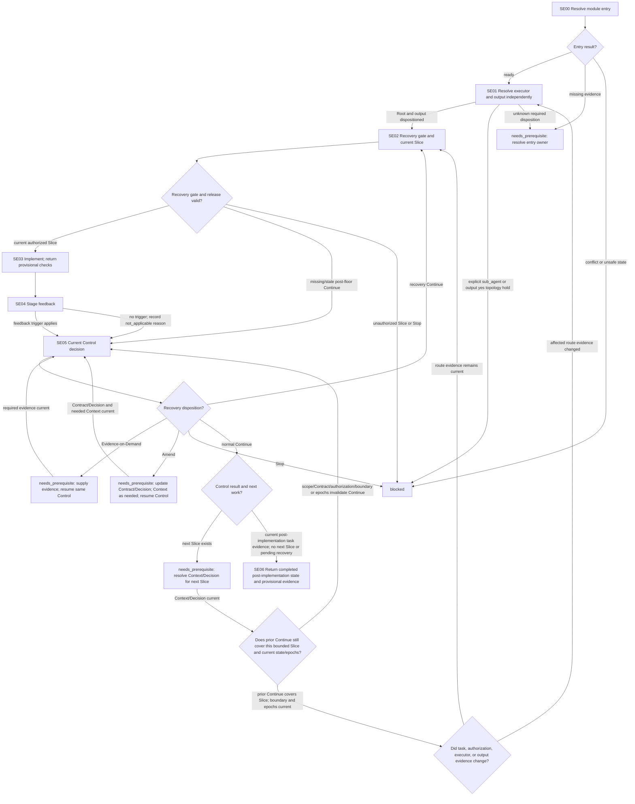

# Single-Agent Execution Module

[English](single-execution.md) | [简体中文](single-execution_zh_cn.md)

This Layer-04 module composes executor/output disposition, a current controlled Slice, local implementation, stage feedback, and Control for an authorized Single-Agent task. It returns implementation state and provisional evidence to its caller; final verification belongs to the later verification/repair workflow.

## Entry declaration

| Field | Requirement |
| --- | --- |
| Required inputs | Current authorized task and Contract, released Single-Agent mode, complete current Session/audit, sourced Context and Decision, continuation/effect state, and any recovery floor and current Control evidence. |
| Permitted effects | Resolve executor/output, release and implement an authorized local Slice, persist/read back authorized progress, provide stage feedback, and resolve Control. No child creation/dispatch, role reservation, scope expansion, or final verification. |
| Results | Return `complete` only with current implementation state, fingerprint, provisional checks, and Control disposition, and no pending recovery/next Slice; otherwise `needs_prerequisite` with continuation or `blocked`. Conditional substeps may be `not_applicable` with reason. |
| Freshness | Bind evidence to current Contract, task/Slice fingerprint, canonical state revision, Control rule, and relevant epochs. Material changes invalidate affected evidence and require re-entry at the specified checkpoint. |

## Workflow map

## Ordered module checklist

1. **SE00 — Resolve entry.** Call [Module Entry Resolution](../../layer-03-workflow-checkpoints/module-entry-resolution.md) with this declaration, current authorization and route/mode evidence, complete Session/audit and Context/Decision evidence, prior effects, recovery state, and continuation. `ready` allows only module checks. Missing evidence returns `needs_prerequisite` with owner and position; conflict, unsafe state, or unrecoverable prior effects return `blocked`.
2. **SE01 — Resolve executor and output independently.** Apply [Task Assignment](../../layer-01-fundamental-concepts/execution-planning/task-assignment.md) and [Executor Selection](../../layer-03-workflow-checkpoints/executor-selection.md), then [Output Token Routing](../../layer-01-fundamental-concepts/execution-planning/output-token-routing.md) and [Output Route Selection](../../layer-03-workflow-checkpoints/output-route-selection.md). Under released Single-Agent mode, an explicit `sub_agent` result conflicts with locked Mode and is `blocked`. A direct Root output result of `yes` is a hold at the locked topology boundary; report that boundary and block release without implying that Mode can be changed in this Session. Unknown required executor/output evidence returns `needs_prerequisite`. Continue only when Root execution is current and output has been dispositioned.
3. **SE02 — Apply recovery gate and release the current Slice.** Apply [Execution Control](../../layer-01-fundamental-concepts/execution-control/execution-control.md), [Execution Planning](../../layer-01-fundamental-concepts/execution-planning/execution-planning.md), and [Native Reconciliation](../../layer-01-fundamental-concepts/enhanced-native-state/native-reconciliation.md). A recovery floor requires a post-floor `Continue` current for the Control rule and relevant epochs; if missing or stale, return to SE05 before releasing or resuming implementation. `Stop` blocks. Release only a bounded Slice supported by current Context and Decision, with objective, authorized scope/mutations, return conditions, and unreleased boundary. For Enhanced state, apply [Enhanced State Store](../../layer-01-fundamental-concepts/enhanced-native-state/enhanced-state-store.md) and [Enhanced Schema Migrations](../../layer-01-fundamental-concepts/enhanced-native-state/enhanced-schema-migrations.md) conditionally: use authorized typed persistence with expected revision/idempotency where required, then read back and confirm the returned state; incompatible schema blocks dependent writes. In Native mode, update the canonical parent-context record under its owner and confirm the current record. With no recovery floor, record that gate `not_applicable` and why.
4. **SE03 — Implement and return provisional checks.** Apply [Implementation](../../layer-02-workflow-concepts/decision-and-execution/implementation.md). Inspect only needed sources and make the smallest authorized change. Use [LSP MCP Tools](../../layer-01-fundamental-concepts/session-runtime/LSP-MCP-Tools.md) only when code-structure evidence is needed and the capability is available. If required LSP semantics are unavailable, state the limitation and use targeted text search and small path-bounded reads; do not call those findings LSP evidence. Record `not_applicable` only when code-structure evidence is not needed. Block if a required relationship remains unknown. Run focused provisional checks, then return changed paths, effects, current fingerprint, check output, and unresolved issues. This is not final verification.
5. **SE04 — Provide stage feedback.** Apply [Execution Stage Feedback](../../layer-01-fundamental-concepts/execution-control/execution-stage-feedback.md) when its trigger applies, returning a bounded Progress Signal at the material stage boundary. If no trigger applies, record `not_applicable` with observed reason. Both paths continue to SE05; this step never skips Control.
6. **SE05 — Resolve current Control.** Apply [Control](../../layer-02-workflow-concepts/decision-and-execution/control.md), [Execution Control](../../layer-01-fundamental-concepts/execution-control/execution-control.md), [Advisory Selection](../../layer-03-workflow-checkpoints/advisory-selection.md), and [Decisions Advisory](../../layer-01-fundamental-concepts/execution-planning/decisions-advisory.md). Consume current Progress Signal evidence for status, findings, changed scope, verification, issues, needs, and the current unreleased boundary. Use only a current trusted advisory result when eligible, enabled, and authorized; otherwise record advice `not_applicable` with reason and decide from direct current evidence. Preserve the current continuation for each outcome:
   - Missing/stale post-floor `Continue` enters or resumes the same Control check. A fresh recovery `Continue` returns to SE02 for the next/recovered Slice.
   - `Evidence-on-Demand` pauses release and returns `needs_prerequisite`; retain the same Control continuation and return here after evidence arrives.
   - `Amend` returns `needs_prerequisite`; update the Contract and Decision under their owners, and update Context when needed. Then resume this same Control check and obtain a new explicit `Continue` before returning to SE02; the earlier outcome does not release work.
   - `Stop` returns `blocked`.
   - A normal `Continue` with a next Slice returns `needs_prerequisite` for current Context/Decision resolution for that next Slice. Confirm that this `Continue` still covers the new bounded Slice and that the state/epochs remain current. If scope, Contract, authorization, unreleased boundary, or a relevant epoch change invalidates it, resume this Control checkpoint and obtain a new explicit `Continue`; otherwise recheck only changed executor/output evidence at SE01 and continue to SE02 without replaying completed effects. With no next Slice and no pending recovery result, continue to SE06 only when current post-implementation evidence confirms the task is complete.
7. **SE06 — Return implementation state.** Return current evidence that the task's implementation is complete, paths/effects, current fingerprint, provisional check evidence, current Control result and continuation status, plus limitations. Do not claim final verification or final Acceptance; those remain with the later verification/repair and caller workflow.

## Related concepts

- [Execution Control](../../layer-01-fundamental-concepts/execution-control/execution-control.md)
- [Executor Selection](../../layer-03-workflow-checkpoints/executor-selection.md)
- [Implementation](../../layer-02-workflow-concepts/decision-and-execution/implementation.md)
