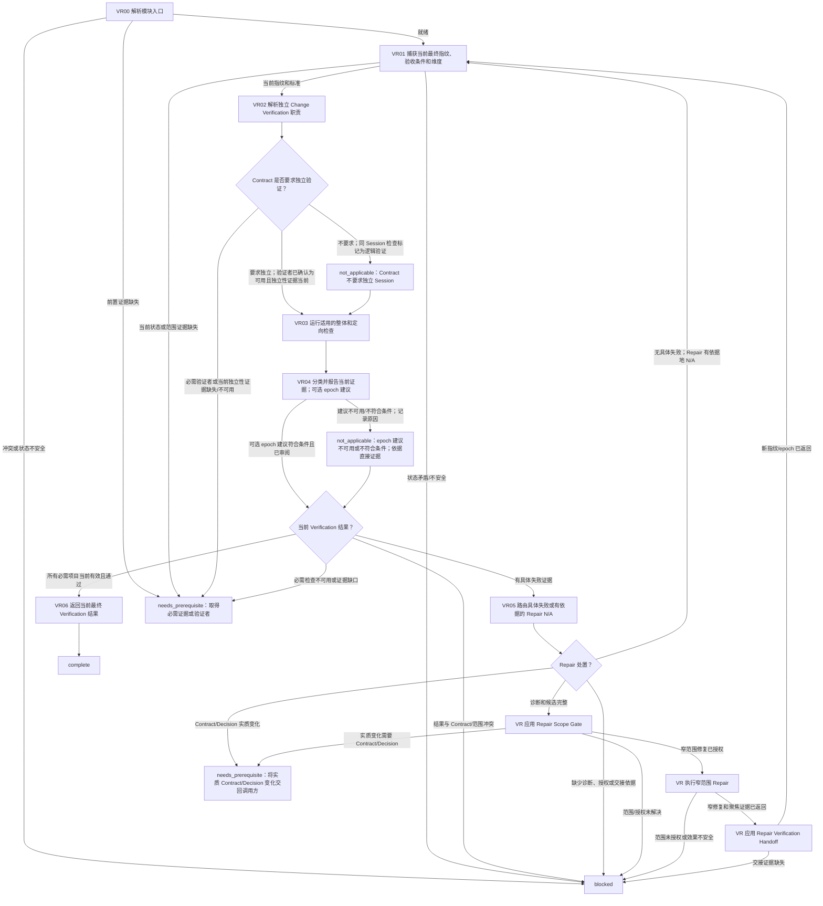

# 验证与修复模块

[English](verification-repair.md) | [简体中文](verification-repair_zh_cn.md)

本 Layer-04 模块捕获并验证当前最终状态、分类和报告结果，并将具体失败路由到获授权的窄范围修复，再返回当前 Verification。入口不要求已有最终 Verification 结果；本模块针对当前状态产出最终 Verification。

## 入口声明

| 字段 | 要求 |
| --- | --- |
| 入口前置条件 | 适用的 Single-Agent 或 Multi-Agent Mode 门禁已有当前释放证据；当前 Session 身份与 authority 已确认；调用方 continuation 和已完成效果均已知，且无未解决的效果歧义。本入口不授权独立 verifier；所需独立性须已由其 owner 授权并提供证据。 |
| 必需输入 | 当前 Contract 和验收条件、已完成的实施或子代理实际结果、当前任务范围与来源/效果证据，以及可供捕获最终 Verification 的当前状态。 |
| 允许效果 | 读取状态、运行已授权检查、分类/报告证据，并按直接 owners 路由已诊断的修复。修复写入仅限于另行授权的窄范围。 |
| 结果 | 以当前最终指纹/epoch、必需检查、独立性状态、结果类别、未解决项目/阻塞报告，且无未解决必需失败返回 `complete`；否则连同 owner 和 continuation 返回 `needs_prerequisite` 或 `blocked`。 |
| 新鲜度 | 将各结果绑定到准确的当前指纹及适用的 implementation/content、documentation 和 Git metadata epoch。任何修复或其他相关变化仅使覆盖范围内的维度失效，并返回当前 Verification。 |

## 工作流路线图

## 有序模块清单

1. **VR00 — 解析入口。** 提供本声明、当前 Contract/标准、实施或子代理实际结果、任务范围、来源/效果证据和 continuation，调用[模块入口解析](../../layer-03-workflow-checkpoints/module-entry-resolution_zh_cn.md)。不要求预先存在最终 Verification 结果。证据缺失时返回 `needs_prerequisite`；冲突、状态不安全或效果无法恢复时返回 `blocked`。
2. **VR01 — 捕获当前最终状态。** 应用[Verification](../../layer-02-workflow-concepts/verification-and-repair/verification_zh_cn.md)捕获准确的当前指纹/epoch，并将每项 Contract 验收条件映射到适用的覆盖维度。应用[Verification Epoch](../../layer-02-workflow-concepts/verification-and-repair/verification-epoch_zh_cn.md)，分别跟踪 implementation/content、documentation 和 Git metadata。当前实施状态和 Contract 标准是必需输入；只有指纹和 epoch 未变化的维度才能复用旧证据。当前状态或标准缺失时，阻塞依赖的验证。
3. **VR02 — 解析独立性要求。** 应用[Verification Independence](../../layer-02-workflow-concepts/verification-and-repair/verification-independence_zh_cn.md)和[Session 职责归属](../../layer-01-fundamental-concepts/session-runtime/session-role-ownership_zh_cn.md)。Contract 要求独立 Change Verification Session 时，使用该职责并仅提供给定范围证据和验收条件；否则将同 Session 检查分类为逻辑验证。在 Multi-Agent 执行中，Worker/子代理实际正文或结果是实施证据，不是独立验证；复用或完整可见也不满足必需的独立验证。必需的独立性不可用时返回 `needs_prerequisite`；不得声称满足 Contract。
4. **VR03 — 运行当前检查。** 针对准确的 VR01 指纹运行适用的最强整体和定向检查。涵盖所有必需标准及变化维度所需检查。不得对受影响维度复用较早 epoch 的证据。必需检查不可运行时，保留不可用原因及阻塞影响。
5. **VR04 — 分类并报告证据。** 应用[Verification Reporting](../../layer-02-workflow-concepts/verification-and-repair/verification-reporting_zh_cn.md)和[Verification Epoch](../../layer-02-workflow-concepts/verification-and-repair/verification-epoch_zh_cn.md)。报告通过、失败、不可用和假设的检查、剩余风险、未解决项目及阻塞影响。只有在启用、符合条件、相关、已授权且绑定到当前指纹/epoch 时，才可通过[建议选择](../../layer-03-workflow-checkpoints/advisory-selection_zh_cn.md)和[Decisions Advisory](../../layer-01-fundamental-concepts/execution-planning/decisions-advisory_zh_cn.md)评估可选的 verification-impact 建议。它只能建议维度，不能免除检查或宣告成功。否则记录带原因的建议 `not_applicable`，并使用直接证据。
6. **VR05 — 路由失败或确立 Repair N/A。** 应用[Repair Disposition](../../layer-03-workflow-checkpoints/repair-disposition_zh_cn.md)。具体失败必须有诊断、受影响路径和最小候选；之后依次应用[Repair Scope Gate](../../layer-02-workflow-concepts/verification-and-repair/repair-scope-gate_zh_cn.md)、[Repair Execution](../../layer-02-workflow-concepts/verification-and-repair/repair-execution_zh_cn.md)及[Repair Verification Handoff](../../layer-02-workflow-concepts/verification-and-repair/repair-verification-handoff_zh_cn.md)。仅执行已授权的窄范围修复，保留实际变更路径/证据，并将新指纹/受影响 epoch 返回 VR01 进行当前重验。Contract 或 Decision 实质变化时，返回 `needs_prerequisite` 给调用方进行语义审查和调度；不得把它当作修复。无具体失败时，以证据依据记录 Repair `not_applicable` 并返回 VR01，确认当前 Verification 结果。诊断、授权、有界范围、修复证据或交接缺失时，阻塞依赖工作。
7. **VR06 — 返回当前最终 Verification。** 返回当前指纹、每个适用 epoch 及状态、标准与证据的映射、独立性分类、检查/结果类别、剩余风险、未解决项目和阻塞影响。仅当所有必需的当前 Verification 项目通过、必需的独立验证已满足、且没有未解决的必需修复/证据时返回 `complete`。此结果本身不宣告整体验收。

## 相关概念

- [Verification](../../layer-02-workflow-concepts/verification-and-repair/verification_zh_cn.md)
- [Repair Disposition](../../layer-03-workflow-checkpoints/repair-disposition_zh_cn.md)
- [Verification Epoch](../../layer-02-workflow-concepts/verification-and-repair/verification-epoch_zh_cn.md)
