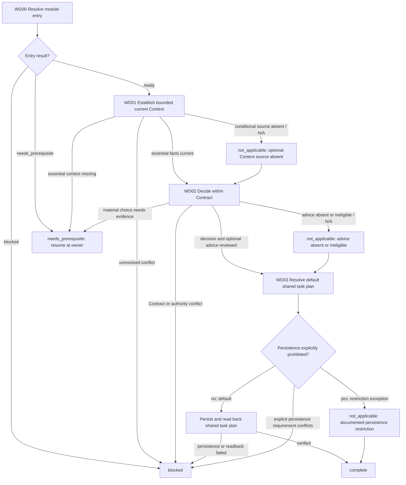

# Work Definition Module

[English](work-definition.md) | [简体中文](work-definition_zh_cn.md)

This Layer-04 module grounds the task in current facts and produces a Contract-consistent decision and the default shared task plan. It does not select an executor, assess output routing, reserve a role, release a Slice, or perform Bootstrap.

## Entry declaration

| Field | Requirement |
| --- | --- |
| Required inputs | Current authorized Contract and task scope, released route/mode evidence, current canonical Session state and completed audit readback, known task facts/source pointers, an authorized available way to obtain needed Context, and caller continuation/effect state. WD01 establishes the current Context; it is not an entry prerequisite. |
| Permitted effects | Bounded authorized read-only Context retrieval; eligible semantic advice only with an authorized current Root Session; default task-plan persistence within existing authorization, respecting explicit persistence restrictions. No executor/output routing, role reservation, Slice release, Bootstrap, implementation, or child dispatch. |
| Results | The module returns `complete` with current sourced Context, Contract-consistent Decision/unreleased boundary, and plan evidence or justified substep `not_applicable`; otherwise `needs_prerequisite` with suspended position or `blocked`. Context/advice/plan substeps may be `not_applicable` with trigger evidence, but the required work-definition module itself cannot be skipped as not applicable. Advice is evidence for review, never authorization. |
| Freshness | Retain source/provenance/freshness and relevant input/policy hashes and epochs. Reconfirm them before advice or dependent decisions; material changes invalidate affected evidence and require caller-directed re-entry at the affected substep. |

## Workflow map

## Ordered module checklist

1. **WD00 — Resolve entry.** Call [Module Entry Resolution](../../layer-03-workflow-checkpoints/module-entry-resolution.md) with this declaration, current authorized Contract and task scope, released route/mode evidence, current canonical Session state and completed audit readback, known task facts/source pointers, an authorized available way to obtain needed Context, and continuation/effect state. A canonical state and completed audit readback are required inputs; current task Context is established in WD01. Resume the recorded substep. Missing prerequisites return with their semantic owners; conflicts or unrecoverable state block. Do not request advice without an authorized current Session.
2. **WD01 — Establish bounded current Context.** Apply [Context](../../layer-02-workflow-concepts/entry-and-context/context.md), [Context Source Selection](../../layer-03-workflow-checkpoints/context-source-selection.md), and [Session Context Firewall](../../layer-01-fundamental-concepts/session-runtime/session-context-firewall.md). Define the smallest question for the next task and inspect only needed sources. Always list/read matching active plan Memories; current instructions prevail and a plan grants no authority. Read relevant reusable Memory and confirm its source pointers/freshness; when absent or unavailable, return to approved authoritative project sources and block only if an essential fact remains unverified. Use [Enhanced Rule Context](../../layer-01-fundamental-concepts/enhanced-native-state/enhanced-rule-context.md) only for a triggered bounded rule lookup, confirm owner/language/source/hash, and read omitted direct owners. Apply [LSP MCP Tools](../../layer-01-fundamental-concepts/session-runtime/LSP-MCP-Tools.md) only when project/code structure evidence is needed; otherwise record `not_applicable` and why. Return current sourced facts, provenance, freshness/epoch, and limitations; stale, conflicting, or missing essential facts block dependent decisions.
   - If downstream Decision advice needs reviewed background, apply [Decision Context Selection](../../layer-03-workflow-checkpoints/decision-context-selection.md) and [Decision Context Generation](../../layer-01-fundamental-concepts/execution-planning/decision-context-generation.md): provide only bounded facts and a concrete goal, review fidelity/relevance/provenance, and confirm exact input/policy bindings. Reject stale or mismatched background; when advice needs no generated context, record `not_applicable` with why.
   - In Multi-Agent mode only, if the Context Source Selection owner identifies a triggered persistent exchange or memo prerequisite, inspect only that trigger's [Context Exchange](../../layer-01-fundamental-concepts/context-exchange/context-exchange.md), [Workspace Boundary](../../layer-01-fundamental-concepts/context-exchange/context-exchange-workspace-boundary.md), [Handoff](../../layer-01-fundamental-concepts/context-exchange/context-exchange-handoff.md), or [Content Memo Dispatch](../../layer-01-fundamental-concepts/context-exchange/content-memo-dispatch.md) owner as applicable. Confirm required current record and Memory evidence; do not create an exchange record just for Context gathering and do not dispatch a memo here. If no trigger exists, record `not_applicable` with why. In Single-Agent mode, these child-specific exchange and memo owners are `not_applicable`; do not load them.
3. **WD02 — Decide within the Contract.** Apply [Decision](../../layer-02-workflow-concepts/decision-and-execution/decision.md), [Execution Decision Gate](../../layer-01-fundamental-concepts/execution-planning/execution-decision-gate.md), and [Execution Planning](../../layer-01-fundamental-concepts/execution-planning/execution-planning.md). State the material question, verified facts, unknowns, options, chosen direction, rejected alternatives, authorized scope/effects, return conditions, and unreleased boundary. For material open choices, prepare the required Decision Brief and release reconnaissance only; confirm the Contract permits the selected direction before later release. After material Session recovery, re-evaluate only the current Decision/Contract evidence here when the caller requests it; do not reopen Mode or repeat a completed audit prompt.
   - Advice is optional. Apply [Advisory Selection](../../layer-03-workflow-checkpoints/advisory-selection.md) and [Decisions Advisory](../../layer-01-fundamental-concepts/execution-planning/decisions-advisory.md) only when an authorized current Root Session exists and the Decision stage is eligible, enabled, and relevant. Otherwise use direct owners and record advice as `not_applicable` with why. Review any suggestion against current direct-owner evidence and hashes; advice never chooses or authorizes the work.
   - Executor selection and output routing are outside this module's scope and remain for the separately authorized execution path.
4. **WD03 — Resolve the default shared task plan.** Call [Planning Output Selection](../../layer-03-workflow-checkpoints/planning-output-selection.md) and apply [Task Plan Memory Lifecycle](../../layer-01-fundamental-concepts/execution-planning/task-plan-memory-lifecycle.md). With or without an Issue or explicit planning request, synthesize current facts and the proposed solution, persist the concrete plan and read it back before implementation or dependent dispatch. Return the exact project/plan identity, permitted contributions and readback evidence. Only a documented explicit persistence restriction permits the owner's exception; a conflicting explicit persistence requirement, missing required access or failed write/readback blocks. Record requirement changes first, then analyze and persist the revised proposal before affected work. Return `complete` only with current facts, Contract-consistent Decision/unreleased boundary and verified plan evidence or the justified restriction exception. This does not release a Slice, select an executor, or authorize implementation; the required module cannot be skipped as `not_applicable`.

## Related concepts

- [Context](../../layer-02-workflow-concepts/entry-and-context/context.md)
- [Context source selection](../../layer-03-workflow-checkpoints/context-source-selection.md)
- [Decision](../../layer-02-workflow-concepts/decision-and-execution/decision.md)
- [Planning output selection](../../layer-03-workflow-checkpoints/planning-output-selection.md)
