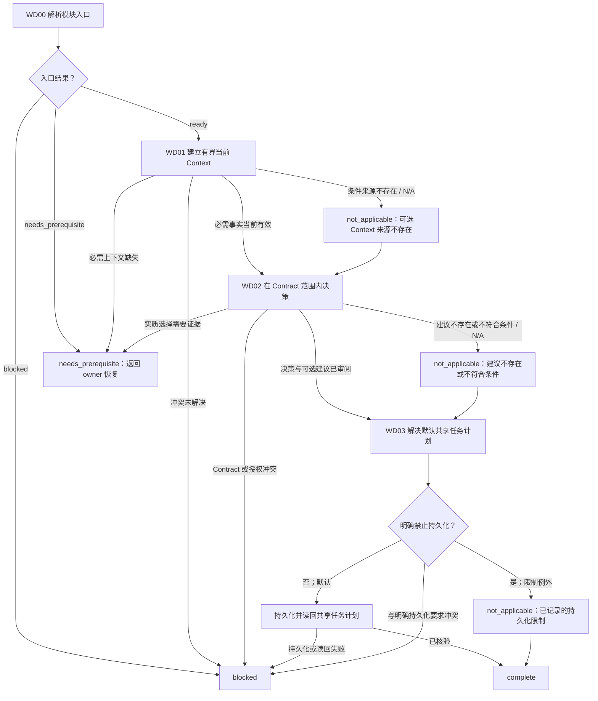

# 工作定义模块

[English](work-definition.md) | [简体中文](work-definition_zh_cn.md)

本 Layer-04 模块用当前事实建立任务上下文，并产出符合 Contract 的决策及默认共享任务计划。它不选择执行者、不评估输出路由、不预留角色、不释放 Slice，也不执行 Bootstrap。

## 入口声明

| 字段 | 要求 |
| --- | --- |
| 必需输入 | 当前已授权 Contract 和任务范围、已释放路线/模式证据、当前规范 Session state 和已完成的审计读回、已知任务事实/来源指针、取得所需 Context 的已授权可用方式，以及调用方 continuation/效果状态。WD01 建立当前 Context；它不是入口前置条件。 |
| 允许效果 | 有界且已授权的只读 Context 检索；仅在已有授权的当前 Root Session 下请求符合条件的语义建议；在既有授权内默认持久化任务计划，并遵守明确持久化限制。不得执行 executor/output 路由、角色预留、Slice 释放、Bootstrap、实施或子代理派发。 |
| 结果 | 本模块以当前有来源的 Context、符合 Contract 的 Decision/未释放边界，以及计划证据或有依据的子步骤 `not_applicable` 返回 `complete`；否则返回带暂停位置的 `needs_prerequisite` 或 `blocked`。Context/建议/计划子步骤可根据触发证据标为 `not_applicable`，但不得整体跳过必需的工作定义模块。建议是待审证据，不是授权。 |
| 新鲜度 | 保留来源/出处/新鲜度及相关 input/policy hash 和 epoch。建议或依赖决策前重新确认；实质变化会使受影响证据失效，并要求调用方从受影响子步骤重新进入。 |

## 工作流路线图

## 有序模块清单

1. **WD00 — 解析入口。** 提供本声明、当前已授权 Contract 和任务范围、已释放路线/模式证据、当前规范 Session state 和已完成的审计读回、已知任务事实/来源指针、取得所需 Context 的已授权可用方式，以及 continuation/效果状态，调用[模块入口解析](../../layer-03-workflow-checkpoints/module-entry-resolution_zh_cn.md)。规范 state 和已完成审计读回是必需输入；当前任务 Context 在 WD01 建立。从记录的子步骤恢复。缺少前置条件时，连同语义 owner 一起返回；冲突或无法恢复的状态则阻塞。没有已授权的当前 Session 时，不请求建议。
2. **WD01 — 建立有界当前 Context。** 应用[Context](../../layer-02-workflow-concepts/entry-and-context/context_zh_cn.md)、[上下文来源选择](../../layer-03-workflow-checkpoints/context-source-selection_zh_cn.md)和[Session Context Firewall](../../layer-01-fundamental-concepts/session-runtime/session-context-firewall_zh_cn.md)。定义下一项任务所需的最小问题，只检查必需来源。始终列出并读取匹配的 active plan Memory；当前指令优先，plan 不授予授权。读取相关可复用 Memory 并核验来源指针/新鲜度；如果没有或不可用，返回经批准的权威项目来源，只有必需事实仍无法核实时才阻塞。仅在触发有界规则查询时使用[Enhanced Rule Context](../../layer-01-fundamental-concepts/enhanced-native-state/enhanced-rule-context_zh_cn.md)，确认 owner/语言/来源/hash，并读取被摘录省略的直接 owner。仅在需要项目/代码结构证据时应用[LSP MCP Tools](../../layer-01-fundamental-concepts/session-runtime/LSP-MCP-Tools_zh_cn.md)；否则记录 `not_applicable` 及原因。返回有来源的当前事实、来源链、新鲜度/epoch 和限制；过期、冲突或缺失的关键事实会阻塞依赖决策。
   - 若下游 Decision 建议需要审阅背景，应用[决策上下文选择](../../layer-03-workflow-checkpoints/decision-context-selection_zh_cn.md)和[Decision Context Generation](../../layer-01-fundamental-concepts/execution-planning/decision-context-generation_zh_cn.md)：只提供有界事实和具体目标，审查忠实度/相关性/来源，并核验准确的输入/政策绑定。拒绝过期或不匹配背景；若建议不需要生成背景，记录 `not_applicable` 及原因。
   - 仅在 Multi-Agent 模式下，若上下文来源选择 owner 确认触发了持久化交换或 memo 前置条件，则只按该触发检查相应的[Context Exchange](../../layer-01-fundamental-concepts/context-exchange/context-exchange_zh_cn.md)、[工作区边界](../../layer-01-fundamental-concepts/context-exchange/context-exchange-workspace-boundary_zh_cn.md)、[交接](../../layer-01-fundamental-concepts/context-exchange/context-exchange-handoff_zh_cn.md)或[Content Memo Dispatch](../../layer-01-fundamental-concepts/context-exchange/content-memo-dispatch_zh_cn.md) owner。确认必需的当前记录和 Memory 证据；不得仅为收集 Context 创建交换记录，也不得在此派发 memo。未触发时记录 `not_applicable` 及原因。Single-Agent 模式下，这些子代理专属交换和 memo owners 均为 `not_applicable`；不得加载这些 owner。
3. **WD02 — 在 Contract 范围内决策。** 应用[Decision](../../layer-02-workflow-concepts/decision-and-execution/decision_zh_cn.md)、[执行决策门禁](../../layer-01-fundamental-concepts/execution-planning/execution-decision-gate_zh_cn.md)和[执行规划](../../layer-01-fundamental-concepts/execution-planning/execution-planning_zh_cn.md)。说明实质问题、已核实事实、未知项、选项、所选方向、拒绝的替代方案、授权范围/效果、返回条件和未释放边界。对于仍开放的实质选择，准备必需的 Decision Brief，且只释放侦察；确认 Contract 允许所选方向后再进入后续释放。Session 实质恢复后，仅在调用方要求时于此重评当前 Decision/Contract 证据；不得重开 Mode 或重复已完成的审计提问。
   - 建议是可选的。仅当已有授权的当前 Root Session 存在，且 Decision 阶段符合资格、已启用并且相关时，应用[建议选择](../../layer-03-workflow-checkpoints/advisory-selection_zh_cn.md)和[Decisions Advisory](../../layer-01-fundamental-concepts/execution-planning/decisions-advisory_zh_cn.md)。否则依赖直接 owner 并将建议记录为带原因的 `not_applicable`。根据当前直接 owner 证据和 hash 审查任何建议；建议不会选择或授权工作。
   - 执行者选择和输出路由不属于本模块范围，仍由之后另行授权的执行路径处理。
4. **WD03 — 解决默认共享任务计划。** 调用[规划输出选择](../../layer-03-workflow-checkpoints/planning-output-selection_zh_cn.md)，应用[任务计划 Memory 生命周期](../../layer-01-fundamental-concepts/execution-planning/task-plan-memory-lifecycle_zh_cn.md)。无论有无 Issue 或明确规划请求，均综合当前事实与拟议方案，持久化具体计划，并在实施或依赖派发前读回。返回准确项目/计划身份、允许贡献及读回证据。仅已记录的明确持久化限制允许使用 owner 的例外；与明确持久化要求冲突、必需访问缺失或写入/读回失败时阻塞。需求变化先记录，再分析并持久化修订提议，然后才处理受影响工作。只有当前事实、符合 Contract 的 Decision/未释放边界，以及已核验计划证据或有依据的限制例外齐备时，才返回 `complete`。这不释放 Slice、不选择执行者，也不授权实施；必需模块不能整体跳过为 `not_applicable`。

## 相关概念

- [Context](../../layer-02-workflow-concepts/entry-and-context/context_zh_cn.md)
- [上下文来源选择](../../layer-03-workflow-checkpoints/context-source-selection_zh_cn.md)
- [Decision](../../layer-02-workflow-concepts/decision-and-execution/decision_zh_cn.md)
- [规划输出选择](../../layer-03-workflow-checkpoints/planning-output-selection_zh_cn.md)
