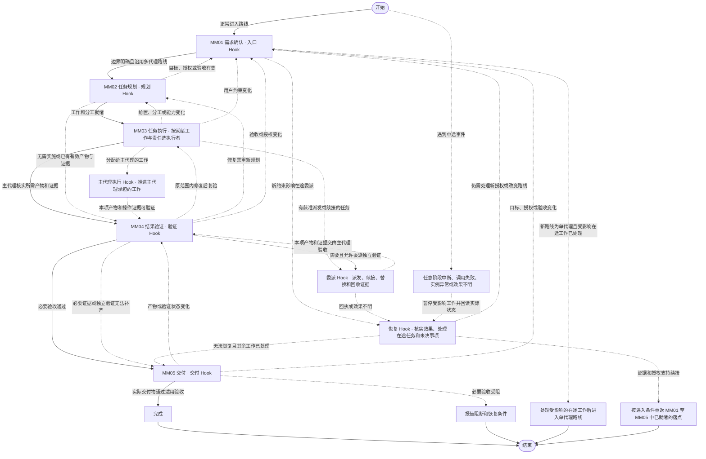
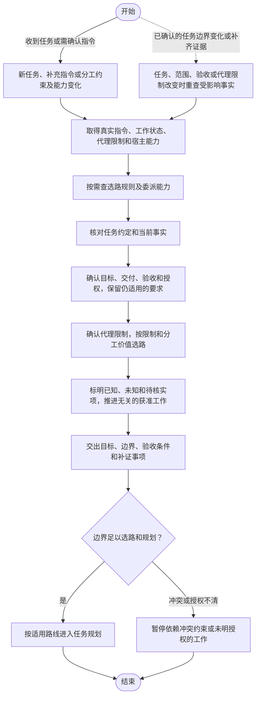
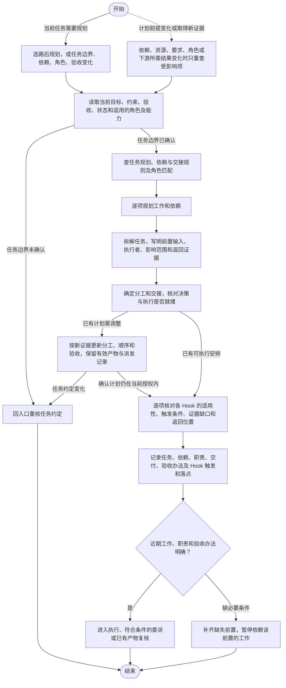
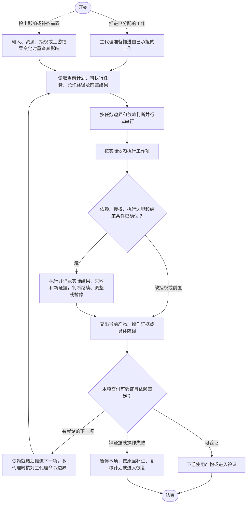
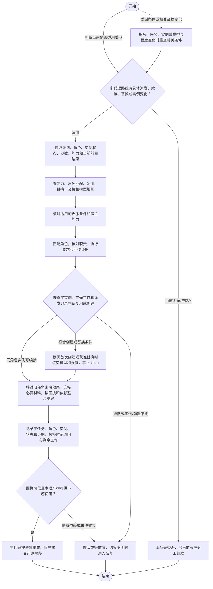
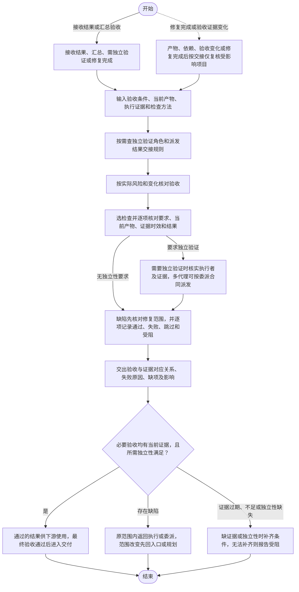
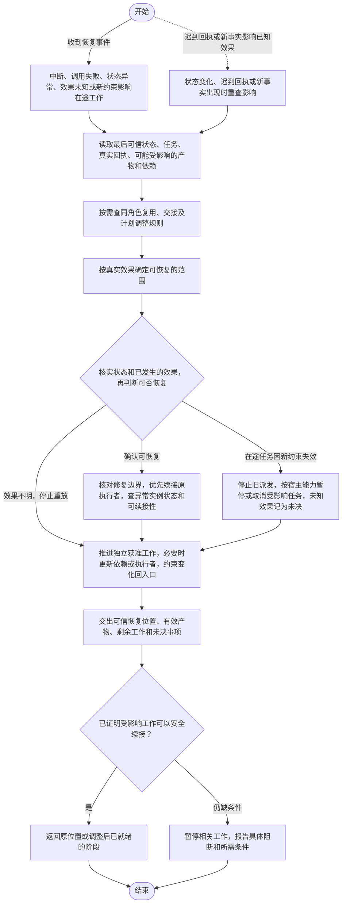
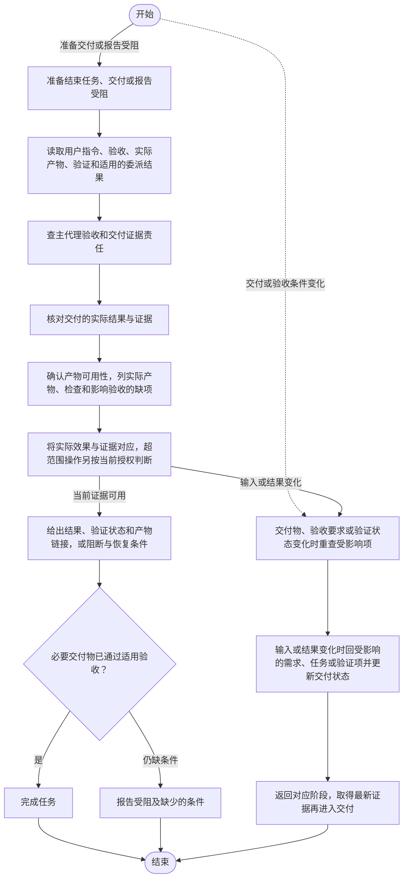

# 多代理 Coding

用户明确要求委派或任务存在适合独立委派的分工时，由主代理保留整体计划、决策、协调和最终验收，按各项工作的实际需求动态派给现有角色。

## 工作流路线图

从「开始」按当前事件进入相应分支。实线表示默认推进或收束，虚线表示条件分支。「结束」汇集本次流程的完成、受阻和转交结果。每个 Hook 的细则见同页子流程图。按[流程控制](coding-multi-agent.md#变更与流程控制)判断受影响工作的落点。

### Hook 子流程图

#### 入口 Hook 的子流程

边界确认后进入选路和任务规划。新约束影响在途工作时，同时进入恢复子流程。[入口合同](../hooks/entry.md)

#### 规划 Hook 的子流程

规划时逐项考虑同页所有 Hook 子项。对适用项明确所需证据、负责人和阻断后的落点，对条件项记触发条件，对当前不适用或事实待核实的项记录原因或缺口。用户目标、授权或验收改变后，回入口重核任务约定。[规划合同](../hooks/planning.md)

#### 主代理执行 Hook 的子流程

两条路线均可进入。多代理路线中主代理仍须遵守其命令执行边界。[主代理执行合同](../hooks/execution.md)

#### 委派 Hook 的子流程

单代理路线在触发判断处继续主代理工作。只有重新选入多代理路线后，才按下图核对委派条件。[委派合同](../hooks/delegation.md)

#### 验证 Hook 的子流程

本图适用于单项结果、汇总验收及修复复验。多代理按需委派独立验证，主代理核对返回证据。单代理缺少所需独立性时记录阻断。[验证合同](../hooks/verification.md)

#### 恢复 Hook 的子流程

在任意阶段按受影响工作项触发。恢复后重查目标阶段的进入条件。[恢复合同](../hooks/recovery.md)

#### 交付 Hook 的子流程

报告受阻也走交付子流程。完成取决于必要验收和当前证据。[交付合同](../hooks/delivery.md)

## 阶段与适用 Hook

从路线选择器进入。主代理已识别满足用户要求或带来协调收益的分工，派发前核实各自的依赖、角色和宿主能力。

1. **MM01 — 需求确认** 按[入口 Hook](../hooks/entry.md)确认目标、用户约束、交付物和验收条件。任务边界足以选路和规划时退出。
2. **MM02 — 任务规划** 基于已确认的任务边界进入[规划 Hook](../hooks/planning.md)。逐项核对同页 Hook 子流程，明确适用条件、证据与回退位置，再确定近期工作、依赖、分工和验收办法。按工作项核对委派、主代理执行及独立验证的触发和证据，主代理负责跨任务决策与集成。

   主会话以 Ultra 启动时，包括此前使用其他档位、随后以 Ultra 开启新对话，进入本路线后必须按当前[主代理职责](../references/roles/main-agent.md)和[子代理角色定义](../references/delegation/delegation-policy.md#任务和角色匹配)制定计划。派发前逐项确定执行者、前置依赖、预期产物和验收条件。主代理负责关键决策、协调、集成和最终验收，按角色职责分配事实取证、实施、独立验证及另获授权的 Git 操作。优先复用同角色实例，新建或替换子代理前按[模型与推理强度规则](../references/delegation/delegation-policy.md#模型与推理强度)确认实际采用的推理强度为非 Ultra。
3. **MM03 — 任务执行** 按[委派 Hook](../hooks/delegation.md)核实依赖、角色、现有实例和宿主能力后派发或续接。按实际回执核对产物和未决影响，可用于下游时由主代理集成。主代理承担的工作按[主代理执行 Hook](../hooks/execution.md)核对进入与退出。
4. **MM04 — 结果验证** 按[验证 Hook](../hooks/verification.md)用当前产物和实际检查核对验收条件。必要验收均有当前证据时通过，失败或缺证据的项目进入流程控制。
5. **MM05 — 交付** 准备交付或报告阻断时进入[交付 Hook](../hooks/delivery.md)，核对实际产物和验证状态。通过适用验收后结束为完成，受阻时说明缺项。

## 变更与流程控制

先按[阶段进入与退出](README.md#阶段进入与退出)核对证据，再依据变化选择落点。

| 变化或当前状态 | Hook 与落点 |
| --- | --- |
| 目标、范围、授权、验收或代理约束改变 | 回到 MM01，按[入口 Hook](../hooks/entry.md)重查变化。分工约束或可用能力影响路线时，按[路线选择](coding.md)重新判断。涉及在途委派时，先按[恢复 Hook](../hooks/recovery.md)处理受影响的旧任务。沿用本路线时，回到 MM02 更新受影响的计划。切换后进入选定路线中满足条件的阶段。 |
| 任务依赖、分工或能力变化 | 回到 MM02，按[规划 Hook](../hooks/planning.md)更新受影响计划。现有分工仍可行且仅实例状态变化时，按[委派 Hook](../hooks/delegation.md)在相关阶段判断续接、等待或替换。派发前核对所需前置结果和相关旧实例的未决效果。 |
| 已有产物满足当前执行要求，或该项只需复核 | 当前产物、计划和适用的委派交付证据满足进入条件时，可从 MM02 直接进入 MM04。需要独立验证时，按[验证 Hook](../hooks/verification.md)核实独立性，涉及派发时同时应用[委派 Hook](../hooks/delegation.md)。 |
| 验证发现缺陷或交付物发生变化 | MM04 按[验证 Hook](../hooks/verification.md)核对修复范围。原范围内的修复回到 MM03，由职责匹配的执行者处理。涉及范围或计划变更时回到 MM01 或 MM02。修复后回到 MM04，沿用原有独立性要求复核受影响项。交付期间证据过期也回到 MM04，必要验收通过后再回 MM05。 |
| 中断、调用失败、子代理失联或结果不明 | 先按[恢复 Hook](../hooks/recovery.md)核对回执、在途操作和实际效果。新约束使在途工作失效时，按宿主能力暂停或取消，并保留无法核实的未决效果。条件恢复后回到原阶段或修订后计划的就绪阶段。续接子任务时按[委派 Hook](../hooks/delegation.md)优先复用同角色实例。需要调整分工时回到 MM02，无法恢复时在 MM05 报告具体阻断。 |

## 模式边界

任务数量、角色、开始时机、模型和推理强度随计划演进。后续工作优先派给同角色已有实例。替换仅按[委派合同](../hooks/delegation.md)核实的例外办理。主代理按[自身职责](../references/roles/main-agent.md#执行要求)推进工作，汇总实际证据并验收。

## 按条件触发的 Hooks

按当前动作查阅[Hook 触发目录](../hooks/README.md)，遇到中断或未知效果时读取[恢复 Hook](../hooks/recovery.md)。
